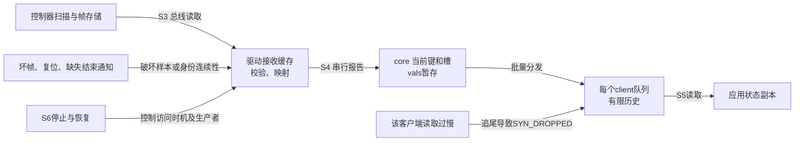
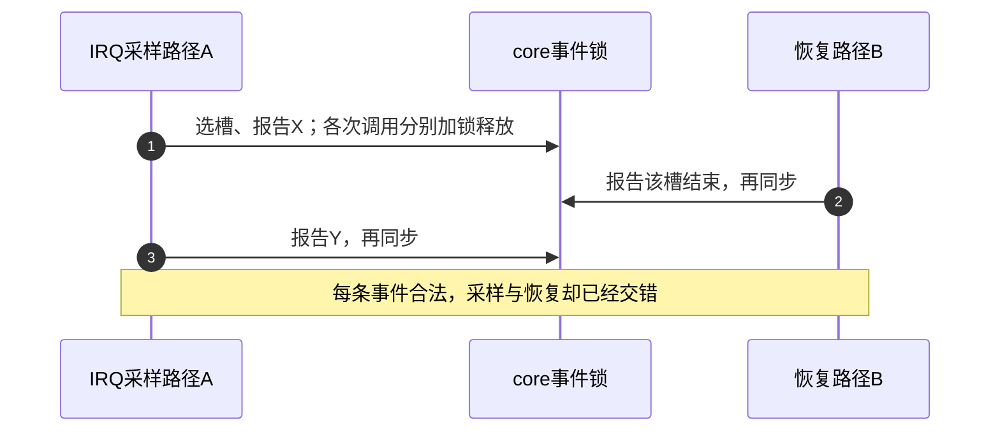
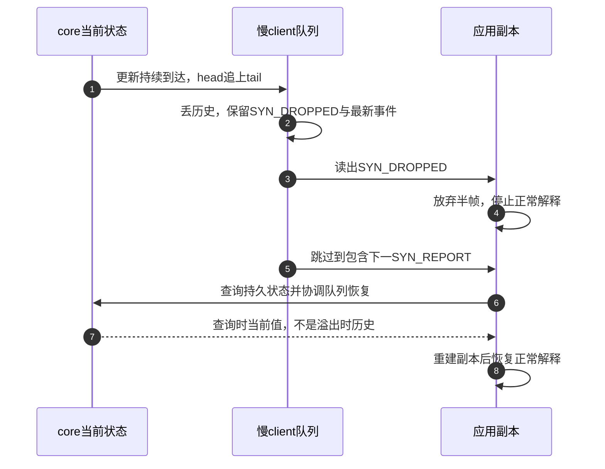
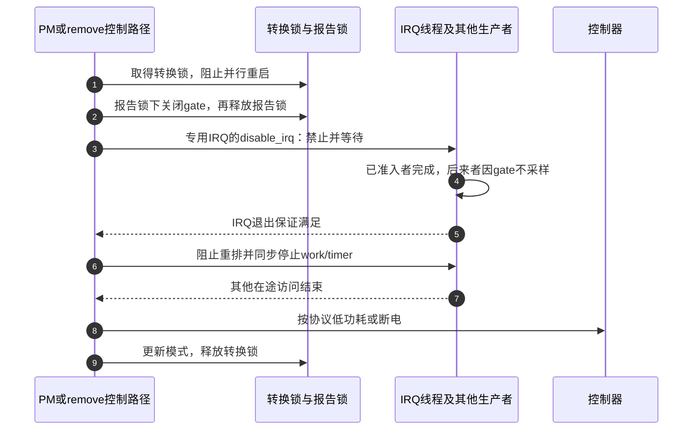

# 第5章\_并发丢帧与电源管理

第四章已经能解释两根手指在槽中延续、离开和替换。这个模型还有三个前提：驱动拿到可信的完整样本，一次报告不被另一条路径插入，用户没有漏掉状态更新。真实设备会打破它们：I²C 读到一半发生错误，复位工作与 IRQ 线程同时报告，慢应用队列溢出，或者系统在手指按住时关掉控制器。

本章沿同一个 S3 采样、S4 报告、S5 观察周期逐项修补这些前提，再解释 S6 停止怎样与下一次启动衔接。不同失效破坏不同状态，不能统一用“加锁”或“重读一次”解决。

## 5.1\_先找到失效发生在哪一份状态上

假设屏幕上还压着一根手指，应用却显示已经抬起。可能是硬件帧漏了该点，驱动把增量误当完整点集，另一个报告者提前收了帧，也可能是应用漏读了创建记录。同一个症状不能直接决定应该重置硬件还是清空应用状态。

| 层次 | 仍保留什么 | 需要恢复什么 |
| --- | --- | --- |
| 总线短读、校验失败 | 之前已接受的状态仍存在，但可能变旧 | 新可信硬件快照或芯片恢复协议 |
| 控制器复位后重新编号 | Linux 仍保留旧槽，硬件 key 连续性失去保证 | 驱动结束/重建接触身份 |
| 两条路径交错报告 | 单事件可能合法，组合却不对应任何采样 | 报告串行化，用户查询不能替代生产者修复 |
| 某 client 队列溢出 | core 当前状态仍可推进，其他独立 client 可正常 | 该用户自己的状态副本，放弃已丢历史 |
| 断电后仍有工作访问 | 指针可能尚存，硬件访问条件已消失 | 先禁止新工作并等在途路径，再改供电或释放 |

core 维护的是驱动报告的事实，不证明硬件帧本身正确。快应用读到错误帧也不会因速度快而得到真实坐标。排障应寻找哪一层最早出现偏差。

## 5.2\_可睡采样与不可睡事件分发怎样接合

一次 I²C 读取可能等待总线、等待锁或让出 CPU；硬 IRQ 执行环境不能满足这些等待。Input 事件报告却允许从原子上下文进入，core 在自旋锁及关中断范围内维护状态并调用事件回调。两项工作约束不同，不能因为最后调用 `input_report_abs()`，就把整个可睡采样放进硬中断。

中断型触摸设备常让硬 IRQ 唤醒线程，由线程读取和校验完整帧再报告。`IRQF_ONESHOT` 管理线程处理期间的 IRQ 屏蔽关系，不自动清控制器 data-ready，不提供总线快照，也不阻止另一个 workqueue 同时报同一设备。

| 上下文 | 合适职责 | 必须保留的约束 |
| --- | --- | --- |
| hard IRQ | 最小不可睡处理，通知线程或安排工作 | 不能执行需要睡眠的 I²C/SPI 传输 |
| threaded IRQ | 可睡取样、校验、报告 | 仍需与其他 IRQ、worker、恢复路径协调 |
| 普通 workqueue | 延迟重试、可睡轮询、恢复 | 自行重排必须受停机门控，取消一次不代表永远停止 |
| timer/hrtimer 回调 | 小量原子工作或安排 worker | 按相应原子上下文约束，不能泛化 PREEMPT_RT 的特殊行为 |
| probe/open/close、常规可睡控制路径 | 配置、启停、等待在途任务 | 特殊 PM 阶段和持锁范围仍需检查 |
| handler events/filter、设备 `.event()` | 快速处理，必要时登记并转交工作 | core 分发时不可睡，不能直接做可睡输出总线访问 |

转交工作时也要明确数据存在哪里。例如把输出请求存进驱动私有缓存，再安排 worker；不能保留即将失效的调用者栈指针。停止流程还要排空这条反向输出路径。

### 5.2.1\_单事件有锁为什么仍能拼出错误帧

采样路径 A 准备报告甲的 `(10,20)`，恢复路径 B 准备释放全部槽。A 先选槽并报 X=10，B 插入 tracking=-1 和同步，A 再报 Y=20 和同步。每个调用都可在 event_lock 下合法执行，组合却不是 A 想表达的帧。

第 2 步插进 A 的两次报告之间，core 没有承诺阻止它。应采用唯一报告线程，或用驱动自己的帧级同步覆盖“映射—全部状态与轴—收尾”，恢复路径也遵守同一规则。硬件取样是否一并放进该范围，取决于控制器允许怎样并行访问。

core 的 event_lock 保护事件状态和分发，`dev->mutex` 协调使用计数及 open/close 等控制动作；grab 的控制修改使用 mutex 与 RCU 发布，不能把 grab 简写成只归 event_lock 管。evdev 设备 mutex、client buffer_lock 和驱动私有锁又是不同同步域。

## 5.3\_先验证硬件帧再改变已公开状态

先读点数 2，再分别读取两个点；如果控制器在中间更新，驱动可能拿到旧帧甲和新帧乙。补 SYN_REPORT 只会把混合结果交给用户，不能让两点重新属于同一次采样。

解决办法取决于硬件保证：冻结快照、FIFO 完整记录、前后帧序号核对，或 data-ready 与 ACK 的所有权握手。帧号核对还要求位宽、回绕速度和读取耗时不能让一次读取跨过完整编号周期；芯片没有给出对应保证时，不能凭同号自行发明快照契约。

原始包先放进本次私有缓冲，检查长度、点数、校验、重复 ID、坐标范围和帧一致性；全部通过才规划映射并报告。重试应有限，计数分别记录短读、校验失败、帧号变化与映射失败。保留之前已接受状态，通常比公开混合半帧更可解释，但旧状态可能变陈旧。

例如最后一根手指的结束帧永久丢失，之后控制器不再中断，旧槽就可能一直活动。因此还要根据芯片协议选择后续快照、受限重试、复位后重建，或在明确错误策略下结束接触。这个恢复可能损失一次操作，却避免错误状态永久延续；不能靠一个没有设备依据的固定延时证明手指已经离开。

## 5.4\_队列溢出后恢复当前状态而不是丢失的历史

设 core 的 X 依次到达 1、2、3、4、5、6，慢应用仍停在 0。其 client 队列追尾时，这版 evdev 丢弃未消费历史，留下 SYN_DROPPED 和最新事件；后续同步边界使相应记录可读。另一个独立 open 有自己的队列；dup/fork 共享一个打开文件则共享同一 client，不能算独立观察者。

每个client还保存自己的时钟选择、事件mask和revoke状态。mask可以减少不关心事件的复制，不改变core设备事实，也不是安全隔离边界。read按完整input_event记录复制，仍可在一帧内部结束；poll/epoll与阻塞读取依赖同一完整帧可读窗口，不能按一次read重新初始化状态。具体队列和独占层次已经在第二章建立。

用户看到 SYN_DROPPED，要撤销尚未解释完成的半帧，忽略事件直到 **包括下一个 SYN_REPORT**，再恢复有持久状态的类别。这不是重放丢失事件，队列没有那段历史了。

第 6、7 步查询的是当下，不保证等于第 5 步那个历史帧末尾。队列还排着 X=2、3、4，查询却得到 X=6；若把旧记录接着当新变化应用，位置就倒退再前进。因此恢复必须协调剩余队列、内核当前值和未完成帧，不能插一次 ioctl 就结束。

可复用 libevdev 的同步读取流程：普通读取返回同步状态后，以 `LIBEVDEV_READ_FLAG_SYNC` 消费恢复事件，再回普通读取；恢复事件表达状态差异，不是补录采样。生产级消费者应核对所用库版本的 [SYN_DROPPED说明](https://github.com/whot/libevdev/blob/master/libevdev/libevdev.h)。这是用户库的接口入口，不属于本章固定的 Linux 内核版本证据。

| 类别 | 查询接口 | 能恢复什么 |
| --- | --- | --- |
| key | `EVIOCGKEY` | 当前按下位图，不能恢复丢失的按下次数 |
| switch | `EVIOCGSW` | 当前开关位图，不能恢复每次切换历史 |
| LED、sound | `EVIOCGLED`、`EVIOCGSND` | core 保存的输出状态，不证明物理执行成功 |
| 普通绝对轴 | `EVIOCGABS(code)` | 单轴当前值与参数，多轴查询不是一个原子快照 |
| MT slots | `EVIOCGABS(ABS_MT_SLOT)` 查询槽范围/选择信息，`EVIOCGMTSLOTS` 按轴查槽值 | 恢复 tracking 及相关轴缓存，不能拿普通 MT 轴 ABS 查询代替全部槽 |
| relative motion | 无当前位置快照 | 已丢位移不可还原，只能从后续增量继续 |
| MSC 等瞬态信息 | 无统一历史查询 | 按协议承认历史丢失，不能凭空补造 |

### 5.4.1\_查询状态本身有哪些实现边界

键、开关、LED、声音位图查询会在锁下复制状态，并清理 **该 client 队列中同类型的待处理事件**，减少快照与旧事件重复应用；复制到用户失败时还可能重新注入 SYN_DROPPED。它不是完全无副作用的变量读取，也不统一完成全部事件类型的恢复。

MT 查询按指定轴逐槽读取并复制，没有冻结多轴槽表。普通 ABS 查询同样不提供跨轴事务。设备仍运动时，分别查询 tracking、X、Y 可能看到不同进度；恢复器应结合协议和后续更新重建可继续使用的状态，不能宣传 ioctl 能取回从未保存的完整硬件帧。

对应锁与队列副作用见 [状态查询与时钟实现](../../../research/source_reading/input/source_explanations/P08_状态重同步与事件时间.md#8.1_位图查询为何还会清理客户端队列)，通过 [Input源码总索引](../../../research/source_reading/input/navigation/P01_Linux_6.12_Input源码阅读索引.md) 可追到固定原件。

## 5.5\_停止前同时关闭新入口并等完旧访问

IRQ 线程已开始 I²C 读，另一 CPU 正要 suspend。只写 running=false 不会撤销已发出的事务；只等一次线程退出，也不能防止之后又开始一次采样。断电前要同时做到 **新采集被禁止，在途访问已经完成**。

这涉及多组状态，不能压成一个 suspended 布尔值。下表是教学设计中的私有状态，不是 core 强制要求的字段名。

| 状态 | 写入和读取者 | 必须保留的区别 |
| --- | --- | --- |
| 使用需求、唤醒策略 | open/close、策略路径更新，启停逻辑读取 | 没普通读者仍可能需要唤醒检测 |
| system_suspended、removing 等阻止原因 | 控制路径串行更新，所有重启入口检查 | resume只能解除挂起原因，不能清掉removing |
| 采集 gate | 控制路径在报告锁下修改，IRQ/worker及重排路径检查 | false是拒绝新工作，不是在途完成证明 |
| OFF/SCAN/WAKE 硬件模式 | 控制路径更新，控制与恢复逻辑读取 | 唤醒检测不等于普通扫描 |
| IRQ/work/timer 在途情况 | 框架维护，对应同步接口等待 | 不能用随意加的私有计数代替退出保证 |

一种锁分工是：转换 mutex 串行 open/close、PM、恢复和 remove，IRQ 线程不取它；报告 mutex 串行可睡采样、整帧报告及 gate 检查。停止者持转换锁，短暂获取报告锁关闭 gate，释放报告锁，再等 IRQ/work/timer，最后改变硬件模式。等待期间仍持转换锁，避免 resume 穿插重启；它不持在途路径退出所需的报告锁。

这也要求核对调用链：open/close 可能已在 core 的 `dev->mutex` 下进入驱动，如果 PM 先持私有锁再调用需要该 core mutex 的接口，就可能形成反向锁序。必须列出所有入口的真实锁顺序，不能把这两把教学锁当可任意叠加的模板。

第 2 步不替代第 3～7 步，第 8 步等它们完成。若 timer 排 worker，worker 又重启 timer，就要先规定 gate 关闭后双方不再重排，再同步排空；不能机械地各取消一次。采样与延迟输出都属于待排空生产者。

对专用 IRQ，disable_irq 禁用并等待处理退出，可能睡眠；不能从会等待自身的 IRQ 线程调用，也不能持有 handler 需要的锁。disable_irq_nosync 只完成禁用；synchronize_irq 等待在途处理，却不永久禁止未来 IRQ。disable/enable 有嵌套计数，应由明确所有者配对，多个停止原因不能各自盲目 enable。

共享 IRQ 不可照搬整线禁用作为单设备停止办法，应按设备屏蔽和共享中断协议停止自身来源并协调等待，否则会影响同线设备。上图限定专用 IRQ，真实连线约束由目标驱动补齐。

## 5.6\_关闭休眠和移除不能共用一个出口条件

close结束普通使用需求，runtime suspend允许降功耗，system suspend要考虑整机睡眠与唤醒，remove永久结束实例。它们可以复用停止动作，却有不同重启条件；resume若不检查removing，就可能在撤销途中重新安排工作。

| 原因 | 可能保留的功能 | 再次运行条件 |
| --- | --- | --- |
| 最后普通使用结束 | 依策略保留唤醒检测 | 新使用到来且没有其他禁止原因 |
| runtime suspend | 满足需求与唤醒策略的低功耗 | runtime resume成功，硬件可访问 |
| system suspend | 非唤醒设备停机；唤醒设备进入适当WAKE模式 | 恢复供电配置且所有启动条件成立 |
| remove | 仅完成停止和资源撤销 | 此实例不再重启 |
| 故障恢复 | 暂停采样，保留错误记录 | 有限恢复成功、身份映射重新可信；失败保持停止 |

IRQ wake配置的是平台唤醒路由，不是让原IRQ线程在睡眠里继续I²C读。普通处理使能和唤醒能力是不同维度，还受控制器、供电及平台约束。IRQF_NO_SUSPEND让特定IRQ在相关阶段继续被处理，却不保证能唤醒系统，不能作为触摸唤醒的通用替代。

固定版本PM文档说明，经过suspend_device_irqs后，wake IRQ不按普通设备handler路径继续执行；其处理方式与IRQF_NO_SUSPEND不同。恢复后仍要核验来源、状态和样本含义，“成功唤醒”不证明已有正常触摸帧。

### 5.6.1\_Input的PM回调没有替芯片驱动做什么

这版input_dev_suspend在事件锁下释放按键、关闭活动LED/声音输出，resume恢复输出设置。它没有读取触摸芯片、按板级要求关regulator，也没有在这个suspend函数里调用MT全槽释放。inhibit路径会释放MT，不能把inhibit行为外推到所有PM路径。

持续触摸时挂起，驱动应根据芯片是否保留身份决定继续可信状态，或结束旧接触后从新快照重建。不能默认core已清全部槽，再让硬件重用key时沿用旧tracking。

同版本edt-ft5x06实际区分不支持挂起、芯片休眠和断电模式；断电恢复需电源、复位和参数恢复后才开放IRQ。这证明需要根据设备模式分支，不能把该芯片延时和寄存器移植到任意屏幕。具体职责见 [PM状态与硬件边界](../../../research/source_reading/input/source_explanations/P09_PM状态恢复与硬件停止边界.md#9.1_系统挂起先处理哪些Input逻辑状态)。

## 5.7\_时间戳说明何时观察到什么

采样、IRQ到达、驱动报告、应用读出是不同时间。总线拥堵使报告晚于触摸，应用还可能读得更晚。默认core在需要有效事件时间时取得内核单调时间，不能把它直接当控制器的真实采样时刻。

可靠采样时间可通过input_set_timestamp在报告前登记，参数必须属于 **CLOCK_MONOTONIC时间域**。芯片tick需要频率换算、回绕复位处理以及与主机时域的对应关系；强制转换成ktime_t不完成这些步骤。取样与登记之间跨系统睡眠还可能影响其他时域换算，应尽快登记并遵守同步约束。

| 选择 | 解释重点 |
| --- | --- |
| CLOCK_REALTIME | 与墙上时间关联，受校时影响，不直接当稳定间隔基准 |
| CLOCK_MONOTONIC | 主机单调时间，input_set_timestamp的输入域；不包含系统睡眠时长 |
| CLOCK_BOOTTIME | 包含系统睡眠时长的单调表示 |

各client可用EVIOCSCLOCKID选择这三种表示。切到不同类型且队列非空时，该版本清空旧队列并加入SYN_DROPPED；队列空或类型没变不会因此强制失步。因此看到这个标记不一定说明CPU读取太慢。

时间选择与序列完整性不同：时间戳连续不能证明没丢帧，相同时间也不意味着同一次read完整返回。应用仍以同步边界和失步通知决定解析方式。

## 5.8\_用交错和故障验证恢复边界

先写明不变量：坏帧不污染槽，停机后不访问失效硬件，恢复不把排队历史当新动作，旧key不冒充新接触。下表是目标环境验收设计，并非本次已经完成的硬件实测。

| 注入或操作 | 重点观察 | 证明边界 |
| --- | --- | --- |
| 各读取阶段短读、-EIO、校验失败 | 不提交半帧，错误分类和有限恢复 | 一次通过不覆盖所有总线交错 |
| 唯一结束帧丢失，之后无IRQ | 如何结束旧槽或重新取得快照 | 丢弃坏帧不证明不会卡住 |
| IRQ在途时unbind | 先排空再释放，没有迟到访问 | KASAN未报告不证明全部路径已执行 |
| 两独立读者，暂停其中一个 | 慢读者失步、快读者独立推进 | dup同一fd不测试独立队列 |
| 触摸中挂起恢复，恢复时关闭 | 需求、模式、gate和tracking分别正确 | 唤醒成功不证明槽或电源序列正确 |
| 非空队列切换时钟 | 重同步且不混用时域 | SYN_DROPPED不限于溢出原因 |
| 适用配置下用lockdep、KASAN、KCSAN等覆盖路径 | 锁序、失效访问、竞争和上下文 | 未启用、未执行或检查器失效时，未告警不是证据 |

**练习与参考答案**：PM持IRQ线程需要的锁再disable_irq，会怎样？PM等线程退出，线程等同一锁，形成等待环；应调整锁分工和等待范围。查询得到X=6后还排着X=2，应报告向左移动吗？不能把旧记录当快照后的新事实，应走完整重同步。resume为什么不能直接running=true？需求或remove原因可能变化，硬件恢复也可能失败。

现在可以分别定位硬件样本错误、报告交错、用户队列失步和停止竞态。下一章把这些约束落实到完整的教学控制器帧解析与槽规划，再对照真实驱动的发布、IRQ和PM边界。

> 内核依据为NXP Linux 6.12.20提交 `dfaf2136deb2af2e60b994421281ba42f1c087e0` 的input.c、evdev.c、event-codes.rst；IRQ等待见 [kernel/irq/manage.c](https://github.com/nxp-imx/linux-imx/blob/dfaf2136deb2af2e60b994421281ba42f1c087e0/kernel/irq/manage.c)，唤醒规则见 [系统休眠与设备中断](https://github.com/nxp-imx/linux-imx/blob/dfaf2136deb2af2e60b994421281ba42f1c087e0/Documentation/power/suspend-and-interrupts.rst)。转换锁、gate和停止步骤是带条件的教学设计，不代表所有驱动使用同一私有结构。
