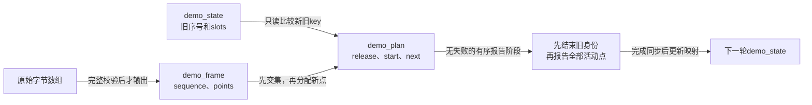
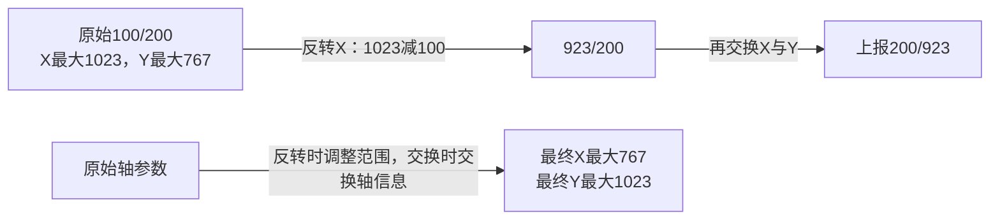
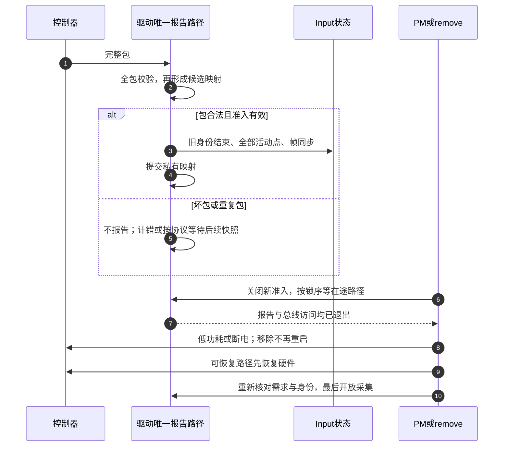

# 第6章\_触摸驱动设计与验证

前五章已经说明报告什么、状态在哪里、何时可运行、如何保持接触身份，以及失步和停机怎样处理。现在要把它们组合成一个可检查的驱动设计：收到一包数据，不能立刻循环调用上报接口；应先证明包有效，建立完整的新旧接触对应，再进入唯一的报告路径。

本章给出一个完整可运行的C程序，实现教学帧的解析、两槽规划和输出验证。帧格式由本章明确规定，不属于任何真实触摸芯片；它用于隔离并验证易出错的算法。真实I²C驱动还要依据具体手册实现取帧、ACK、供电和IRQ，不能拿虚构寄存器冒充已完成的硬件驱动。第三章的完整虚拟轴模块已展示真实Input对象生命周期，本章在那个基础上补齐复杂样本的设计与验证方法。

## 6.1\_先写出控制器必须给出的保证

设目标是两点触摸屏：芯片通过可睡总线传出完整点集，并用低有效IRQ表示新帧可读。线程化IRQ适合完成总线读取，但IRQ低电平本身不保证读取期间帧不会变化。设计前要逐项取得下列答案，答案会直接影响代码路径。

| 问题 | 本章教学输入的约定 | 真实设备必须提供的依据 |
| --- | --- | --- |
| 一包包含什么 | 本次所有活动接触，数量0～2 | 完整快照还是仅变化，是否有显式结束记录 |
| 编号何时稳定 | key在同一接触期间稳定，只有接触结束后才可重用 | 芯片ID生成与复用规则，复位是否重新计数 |
| 数据何时可读 | 演示直接取得一整个字节数组 | 快照/FIFO/data-ready及ACK所有权 |
| 是否漏帧 | 8位序号按模256递增 | 位宽、回绕周期、重复帧与丢帧的可辨识条件 |
| 坐标范围 | 原始X为0～1023，Y为0～767 | 原始量程、坐标方向、固件配置和面板安装方向 |
| 接触能力 | 可同时报告两个位置 | 位置报告容量与总检测数量的区别 |
| 停机与唤醒 | 演示无硬件，仅说明接口边界 | 电源/复位/低功耗时序、IRQ模式及平台唤醒能力 |

若硬件帧会在读取期间变化，可使用手册规定的锁存或FIFO；支持帧号核对时，还要保证读取时长不会跨完整回绕周期。重试有上限，任何无效包不进入Input报告。ACK在读取前、校验后还是提交后执行，必须依据芯片协议：提前可能释放当前帧供硬件覆盖，过晚可能维持电平IRQ造成重复进入。

## 6.2\_把完整快照变成一次可提交的计划

考虑旧槽0装key7，槽1装key9，新点集按 `[key11,key9]` 返回。逐点边读边找空槽，key11先到时会因旧槽全满而失败。正确规划先知道整帧：保留交集key9的槽1；key7已经不在新集合，安排结束槽0；再把key11安排到槽0。控制器列表顺序改变不会移动仍持续接触的槽。



这里把解析结果、候选计划和已提交状态分开。解析失败时不修改旧状态，规划完成前不调用报告接口；进入报告阶段后不能再发现长度或重复ID错误。Input报告API没有把整帧撤销的事务，因此保证应放在它们之前。

本例对序号跳变采用保守策略：不再相信旧身份连续性，先结束所有旧接触，再以当前完整点集开始新身份。它可能把一次真实持续触摸切成两次，代价是手势中断；好处是不把丢失期间已经结束并重用的key冒充旧手指。若真实协议能证明身份跨丢帧可靠，可以采取不同策略，但需要明确证据。

8位序号不是无限历史。255→0是正常递增，等号在本例中表示重复包；若中间恰丢256帧，单看这个字段便不能识别。设备复位也可能重用序号，所以程序另留force_reset入口，供已知复位事件强制重建；它不猜测无法从包中观察到的事实。

## 6.3\_运行完整的解析与槽规划程序

教学协议按字节排列，不通过强制转换结构体读取，避免主机对齐与大小端影响。总长度为 `4 + 5×count`，最后一个字节是前面所有字节的异或校验。异或只用于简单演示，无法检测所有多位错误，不是实际控制器CRC的替代。

| 字节偏移 | 长度 | 含义 |
| --- | --- | --- |
| 0 | 1 | 固定标记0xa5 |
| 1 | 1 | 递增序号 |
| 2 | 1 | 完整点集数量0～2 |
| 3起 | 每点5 | key一字节、X两字节小端、Y两字节小端 |
| 最末 | 1 | 前述字节的异或值 |

以下程序包含解析器、候选映射、演示输入生成器和main，没有省略自定义类型或隐藏的板级函数。

```c
/* 教学控制器协议与完整槽规划；不是任何真实芯片的寄存器驱动。 */
#include <stdbool.h>
#include <stddef.h>
#include <stdint.h>
#include <stdio.h>
#include <string.h>

#define DEMO_SLOTS 2U
#define DEMO_MAX_PACKET (4U + 5U * DEMO_SLOTS)
#define DEMO_MAX_X 1023U
#define DEMO_MAX_Y 767U

struct demo_point { uint8_t key; uint16_t x; uint16_t y; };
struct demo_frame {
    uint8_t sequence;
    unsigned int count;
    struct demo_point points[DEMO_SLOTS];
};
struct demo_slot { bool active; struct demo_point point; };
struct demo_state {
    bool have_sequence;
    uint8_t sequence;
    struct demo_slot slots[DEMO_SLOTS];
};
struct demo_plan {
    struct demo_state next;
    bool release[DEMO_SLOTS];
    bool start[DEMO_SLOTS];
    bool identity_reset;
};
enum demo_result {
    demo_ok, demo_duplicate, demo_bad_length, demo_bad_magic,
    demo_bad_checksum, demo_bad_coordinate, demo_repeated_key
};

static uint16_t demo_read_le16(const uint8_t *data)
{
    return (uint16_t)((uint16_t)data[0] | (uint16_t)((uint16_t)data[1] << 8));
}

static enum demo_result demo_parse(const uint8_t *data, size_t size,
                                   struct demo_frame *output)
{
    struct demo_frame frame = {0};
    uint8_t checksum = 0;

    /* 先校验总长，绝不按未验证的点数访问记录。 */
    if (size < 4U)
        return demo_bad_length;
    if (data[0] != 0xa5U)
        return demo_bad_magic;
    frame.sequence = data[1];
    frame.count = data[2];
    if (frame.count > DEMO_SLOTS || size != 4U + 5U * frame.count)
        return demo_bad_length;
    for (size_t i = 0; i + 1U < size; ++i)
        checksum ^= data[i];
    if (checksum != data[size - 1U])
        return demo_bad_checksum;

    for (unsigned int i = 0; i < frame.count; ++i) {
        const uint8_t *record = data + 3U + 5U * i;
        struct demo_point *point = &frame.points[i];
        point->key = record[0];
        point->x = demo_read_le16(record + 1);
        point->y = demo_read_le16(record + 3);
        if (point->x > DEMO_MAX_X || point->y > DEMO_MAX_Y)
            return demo_bad_coordinate;
        for (unsigned int j = 0; j < i; ++j)
            if (frame.points[j].key == point->key)
                return demo_repeated_key;
    }
    *output = frame; /* 所有检查通过以后才公开解析结果。 */
    return demo_ok;
}

static int demo_find_key(const struct demo_frame *frame, uint8_t key)
{
    for (unsigned int i = 0; i < frame->count; ++i)
        if (frame->points[i].key == key)
            return (int)i;
    return -1;
}

static enum demo_result demo_prepare(const uint8_t *data, size_t size,
                                     const struct demo_state *current,
                                     bool force_reset, struct demo_plan *output)
{
    struct demo_frame frame;
    struct demo_plan plan = {0};
    bool assigned[DEMO_SLOTS] = {false};
    enum demo_result result = demo_parse(data, size, &frame);

    if (result != demo_ok)
        return result;
    if (current->have_sequence && frame.sequence == current->sequence &&
        !force_reset)
        return demo_duplicate;

    /* 跳号后不再相信旧身份连续性；这是保守教学策略。 */
    plan.identity_reset = force_reset ||
        (current->have_sequence &&
         frame.sequence != (uint8_t)(current->sequence + 1U));
    plan.next.have_sequence = true;
    plan.next.sequence = frame.sequence;

    /* 第一遍只保留交集，先把离开者的槽从候选映射中腾出来。 */
    for (unsigned int slot = 0; slot < DEMO_SLOTS; ++slot) {
        int point_index = -1;
        if (current->slots[slot].active && !plan.identity_reset)
            point_index = demo_find_key(&frame, current->slots[slot].point.key);
        if (point_index >= 0) {
            unsigned int index = (unsigned int)point_index;
            plan.next.slots[slot].active = true;
            plan.next.slots[slot].point = frame.points[index];
            assigned[index] = true;
        } else {
            plan.release[slot] = current->slots[slot].active;
        }
    }

    /* 第二遍分配新接触；完整点集已验证不超过容量。 */
    for (unsigned int i = 0; i < frame.count; ++i) {
        if (assigned[i])
            continue;
        for (unsigned int slot = 0; slot < DEMO_SLOTS; ++slot) {
            if (!plan.next.slots[slot].active) {
                plan.next.slots[slot].active = true;
                plan.next.slots[slot].point = frame.points[i];
                plan.start[slot] = true;
                assigned[i] = true;
                break;
            }
        }
    }
    *output = plan; /* current始终只读，坏包和重复帧不修改它。 */
    return demo_ok;
}

static void demo_emit_and_commit(struct demo_state *state,
                                 const struct demo_plan *plan)
{
    printf("sequence=%u reset=%u\n", (unsigned int)plan->next.sequence,
           plan->identity_reset ? 1U : 0U);
    /* 所有旧身份先结束，再报告新点；对接Input时仍在同一串行帧内。 */
    for (unsigned int slot = 0; slot < DEMO_SLOTS; ++slot)
        if (plan->release[slot])
            printf(" release slot%u key%u\n", slot,
                   (unsigned int)state->slots[slot].point.key);
    for (unsigned int slot = 0; slot < DEMO_SLOTS; ++slot) {
        const struct demo_slot *next = &plan->next.slots[slot];
        if (next->active)
            printf(" %s slot%u key%u @(%u,%u)\n",
                   plan->start[slot] ? "start" : "keep", slot,
                   (unsigned int)next->point.key,
                   (unsigned int)next->point.x, (unsigned int)next->point.y);
    }
    puts(" sync");
    *state = plan->next;
}

/* 以下仅为演示输入生成器；真实驱动的字节应来自控制器。 */
static size_t demo_encode(uint8_t sequence, const struct demo_point *points,
                          unsigned int count, uint8_t data[DEMO_MAX_PACKET])
{
    size_t size = 4U + 5U * count;
    data[0] = 0xa5U; data[1] = sequence; data[2] = (uint8_t)count;
    for (unsigned int i = 0; i < count; ++i) {
        uint8_t *record = data + 3U + 5U * i;
        record[0] = points[i].key;
        record[1] = (uint8_t)points[i].x;
        record[2] = (uint8_t)(points[i].x >> 8);
        record[3] = (uint8_t)points[i].y;
        record[4] = (uint8_t)(points[i].y >> 8);
    }
    data[size - 1U] = 0;
    for (size_t i = 0; i + 1U < size; ++i)
        data[size - 1U] ^= data[i];
    return size;
}

int main(void)
{
    const struct demo_point first[] = {{7, 10, 20}, {9, 50, 60}};
    const struct demo_point turnover[] = {{11, 70, 80}, {9, 55, 60}};
    const struct demo_point repeated[] = {{9, 1, 2}, {9, 3, 4}};
    struct demo_state state = {0};
    struct demo_plan plan;
    uint8_t data[DEMO_MAX_PACKET];
    size_t size = demo_encode(254, first, 2, data);

    if (demo_prepare(data, size, &state, false, &plan) != demo_ok)
        return 1;
    demo_emit_and_commit(&state, &plan);
    size = demo_encode(255, turnover, 2, data);
    if (demo_prepare(data, size, &state, false, &plan) != demo_ok ||
        !plan.release[0] || !plan.start[0] || plan.start[1] ||
        plan.next.slots[1].point.key != 9)
        return 1;
    demo_emit_and_commit(&state, &plan);

    /* 校验错误和重复key不得生成可提交的计划。 */
    data[size - 1U] ^= 1U;
    if (demo_prepare(data, size, &state, false, &plan) != demo_bad_checksum)
        return 1;
    puts("bad checksum: no report, state retained");
    size = demo_encode(0, repeated, 2, data);
    if (demo_prepare(data, size, &state, false, &plan) != demo_repeated_key)
        return 1;
    puts("repeated key: no report, state retained");

    size = demo_encode(0, turnover, 2, data);
    if (demo_prepare(data, size, &state, false, &plan) != demo_ok ||
        plan.identity_reset)
        return 1;
    demo_emit_and_commit(&state, &plan); /* 255到0是正常回绕。 */
    if (demo_prepare(data, size, &state, false, &plan) != demo_duplicate)
        return 1;
    puts("duplicate sequence: no report");

    size = demo_encode(2, turnover, 2, data);
    if (demo_prepare(data, size, &state, false, &plan) != demo_ok ||
        !plan.identity_reset || !plan.release[0] || !plan.release[1])
        return 1;
    demo_emit_and_commit(&state, &plan); /* 跳号，明确结束旧身份。 */
    size = demo_encode(3, NULL, 0, data);
    if (demo_prepare(data, size, &state, false, &plan) != demo_ok ||
        plan.next.slots[0].active || plan.next.slots[1].active)
        return 1;
    demo_emit_and_commit(&state, &plan);
    return 0;
}
```

可保存为touch_frame_demo.c，或使用 [配套完整文件](../../../labs/kernel/input/materials/touch_frame_demo.c)：

```sh
cc -std=c11 -Wall -Wextra -Werror touch_frame_demo.c -o touch_frame_demo
./touch_frame_demo
```

第一帧建立两个接触。第二帧的关键输出应是：

```text
sequence=255 reset=0
 release slot0 key7
 start slot0 key11 @(70,80)
 keep slot1 key9 @(55,60)
 sync
```

这证明本例不会因为key11在新列表中排在前面，就丢掉它或抢走key9的槽。随后坏校验与重复key只打印拒绝说明，不产生sync；序号0保留两个身份，重复序号不报告，跳到2则先释放两个旧身份再开始新身份。最后空完整帧释放全部槽。

### 6.3.1\_逐段检查程序为什么不会公开半帧

`demo_parse`先验证最短长度和固定标记，再限定count与精确长度，之后才访问记录。坐标与重复key通过以后才写output。`demo_prepare`只读current，用局部plan保留交集、释放缺席者并分配新点，最后才公开plan；失败或重复包返回时调用者不能使用上次留下的plan。

第二遍分配不会耗尽候选槽：新点总数已经不超过容量，第一遍保留的点也属于这个集合，其余旧点没有继续占候选槽。这一容量证明依赖完整点集和key唯一性；把输入改为增量而不改算法，会错误释放缺席者。

`demo_emit_and_commit`先输出全部结束，再输出活动点，最后同步并提交next。打印只是观察计划的教学替身，start不是Linux tracking ID；真实tracking由Input槽状态接口产生。演示输入生成器只供main的固定合法数量使用，真实包必须经过解析器，不能把生成器当接收边界。

## 6.4\_把计划动作接到真实Input接口

整份计划应该由同一个串行报告路径执行。解析器保留的是原始面板坐标，坐标变换在确定槽之后、报告坐标之前应用一次；不要在解析阶段和Input helper里各反转一次。

| 计划动作 | 对应Input操作 | 关键前提 |
| --- | --- | --- |
| release[slot]为真 | input_mt_slot选定槽，再input_mt_report_slot_state报告false | 旧身份在同一串行报告周期内明确结束 |
| next槽活动 | 选槽，report_slot_state报告true | 同一旧key沿用身份；刚结束再激活的槽生成新身份 |
| 报当前点坐标 | touchscreen_report_pos，或在没有变换时报告MT X/Y | 轴能力、范围与变换已在注册前准备 |
| 全部点完成 | input_mt_sync_frame，然后input_sync | 内部seen周期与外部同步分别完成 |
| 更新驱动映射 | 保存plan.next | 所有其他报告/恢复入口遵守同一串行化规则 |

对完整点集可使用INPUT_MT_DIRECT与INPUT_MT_DROP_UNUSED；本例已经显式报告所有需要结束的槽，DROP_UNUSED可承担未见槽清理，但不能成为驱动私有映射不更新的理由。每个仍活动点都报告active，即便坐标没变，也要维护内部seen标记。

上表是依赖内部frame/seen的完整点集设计。另一些驱动按硬件明确的UP事件结束接触，不使用DROP_UNUSED，按需要做指针兼容后直接input_sync；不能把本例的每个helper都变成所有触摸驱动的必选调用。

本方案自管key→slot，不能又指望get_slot_by_key的内部key同步追随它。第四章已解释按key helper的同帧used限制；这里通过候选映射明确决定槽，不绕过库的内部计数来“强制腾槽”。

版本化源码从 [Input总索引](../../../research/source_reading/input/navigation/P01_Linux_6.12_Input源码阅读索引.md) 进入，[触摸适配模块导读](../../../research/source_reading/input/navigation/P06_触摸帧怎样接到坐标与发布路径.md#6.1_先把芯片协议与Input状态分开) 连接本例的职责。槽状态接口分别见 [身份报告](../../../research/source_reading/input/source_explanations/P06_多点槽状态与帧收尾.md#6.2_报告活动状态怎样标记本帧并分配身份) 和 [内部帧收尾](../../../research/source_reading/input/source_explanations/P06_多点槽状态与帧收尾.md#6.3_内部帧结束为何还需要外部同步)，不是另在本章复制一套core实现。

## 6.5\_坐标反转交换必须与声明的范围一致

面板安装方向可能不同于控制器原始坐标。假设原始X为0～1023、Y为0～767，要求先反转X再交换轴，原始点 `(100,200)` 应先变为 `(923,200)`，再变成 `(200,923)`；最终X量程来自原始Y，最终Y量程来自原始X。如果只交换报告值而不交换声明的范围，用户看到的最大值就会与实际坐标空间矛盾。



`touchscreen_parse_properties()`在驱动已声明默认轴以后读取父设备的固件属性，并保存后续变换所需的touchscreen_properties。随后初始化MT槽，使兼容轴复制的是正确参数。每次报告使用touchscreen_report_pos应用变换；解析属性本身不会改写未来所有输入值。

| 通用属性 | 本版本helper怎样使用 | 容易混淆的边界 |
| --- | --- | --- |
| touchscreen-min-x/y | 设置对应轴minimum | 不是简单从每个原始值减去minimum |
| touchscreen-size-x/y | 最大坐标加一，存入轴时减一 | 不是“max-min+1”的任意长度；0等无效范围要由设备配置校验拒绝 |
| touchscreen-fuzz-x/y | 更新fuzz | 不替代坏帧和坐标范围检查 |
| touchscreen-max-pressure、fuzz-pressure | 更新已声明压力轴参数 | 不会凭属性创建原本不支持的压力能力 |
| touchscreen-inverted-x/y | 保存反转标志，报告时使用原坐标最大值减去坐标 | 先反转，后交换 |
| touchscreen-swapped-x-y | 交换轴参数，报告时交换坐标 | 所有槽一致应用，不能只改slot0 |
| min-pressure、average-samples、x/y-mm、panel等binding字段 | 不能假定本helper全部读取 | binding允许某字段，不等于该通用函数替驱动实现对应功能 |

例如minimum不为零且启用反转时，helper会把该轴声明区间移到零起点，同时保留反转前最大值用于计算；这需要和原始取值范围一起理解。touchscreen_set_mt_pos还把变换结果写入s16坐标结构，使用位置匹配时须验证范围，不能把窄化当自动裁剪。

属性读取失败会保留默认值，函数没有返回一个可逐项判断的错误码；驱动仍要校验芯片能力、配置量程与供电资源。完整实现与声明对应见 [坐标属性与报告变换](../../../research/source_reading/input/source_explanations/P10_触摸属性怎样改变坐标与轴参数.md#10.1_属性先修改哪些轴参数)。本节不虚构compatible或板级GPIO编号；具体节点应遵守目标控制器binding。

## 6.6\_发布与IRQ准备按可访问依赖排序

input_register_device过程中接口可能已经对外可见，不能等它返回以后才准备open需要的IRQ或锁。反过来，请求IRQ也可能立即进入handler；不能把尚未完整初始化的私有结构交给它。应先画依赖，再选硬件准入方案。

| 阶段 | 必须已经成立的条件 | 失败撤销 |
| --- | --- | --- |
| S0资源与控制器识别 | 私有结构、总线、供电/复位资源有明确所有权 | 撤销已开启资源，不保留会访问它们的生产者 |
| S0状态准备 | 锁、缓冲、映射、错误计数、轴与MT槽已初始化 | 未公开对象按分配方式释放 |
| S1之前的IRQ准备 | handler所需状态完整，硬件来源或软件gate保持停止 | 即使IRQ立刻触发，也不会访问未准备资源 |
| S1 Input注册 | open依赖的全部资源与运行策略已经准备 | 注册失败按显式/devres协议清理，不能再当已注册对象注销 |
| S2首次需求 | open可安全恢复硬件并开放采集 | 失败在返回前撤销部分启动，core不替驱动补调用close |
| S6退出 | 先禁止新准入并等所有在途访问，再改电源和释放 | 迟到close/文件引用不能复活已经移除的硬件 |

一种设备可先准备IRQ并保持控制器来源关闭，注册后由open启动；另一种设备始终扫描，只要状态完整，也可能在Input注册前接受初始化状态。选择依赖控制器和功耗策略，不能把“IRQ一定先”或“注册一定先”写成普遍规则。

同版本edt-ft5x06在准备轴、属性和MT后请求threaded IRQ，再注册Input，说明先IRQ并不自动错误；但这个实际顺序不能授权另一份有不同open和资源依赖的驱动照抄。devm也只管理释放动作，资源取得顺序仍要匹配“先停生产者、后释放其访问对象”的依赖。

## 6.7\_停止恢复与错误如何回到同一状态周期



第2步与第3、4步之间也必须受驱动同步约束，不能在校验后、报告前让另一恢复路径换掉current映射。第6、7步不只是把一个布尔值置false；第五章的停止等待及防止并行重启仍然适用。错误计数应区分总线失败、协议损坏、重复包、序号跳变、身份重建和用户队列失步，最后一种不属于本解析器错误。

如果唯一下抬通知丢失，程序只能等下一完整包；真实驱动必须另有协议依据的快照/重试/恢复策略。有限错误后释放旧接触是可选择的降级行为，但它会中断用户手势，应该明确记录，不能称为没有代价的自动修复。

## 6.8\_从算法测试走到目标设备验收

先验证纯解析与映射，再验证内核接口，最后验证板级连线和低功耗。某层通过不能替代另一层。本章程序可在普通C环境运行；真实Input和硬件步骤需要目标内核及设备。

| 验证层 | 输入与操作 | 应观察到什么 |
| --- | --- | --- |
| 字节解析 | 手工小端包、短包、过多点、坏校验、重复ID、越界坐标 | 成功字段正确，所有坏包不产生可提交计划 |
| 身份与容量 | 两槽全满换人、点顺序交换、空帧、正常回绕、跳号与显式复位 | 持续key保槽，新接触有新身份，错误不污染current |
| 内核设备公开 | /proc/bus/input/devices、sysfs及eventX | 身份、能力、handler连接可解释；有设备不必然有evdev节点 |
| 事件语义 | evtest观察按下、静止、交叉、逐指抬起 | 每个身份生命周期正确，轴和同步边界符合协议 |
| 分类与坐标 | libinput debug-events、EVIOCGABS与MT槽查询 | touchscreen分类、范围、方向、fuzz及resolution与能力一致 |
| 独立消费者 | 两次独立open，暂停一个读者 | 各自队列推进，慢读者正确处理SYN_DROPPED |
| 退出与PM | 持续触摸中解绑、挂起恢复、恢复失败 | 没有在途失效访问，不残留无法解释的接触 |

故障判断应沿因果链定位：无eventX先查注册、evdev配置和连接；有节点没事件查运行准入、IRQ来源和能力；对角跳点查帧一致性；交叉时身份跳变查key和映射；恢复后IRQ风暴查来源清除、模式和开放时机；只有慢应用卡住则查其失步恢复，不先重置整颗芯片。

首次bring-up应保存设备身份、能力位图、轴参数和标准动作记录。升级内核、固件或设备树后比较相同物理动作的事件语义、量程与方向、身份创建结束、独立客户端和退出路径。更换寄存器采集实现不应无意改变用户ABI；改变code、属性、量程或校准含义则是需要明确审查的行为变化。

**练习与参考答案**：把完整点集协议改成增量，还能直接使用本算法吗？不能，缺席不再表示结束。坏包后为何不提交先前已解析的第一个点？它尚不能证明属于完整可信快照，还会污染映射。交换轴后为何要连fuzz等轴信息一起检查？它们描述的是对应方向的观测属性，值和元数据必须属于同一个最终坐标系。

本章完成的是可运行的解析规划模型和有依据的驱动接合设计。程序运行不证明I²C、IRQ、供电、唤醒或真实evdev已经通过；目标验证需要记录实际内核配置、控制器身份和板级证据，不能只保存一张“看到坐标”的截图作为整个驱动正确的证明。
