# 第1章\_Linux\_Input\_子系统专题大纲

## 1.1\_专题定位

同样是“按下一个键”或“移动一个接触点”，不同控制器可能给出 GPIO 电平、总线字节包或其他私有数据。如果每个应用都负责理解这些数据，换一颗芯片就可能迫使应用一起修改。Input 子系统在驱动与使用者之间建立稳定的事件语义，但它还必须解决当前状态、多个观察者、设备退出和丢帧后的恢复。

本专题从这个需求出发，先建立事件与帧，再逐层找到 Linux 中承载状态的对象。读者应已了解 C 结构体、指针、文件描述符和基本驱动概念；本专题会解释 Input 特有的角色，不假定读者已懂多点槽协议。GPIO、I²C、IRQ 和供电只在接合处说明职责，其电气与控制器实现仍由对应专题承担。

## 1.2\_阅读地图

```mermaid
flowchart LR
    P1["P01：从硬件样本建立事件与帧"]
    P2["P02：找到当前状态、批次和读者队列"]
    P3["P03：公开设备并配对启停与释放"]
    P4["P04：让多个接触跨帧保持身份"]
    P5["P05：按失效位置恢复与停止"]
    P6["P06：完整解析、槽规划与驱动接合"]
    P1 -->|"稳定语义需要具体状态承载"| P2
    P2 -->|"运行路径依赖对象先安全建立"| P3
    P3 -->|"生命周期正确仍未解释多指身份"| P4
    P4 -->|"坏帧、慢读者和断电破坏不同状态"| P5
    P5 -->|"把各层保证组合成可验证设计"| P6
```

| 阶段 | 文档 | 本篇解决的问题 | 前置结论 | 为下一篇留下的问题 |
| --- | --- | --- | --- | --- |
| 看见问题 | [P01](P01_从硬件样本到统一输入事件.md) | 每个应用直接读硬件为何不可维护 | 无 | 统一层内部如何保存和传播状态 |
| 建立模型 | [P02](P02_体系结构与事件传递.md) | 四类角色如何通信，状态归谁所有 | 需要稳定事件 ABI | 驱动如何声明设备并上线 |
| 兑现对象 | [P03](P03_设备注册能力与生命周期.md) | `input_dev` 如何建立、匹配、打开和释放 | handler 根据能力连接设备 | 多个同时接触怎样分别保留身份 |
| 完善协议 | [P04](P04_事件帧与多点触控.md) | 从两指运动推导槽、接触身份、完整点集释放和满槽换人 | 事件以设备为顺序域，发布与启停已有配对 | 并发、两层失步和停机如何处理 |
| 检验边界 | [P05](P05_并发丢帧与电源管理.md) | IRQ、睡眠、缓冲溢出、PM 竞态 | 驱动必须提交完整帧 | 如何形成真实驱动设计 |
| 工程落地 | [P06](P06_触摸驱动设计与验证.md) | 先校验全包、规划身份，再接入坐标、报告与停止路径 | 前五篇完整模型 | 教学算法已可运行，真实总线与硬件仍需目标验证 |

默认按六篇顺序阅读。第一章的 C 读者观察普通帧，第三章的完整虚拟轴模块展示真实 Input 对象生命周期，第四章的 C 槽读者重建多指状态，第六章的可运行解析规划程序检验生产者算法。它们各自验证链路的一部分：虚拟设备不会证明真实触摸芯片的时序，纯 C 测试也不会证明目标内核已经成功加载驱动。

## 1.3\_版本与证据边界

通用模型以 Linux 6.12.20 为源码核对基线。正文链接到 [Input 源码导读](../../../research/source_reading/input/navigation/P01_Linux_6.12_Input源码阅读索引.md)，源码文件保持上游相对路径；控制器寄存器、设备树 binding 和电气时序必须再以具体芯片资料为准。

源码的 [事件模块导读](../../../research/source_reading/input/navigation/P02_事件状态怎样到达各客户端.md#2.1_沿同一次移动寻找状态落点) 按S4～S5定位当前值、暂存批次和客户端队列，再分别链接core与evdev的唯一实现；原件继续按上游路径保存，导读不复制函数体。

[生命周期模块导读](../../../research/source_reading/input/navigation/P03_设备怎样公开启停和退出.md#3.1_分开观察可见性使用关系与生产者) 继续把S0/S1公开、S2使用需求和S6停止分开，关联分配注册、失败回滚与poller等生产者的唯一实现；虚拟轴实验在第三章正文完整提供。

[多点模块导读](../../../research/source_reading/input/navigation/P04_接触身份怎样跨帧保留.md#4.1_先找三种身份和两份槽状态) 把S3～S5中的硬件key、槽位置、tracking身份和用户副本分开，关联帧收尾及匹配的唯一实现；第四章提供完整C读者、五帧轨迹和漏释放反例。

[异常与停止模块导读](../../../research/source_reading/input/navigation/P05_失步与停机分别恢复哪份状态.md#5.1_从故障位置选择需要恢复的状态) 从故障发生层定位查询、队列副作用和PM职责，区分用户副本重建、逻辑状态清理与真实控制器停止。

[触摸适配模块导读](../../../research/source_reading/input/navigation/P06_触摸帧怎样接到坐标与发布路径.md#6.1_先把芯片协议与Input状态分开) 追踪属性解析、坐标变换和设备公开窗口。完整帧协议是第六章明确规定的教学输入；通用属性 helper 与真实 edt-ft5x06 顺序则来自固定版本原件，两种证据不混用。

## 1.4\_与相邻专题怎样交接

GPIO 按键驱动先决定何时采样和怎样去抖，再向 Input 报告键状态；Input 不替代电平采样。I²C 触摸驱动先依据芯片协议取得一致的数据包，再提交标准接触事件；Input 不替代字节包校验。用户程序读取 evdev 后，还要自行维护状态副本并遵守失步恢复契约，看到一次可读通知不等于已取得一整个应用语义动作。

从真实设备排障时，可按这三个边界回到相应章节：采不到样本先查平台与设备驱动，报告后没有事件进入第二、三章，多指身份或恢复异常进入第四至六章。专题结束时应能把问题定位到具体状态及其所有者，而不是把所有故障都称为“Input 没工作”。
