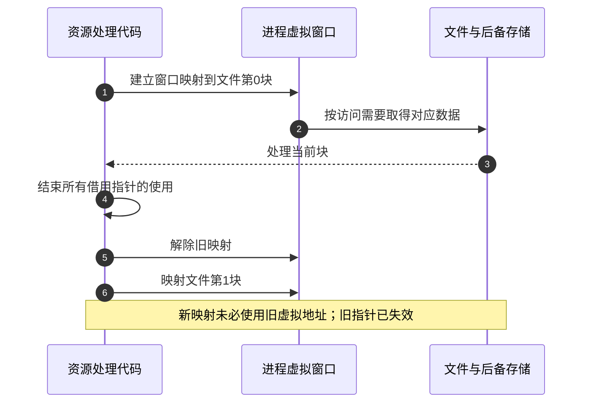

# 第1章\_地址空间有限为什么仍能处理更大的数据集

一台机器装有很多内存，一个资源文件也可能远大于进程的可用地址范围，程序却仍能分批处理它。这里没有让指针偷偷变长：**数据一共有多少、此刻映射了多少、实际驻留了多少，以及谁能访问它，是不同的问题。** 本文面向理解 C 指针的读者，从一个资源处理例子建立这些区别，再对照 Linux、Windows 和图形处理器（GPU）场景。

## 1.1\_先分清指针范围与存储容量

设一个字节寻址模型使用 32 位地址，完整地址集合有 `2^32` 个值，也就是 4 GiB 范围。这个算式描述可编码的地址，不保证应用可以把每一个值都当作有效指针：系统会保留部分范围，程序代码、共享库、栈和已有映射也占位置，还可能有空洞与保护页。

**虚拟地址（VA）** 是程序发起访问时使用、需要按当前地址空间解释的地址；**物理地址（PA）** 用于定位系统物理地址空间中的对象。启用相应地址转换时，页表描述映射及权限，处理器的转换硬件据此处理访问。物理地址范围也不全是已安装 RAM，还可能包含设备窗口和未实现区域。

两个进程都出现 `0x10000000`，不意味着访问同一物理页。操作系统选择各自的映射与权限；处理器使用当前转换上下文。地址空间标识符和地址转换缓存（TLB）是标记与缓存转换结果的机制，不能单独承担“隔离”的全部解释：权限检查、页表管理和上下文切换协议同样不可少。进程也可以经明确共享映射访问同一物理页，此时相同字节未必在两边具有相同虚拟地址。

| 当前问题 | 应核对的量 | 一个不能替代它的量 |
| --- | --- | --- |
| 程序还能安排多少映射 | 用户虚拟范围、已有映射与可用空洞 | 主板剩余 RAM 容量 |
| 这段映射当前驻留多少 | 实际物理页及驻留状态 | 文件总大小或预留虚拟范围 |
| 机器能够寻址多少 RAM | CPU/SoC 物理寻址、控制器、安装容量与系统限制 | 某进程的指针宽度一个数字 |
| 能否一次分配一大块连续虚拟区域 | 所需长度及当前连续空洞 | 所有空洞长度之和 |

32 位操作系统可以借助合适的物理地址扩展管理超过 4 GiB 的 RAM，再把其中不同页映射给不同进程。它改变页表所能指向的物理页范围，不把已有 32 位指针直接扩展成更长的虚拟地址。ARM LPAE 与 x86 PAE 是各自架构的机制，不能只因缩写相近就共享固定的物理位数；实际能力还要查处理器和操作系统版本。

固件也可能使用地址转换和缓存属性，但不因此就提供进程虚拟内存。U-Boot 的映射、物理解码和镜像搬移如何区分，见 [启动地址模型](../../system_software/uboot/P07_镜像搬迁为什么不等于改变内存映射.md)。不能反过来把某个固件的恒等映射当成 Linux 的全部地址组织。

## 1.2\_同一个窗口怎样依次处理更大的文件

设资源库长 6 GiB，程序只打算给它保留一个 256 MiB 的映射窗口。程序先映射第 0 块，处理后确保没有人继续使用窗口内指针，解除映射，再映射下一块。重复 24 次便覆盖文件。这里始终只有一块资源映射，不存在一根可以同时索引完整 6 GiB 文件的普通指针。

这也解释 `mmap` 为什么不是绕开地址空间限制的魔法。建立文件映射仍占虚拟范围；按需调页可能延后物理页的实际取得，但并没有消除映射地址的占用。解除映射才能释放对应虚拟范围，数据是否仍留在页缓存是另一件事。



跨块记录需要额外安排。例如一条压缩记录横跨两个窗口，不能只截取其中一半交给解码器；可按记录边界选窗口、保留边界小缓冲区，或在预算内同时映射邻接两块。窗口越小，映射切换、边界处理和重复访问可能越频繁；窗口越大，占用的虚拟范围和工作集预算越高。

先运行下面的 C 地址模型，观察 6 GiB 文件偏移如何分成 24 个窗口。它只计算偏移，不申请 6 GiB 内存，也不调用具体系统的映射 API。

```c
#include <inttypes.h>
#include <stdint.h>
#include <stdio.h>

int main(void)
{
    const uint64_t mib = UINT64_C(1024) * 1024;
    const uint64_t file_size = UINT64_C(6) * 1024 * mib;
    const uint64_t window_size = 256 * mib;
    uint64_t offset = 0;
    unsigned int windows = 0;

    while (offset < file_size) {
        uint64_t remaining = file_size - offset;
        uint64_t length = remaining < window_size ? remaining : window_size;

        /* 实际程序在此映射、处理并解除映射；旧指针不能传到下一轮。 */
        printf("offset=%" PRIu64 " MiB length=%" PRIu64 " MiB\n",
               offset / mib, length / mib);
        offset += length;
        ++windows;
    }
    printf("windows=%u processed=%" PRIu64 " MiB\n", windows, offset / mib);
    return 0;
}
```

配套 [address_window.c](../../../labs/foundations/memory/address_window.c) 可直接取用。在仓库根目录、有 C 编译器的 Bash 中运行：

```bash
# 只运行地址计算模型，不修改映射或系统配置。
cc -std=c11 -Wall -Wextra -Werror \
  labs/foundations/memory/address_window.c -o /tmp/address_window
/tmp/address_window
```

最后应为 `windows=24 processed=6144 MiB`。把文件大小再增加 1 MiB，应出现第 25 个窗口，最后一块仅 1 MiB；把窗口改为 512 MiB，应减少到 12 块。实际 32 位程序还需要使用支持大文件偏移的系统接口和构建设置；C 模型里的 `uint64_t` 只证明能保存大整数，不会自动把操作系统的文件偏移接口或指针改成 64 位。

## 1.3\_增加进程与借用GPU分别改变什么

若资源可以分成独立任务，也可以由多个进程各自映射一部分。每个进程有自己的虚拟范围，但全部仍竞争同一台机器的 RAM、缓存和存储带宽。它不是把 A 进程的一根指针变成可以遍历 B 进程全部对象的指针。

例如主进程管理场景，资源进程解码下一批数据，渲染进程提交绘制。资源进程先完成数据，再通过消息或共享区域中的就绪协议通知消费者。共享内存只共享字节，不自动解决生产者何时写完、消费者何时用完；资源复用要有明确确认，跨进程传递通常用共享对象标识和偏移，不能随手发送本地裸指针。


这是一种可设计的职责划分，不是在声称所有游戏都采用三个进程。进程间通信（IPC）、同步、复制和重复元数据都有成本；如果单进程已有足够地址范围，简单的分块工作流可能更合适。只有独立性和隔离收益足以覆盖通信成本时，才值得拆进程。

GPU 场景还多一个地址视角。资源句柄描述一个对象，并不等于 CPU 已把该对象所有字节映射进自己的地址空间；但上传缓冲区、读回缓冲区、驱动元数据以及显式 CPU 映射仍可能消耗系统内存和 CPU 虚拟范围。以 Direct3D 12 为例，默认堆、上传堆和读回堆具有不同 CPU 访问条件，不能统一称为“完全不占 CPU 空间”。见 [Microsoft 堆类型说明](https://learn.microsoft.com/en-us/windows/win32/api/d3d12/ne-d3d12-d3d12_heap_type)。

独立 GPU 可能有自己的显存；统一内存架构（UMA）则不能按“RAM 加一块完全独立显存”计算容量。UMA 也不保证任意 GPU 资源都可随意由 CPU 映射，仍须遵守资源类型、缓存和同步合同。这里比较的是访问与存放方式，不能用显存容量直接扣减进程的全部内存成本。见 [Microsoft 架构属性说明](https://learn.microsoft.com/en-us/windows/win32/api/d3d12/ns-d3d12-d3d12_feature_data_architecture)。

## 1.4\_为什么不能把3GiB写成所有32位程序的上限

前面的 4 GiB 是地址编码范围，用户实际可用部分由执行环境决定。Windows 的 **大地址感知（Large Address Aware，LAA）** 是可执行文件中的属性；**4GT** 是适用的 32 位系统调整用户/系统虚拟范围的机制。二者所处层次不同，不能用“打开其中任意一个就有 3 GiB”概括。

| Microsoft 文档中的运行条件 | 32 位进程的用户虚拟范围上限 |
| --- | --- |
| 32 位 Windows 默认条件 | 2 GiB |
| 支持的 32 位 Windows，启用 4GT 且程序具有 LAA | 最多 3 GiB |
| 64 位 Windows，32 位程序没有 LAA | 2 GiB |
| 64 位 Windows，32 位程序具有 LAA | 4 GiB |

表格按官方资料核对于 2026-10-18；它是地址范围上限，不是可连续分配大小或物理 RAM 保证。实际系统版本还有限制，不能仅打开 PAE 就认定所有 32 位 Windows 都能使用超过 4 GiB RAM。4GT 增加用户范围也会缩小系统范围，需要评估相应资源代价。依据：[Windows 内存限制](https://learn.microsoft.com/en-us/windows/win32/memory/memory-limits-for-windows-releases)、[虚拟地址划分](https://learn.microsoft.com/en-us/windows/win32/memory/virtual-address-space)。

Linux 的划分则取决于架构和内核配置，不能把某张 x86 或 ARM 示意图写成全 Linux 默认。例如固定 Linux 6.12.20 的 ARM 配置具有不同 `VMSPLIT_*` 选择；ARM64 的虚拟地址位数和页大小也有多种配置。相关固定证据及 32/64 位对照见 [启动桥接章的地址边界](../../../publications/books/running_linux_kernel/P04_uboot启动流程说明.md#4.5_内核建立虚拟地址空间_没有改变板上的内存容量)。64 位程序通常有更大虚拟范围，但“64 位”不保证所有实现至少给用户 256 TiB，更不意味着有同等容量的物理内存。

## 1.5\_高端内存解决的是内核映射问题

当内核自身的虚拟范围有限，不能把所有物理 RAM 永久直接映射进去时，Linux 用 **高端内存（highmem）** 描述这类不能直接永久映射访问的页。它不是另一种内存芯片，也不是给用户地址空间追加的一段隐藏空间。

访问这样的页需要适当映射。Linux 6.12 文档推荐新代码使用符合场景的局部映射接口；`kmap_local_page` 返回的地址仅在调用者上下文有效，不能随意交给其他上下文，嵌套解除须遵守反向顺序。低端页或未启用 HIGHMEM 时可直接得到已有直接映射地址。`ioremap` 面向设备 I/O 区域，不能作为普通 highmem RAM 页映射的通用替代。依据：[Linux 6.12 高端内存处理](https://docs.kernel.org/6.12/mm/highmem.html)、[设备 I/O 访问](https://docs.kernel.org/6.12/driver-api/device-io.html)。

回到资源库问题：扩大物理寻址帮助全机容纳更多页；highmem 映射让内核在有限虚拟范围里访问相关页；窗口化让用户程序分批处理数据；进程拆分把职责分到不同地址空间；64 位程序扩大可表达的地址范围。这些机制改变不同约束，不能互相替代。选择前先问清楚失败的是地址范围、连续空洞、物理驻留预算、文件接口，还是设备资源预算，再修改真正限制当前工作的那一项。
