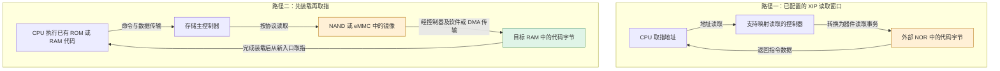
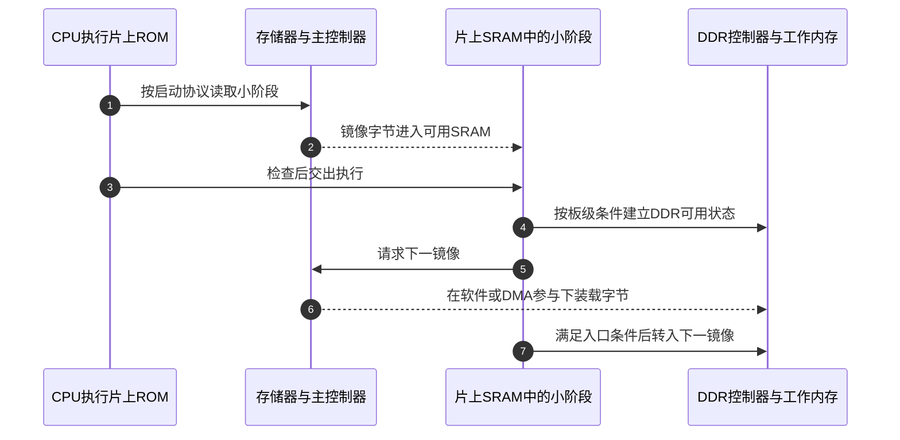

# 第1章\_存着程序的芯片为什么不一定能直接取指

开发板上既有 Flash 又有 DDR，镜像明明已经写进 Flash，为什么启动时还要把它搬进内存？回答这个问题，需要分开三层：器件怎样保存位、主机用什么协议读写、处理器能否把那条通路当成取指地址。本文先从取指需求推导读取路径，再比较 NOR、NAND、eMMC 和 DDR；具体板的地址及初始化值仍由芯片与板级资料确定。

## 1.1\_取指需要一条已经可用的地址访问路径

处理器执行一条指令时，需要从当前指令地址取得字节。某个设备里存在同样的字节，并不意味着处理器可以直接把设备内部编号当成指令地址。假设存储设备要求先发送“读取第几个块”的命令，等待完成，再从数据通道接收结果，CPU 的普通取指并不会自动替软件完成整套协议。

有两条不同办法。第一条由控制器把 CPU 的地址读请求转换成外部存储访问，形成可取指窗口；代码不先整体复制到 RAM 就能执行，这称为 **原地执行（Execute In Place，XIP）**。第二条先由已有代码驱动存储控制器，把镜像读到可执行的 RAM 范围，完成必要检查后再跳过去。

图中第二条通路的 CPU 开始时已经有代码可执行；否则会陷入“先运行驱动才能读取驱动”的循环。片上 ROM 是常见的起点，也可以有其他前级。图是访问关系，不声称任何具体芯片都具备这些控制器，更不表示板上两个存储器之间存在不用控制器的数据直连。

XIP 也不是只看 Flash 型号即可确认的属性：还要核对控制器映射能力、读命令、时序、地址窗口以及执行权限。栈和可变数据通常仍需要 RAM；可执行代码放在非易失介质，不会让普通 C 的可写对象自动变成可随意修改的 Flash 字节。

## 1.2\_先认识介质与控制器\_再比较四个名称

**Flash** 是断电后仍可保持数据的一类存储；NOR 与 NAND 是两种不同组织方式的 Flash 家族。它们的读取、编程和擦除约束不同，不能把“非易失”直接推成“支持任意字节覆盖写”。并行 NOR 和串行 NOR 也不是同一种主机接口，名称 NOR 并不保证外部一定有完整地址线与数据线。

**eMMC** 是把 NAND 与管理控制器集成在一起、向主机提供 MMC 协议访问的存储方案。因此 eMMC 与裸 NAND 不是“有无掉电保持”的区别，而是管理职责和主机接口不同。控制器内部处理错误纠正、坏块和磨损管理，主机面对逻辑存储地址，不能直接把一个逻辑块号当成 NAND 阵列里的固定物理页。依据：[Micron NAND 类型与管理边界](https://www.micron.com/products/storage/nand-flash/choosing-the-right-nand)。

本章说的 **DDR 内存** 指 DDR 系列动态随机存取存储器（DRAM），用作工作内存，需要供电和刷新维持内容；DDR 表示双倍数据速率的传输方式。这个词也可能出现在其他接口的双沿传输模式中，不能看到控制器写着 DDR 模式就认定外部接的是 DRAM。DRAM 的工作内容不作为普通断电持久保存的依据。参见 [Micron DRAM 说明](https://www.micron.com/products/memory/dram-components/ddr5-sdram)。

| 对象 | 主机面对的典型访问形式 | 谁承担主要管理 | 在启动中的典型角色 |
| --- | --- | --- | --- |
| NOR Flash | 并行或串行读/编程/擦除；满足集成条件时可建立读取窗口 | 主机控制器与软件按器件协议管理操作 | 保存启动代码；可选择 XIP 或装载执行 |
| 裸 NAND Flash | 页数据读取/编程与块擦除，另有状态和元数据 | 主机侧处理相应 ECC、坏块与布局；部分器件有片内 ECC | 保存较大镜像，由加载路径取得数据 |
| eMMC | 经 MMC 主控制器访问逻辑存储范围 | 器件内部管理 NAND；主机仍负责协议、布局及数据使用 | 保存镜像、文件系统及其他持久数据 |
| DDR DRAM | CPU/其他主设备经内存控制器访问工作内存 | 控制器、物理接口和初始化软件维持时序与刷新 | 放置已装载代码、栈、堆和运行数据 |

这张表比较的是角色，不是速度排行榜。带宽、延迟、寿命、成本和容量必须指定器件、接口模式、访问尺寸、读写比例及工作条件。不能把某一代串行 NOR 的速度写成全部 NOR 的速度，也不能仅凭“有内置控制器”宣布 eMMC 无须初始化或没有失效风险。

## 1.3\_为什么读一个字节与改一个字节的代价不同

普通 RAM 地址模型容易让人以为 Flash 也可以任意覆盖一个字节。但 Flash 编程与擦除是不同操作，粒度和允许次数受器件约束；NAND 通常按页处理数据、按更大的块擦除，不能写成“按块写、按页擦”。重复编程、部分页编程和错误纠正规则还需查具体器件。Linux 的 [NAND 驱动文档](https://www.kernel.org/doc/html/v4.20/driver-api/mtdnand.html) 记录了页重复写限制及页/擦除块接口；这里仅引用介质操作边界，不用旧版驱动 API 指导当前内核实现。

做一个明确限定的推演：假设一种器件的可改写操作要求先擦除整个块，块内还有必须保留的数据。直接擦块会破坏其他有效内容，因此软件或内部管理层需要先保存有效数据、按规则擦除/选择新位置，再编程并更新记录。正在修改的“一个字节”只是应用需求，底层实际动作可能远大于它。真实系统还要处理掉电中断，不能把这个推演当成一个已具备原子更新保证的写入算法。

NOR 同样有编程和擦除约束；支持随机读取并不意味着随机覆盖写的行为与 RAM 相同。对于串行 NOR，读、编程、擦除、状态查询还可能对应不同事务，编程或擦除期间哪些区域可读也依器件而定。依据：[Infineon NOR 编程/擦除挂起与恢复](https://community.infineon.com/t5/Knowledge-Base-Articles/Implementation-of-Program-Erase-Suspend-and-Resume-Operations-in-Serial-NOR/ta-p/256736)。

这也给 XIP 带来一个直接约束：如果正在执行的代码所在介质进入不允许该区域读取的状态，后续取指就可能受阻。安排更新操作时，需要核对读写并行能力、可执行代码和中断路径的位置，不能只把更新函数移到 RAM，就假定它调用的所有函数和常量也都已离开被修改介质。

## 1.4\_映射读取可以由控制器提供\_不意味着复位后立刻可执行

以 ST 的 AN4760 Rev.5（2026-02）为具体反例：其 QUADSPI 有间接访问和内存映射读取等模式，内存映射方式可供处理器取指；第 6.2 节的 STM32F7 示例先从内部 Flash 启动，再配置外部通路后执行外部代码。**支持外部 XIP 与支持复位直接从该外部器件启动，是两个条件。**

| 该文档中的模式 | CPU 侧当前任务 | 本节需要的区别 |
| --- | --- | --- |
| 间接模式 | 软件安排器件事务并传送数据 | 用于读、编程或擦除等操作 |
| 状态自动轮询模式 | 控制器按配置持续查询操作状态 | 减少软件反复发查询的工作 |
| 内存映射模式 | 主设备按地址读取外部内容 | 提供读取/取指视图，不把 Flash 改成普通可写 RAM |

以上只描述此文档所列控制器的模式，不能推广到全部 STM32 或所有 QSPI 实现。资料定位：[AN4760，§3.3，pp.22～23；§6.2.1，p.53](https://www.st.com/content/ccc/resource/technical/document/application_note/group0/b0/7e/46/a8/5e/c1/48/01/DM00227538/files/DM00227538.pdf/jcr%3Acontent/translations/en.DM00227538.pdf)。表格已给出本节所需模式含义，原件供追溯，不要求读者先查寄存器才能理解这条边界。

DDR 也有相似的“窗口存在”和“当前可用”区别。芯片地址图可以先分配一段 DDR 窗口，但时钟、控制器、物理连接及时序条件尚未建立时，不能把它当可靠栈或镜像目的地。初始化代码必须先在已经可用的执行环境中运行。

## 1.5\_把存储身份放回一条启动过程

下面固定一个教学方案：ROM 先把小阶段读入片上 SRAM，小阶段建立 DDR 环境，再把较大镜像放入 DDR。**SRAM** 是无需 DRAM 那种刷新过程的静态 RAM，此处仅把它作为片上早期工作区；容量和复位状态须以芯片为准。

第一步“从某介质启动”说的是镜像来源，不表示 CPU 第一条指令就在该介质执行；第三步前 CPU 仍运行 ROM。第六步也不是存储器自己决定复制到哪里，而是执行中的加载路径安排传输。

这个方案不能写成所有板的必经路线。i.MX6ULL RM Rev.1（2017-11）§8.1、pp.249～250 说明其复位先进入片上 ROM，ROM 能按镜像中的设备配置数据处理 DDR 配置，因此可以采用另一种前级责任分工。对应表、过程图及格式说明已经在 [SPL 章节的 DCD 反例](../../system_software/uboot/P05_为什么需要SPL以及它怎样交出下一阶段.md#5.3_用DCD反例校正BootROM的能力边界) 就地给出；原件身份见 [Arm 资料索引](../../../reference/external_resources/arm/README.md)。

最后用三问检查自己的板：存储器提供什么协议；复位时谁已经能执行并驱动这条通路；下一阶段代码和数据将落在哪个已可用范围。若只知道“板上是 eMMC”或“代码在 NOR”，这三问仍没有全部回答。得到答案以后，再去核对 [内存镜像到 Linux 入口](../../system_software/uboot/P11_内存镜像如何变成Linux入口现场.md)，才不会把读取成功、可执行地址和完整启动混为一谈。
