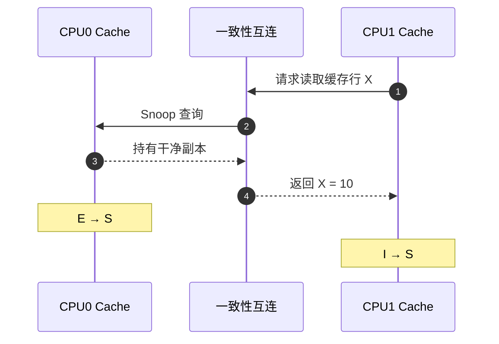
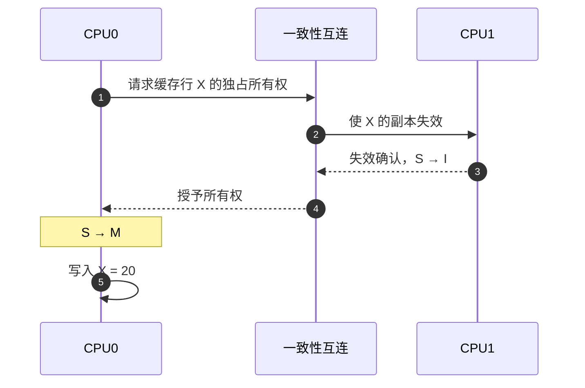
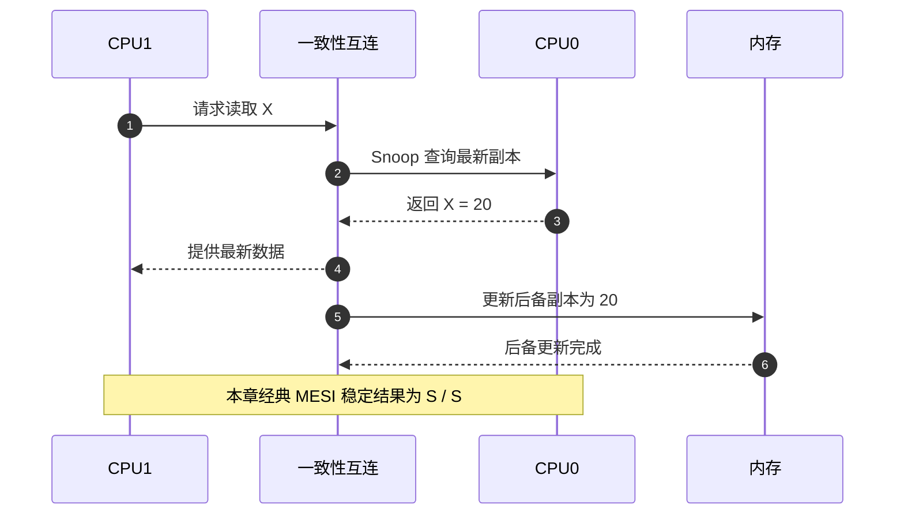
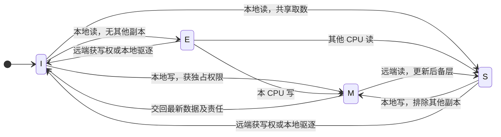

# 第2章\_MESI\_状态机与一致性事务

上一章留下三个问题：缓存中的字节还能不能读、当前 CPU 能不能直接改、最新值是否已经交回下一层。这一章用同一行里的 `X`，沿“首次读 → 第二个读者加入 → 一个 CPU 写 → 另一个 CPU 再读”回答它们。先限定一个教学系统：两个私有缓存连接一个后备内存层，使用写回和失效式协议；正文中的“主存”都指这个模型的后备层。真实多级缓存中，某一级的干净副本与下一层一致，并不等于 DRAM 已更新。

如果副本不能读，至少需要一个无效标记。若两个 CPU 都能读同一份数据，就需要“共享可读、写前协调”的状态。若只有一个 CPU 持有修改后的最新值，还必须记住由它承担交回数据的责任。这先得到 I、S、M 三种角色。

还可以省下一次通信：当读取时已经确认其他缓存都没有副本，先记下“干净且独占”；将来本 CPU 写入便无需再排除其他读者。这就是 E 状态的意义。它是一项利用独占事实的优化，四种状态不是四类物理缓存。

## 2.1\_从有效性与写权限得到四种稳定状态

MESI 由四种状态的英文首字母组成：Modified、Exclusive、Shared 和 Invalid。

这些状态由 **缓存控制器** 维护，通常保存在与缓存行地址标签关联的状态位中；数据本身保存在缓存的数据阵列。软件执行读写指令，控制器查标签、检查权限并发消息。互连或目录还会保存参与者和未完成事务的信息。它们共同构成分布式协议，不能把 CPU0 的一个状态位当成整条行的全局状态。

| 状态 | 含义 | 可读取 | 可直接写入 | 其他缓存可有有效副本 | 主存副本 |
| --- | --- | ---: | ---: | ---: | --- |
| M（Modified） | 独占且已修改 | 是 | 是 | 否 | 可能已经过期 |
| E（Exclusive） | 独占但未修改 | 是 | 是 | 否 | 与缓存一致 |
| S（Shared） | 多个缓存可共享 | 是 | 否 | 是 | 经典 MESI 中与缓存一致 |
| I（Invalid） | 当前副本无效 | 否 | 否 | 不限制 | 对本缓存无意义 |

### 2.1.1\_Modified

`M` 表示当前缓存拥有唯一有效且已经修改的副本。最新数据位于该缓存中，主存可能仍是旧值。缓存行被驱逐或响应其他 CPU 的一致性请求时，脏数据必须被写回或转交到系统认可的一致性位置。

```text
CPU0：M，X = 20
CPU1：I
内存：   X = 10
```

### 2.1.2\_Exclusive

`E` 表示当前缓存拥有唯一有效副本，而且数据尚未被修改。由于其他缓存没有有效副本，本 CPU 第一次写入时通常可以在本地完成 `E → M`，不必先广播失效请求。

```text
CPU0：E，X = 10
CPU1：I
内存：   X = 10
```

### 2.1.3\_Shared

`S` 表示多个缓存可以持有相同的干净副本。CPU 可以读取它，但要写入之前必须先取得独占所有权，并使其他缓存中的副本失效。

```text
CPU0：S，X = 10
CPU1：S，X = 10
内存：   X = 10
```

### 2.1.4\_Invalid

`I` 表示缓存行在逻辑上无效。缓存 SRAM 中可能仍残留旧比特，但处理器不能把它们作为有效数据返回；下一次访问必须重新发起请求。

```text
CPU0：M，X = 20
CPU1：I，X = 10  ← 物理内容可能仍在，但已经不可使用
```

## 2.2\_沿一次完整读写周期追踪状态

下面用两个 CPU 对同一缓存行的读写说明 MESI 的核心过程。图中的状态是教学用的稳定状态，实际微架构还会加入等待数据、等待失效确认等瞬态状态。

### 2.2.1\_CPU0首次读取

初始时两个缓存都没有有效副本：

```text
CPU0：I
CPU1：I
内存：X = 10
```

CPU0 读取 `X` 并发生 Cache Miss。如果一致性系统确认没有其他有效副本，CPU0 可以获得 `E`；有些实现也可能保守地授予共享状态，因此不能把“首次读取必然得到 E”当作软件可依赖的规则。

```text
CPU0：E，X = 10
CPU1：I
内存：   X = 10
```

### 2.2.2\_CPU1随后读取

CPU1 发起共享读请求后，CPU0 的独占副本变为共享副本：

```text
CPU0：E → S
CPU1：I → S
```



### 2.2.3\_CPU0取得写权限

CPU0 不能直接修改 `S` 状态的缓存行。它必须发起升级或所有权请求，等待其他共享副本失效后再写入：



结果是：

```text
CPU0：M，X = 20
CPU1：I
内存：   X = 10
```

### 2.2.4\_CPU1再次读取

CPU1 再次读取时不能使用本地无效副本。由于最新数据位于 CPU0 的 `M` 缓存行中，一致性系统必须从拥有者或一致性点取得 `20`，而不能直接返回主存中的旧值 `10`。



## 2.3\_稳定状态与未完成事务怎样区分

把上面的完整周期压缩到一份账本，可以检查每一步是否同时满足“可读副本相同”和“至多一个可写拥有者”。下表列的是事务完成后的稳定状态，等待数据或确认的中间阶段不提前当成完成。

| 阶段 | 触发动作 | CPU0 | CPU1 | 后备内存 | 继续执行的必要条件 |
| --- | --- | --- | --- | --- | --- |
| T0 | 尚未访问 | I | I | 10 | 无有效缓存副本 |
| T1 | CPU0 读 | E，10 | I | 10 | 数据到达且确认可独占 |
| T2 | CPU1 读 | S，10 | S，10 | 10 | CPU0 放弃独占，CPU1 获得有效数据 |
| T3 | CPU0 写 20 | M，20 | I | 10 | CPU1 失效被确认，CPU0 取得写权限 |
| T4 | CPU1 再读 | S，20 | S，20 | 20 | 最新数据被交付，经典 MESI 的干净共享条件成立 |

T4 的数据传输与后备更新可以由不同实现重叠安排；表格不规定总线拍数。它规定的是稳定结果，不能把“数据已到达”单独当作全部协议责任都已结束。第六章会用另一种状态解释怎样允许后备层保持旧值而仍然共享最新数据。



一致性请求在不同协议中名称并不完全相同，但可以抽象为两类：

- 共享读：只请求可读副本，允许其他 CPU 继续持有副本；
- 所有权请求：请求可写的唯一副本，同时使其他副本失效。

常见资料可能把后一类操作称为 Read For Ownership、Read Unique 或 Read Exclusive。这些名称来自不同总线或互连语境，不应机械地当成同一协议中的固定命令。

真实硬件还存在 `IS`、`SM`、`MI` 等瞬态状态，用于表示请求已发出但数据、权限或确认尚未全部到达。MESI 的四个字母主要描述便于理解的稳定状态，并不是完整的微架构状态机。

例如 T3 中失效确认尚未返回时，CPU0 不能因为“请求已经发出”就对外表现为拥有写权限；控制器会保留未完成事务，并按协议处理同时到达的另一个请求。内部时序和竞争由硬件协议实现保证。软件不需要猜若干缓存时钟周期后再读取，但仍须遵守语言及体系结构的原子性、同步和内存顺序要求。

练习：`CPU0=M、CPU1=S` 能否成为本章模型中同一行的稳定状态？不能，M 已承诺没有其他有效缓存副本。`CPU0=S、CPU1=I` 呢？可以，S 允许共享而不保证当前一定存在另一个读者；例如其他读者已逐出自己的干净副本。最后，若 CPU0 从 E 写成 M，需不需要先让 CPU1 失效？不需要，因为 E 已经证明 CPU1 没有有效副本。这三个判断比背字母更能检验是否理解了权限。

> 实现对照：[gem5 的 MESI Two Level 协议](https://www.gem5.org/documentation/general_docs/ruby/MESI_Two_Level/) 展示私有 L1、共享 L2 与目录状态，以及 E 状态省去写升级通信的作用。它是具体模拟实现，不代表所有处理器的微架构；本文以单一后备层建立经典模型。

上一篇：[缓存一致性问题与缓存行](P01_缓存一致性问题与缓存行.md)。

下一篇：[缓存行所有权竞争与伪共享](P03_缓存行所有权竞争与伪共享.md)。
