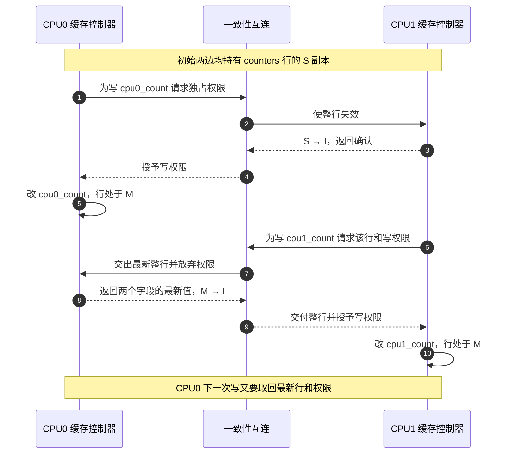

# 第3章\_缓存行所有权竞争与伪共享

上一章的协议保证 CPU 不能使用已失效的旧副本，却没有保证取得写权限很便宜。现在让两个 CPU 高频更新各自的计数，观察它们为什么会因布局而互相等待。本章只改变访问者和字段位置，沿用经典 MESI 的权限规则。

## 3.1\_从变量竞争追到缓存行所有权

两个线程修改不同 C 变量，不代表硬件处理的是两个独立一致性对象。缓存一致性协议通常以 Cache Line 为粒度维护共享、失效和写权限：

```c
struct counters {
    unsigned long cpu0_count;
    unsigned long cpu1_count;
};
```

```text
| cpu0_count | cpu1_count | 其余字节…… |
|<----------- 同一条 Cache Line ----------->|
```

图中假设两个字段的实际地址确实落在同一行；仅凭结构体声明不能排除跨行放置。CPU0 只改 `cpu0_count`，也必须取得整条缓存行的可写所有权；CPU1 随后只改 `cpu1_count`，仍要让 CPU0 的该行副本失效，再取得同一条行的所有权。软件字段互不重叠，硬件写权限却发生冲突，这就是 **伪共享（False Sharing）**。

## 3.2\_真共享和伪共享的共同成本与不同原因

把 CPU1 的操作改成只读 `cpu1_count`，问题也没有消失：CPU0 写使 CPU1 的整行副本失效，CPU1 再读又要取得该行，CPU0 下一次写再排除这个读者。**伪共享至少需要一个写入者，不要求两个 CPU 都写。** 若两个 CPU 真正需要更新的是同一个计数，则无法仅靠移动字段消除这项通信；这称为真共享。下面再按访问对象区分三种情况。

| 类型 | CPU 是否访问同一字段 | 缓存行是否相同 | 修复方向 |
| --- | --- | --- | --- |
| 真共享 | 是 | 是 | 减少全局更新、分片、批处理或改变算法 |
| 伪共享 | 否 | 是 | 调整布局、分离写热点、per-CPU 存储 |
| 只读共享 | 多 CPU 读同一字段 | 是 | 通常可共同持有共享副本，不反复争夺写权限 |

两类写共享都表现为缓存行所有权转移、失效流量和流水线等待；差别在于伪共享可以仅通过改变布局消除，而真共享反映的是算法确实要求多个 CPU 更新同一逻辑状态。

## 3.3\_一次所有权来回迁移的完整过程



可观察后果包括：

- Store 需要等待所有权；
- 一致性互连产生额外探测、失效和响应；
- 后续读可能因本地副本失效再次取数；
- Store Buffer 和未完成访存队列积压；
- 核数增加后吞吐量不再近似线性扩展。

这里不要求数据每次都写回 DRAM。最新数据可以直接由另一个缓存或共享缓存层提供；瓶颈是缓存行权限和最新副本的位置不断变化。

## 3.4\_全局原子计数为什么特别容易成为热点

```c
atomic_fetch_add(&global_readers, 1);
```

这里是 C 原子接口的操作片段，不是完整程序。**原子读改写（Read-Modify-Write，RMW）** 比普通 Store 更明确地要求：读取旧值、计算新值、在竞争者之间形成不可分割更新。若每次操作都更新同一全局计数：

1. 所有 CPU 争夺同一缓存行；
2. 每个 RMW 必须基于前一次更新后的最新值；
3. 缓存行在逻辑上形成串行化点；
4. 高并发读路径即使访问不同业务对象，也被该计数器连接起来。

这里按原子更新在私有缓存中执行的模型推导；某些处理器可在共享层执行原子操作，不能声称每条原子指令必定把数据搬到请求核。不可消除的约束是：同一个精确计数的更新必须形成串行关系，具体代价还取决于硬件执行位置。

这解释了 per-CPU counter、分片计数和批量汇总的价值：把高频写分散到不同缓存行，只在需要结果时读取或合并。代价转移到了汇总：逐个读取期间其他 CPU 还在更新，得到的总数未必对应同一瞬间；若要求严格快照，仍需额外协议。RCU 的读侧管理也可能利用局部状态减少全局写，但它解决的是读者与回收的协调，不能作为任意精确计数器的直接替代品。

## 3.5\_为什么读共享和写共享的扩展性不同

多个 CPU 只读同一行时，可以各自在 Shared 状态持有副本，读取主要支付首次填充和容量/冲突 Miss 的成本。任何 CPU 开始写入后，都需要排除或更新其他可读副本，所有权才成为频繁通信资源。

因此“RCU reader 仍然会访问共享 cache”与“RCU reader 避免全局共享写”并不矛盾：前者可能有普通读 Miss，后者避免每次查找都触发写权限迁移。若读侧代码主动修改共享对象字段，写共享成本和字段级同步责任都会重新出现。

## 3.6\_布局优化必须先确认真正的写入者

常见布局策略：

- 把不同 CPU 高频写入的字段放到不同缓存行；
- 使用 per-CPU 数据，让每个 CPU 写自己的副本；
- 将高频写字段与大量只读字段分开；
- 对统计值做本地累加，低频批量合并；
- 将锁与它保护的热点数据按实际访问模式布局。

但填充并非免费：

- 增加对象尺寸和缓存容量压力；
- 可能让原本同读的字段分散到多行，增加读 Miss；
- 数组中每个元素对齐到整行会显著放大内存占用；
- 缓存行大小和共享层级因实现而异；
- 结构体布局变化会影响 ABI、DMA 描述符或设备格式。

所以应由测量证明存在所有权竞争，再按写入者边界调整，不应给所有结构体机械加 64 字节 padding。

## 3.7\_怎样从性能现象定位到缓存行

研究过程应保存：

1. 负载中哪些 CPU/线程执行写入；
2. 热点地址映射到哪个对象和字段；
3. 两个字段是否落在同一缓存行；
4. 所有权转移或 HITM/类似事件是否集中在该行；
5. 分离字段后吞吐量、延迟和一致性流量是否同步变化。

Linux 平台可以按架构和工具能力使用 `perf c2c`、相关 PMU 事件、`pahole`、BPF 或采样剖析。PMU 是处理器的性能监测单元；`perf c2c` 汇总缓存行共享相关采样，`pahole` 显示编译后的结构体布局。某些处理器的 HITM 事件表示访问命中了其他缓存的已修改行，但它不是“发现伪共享”的自动判决，还要还原字段和参与者。不同 CPU 的事件名称和可解释范围不同，必须记录处理器型号、内核版本和 perf 版本，不能把某款 x86 的事件直接套到 Cortex-A7。

最小 A/B 实验应保持业务工作量不变，只改变字段布局；若同时改变算法、锁和批处理，就无法归因收益来自消除伪共享还是其他因素。

## 3.8\_与\_Store\_Buffer\_和内存顺序的边界

Store Buffer 可以暂时吸收写入等待所有权的延迟，却不能取消最终的所有权竞争；内存屏障可以限制访问观察顺序，却不能让多个 CPU 同时拥有同一缓存行的写权限。

```text
缓存一致性：谁拥有最新缓存行和写权限
缓存行竞争：这些权限在参与者之间多频繁迁移
Store Buffer：等待迁移时写入暂存在哪里
内存顺序：暂存和传播允许产生哪些观察结果
```

Store Buffer 与乱序执行的权威说明见[体系结构内存顺序专题](../memory_ordering/大纲.md)。本章只维护缓存行粒度的所有权与性能问题。

## 3.9\_方案选择核对表

| 观察到的问题 | 先检查 | 可能方案 |
| --- | --- | --- |
| 多 CPU 更新同一计数 | 是否真共享、是否要求每次精确 | per-CPU、分片、批处理或降低精确度 |
| 不同字段写入仍互相拖慢 | 字段地址是否同一缓存行 | 分离布局或按写入者分组 |
| 加 padding 后读性能下降 | 只读字段是否被分散、对象是否膨胀 | 缩小对齐范围或调整冷热布局 |
| 只有一个 writer 仍很慢 | 其他 CPU 是否读同一行中的独立字段；再排查锁、NUMA 和带宽 | 读写伪共享也可分离布局，不能按写者数量排除 |
| RCU reader 扩展性差 | 是否在读侧写共享统计或引用数 | 改用本地统计、批量汇聚或重新界定生命期 |

## 3.10\_本章验收

用三个工作负载预测布局修改是否有用，再核对答案：A 为 CPU0 写 `count0`、CPU1 写 `count1`；B 为 CPU0 写 `count0`、CPU1 读 `count1`；C 为两个 CPU 都原子加同一个 `total`。初始时相关字段同处一行。

A、B 都可能因字段共行产生伪共享，分行能消除这部分相互失效；C 是真共享，给 `total` 四周填充只能隔离其他字段，不能让两个 CPU 独立更新同一个精确值。若 A、B 原来已经分行，继续填充并无这个收益。实际 A/B 测量还须固定线程绑核、操作次数和统计方式，并确认编译器没有消掉待测访存；预测成立不是已经测得性能提升。

> 对照依据：[Linux False Sharing 文档](https://www.kernel.org/doc/html/latest/kernel-hacking/false-sharing.html) 明确给出一个 CPU 修改引用数、其他 CPU 读取同一行内名字字段的例子，并介绍 `perf c2c`、`pahole` 与布局取舍。这里的读写伪共享判断不依赖某个 PMU 事件在所有处理器上都可用。

1. 能从两个不同字段追到同一缓存行的写权限竞争。
2. 能区分真共享、伪共享和只读共享。
3. 能解释为什么全局原子计数在高核数下形成串行化点。
4. 能说明 per-CPU/分片转移了什么成本，以及汇总成本仍在哪里。
5. 能设计只改变布局的 A/B 实验，并承认 PMU 事件的平台边界。
6. 能区分缓存行所有权、Store Buffer 和内存顺序三个机制。

上一篇：[MESI 状态机与一致性事务](P02_MESI_状态机与一致性事务.md)。

下一篇：[Arm ACE、CHI 与一致性域](P04_ARM_ACE_CHI_与一致性域.md)。
