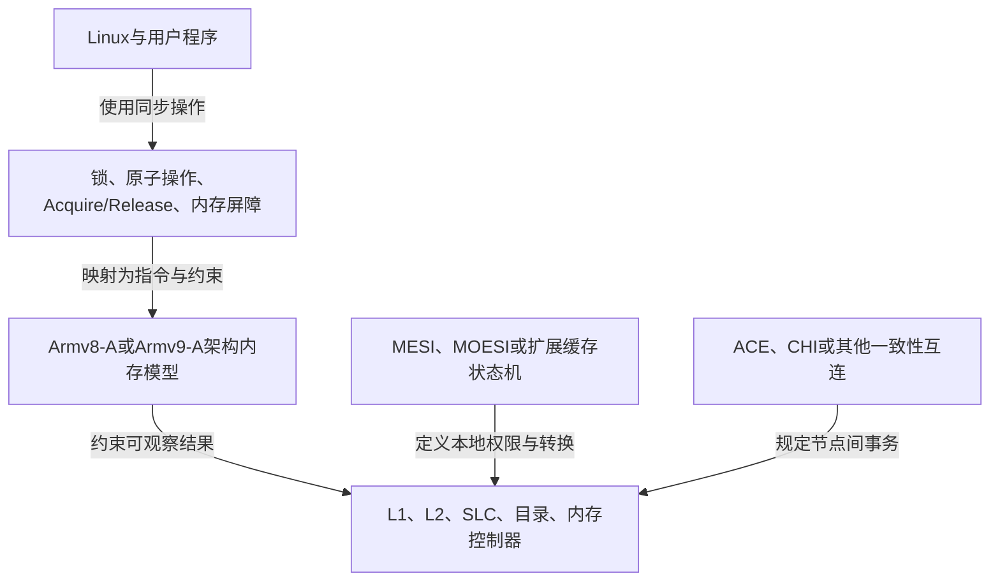
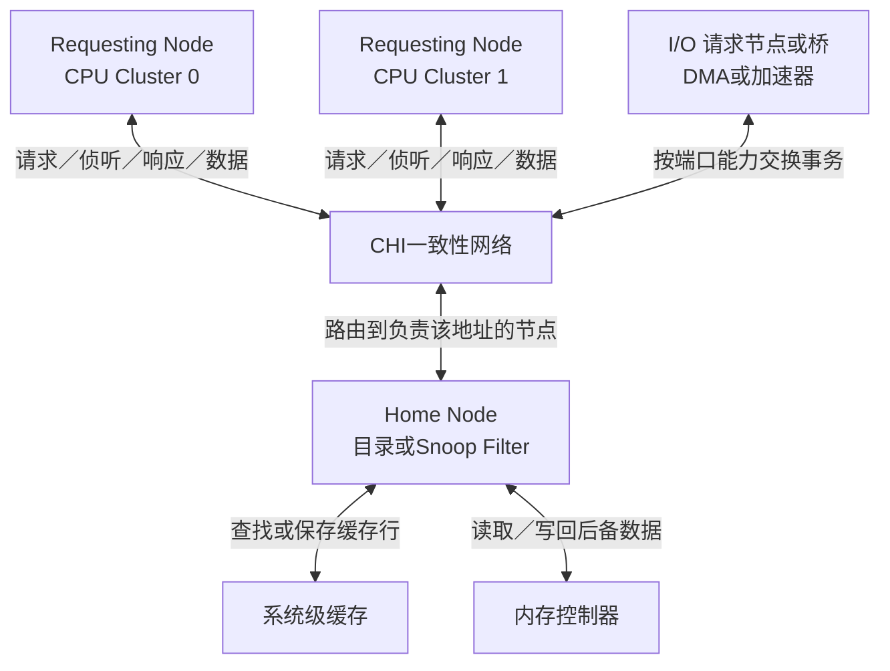
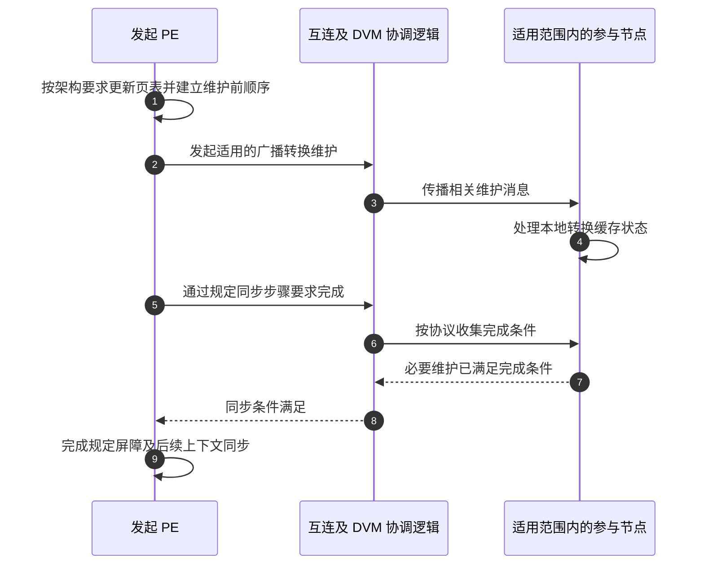

# 第4章\_ARM\_ACE\_CHI\_与一致性域

前面已经有缓存控制器、行状态和失效确认。把两个核扩展成多个核集群、共享缓存与设备以后，消息必须跨越这些硬件边界：谁发请求，谁查持有者，谁返回数据？本章把教学模型放进 Arm 系统的接口层，区分架构保证、互连事务和平台接线。这里建立职责，不列出某款芯片的全部信号和寄存器。

## 4.1\_Arm多核系统中的实现关系

首先区分“软件应当观察到什么”和“芯片用哪些硬件消息实现它”。否则看到一个 Arm 架构版本，就容易误以为所有产品必须采用同一套缓存状态位。

### 4.1.1\_Armv8与Armv9没有规定必须使用MESI

Armv8-A 和 Armv9-A 是 A-profile 体系结构版本，定义指令集、异常模型、内存模型以及软件可观察的行为。具体 CPU 或 SoC 可以选择 MESI、MOESI 类或扩展状态机，并另行选择广播、目录等副本定位方式，只要最终满足体系结构要求。状态集合与定位方法属于不同设计轴，并非互相排斥的协议名称。

Arm 文档用 **处理单元（Processing Element，PE）** 表示执行指令的架构单元；下文提到某个 PE 时，可以先对应前面例子中的一个执行者，而不把它当成互连或缓存控制器。

因此，下面的等式并不成立：

```text
Armv8 = MESI
Armv9 = MOESI
```

更准确的层次关系是：



这张图用于区分抽象层次，并不表示每个具体系统都严格按同一方向逐层实现。

### 4.1.2\_ACE与CHI负责传递一致性事务

缓存控制器仅保存自己的状态还不够：它需要把“请其他副本失效”送出去，把“已失效”收回来。**一致性互连** 是承载这些事务的硬件网络；CPU Cluster 指一组核及其局部共享资源，**系统级缓存（System-Level Cache，SLC）** 则服务于更大范围的访问者。Arm SoC 常在这些部件之间使用 ACE 或 CHI 接口协议，让连接两端按共同规则解释请求、响应、Snoop 与数据。

#### (1)\_ACE

AMBA 是 Arm 的片上接口规范家族名称。**AXI（Advanced eXtensible Interface）** 定义读写传输接口；**ACE（AXI Coherency Extensions）** 在其基础上增加一致性相关通道和语义，使具有缓存的主设备能够接收侦听并交出状态或数据。ACE-Lite 面向不保存可被这样侦听的一致性缓存副本、但需要对 CPU 缓存保持一致的 I/O 请求者。设备能够发出一致性访问，和设备自身能够长期保留受协议管理的缓存副本，是两种能力。

ACE 使用的状态语义比经典四状态 MESI 更丰富，例如 UniqueClean、UniqueDirty、SharedClean 和 SharedDirty。它们可以借助 MESI/MOESI 理解，但不应与 MESI 四个字母逐项等同。

#### (2)\_CHI

**CHI（Coherent Hub Interface）** 面向多节点系统组织一致性事务，将请求、响应、侦听和数据分为不同通道。请求节点 RN（Requesting Node）发出访问；归属节点 HN（Home Node）负责指定地址范围的协调，必要时联系缓存拥有者；内存侧节点提供后备数据。HN 可结合目录或侦听过滤器记录潜在副本位置，这项记录为什么能减少通信，下一章单独推导。



目录记录某条缓存行可能位于哪些节点，使互连能够定向发送 Snoop，而不必无条件广播给所有 CPU。MESI/MOESI 描述“缓存行处于什么状态”，ACE/CHI 则更侧重“请求、失效、数据和所有权怎样在系统中传递”。

图是职责布局，不是强制串行的数据线路；实际 CHI 实现可以让数据直接送到请求者，同时由 HN 完成权限协调。节点类型、可选事务和直接传输能力要按具体版本及产品确认。可对照 [Arm 的 CMN 工具说明：CHI 与 CMN 节点](https://github.com/ArmDeveloperEcosystem/cmn-tools/blob/main/docs/README-cmn.md)，其中说明请求节点、Home、内存侧节点以及直接数据传输的关系。

### 4.1.3\_CPU一致性与DMA一致性的边界

CPU 集群内部保持一致，并不代表所有 DMA 设备都会自动参与同一个一致性域。设备是否具有硬件一致性能力，要核对设备端口、互连路径、事务属性和平台配置。IOMMU 主要承担设备地址转换与访问隔离；“经过 IOMMU”本身不能证明数据缓存一致，反过来也不能把“不使用 IOMMU”视为必然非一致。

Linux 驱动不能仅凭“CPU 使用 MESI”就跳过 DMA API。驱动仍应使用 `dma_alloc_coherent()`、`dma_map_*()`、`dma_sync_*()` 等接口表达设备访问方向和所有权转换，由体系结构代码处理一致或非一致平台之间的差异。

### 4.1.4\_扩展协议为何存在

到这里先留下四个未决问题，后文逐项解决。下面是阅读路标，不是当前要求背下来的状态全集：

- MOESI 增加 Owned，允许某个缓存持有脏数据并与其他缓存共享；
- MESIF 增加 Forward，指定共享副本中的响应者；
- 目录协议记录缓存行持有者，降低大规模系统中的广播成本；
- 实际微架构还会加入大量瞬态状态处理并发事务。

这些扩展没有改变核心问题：硬件仍需追踪最新数据、读共享者和写所有者，并在权限转移时正确处理失效与数据传递。

## 4.2\_Shareability\_Domain\_与\_DVM

同一互连可以连接多个观察者，但软件需要的保证未必覆盖全部观察者。**共享属性（Shareability）** 描述内存位置的数据一致性要求；域由系统实现和集成定义。一个 Inner Shareable 域可以跨多个核集群，不能把它固定等同于“一个 Cluster”。Non-shareable 也不是访问权限：它不意味着其他 CPU 在物理上无法发起访问。

先看内存属性，再看屏障操作数，不能把两者合成四档属性。下表采用 AArch64 普通可缓存内存的概念边界，省略地址转换阶段合成等细节。

| 内存的 Shareability 属性 | 当前需要理解的保证 | 不能推出 |
| --- | --- | --- |
| Non-shareable | 不借该属性要求跨处理器域的数据一致性；典型用途是单 PE 使用的内存 | 其他 PE 被禁止访问，或实现一定不保持一致 |
| Inner Shareable | 在所属 Inner 域的观察者间满足数据一致性要求 | 域边界就是一个核集群的物理边界 |
| Outer Shareable | 在所属 Outer 域满足数据一致性要求，包含相应 Inner 域 | 所有 SoC 主设备都必然在该域内 |

**Full System 不是第四种内存 Shareability 属性。** 在较早的架构描述中，它与 NSH、ISH、OSH 一起出现在 DMB/DSB 的操作范围选择中。DMB 是数据内存屏障，限制相关内存访问的观察顺序；DSB 还涉及规定操作的完成。本章只区分范围，不把屏障当成缓存刷新命令。

| 文档版本 | DMB 操作数如何解释 | 阅读时的用途 |
| --- | --- | --- |
| DDI0487 G.b，C6.2.80 | `NSH`、`ISH`、`OSH` 分别指定相应范围；`SY` 为 Full System；这些无后缀形式约束读和写 | 对照旧版手册及现有代码的作用域描述 |
| DDI0487 M.c，C6.2.150 | `NSH`、`ISH`、`OSH` 均注明与 `SY` 行为相同且已弃用；相应 `LD`、`ST` 变体也归并到 `LD`、`ST` | 说明最新手册的描述已变化，不能把旧范围表无版本地称为当前规则 |

两份材料的差异应保留版本后解释，不能悄悄挑选一份。这里也不能反向推断旧芯片已经改变行为，或仅凭新版表格就改写既有内核屏障代码。平台实现与目标版本仍须分别核对。

> 本地核对：[Arm ARM DDI0487 G.b](https://developer.arm.com/documentation/ddi0487/gb)，B2.7 与 C6.2.80；[DDI0487 M.c](https://developer.arm.com/documentation/ddi0487/mc)，B2.10.1.1～B2.10.1.2（320～322 页）、C6.2.150（2172～2173 页）。M.c 仍列出三种内存共享属性，屏障操作数的文字变化不能拿来删除这三种属性。

还要防止把另一种“旧副本”混进 MESI：处理器的 **地址转换缓存（Translation Lookaside Buffer，TLB）** 可以保存旧的虚拟地址到物理地址映射。页表字节已经更新，并不自动使远端 TLB 放弃旧映射。**分布式虚拟内存（Distributed Virtual Memory，DVM）** 事务用于传播相关维护信息，而不是传送 X 的普通缓存行数据。ACE/CHI 在支持这些事务的节点之间传递消息；哪些设备参与取决于实现，不能把所有 SMMU 都画成必然接收者。



缓存一致性与 DVM 都借助一致性互连，但职责不同：前者维护数据缓存行副本，后者协调分布式地址转换状态。

图刻意区分“消息已发出”和“规定同步完成”，是职责顺序图，不是某一版 CHI 的逐包信号图，也不是可直接复制的页表修改代码。具体 TLBI 指令、范围、DSB 和可能的 ISB 必须由目标架构的页表维护协议决定。读到一个普通失效确认时，不能据此宣布全部地址转换维护已经结束。

> 互连入口：[Arm CMN 工具说明的 DVM 小节](https://github.com/ArmDeveloperEcosystem/cmn-tools/blob/main/docs/README-cmn.md#distributed-virtual-memory-dvm) 说明 DVM 如何借请求、数据和侦听通道传递。完成条件属于架构维护协议，不能由通道有消息经过替代。

练习：一个设备经过 IOMMU 且 CPU 的内存映射为 Inner Shareable，能否直接证明它的 DMA 与 CPU 缓存一致？不能。还缺设备端口、实际访问属性和互连参与范围的证据。同样，一张包含 System 的屏障表不能证明页表存在名为 System 的第四种共享属性。

上一篇：[缓存行所有权竞争与伪共享](P03_缓存行所有权竞争与伪共享.md)。

下一篇：[Snooping 与 Directory 一致性](P05_Snooping_与_Directory_一致性.md)。
