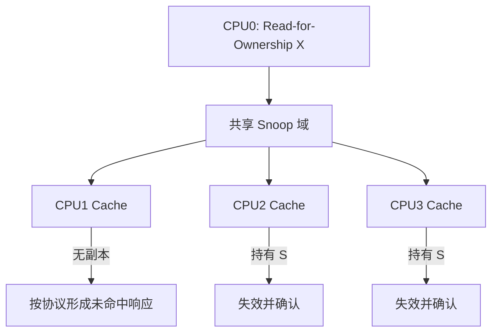
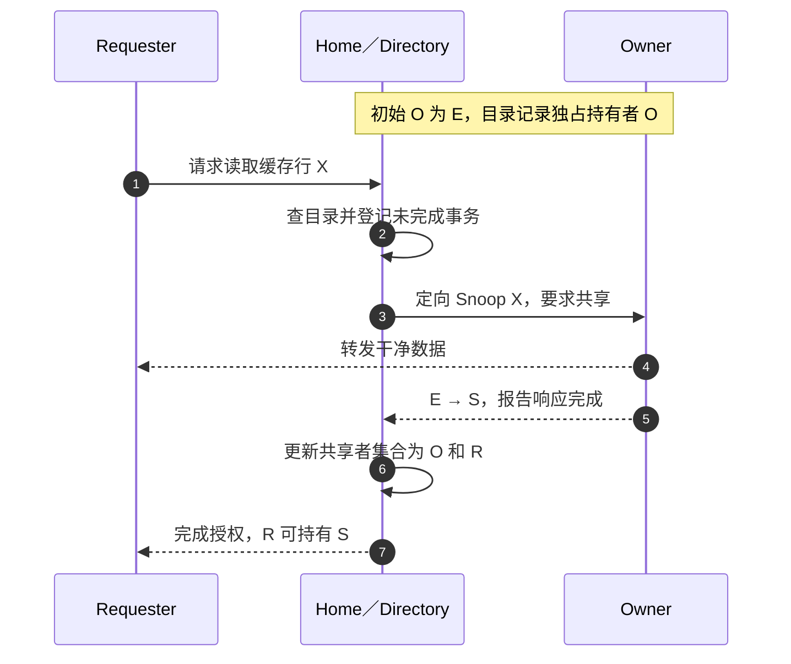

# 第5章\_Snooping\_与\_Directory\_一致性

上一章把失效消息放进了真实互连，但仍把“找到其他副本”当成一个动作。现在把 CPU 数量从两个增加到许多个：CPU0 想写 X，究竟该联系谁？本章比较两种发现办法，再说明它们如何与已经学过的 MESI 状态配合。

## 5.1\_状态机还需要消息投递机制

MESI 说明缓存行应处于什么状态，却没有规定系统怎样找到其他副本。真正的实现还必须回答：读缺失发给谁、写者怎样使共享副本失效、脏数据由缓存还是内存返回。

## 5.2\_Snooping\_广播观察

最朴素的办法是不预先保存位置表，而是把请求送给所有可能持有副本的缓存，让它们各自查标签。这种观察请求的动作称为 **侦听（Snoop）**，采用广播侦听的系统称为 Snooping 系统。某个缓存看到与自己持有缓存行相关的读、独占读或失效事务后，更新本地状态并在需要时提供数据。

它免去了先查询一张全局持有者表的步骤，小规模共享总线容易组织这种广播。但一次访问会占用许多无关缓存的标签查询和响应资源；参与者增加后，处理所有广播的成本可能先于业务计算成为瓶颈。其实际延迟取决于总线仲裁、拓扑和并发负载，不能一概认定比目录低。

上图选择 CPU2、CPU3 同时持有 S 的场景。若改成 CPU3 持有 M，其他缓存就必须为 I，CPU3 还要交出最新数据；不能把这两种场景画在同一行的同一时刻。无副本的缓存怎样报告未命中、系统怎样汇聚响应由协议决定，软件不参加这个确认过程。

## 5.3\_Directory\_定向查找

若系统已经知道 X 只有 CPU2、CPU3 持有，每次再询问其余几十个 CPU 就浪费了。为此可以在硬件中保存 **目录（Directory）**：以行地址定位一项记录，记下无缓存者、独占拥有者或可能的共享者集合。负责某一地址范围并协调事务的节点称为 **Home**。新请求先到它，目录控制器读取记录，发出定向查询，并在事务完成后更新记录。Home 是地址的协调归属，Owner 是当前副本或脏数据的责任者，两者不一定在同一节点。

Directory 可以减少广播范围，适合参与者较多、跨节点查询昂贵的系统；代价是目录存储、查找跳数、并发事务状态和目录容量管理。**侦听过滤器（Snoop Filter）** 保存足以排除不可能持有者的信息；保守记录可能多问一个无副本节点，但不能无补救地漏掉真实拥有者。稀疏记录容量不足时，必须按实现回收条目、失效相关副本或退回更广查询，不能直接忘掉仍有效的副本。

下面从干净独占副本开始，避免混入尚待下一章解释的脏共享。目录最初记为 `owner=O`；事务进行中还要记住请求者 R，直到数据和权限责任都完成。

## 5.4\_两者不是缓存行状态的替代品

Snooping 与 Directory 解决“消息发给谁”，MESI/MOESI/MESIF 解决“节点收到消息后处于什么权限状态”。现代系统可以在一个层级内广播，在另一个层级使用目录，不能把整台机器简单贴成单一实现。

用同一负载比较：64 个参与节点中，X 只有两个远端共享者。广播办法把一次写请求交给其余 63 个节点检查；精确目录只需定向联系两个共享者，另付一次目录查找及记录维护。这里数的是逻辑查询目标，不是实际链路包数。若 X 恰好被其余 63 个节点全部共享，目录仍须联系全部持有者，过滤收益就很小。小规模系统、广泛共享负载和目录资源开销都可能使广播仍然合理，不能只凭“目录更先进”作选择。

练习：目录把已经逐出的 CPU3 仍记作共享者，会怎样？它可能多发一次查询，得到未命中后修正或继续保守记录。反过来，若漏掉仍持有 M 的 CPU3，就可能错误地从旧后备内存返回数据；实现必须通过准确记录或安全回退避免这种漏查。两种误差的正确性后果不对称。

> 产品证据：[Arm CCN-508 r0p1 的 Fully-coherent Home Node](https://developer.arm.com/documentation/100020/0001/functional-description/about-the-functions/fully-coherent-home-node?lang=en) 说明 Home 按地址范围管理一致性、请求串行化与 Snoop Filter，并利用记录减少广播。图中数据直送与目录更新的安排是教学事务，不宣称复现该产品的全部通道。

上一篇：[Arm ACE、CHI 与一致性域](P04_ARM_ACE_CHI_与一致性域.md)。

下一篇：[MESIF、MOESI 与协议扩展](P06_MESIF_MOESI_与协议扩展.md)。
