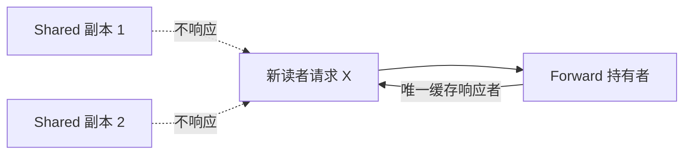
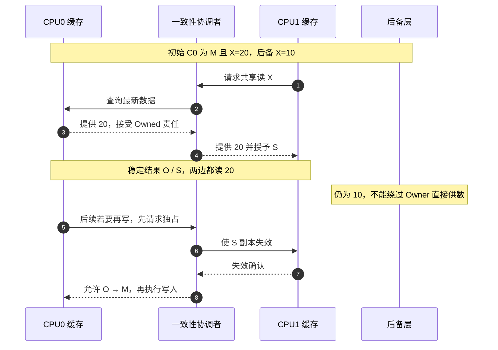
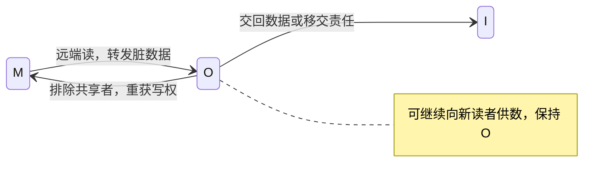
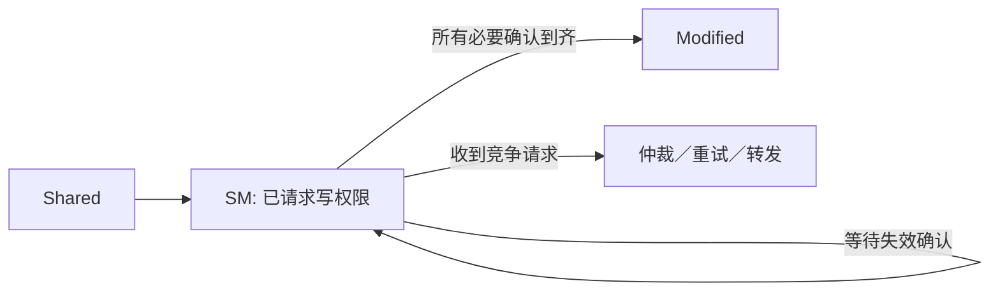

# 第6章\_MESIF\_MOESI\_与协议扩展

目录已经帮助请求找到持有者，但“找到多个可读副本”之后还剩两个独立问题：由谁提供数据？如果最新数据尚未写回后备层，能不能先让另一个 CPU 共享？本章分别增加一项责任来回答它们，不把所有扩展状态当成必须同时采用的配置。

## 6.1\_四种状态成立以后还有什么优化空间

MESI 足以描述基本读写权限。它可以通过总线仲裁、目录选择或后备内存供数，正确处理多个共享者；并不是所有 S 副本都会争相发送数据。然而，共享读取的数据来源和首次共享脏数据时的写回成本仍有优化空间。MESIF 与 MOESI 分别增加 Forward 和 Owned 状态，改变的是数据响应和脏数据责任的管理，不给软件增加“可以忽略同步”的保证。

## 6.2\_MESIF\_的\_Forward

设 CPU0、CPU1 都有 X 的干净副本，CPU2 现在也要读取。如果总从后备内存取，可能放弃了附近缓存已有的数据；如果每次临时选一个共享者，又要解决响应者选择。**转发状态（Forward，F）** 把这个选择保存在行状态中：至多一个共享副本承担缓存转发职责，其他 S 副本仍可本地读取。MESIF 就是在 MESI 上增加这一状态的协议模型。

F 仍是干净共享副本，在本专题的单一后备层模型中后备数据也是最新的。F 不授予独占写权限；转发职责也不保证永远有某个缓存承担，例如相关干净副本被逐出后，系统仍须能从后备层满足读取。具体实现决定如何重新指定响应者，不能把 F 当成软件需要寻找的固定 CPU。

> 版本例子：[Intel QuickPath 介绍，320412-001US，2009 年，Protocol Layer](https://www.intel.co.jp/content/dam/doc/white-paper/quick-path-interconnect-introduction-paper.pdf) 说明了 MESIF 的干净缓存转发职责。这是该互连语境的机制说明，不据此推断所有 Intel 产品使用完全相同的内部状态机。

## 6.3\_MOESI\_的\_Owned

回到第二章 T4：CPU0 为 M、X=20，后备层仍为 10，CPU1 请求读取。经典 MESI 若要结束为 S/S，必须使后备层也满足干净共享条件。若两个 CPU 接下来只是反复读 20，这次立即写回是否可以推迟？可以，但需要有人明确接下“后备层仍旧、以后由我交回最新数据”的责任。

**拥有状态（Owned，O）** 就保存这项责任。CPU0 转成 O，CPU1 持有同样为 20 的 S 副本，后备层可以仍是 10。Owner 并非唯一保存最新值的缓存，而是承担脏数据响应和最终交回责任的缓存。责任在驱逐时可以写回，也可以按协议移交，不能随副本一起悄悄丢弃。

此时必须牢记：内存可能不是最新副本，Owner 承担脏数据责任。Owned 与 Exclusive 不同，前者可被共享且为脏，后者独占且与后备层一致。**O 本身不能直接改写仍被 S 共享的数据**；写前仍要排除共享者，转成独占可写状态。收益是推迟部分写回，代价是共享期间仍要定位 Owner、处理其离开和责任移交。

可以用同一现场比较结果：经典 MESI 为 `S(20)/S(20)/后备20`；MOESI 可以为 `O(20)/S(20)/后备10`。两个模型都让 CPU1 读到 20，只是后备更新责任不同。协议名称不能代替具体产品手册；产品可能把这些职责与其他扩展合并，不能据厂商名称固定推断其状态集合。

> 实现对照：[gem5 MOESI CMP Directory 的 Directory Controller 状态表](https://www.gem5.org/documentation/general_docs/ruby/MOESI_CMP_directory/) 将 O 描述为一个拥有者加可能的共享者，数据可以不同于内存；L1 控制器还用 OM 等瞬态等待确认。这里用它核对责任分离，不把该模拟器内部的每个字母直接当成通用 MESI 字母。

## 6.4\_稳定状态之外还有瞬态状态

真实控制器还需要表示“已发请求、等待数据、等待失效确认、发生冲突重试”等瞬态状态。例如从 S 升级到 M 不是瞬时动作，在全部失效确认返回前不能让本地写入对外宣称完成。

因此，教材状态图是稳定状态的抽象，不等于芯片 RTL 的全部状态机。

最后判断两个说法：“有 F 就可以直接写”“有 O 就只有 Owner 保存最新值”。两者都错。F 仍可能与 S 共享；O 的其他 S 副本也含最新数据。权限、数据新旧和响应责任是不同维度，增加一个字母通常是在表达其中某项尚未记录的责任。

上一篇：[Snooping 与 Directory 一致性](P05_Snooping_与_Directory_一致性.md)。

下一篇：[LLC 包含策略与缓存写策略](P07_LLC_包含策略与缓存写策略.md)。
