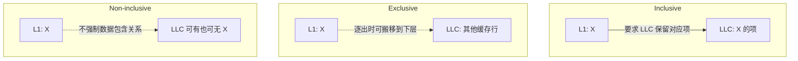
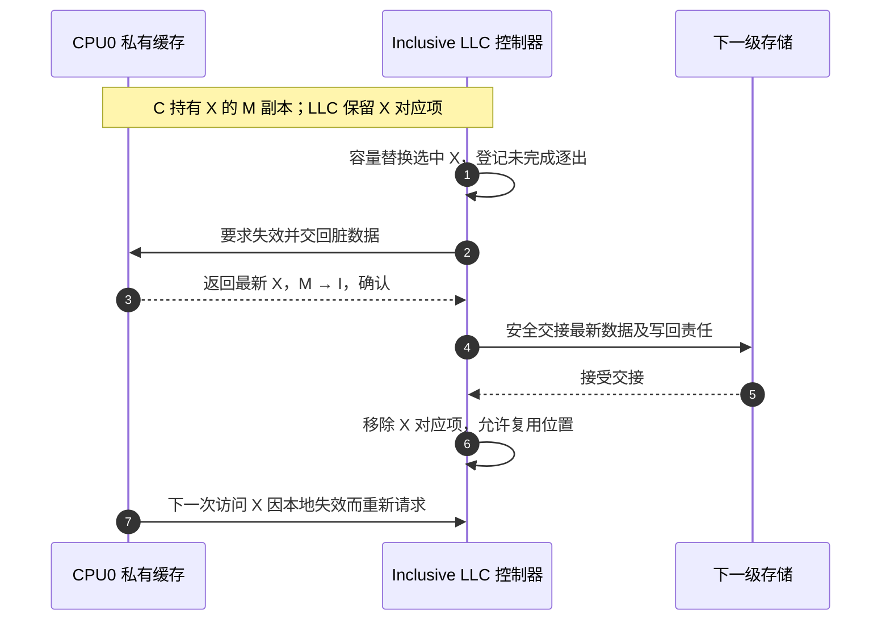

# 第7章\_LLC\_包含策略与缓存写策略

前面的例子把私有缓存之外简化为一个后备层。真实处理器通常还有多级缓存：靠近核心的小缓存强调延迟，更远的大缓存减少访问内存的次数。**末级缓存（Last-Level Cache，LLC）** 是这条层级中最后一级缓存，不保证一定叫 L3，也不保证整台机器只有一个实体。本章问的是：同一行要在几层保存，以及更新何时传给下一层；这些选择与 MESI 的读写权限不同。

## 7.1\_包含关系回答上层副本在哪里

假设 L1 已保存 X，LLC 是否也必须为 X 保留对应项？若必须，LLC 查不到 X 就能排除它仍在 L1 的情况，查询很方便，但同一行会占用两层容量。若把两层容量用于不同数据，就必须在取入和逐出时安排搬移，也不能再用一次 LLC 未命中证明上层没有副本。下面按这两种取舍区分包含策略；“上层”指更靠近核心的缓存。

| 策略 | 基本约束 | 优势 | 代价 |
| --- | --- | --- | --- |
| Inclusive | 上层缓存行在 LLC 中也有对应项 | LLC 标签可辅助定位上层副本 | LLC 驱逐可能反向驱逐上层，重复占用容量 |
| Exclusive | 在约定的两个层级之间不同时保留该行的数据副本 | 提高总有效容量 | 层级间搬运与状态管理更复杂 |
| Non-inclusive/non-exclusive | 不强制包含或排斥 | 设计更灵活 | 不能仅凭 LLC 命中与否判断上层是否持有 |

“LLC 不包含数据”不代表系统没有目录信息；数据阵列与 Snoop Filter/Directory 标签可以分离实现。

包含也不等于每一级数据比特时刻相同。若 L1 已把 X 改为 M，LLC 的对应项可以仍承担位置和包含信息，而最新数据在 L1；读取仍需遵循一致性协议。图中的三种关系都是明确层级间的策略，不能不问层级就给整颗芯片贴一个 Inclusive 或 Exclusive 标签。

## 7.2\_Write-through\_与\_Write-back

接着让 CPU 对 X 连续写十次。**写直达（Write-through）** 要把本层写入继续向下一层传播，因而增加下层写流量；途中仍可以有写缓冲和合并，不能把它解释为每条 Store 都阻塞到 DRAM 完成。**写回（Write-back）** 可以先在本层累积修改并标记为脏，等逐出或一致性事务要求时再交回最新值。十次局部改写因此可能只产生一次后备更新，代价是必须记住最新数据和脏责任的位置。

## 7.3\_Write-allocate\_与\_No-write-allocate

再问一个独立问题：本层根本没有 X，第一次写是否为它分配缓存项？**写分配（Write-allocate）** 会建立本地项；对于只改行内一部分字节的普通写，通常还要取得其余字节的当前内容及所需权限。整行覆盖等优化可能省去读取旧数据，不能把“写分配”定义成无条件先从 DRAM 读取整行。**不写分配（No-write-allocate）** 则让这次缺失写传给下一层而不在本层建立数据项，适合减少一次性流式写占用缓存；若很快又读同一行，可能反而增加缺失。

这些策略可以组合，例如常见的 Write-back + Write-allocate，但不能从“使用 MESI”推导出唯一写策略。协议权限与缓存填充/写回策略属于相互配合但不同的设计维度。

## 7.4\_反向失效为何影响性能

假设严格 Inclusive 的 LLC 因容量压力选中 X 作为替换目标，但 CPU0 的 L1 正在频繁使用 X。若 LLC 直接删除 X 的对应项，便违反“上层有则下层也有”的承诺。因此，它需要 **反向失效（Back-invalidation）**，让上层先放弃副本。如果上层为脏，还必须先接住最新数据，不能只清掉有效位。

图中把数据交接画成顺序步骤以突出责任，实际实现可能经过写回缓冲并重叠执行。重要的是不能在责任无人承接时丢失最新值。LLC 中其他负载带来的容量冲突，就这样变成 CPU0 本来会命中的访问发生缺失；这也是分析尾延迟时不能只看 LLC 自身命中率的原因。

练习：一个 Non-inclusive LLC 未命中 X，能否省略对上层缓存的查询？不能仅据数据未命中这样做，仍须用独立目录、过滤器或查询协议判断。反过来，若选择保留目录而逐出数据，可能避免严格数据包含带来的反向失效，但需支付额外元数据和管理成本。

> 具体实现对照：[gem5 MESI Two Level](https://www.gem5.org/documentation/general_docs/ruby/MESI_Two_Level/) 采用 L1/L2 包含关系；[Arm CCN-508 r0p1 的 Home Node](https://developer.arm.com/documentation/100020/0001/functional-description/about-the-functions/fully-coherent-home-node?lang=en) 则描述数据行以排斥策略为主的 L3 和独立侦听过滤职责。它们说明需要查明层级和产品，不能由 MESI 名称推导缓存包含策略。

上一篇：[MESIF、MOESI 与协议扩展](P06_MESIF_MOESI_与协议扩展.md)。

下一篇：[ccNUMA 与多 Socket 一致性](P08_ccNUMA_与多_Socket_一致性.md)。
