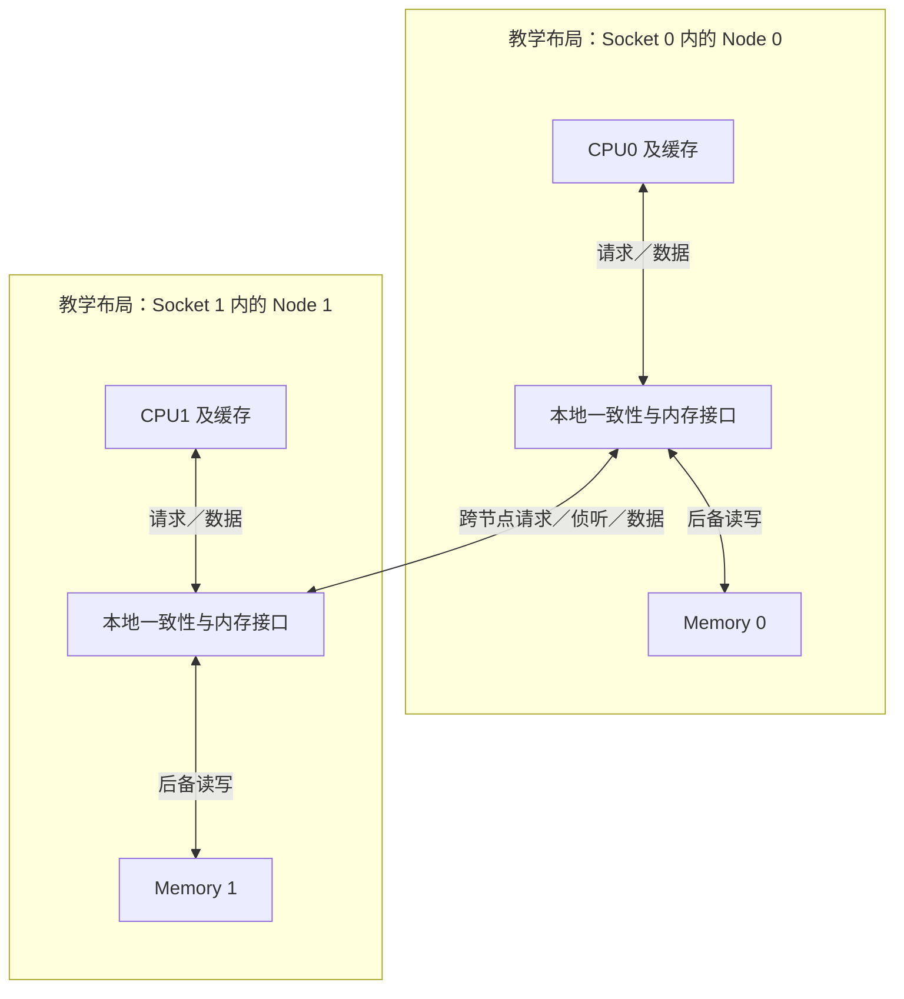
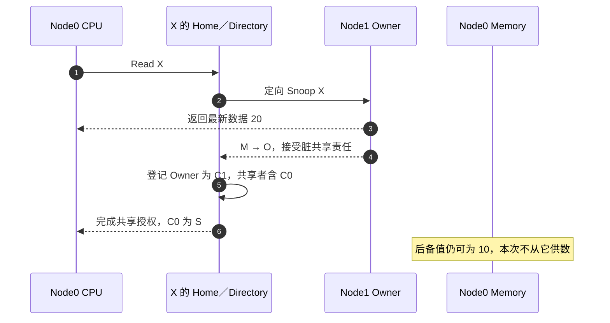

# 第8章\_ccNUMA\_与多\_Socket\_一致性

前面用缓存层级解释了一次访问可能由不同位置供数。现在把内存控制器也分散到不同节点：程序仍能使用共享地址，但到达数据和完成权限协调的距离变了。本章沿同一个 X 区分“页放在哪里”和“最新副本在哪里”。

## 8.1\_一致不等于等距

**缓存一致的非均匀内存访问（cache-coherent Non-Uniform Memory Access，ccNUMA）** 让参与 CPU 在共享物理地址空间内访问普通共享内存，并由缓存与系统互连维持一致性；访问本地内存和远端内存的延迟、带宽与互连占用却不同。“统一”不表示每个物理地址都对所有 CPU 无条件可访问，访问权限和设备地址范围另有约束。

NUMA node 表示操作系统使用的内存局部性单元，Socket 表示处理器封装的拓扑单位，两者不保证一一对应。下面只选择“两个 Socket 各提供一个带内存的 node”作为教学布局，不能据此推断实际机器的 node 数量。

一致性回答“读到的值是否符合缓存行协议”，NUMA locality 回答“为了得到这个值走了多远”。两者不能互相替代。

## 8.2\_一次远端脏行读取

假设物理页的后备内存归属 Node 0，但 Node 1 的 CPU 已取得 X 的写权限并修改了它。此时页的位置没变，最新值的位置却变了。下面采用第六章 MOESI 的脏共享选择，初始远端为 M，本地请求者为 I；Home 负责 X 的地址，并从目录记录找到远端拥有者。

因此“访问本地页”也不保证数据一定由本地 DRAM 返回；共享写入可能把所有权和最新数据带到远端缓存。

图采用允许缓存直接供数的抽象互连；具体产品也可能经 Home 转发。数据到达与协议授权是两项条件，不应从一根直达箭头推出没有 Home 协调成本。

## 8.3\_扩展性代价

- 远端访问需要更多互连跳数和协议消息。
- 跨 Socket 写共享会引起缓存行所有权往返，通常比本 Socket 内竞争更昂贵。
- Directory 能限制 Snoop 目标，但目录容量和 Home 节点本身也可能成为压力点。
- 内存放置、线程亲和性和共享数据布局共同决定性能。

Linux 将硬件单元抽象为 NUMA node，并提供距离与内存策略；这些属于操作系统使用层。本章只建立硬件前提，进一步可阅读 [Linux NUMA 文档](https://docs.kernel.org/mm/numa.html)。

把优化放回同一个负载比较：若每个线程反复读取自己独有的大数组，线程与内存放在同一 node 往往能减少远端内存访问。若两个 Socket 不断改写同一条计数器缓存行，仅把后备页移到其中一个 node，不能消除两个写者之间的权限往返；还应检查分片或减少共享写。若迁移线程而不迁移其热数据，又可能把原本的局部访问变为远端访问。这些都是待测预测，不能单凭 node 编号判断延迟。

练习：线程固定在 Node 0，页也分配在 Node 0，是否足以证明它没有远端一致性流量？不够。先找出是否有远端 CPU 缓存或写入相同行，再看目录、权限和数据的实际路径。内存放置与缓存行拥有者是两份不同的状态。

上一篇：[LLC 包含策略与缓存写策略](P07_LLC_包含策略与缓存写策略.md)。

下一篇：[CXL.cache 与设备一致性](P09_CXL.cache_与设备一致性.md)。
