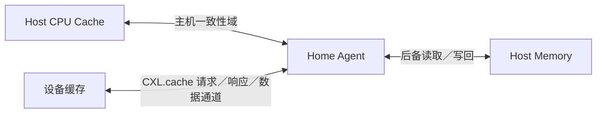
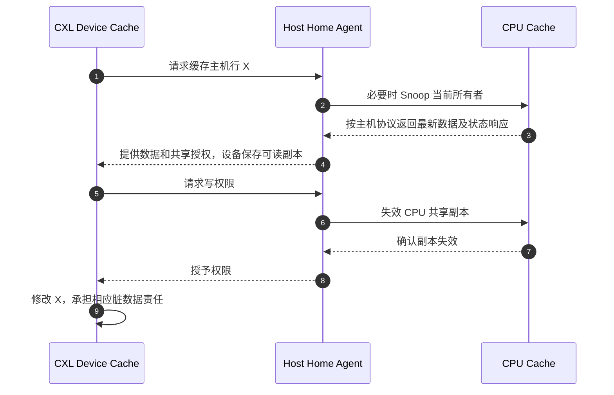

# 第9章\_CXL.cache\_与设备一致性

上一章把缓存参与者分散到不同处理器节点。如果加速器也想把正在计算的主机数据保存在自己的缓存里，主机 CPU 改写时如何找到这个副本？本章增加设备缓存这一参与者，继续追踪数据、权限和脏责任，不把“链路接通”当成“所有访问都自动同步”。

## 9.1\_一致性参与者从\_CPU\_扩展到设备

传统 PCIe 设备主要通过 DMA 访问主机内存，软件使用 DMA API 协调访问与可见性；一些平台本来就提供硬件一致的 DMA，也不是所有 DMA 都要求复制缓冲区。这里新增的需求是：设备自己长期保留缓存行，并能接受主机的侦听、失效和权限转换。只保证一次 DMA 能取得正确数据，还没有完整回答这个问题。

**Compute Express Link（CXL）** 是连接主机与设备的互连规范家族。其中 `CXL.cache` 定义设备缓存主机内存时参与的一致性事务。主机中的 **Home Agent（HA，归属代理）** 协调对应地址的权限并联系主机侧缓存或内存；设备通过它取得数据和授权。下面按 CXL Consortium 2020 年的 CXL 1.1 教学材料建立这一基本方向，不覆盖后续版本的全部交换、内存池和对等访问拓扑。

## 9.2\_CXL.io\_CXL.cache\_与\_CXL.mem

设备先需要被发现和配置，计算时可能缓存主机数据，也可能把自己的附加内存提供给主机使用。这三项需求方向不同，所以分为三个子协议。名称里的 cache 和 mem 要结合谁发请求、数据属于哪一侧理解。

| 协议 | 核心用途 |
| --- | --- |
| CXL.io | 发现、配置、错误报告以及 PCIe 风格 I/O 语义 |
| CXL.cache | 设备缓存主机内存，并参与相应一致性事务 |
| CXL.mem | 主机访问设备附加内存 |

三者解决的方向不同。CXL.io 是必需的基础协议，设备是否再支持 cache、mem 或两者要看设备能力。`CXL.mem` 是主机对设备内存的访问协议，其数据可进入主机缓存，但不能只把它定义为缓存行为。上表依据 [CXL Consortium：串行附加内存与 CXL 的协议分工](https://computeexpresslink.org/blog/the-benefits-of-serial-attached-memory-with-compute-express-link-2349/)；不要从“支持 CXL”推断三个协议全部实现。

## 9.3\_设备缓存行也需要权限转换

设备读取主机缓存行后可能保留副本；CPU 随后写入时，Home Agent 必须根据一致性模型探测或失效设备副本。设备希望修改缓存行时，也必须取得相应写权限，不能绕过主机一致性控制。

图中的数据先进入 HA，再由主机侧提供给设备。即使原始数据来自 CPU 缓存，也不能画成 CPU 缓存绕过 HA 直接向 CXL 设备供数。数据与授权可使用不同消息，设备必须等本次操作所需条件满足；图中合写一条箭头只表示教学阶段，不表示它们必须原子地同包抵达。[CXL Consortium 的一致性问答](https://computeexpresslink.org/blog/questions-from-the-compute-express-link-exploring-coherent-memory-and-innovative-use-cases-webinar-2341/) 明确解释了 HA 供数和数据／授权分离。

## 9.4\_它没有消除软件协议

CXL.cache 扩大了硬件一致性域，但设备驱动仍需处理命令完成、对象生命期、错误恢复、安全隔离和设备重置。硬件缓存一致性也不等于所有 MMIO、doorbell 和设备内部状态天然满足软件所需顺序。

例如，设备已经取得 X 的最新输入，不代表计算已经完成；主机看到缓存一致的结果字节，也不自动证明设备已停止访问整个缓冲区。能否释放缓冲区仍由命令完成和生命周期协议决定。细粒度共享可以减少某些显式数据搬运，却会引入设备缓存状态、侦听响应、HA 压力和恢复管理；大块顺序传输并不因此必须改成缓存共享。

练习：产品只声明支持 CXL.mem，能否证明它会把主机内存缓存到设备中？不能，那是 CXL.cache 的能力方向。再问：设备拿到缓存行授权，能否立即由驱动释放关联对象？仍不能，授权只证明这次硬件访问的权限，不证明软件任务或设备访问生命周期结束。

后续版本与完整事务编码通过 [CXL Consortium 规范入口](https://computeexpresslink.org/cxl-specification/)追溯；本章的方向、角色和最小事务已经在正文展开，不要求先读完整规范才能区分三者。

上一篇：[ccNUMA 与多 Socket 一致性](P08_ccNUMA_与多_Socket_一致性.md)。

下一篇：[协议边界与学习核对](P10_缓存一致性协议边界与学习核对.md)。
