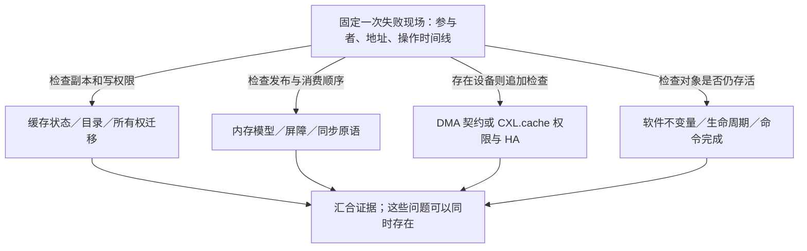

# 第10章\_缓存一致性协议边界与学习核对

沿前九章，同一个 X 已经经过私有缓存、目录、远端节点和设备缓存。本章把这些层次放回一个工程判断：看到旧值、吞吐下降或设备结果异常时，怎样找出缺失的保证？下面的结论用于回忆，随后用具体现场检验，不能把一次访问只分配给一个层次就停止排查。

## 10.1\_核心结论

1. MESI/MOESI/MESIF 管理缓存行副本、最新数据责任和读写权限。
2. Snooping/Directory 解决一致性消息怎样定位其他副本。
3. Inclusive/Exclusive 等策略描述缓存层级之间的内容关系，不等于一致性状态。
4. ACE/CHI/CXL.cache 等互连协议负责在更大的系统范围传输一致性事务。
5. 缓存一致性不等于内存顺序，更不等于 C/C++ 对象的业务不变量；跨地址观察、传播和屏障由[体系结构内存顺序专题](../memory_ordering/大纲.md)维护。
6. CPU 一致性域扩大到 DMA 或 CXL 设备后，软件仍须遵守相应 API、命令和生命期协议。

## 10.2\_学习核对

**现场一：两个 CPU 各自增加不同字段，结果正确，增加核数却更慢。** 先核对字段地址和缓存行大小。若两字段同处一行，第三章的失效与权限往返可以解释额外通信；分开字段是可检验的布局实验。即使这里只有一个写者，另一个 CPU 读取独立字段也可能形成伪共享。若它们本来就在不同缓存行，则这个解释尚未成立，应继续查其他瓶颈。

**现场二：CPU0 先写 data，再写 ready，CPU1 观察到 ready 后读取 data。** 假设硬件缓存一致，仍不能从这个前提单独推出 CPU1 一定看到新 data。这里还涉及两次访问之间的发布与观察顺序，以及所用语言是否允许这些并发访问。应进入内存顺序与软件同步层，而不是让软件等待若干缓存时钟周期。若对象已经被释放，补屏障也不能恢复对象生命期。

**现场三：设备已经读取最新输入，主机据此释放缓冲区。** 最新输入可以由 DMA 一致性或 CXL.cache 保证，但设备后续可能还要写结果或再次读取。缺少的是命令完成和停止访问的证据。硬件副本正确、软件释放过早可以同时成立，不能因为第一项正常就跳过第二项。

下面再用短问题复盘各层；每个问题都应能在本专题正文找到推理过程。

- 能否解释为什么 M 状态下主存可能不是最新数据？
- 能否区分缓存行状态与 Snooping/Directory 消息投递？
- 能否说明 MESI 为什么不能替代 acquire/release 或内存屏障？
- 能否解释伪共享为什么没有数据竞争也可能很慢？
- 能否区分 LLC 包含策略、写策略和一致性协议？
- 能否说明 ccNUMA 为什么既一致又不等距？
- 能否区分 CXL.io、CXL.cache 与 CXL.mem？

答案要点：M 把最新数据责任留在缓存，后备层可旧；状态描述权限，目录描述联系谁；同一位置一致不建立任意跨位置顺序；不同变量同一行仍竞争权限；包含、写传播和权限是三条设计轴；ccNUMA 维持一致却有距离差异；CXL 的 io 承担基础 I/O，cache 面向设备缓存主机数据，mem 面向主机访问设备内存。这些答案不是性能承诺，仍须结合具体协议、版本和测量验证。

## 10.3\_参考资料

- [Arm：Memory ordering](https://developer.arm.com/documentation/102336/latest/)
- [Arm：AMBA AXI and ACE Protocol Specification](https://developer.arm.com/documentation/ihi0022/latest/)
- [Arm：Introducing AMBA CHI](https://developer.arm.com/documentation/102407/latest/)
- [Linux：Memory Barriers](https://docs.kernel.org/core-api/wrappers/memory-barriers.html)
- [Linux：NUMA](https://docs.kernel.org/mm/numa.html)
- [CXL Consortium：CXL Specification](https://computeexpresslink.org/cxl-specification/)

其中 `latest` 和规范发布页是继续查阅的入口，不是固定版本证据。本专题对 Arm 共享属性和屏障操作数分别核对 DDI0487 G.b、M.c，对 CXL 基本角色采用已在第九章注明的早期公开教学材料；遇到新版本，保留版本差异再判断，不把旧状态图直接冒充当前芯片的实现。

上一篇：[CXL.cache 与设备一致性](P09_CXL.cache_与设备一致性.md)。

继续阅读：[体系结构内存顺序专题](../memory_ordering/大纲.md)。现在已经知道硬件如何管理同一行；下一步需要解释：同一 CPU 的多个访问为什么仍可能被其他参与者按不同顺序观察。
