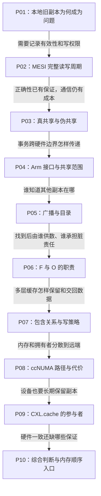

# 第1章\_缓存一致性专题大纲

## 1.1\_专题定位

本专题解释多核处理器如何在多个私有缓存之间维护同一缓存行的一致视图，并进一步区分缓存一致性、内存顺序和 DMA 一致性。重点是建立硬件运行模型，不在这里重复 Linux DMA API 或同步原语用法。

默认读者了解普通变量的读写，但不必先学过 MESI 或片上互连。沿同一个 `X`，先发现本地缓存可能保留旧值，再推导状态、消息、权限和数据责任。前一章建立的模型在后一章增加一个现实约束；图中的阶段与数值是教学模型，产品示例另标版本。无需操作真实多核硬件，也可以完成正文的地址、状态和事务预测；性能测量必须另行记录平台条件。

## 1.2\_建议阅读顺序

1. [缓存一致性问题与缓存行](P01_缓存一致性问题与缓存行.md)：先解释 SMP（Symmetric Multiprocessing，对称多处理）的参与者、逻辑 CPU、`CONFIG_SMP`、UP/AMP/NUMA 边界，再从共享内存推出缓存一致性问题，并区分一致性、内存序和对象语义。
2. [MESI 状态机与一致性事务](P02_MESI_状态机与一致性事务.md)：承接多副本问题，推导 I/S/M/E，跟踪同一行 T0～T4 的数据、权限和后备值；留下通信成本问题。
3. [缓存行所有权竞争与伪共享](P03_缓存行所有权竞争与伪共享.md)：沿写权限来回迁移理解真共享、伪共享、全局原子热点和布局取舍。
4. [Arm ACE、CHI 与一致性域](P04_ARM_ACE_CHI_与一致性域.md)：把前文事务放回硬件接口，区分架构、状态机、互连、内存共享属性和屏障范围；目录在这里定位职责，下一篇展开。
5. [Snooping 与 Directory 一致性](P05_Snooping_与_Directory_一致性.md)：理解广播观察和目录定向查找怎样定位缓存副本。
6. [MESIF、MOESI 与协议扩展](P06_MESIF_MOESI_与协议扩展.md)：在已经找到副本的前提下，分别解决干净数据转发与延后脏数据写回，并说明等待确认的瞬态。
7. [LLC 包含策略与缓存写策略](P07_LLC_包含策略与缓存写策略.md)：区分 Inclusive、Exclusive、写回、写直达和写分配。
8. [ccNUMA 与多 Socket 一致性](P08_ccNUMA_与多_Socket_一致性.md)：解释一致但不等距的多节点系统。
9. [CXL.cache 与设备一致性](P09_CXL.cache_与设备一致性.md)：将一致性参与者从 CPU 扩展到设备缓存。
10. [协议边界与学习核对](P10_缓存一致性协议边界与学习核对.md)：集中复盘 CPU 一致性、DMA 一致性和扩展协议边界。

## 1.3\_专题边界

本专题已经覆盖 Snooping 与 Directory、MESIF/MOESI、Inclusive/Exclusive LLC、NUMA 一致性域和 CXL.cache。Store Buffer、传播和屏障的硬件抽象由[体系结构内存顺序专题](../memory_ordering/大纲.md)维护；Linux 的 ONCE、SMP 屏障与 release/acquire 契约由 [Linux 内存顺序专题](../../../linux/synchronization_and_asynchrony/synchronization/memory_ordering/大纲.md)维护。DMA 映射接口、RCU 和锁的调用方式也保留在各自专题，通过链接关联，避免把硬件协议与软件 API 再次混写。
