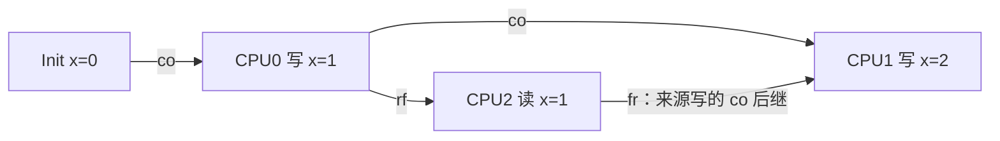
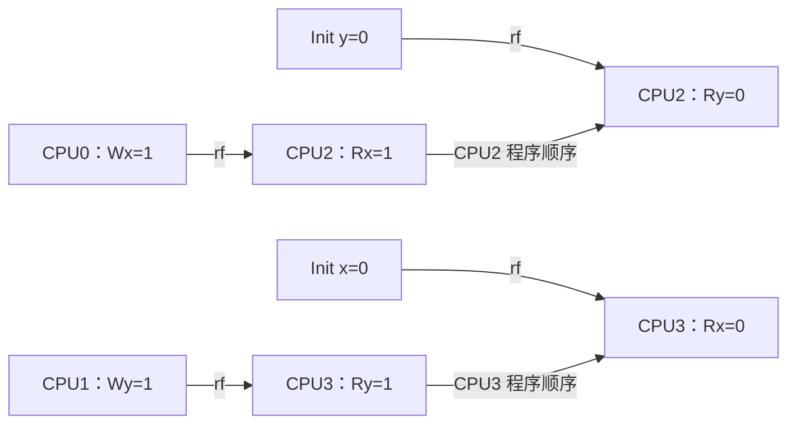
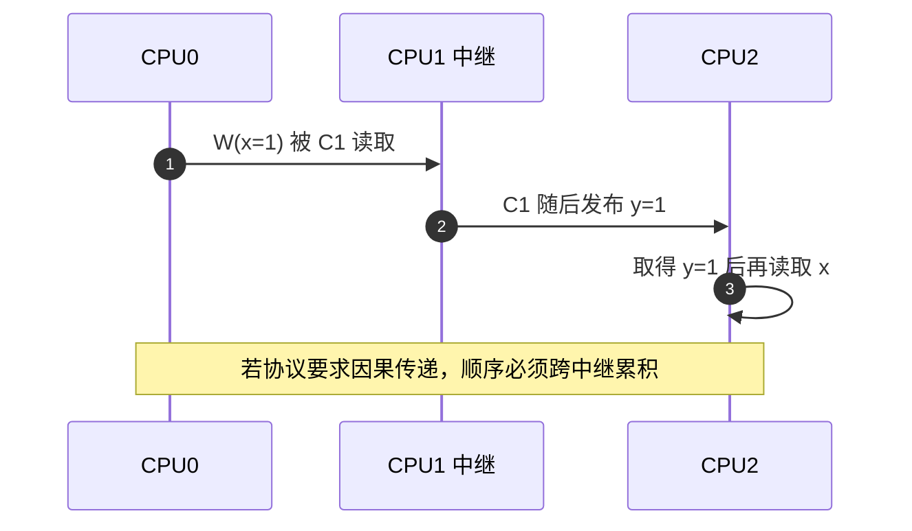

# 第4章\_一致性序\_传播与多副本原子性

## 4.1\_从两个\_CPU\_扩展到多个观察者

MP 和 SB 只需要两个 CPU，就能说明跨地址顺序不是默认保证。当系统有多个写者和多个观察者时，还会出现更深的问题：

- 对同一地址的多次写，所有观察者是否必须认同一个先后？
- 一次写在某个 CPU 可见后，是否已经同时对所有 CPU 可见？
- CPU1 看到 CPU0 的写并继续发布新状态时，CPU2 能否只看到后者却看不到前者？
- 两个 reader 能否对两个独立 writer 的先后得出相反结论？

这些问题分别涉及一致性序、传播、多副本原子性和累积性，不能都压缩成“cache 最终一致”。

## 4.2\_同一位置需要一致性序

假设 `x` 初始为 0，CPU0 写 1，CPU1 写 2。对同一位置，模型需要组织出一个写入顺序，例如：

```text
Init(x=0) → W0(x=1) → W1(x=2)
```

或：

```text
Init(x=0) → W1(x=2) → W0(x=1)
```

具体由竞争交错决定，但在模型的一次合法执行中，同一位置的写入及各读取来源必须能按共同的写序解释。这不是“先允许任意矛盾、过一会儿最终收敛”的保证。不同观察者可以漏掉中间值，也未必执行相同次数的读取；这不等于各自拥有互相冲突的同址写序。形式模型常把这条每位置写序称为 **一致性序（Coherence Order，`co`）**。

缓存一致性协议通过缓存行状态、所有权和事务来实现这类保证，完整状态机见[缓存一致性专题](../cache_coherence/大纲.md)。内存模型使用抽象关系描述结果，不要求软件知道具体状态集合采用 MESI 还是 MOESI，也不要求知道副本由广播还是目录定位。

## 4.3\_读取来源和被覆盖关系

分析一次读取时，至少要记录三类关系：

- **program order（po）：** 同一执行者的事件顺序；
- **reads-from（rf）：** 读取实际取得哪个写入的值；
- **coherence order（co）：** 同一地址写入的顺序。

若 R 从 Wold 取值，而 Wnew 在同址一致性序中位于 Wold 之后，就从 R 向 Wnew 连一条 **from-read（`fr`，从读取指向后继写）** 关系。它由读取来源和同址写序推出，不是用墙上时钟证明 R 的物理执行一定早于 Wnew 发射。把 `po/rf/co/fr` 画成图，可以检查模型禁止的关系组合是否出现环；并非任何边组成的环都自动非法。



## 4.4\_传播不等于一次全局广播完成

“写已经传播”必须指定观察者和模型。在允许非多副本原子传播的抽象模型中，可以出现下面这样的窗口：

```text
CPU1 已可读取 W0
CPU2 尚未可读取 W0
CPU3 通过另一个同步事件间接得知 W0
```

另一些模型要求写入一旦被写者之外的观察者取得，其他观察者也必须按其全局可见性规则处理它，不能再用上述“只传播到一部分远端”的故事解释结果。这个约束不表示所有 CPU 同时执行 Load，更不表示互连信号瞬间到达；它是对允许观察结果的约束。

软件若需要把“我已看到某写”继续传递给第三方，还必须检查本地排序和同步链。有些模型需要通过具有累积性的屏障连接外部写，有些模型由较强传播性质配合本地排序满足相关保证，不能一概推断每个架构都需要额外广播。

不能从“缓存一致性会广播失效”直接推出写在同一瞬间对所有 CPU 可见。具体互连可以定向发送、分层汇聚或经过共享缓存，架构只需满足对外契约。

## 4.5\_IRIW\_为什么检验多观察者一致意见

**独立写的独立读取（Independent Reads of Independent Writes，IRIW）** 使用两个独立写者和两个 reader。下面仍是抽象事件伪代码，尚未给两个 reader 的 Load 之间增加排序约束：

```c
/* 初始 x = 0, y = 0。 */

/* CPU0 */        /* CPU1 */
x = 1;            y = 1;

/* CPU2 */        /* CPU3 */
r0 = x;           r2 = y;
r1 = y;           r3 = x;
```

关注结果：

```text
CPU2：r0=1, r1=0   // 认为 x 的写先可见
CPU3：r2=1, r3=0   // 认为 y 的写先可见
```



这个结果没有直接让某一地址违反一致性，但也不能仅据它就断言“硬件非多副本原子”。假设模型允许后一个独立 Load 提前取值：CPU2 先取 y=0，CPU3 先取 x=0，随后两个写成为全局可见，CPU2 再取 x=1、CPU3 再取 y=1。按寄存器所属的程序位置记录结果，仍得到上面的组合。这条解释甚至不需要写入对不同远端分批可见。

因此要把两项约束分开检验：先明确 reader 内部的 Load→Load 是否被模型保留，再问两个独立写的传播有什么全局约束。如果 reader 的这条顺序已经由合适的屏障或目标认可的依赖保留，才可以用相应 IRIW 变体更有针对性地研究传播。没有注明模型与加序方式的裸 IRIW，不能单独鉴定多副本原子性。

## 4.6\_WRC\_为什么引出累积传播

**写读因果链（Write-to-Read Causality，WRC）** 可以写成：

```c
/* 初始 x = 0, y = 0。 */

/* CPU0 */        /* CPU1 */              /* CPU2 */
x = 1;            r0 = x;                 r1 = y;
                  y = 1;                  r2 = x;
```

若 CPU1 先读到 `x == 1`，再发布 `y == 1`，CPU2 读到 `y == 1` 后，软件可能希望它也必须看到 `x == 1`。这不只是 CPU1 排列自己的两个访问；CPU1 还要把 **从 CPU0 观察到的先前写** 累积进向 CPU2 的发布链。



某些屏障只排列本 CPU 自己的访问，某些同步原语还具有模型要求的累积效果。选择屏障时若忽略中继参与者，就可能在两 CPU MP 测试中正确，在三 CPU 因果链中失败。

## 4.7\_多副本原子性要准确表述

**多副本原子性（Multi-copy Atomicity，MCA）** 讨论一项写对不同观察者的可见性是否存在统一约束。若还允许写者提前从自己的 Store Buffer 转发取值，而对其余观察者要求统一可见，文献常用 **Other-multi-copy Atomicity** 区分这个例外。它与第二章的单次访问不撕裂不是同一种原子性：前者比较多个观察者，后者检查一次访问的数据是否完整。

实际定义受体系结构、内存类型和模型术语影响，因此文档中应避免：

- 把某个架构的普通内存结论外推到设备内存；
- 把“现代实现通常更强”写成跨版本契约；
- 把缓存协议的广播实现等同于架构级多副本原子性；
- 只靠两线程测试判断多观察者属性。

IRIW、WRC 和 ISA2 这类多参与者测试可以检验传播与排序的组合；要识别其中某一性质，必须控制其余条件。SB 的本核转发或跨址绕行与对其他观察者多副本原子并不冲突，因此“能出现 SB 0/0”也不自动证明非 MCA。

> 模型演进依据：[Pulte 等，Simplifying ARM Concurrency，POPL 2018](https://www.cl.cam.ac.uk/~pes20/armv8-mca/armv8-mca-draft.pdf) 区分旧模型与修改后的 Armv8 多副本原子模型，并分开线程内排序和外部可见性。这个版本变化正说明不能拿未标版本的“Arm 很弱”替代模型判断。

## 4.8\_一致性\_排序与生命周期仍是三件事

| 机制层 | 回答的问题 |
| --- | --- |
| 同址一致性 | 同一位置的写入和读取怎样形成可接受关系 |
| 跨址内存顺序 | 多个位置的事件怎样形成 happens-before/传播约束 |
| 对象生命周期 | 旧地址何时不再被任何执行者使用并可复用 |

即使硬件对写入提供很强的传播保证，也不知道一个 C 指针何时逃逸、一个 RCU 读者何时退出，或引用计数何时归零。硬件模型是对象协议的基础，不是对象协议本身。

## 4.9\_本章验收

练习：R 从 `x=1` 的写 W1 取值，另有 W2 写 `x=2` 且 `W1 co→W2`。应补 `R fr→W2`，而不是 `W2 rf→R`，因为 R 没有读到 2。再判断：“裸 IRIW 出现反向结果，所以一定是传播延迟。”不成立，上文的提前 Load 时间线就能反驳；还缺 reader 排序与模型版本证据。

1. 能用 `po/rf/co/fr` 描述一次读取来自哪个写入。
2. 能区分同址一致性与多个地址的相对观察顺序。
3. 能解释“对 CPU1 可见”为什么不自动等于“同时对所有 CPU 可见”。
4. 能逐步说明 IRIW 在检验什么，而不是把它误写成单地址旧值问题。
5. 能解释三 CPU WRC 为什么需要考虑累积传播。
6. 能把一致性、排序和生命周期分开。

上一篇：[乱序执行、Store Buffer 与观察时机](P03_乱序执行_Store_Buffer与观察时机.md)。

下一篇：[屏障、Acquire/Release 与依赖顺序](P05_屏障_Acquire_Release与依赖顺序.md)。
