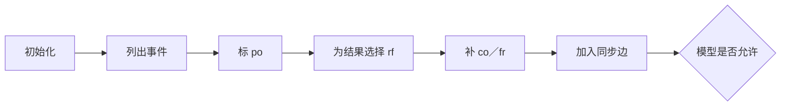
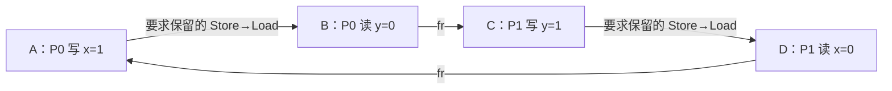

# 第6章\_Litmus\_Test\_并发交错推演

## 6.1\_Litmus\_Test\_不是普通压力测试

前几章已经手工追踪 MP、SB 和多参与者传播，现在要把“可能这样发生”变成对指定模型的可检查判断。本章先用 SC 做共同基线，再指出弱模型放松了哪些关系。所有类似 `P0: ...` 的片段都是线程事件伪代码，不是完整 C 程序，也不是可以直接交给 herd7 的文件格式；代码中的寄存器结果各归所属线程。

Litmus Test 把真实程序缩成少量参与者、共享位置和访问事件，再向内存模型询问某个结果是否允许：

```text
初始状态 + 每个参与者的事件 + 关注结果 + 目标内存模型
```

形式工具检查给定模型下的抽象执行。以 herd7 对 `exists` 条件的常见输出为例，`Sometimes` 表示部分候选合法结果满足条件，`Never` 表示没有合法结果满足，`Always` 表示全部合法结果都满足。具体输出要结合工具和条件类型阅读。它不依赖某个结果在当前机器上是否容易出现，也不需要靠随机调度碰运气。

压力测试回答“这台机器这次运行观察到了什么”；Litmus 模型回答“在给定模型中是否存在这种执行”。二者应互相校验，但不能互相替代。

## 6.2\_先固定读图规则

每个测试都按同一顺序分析：

1. 写出所有共享变量初始值；
2. 给每个 Load/Store 编号；
3. 标出每个参与者内部的程序顺序 `po`；
4. 为关注结果选择读取来源 `rf`；
5. 补上同址一致性 `co` 与由旧值读取推出的 `fr`；
6. 加入屏障、acquire/release、依赖或锁产生的顺序边；
7. 检查模型是否因环、传播或其他公理禁止该执行。



## 6.3\_MP\_消息传递

```c
/* 初始 data=0, flag=0。 */
P0: data=1; flag=1;
P1: r0=flag; r1=data;
```

关注 `r0=1 && r1=0`。在允许相应跨地址弱序的模型中，P1 可以从新 `flag` 写取值，同时从 `data` 的初始写取值；同址一致性没有被破坏。它不是“任何无屏障程序都允许”的结论，SC 例如会禁止它：`Wdata po→Wflag rf→Rflag po→Rdata fr→Wdata` 构成与 SC 总序矛盾的环。

加入“data 写 → release flag → acquire 读到 flag → data 读”后，关注结果被禁止。MP 用来回答： **发布点能否把此前初始化交给取得该发布的消费者。**

## 6.4\_SB\_Store\_Buffering

```c
/* 初始 x=0, y=0。 */
P0: x=1; r0=y;
P1: y=1; r1=x;
```

关注 `r0=0 && r1=0`。每个读取都从初始写取值，形成指向对方新写的 `fr` 关系。允许 Store→Load 绕行的模型可以接受相应结果；如果两边都加入该模型认可的全屏障，再假设仍读到 0/0，就会形成模型禁止的顺序环。

先不用工具，按 SC 的定义穷尽两条事件链。把 P0 的写与读命名为 A、B，把 P1 的写与读命名为 C、D，必须保留 `A→B` 和 `C→D`。四个事件只有以下六种交错；每次读都取全局排列中该地址最近的写。

| 全局交错 | B 读 y 得 r0 | D 读 x 得 r1 |
| --- | ---: | ---: |
| A B C D | 0 | 1 |
| A C B D | 1 | 1 |
| A C D B | 1 | 1 |
| C D A B | 1 | 0 |
| C A D B | 1 | 1 |
| C A B D | 1 | 1 |

六种情况没有 0/0，这就是一个完整的小型证明。若采用第三章的 Store Buffer 模型，程序事件 A、C 可以先进入本地队列，B、D 在它们对外提交前都读到 0；那是另一套事件与规则，不能把它塞进上表后说 SC 自相矛盾。



图在检查“坏结果假设加上所需约束”是否矛盾。增加屏障不是删除 `fr` 或改变读取已取到的值，而是让这一候选执行不再合法；实际运行必须选择别的结果。

SB 用来回答： **本地写尚未对外有序时，后续读取能否先取得另一个地址的旧值。**

## 6.5\_LB\_Load\_Buffering

```c
/* 初始 x=0, y=0。 */
P0: r0=x; y=1;
P1: r1=y; x=1;
```

关注 `r0=1 && r1=1`。SC 下，两条程序顺序与两条 `rf` 会构成环，因此禁止。若模型允许这里的独立 Load→Store 重排，则可以先使两个常量写生效，再完成两个读取，得到 1/1。常量 1 已明确写在程序中，这个测试不能直接等同于“凭空产生任意值”；若把写入值改为依赖前一读取，测试和模型约束都发生了变化。

LB 与 SB 的事件方向相反，不能因为代码布局相似就选择同一种屏障。

## 6.6\_IRIW\_独立写的独立读取

```c
/* 初始 x=0, y=0。 */
P0: x=1;
P1: r0=x; r1=y;
P2: y=1;
P3: r2=y; r3=x;
```

关注 `r0=1, r1=0, r2=1, r3=0`。按寄存器位置看，两个 reader 分别读到不同 writer 的新值和另一地址的旧值。这里既要检查读侧 Load→Load 顺序，也要检查传播；裸 IRIW 的结果不能单独证明非多副本原子，第四章已经给出提前读取也形成相同结果的时间线。

SC 下沿 `Wx rf→Rx po→Ry0 fr→Wy rf→Ry po→Rx0 fr→Wx` 得到禁环。在两个 reader 的两次 Load 之间加入足够强、且具有所需传播保证的屏障，可以在相应弱模型下排除这一结果；“足够强”必须由目标模型确认，不能把任意一个名为读屏障的原语都视为同等能力。

## 6.7\_WRC\_中继因果

```c
/* 初始 x=0, y=0。 */
P0: x=1;
P1: r0=x; y=1;
P2: r1=y; r2=x;
```

关注 `r0=1, r1=1, r2=0`。P1 已看到 CPU0 的新 x，又让 P2 看到新 y，但 P2 仍读取旧 x。WRC 用来检验中继同步是否具有累积传播能力。

只分析 P1 自己的 `r0 → y` 顺序不够，还要问 P1 是否把它从 P0 观察到的写一并带入向 P2 的顺序链。

## 6.8\_ISA2\_两段发布链

ISA2 是这里使用的测试家族名称，不是“第二版指令集”。它可理解为把消息传递再延长一跳；设 payload、flag1、flag2 初始均为 0：

```text
P0：写 payload=1，再写 flag1=1
P1：r0=flag1，再写 flag2=1
P2：r1=flag2，再读 r2=payload
关注：r0=1、r1=1、r2=0
```

先把它当成没有额外约束的事件形状，而不因“写 flag”就认定已具备 release。再逐段加入目标认可的发布、取得或依赖，检查关注结果是否被排除。它检验多段链能否传递所需保证；已有一次直接 MP 成功，不足以证明任意一组较弱排序操作都能安全接成长链。若每一段确实建立语言模型认可的同步关系，则还应使用该模型的传递性推理，不能凭空宣称 release/acquire 链不传递。

## 6.9\_六种模式的选择价值

| 模式 | 参与者结构 | 主要暴露的问题 |
| --- | --- | --- |
| MP | 一生产者一消费者 | 发布—取得是否交付初始化 |
| SB | 两边 Store→Load | 写缓冲与双向 Store→Load 排序 |
| LB | 两边 Load→Store | 推测、依赖和因果闭环 |
| IRIW | 两 writer 两 reader | 读侧排序与独立写传播的组合 |
| WRC | writer—中继—reader | 已观察写能否累积传播 |
| ISA2 | 两段发布链 | 多跳同步的传递性 |

这张表不是“看见代码形状就套模板”。真实算法可能同时包含多个模式，需要把关键事件抽出来分别检查。

## 6.10\_怎样从真实代码缩成\_Litmus

以队列发布为例：

```c
slot[index] = item;
producer_index = index + 1;
```

缩减步骤：

1. 只保留一个槽位 `data` 和一个发布索引 `flag`；
2. 把生产者写槽位映射为 Wdata，写索引映射为 Wflag；
3. 把消费者读索引映射为 Rflag，读槽位映射为 Rdata；
4. 把错误条件写成 `Rflag==new && Rdata==old`；
5. 分别测试无序、屏障、release/acquire 版本；
6. 再回到真实代码检查多写者、环回代际和生命周期是否引入新状态。

Litmus 只验证抽出的顺序核心，不会自动验证数组越界、ABA、对象释放或等待唤醒。

## 6.11\_允许结果和观测结果不可混淆

- `Sometimes` 表示模型中至少存在一种满足条件的执行，不表示硬件每次都会出现。
- `Never` 表示在该模型和测试表达范围内被禁止，不表示未建模的编译器撕裂、MMIO 或数据竞争也安全。
- 压力测试出现模型禁止结果，首先检查测试是否有 C 语言未定义行为、模型是否选错、编译器访问是否标记正确，以及目标硬件是否符合所声明架构。
- 压力测试长期未出现允许结果，不能把测试次数当成证明。

## 6.12\_配套实验

[Linux LKMM Litmus 实验](../../../../labs/kernel/memory_ordering/P02_LKMM_Litmus_消息传递与屏障/README.md)提供 MP、SB 和 IRIW 的成对测试：先运行无序版本确认坏结果在模型中 `Sometimes`，再加入 release/acquire 或全屏障确认相应结果变为 `Never`。实验还要求保留 `herd7` 版本、Linux 模型版本和完整输出。

## 6.13\_本章验收

检验上面的六种模式时，先遮住结论，从初始值重建一次坏结果的读取来源。SC 下本章列出的六个关注结果均被禁止，但理由中的环各不相同；弱模型会保留不同的边，因此不能把“SC 下有环”直接当成它们都不可能出现的硬件证明。再改变一个条件，例如只在 SB 一边加屏障、让 MP 的 acquire 读取旧标志，重新检查缺失的是哪条边，而不是复用原答案。

1. 能按初始化、事件、`po/rf/co/fr` 和同步边推演测试。
2. 能分别说出 MP、SB、LB、IRIW、WRC、ISA2 检验什么。
3. 能从真实发布代码缩出最小 MP 测试。
4. 能区分模型允许、硬件观察和程序正确性。
5. 能指出 Litmus 没有验证的生命周期、编译器和 I/O 边界。

上一篇：[屏障、Acquire/Release 与依赖顺序](P05_屏障_Acquire_Release与依赖顺序.md)。

下一篇：[反汇编、压力测试与形式化验证边界](P07_反汇编_压力测试与形式化验证边界.md)。
