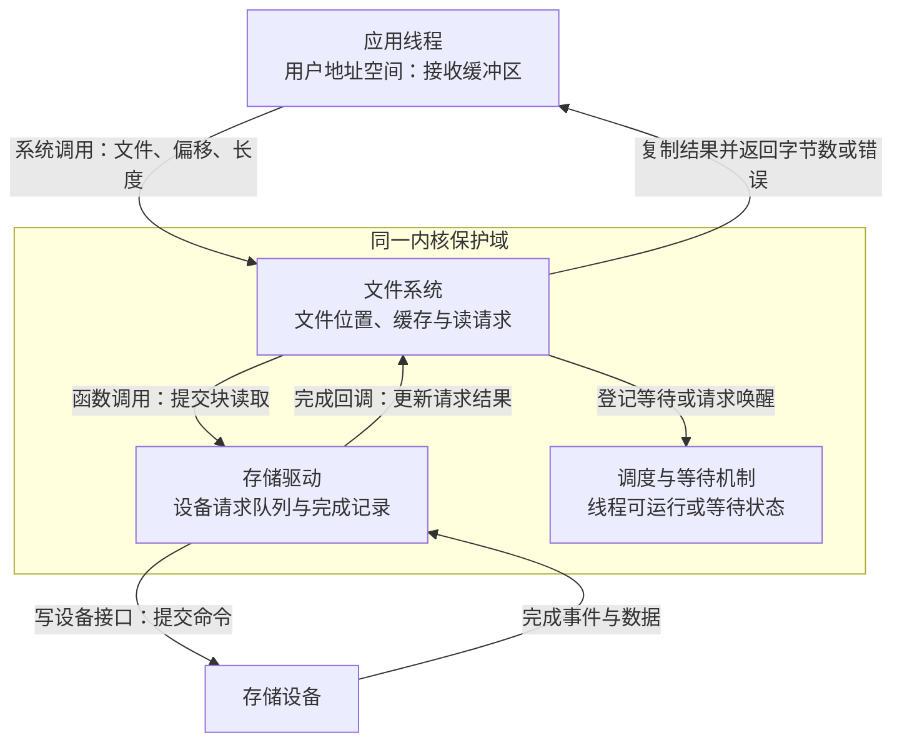
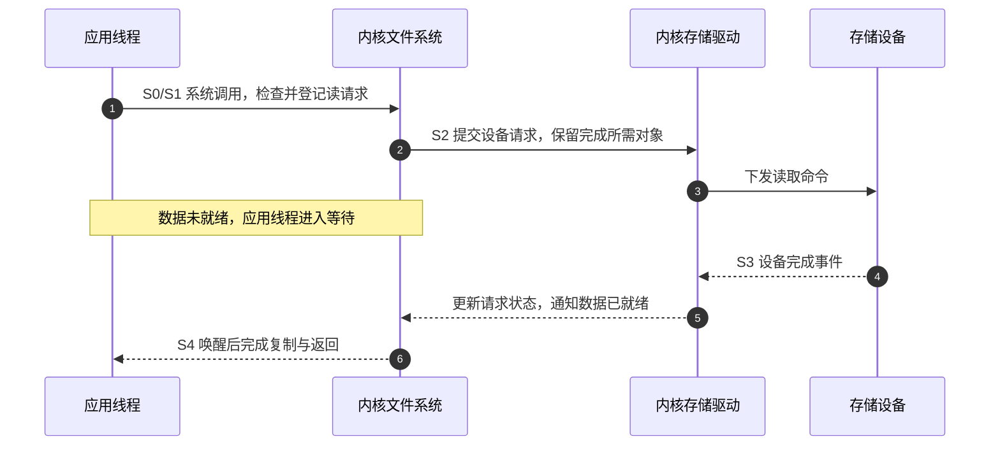
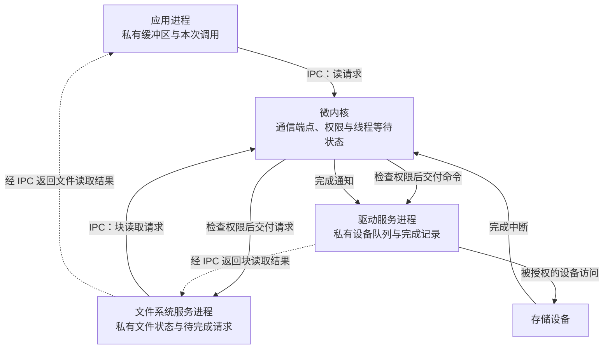
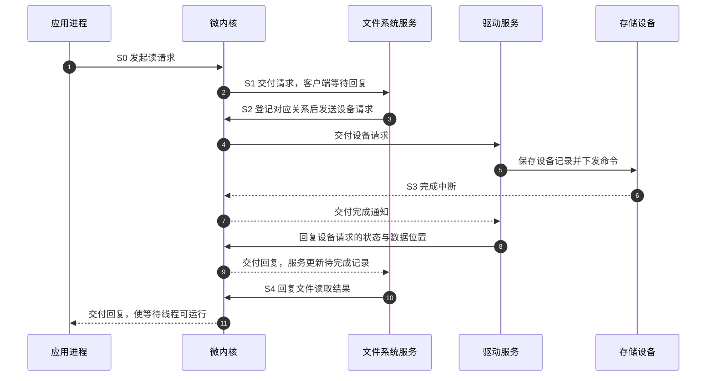
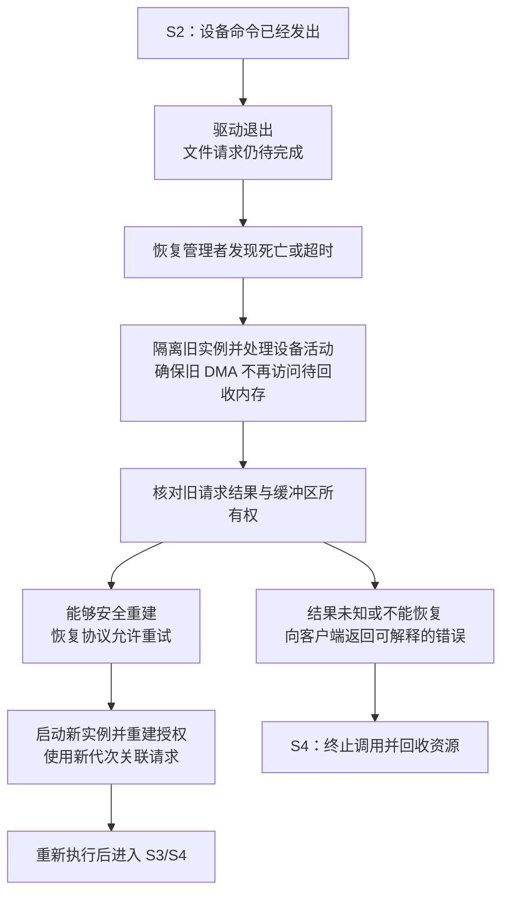

# 第1章\_宏内核和微内核

一个应用要从文件中读出 4 KiB 数据。它知道文件描述符和文件偏移，却不知道数据位于存储设备的哪个位置，也不应该任意修改设备控制寄存器。因此，需要文件系统解释文件、驱动操作设备，还需要有人决定谁有权访问这些资源。

这些工作应放在一个共同的特权环境中，还是分给几个受到保护的服务进程？这才是理解宏内核与微内核的起点。本篇沿同一次读取比较两种安排，再讨论故障恢复和实时性。先假定处理器支持特权级与内存保护；不把没有相应保护配置的单片机系统直接套进图中。

## 1.1\_先确定谁有权管理硬件

**讲解层次：概念层。** 本篇的读取流程是教学模型，方框表示软件角色与保护边界，不表示芯片里有几个物理处理器，也不是某个版本的完整函数调用图。

处理器在执行普通应用时，限制它能执行的特权操作和能访问的内存。操作系统的 **内核（kernel）** 在受控的特权环境中管理处理器时间、内存保护以及进入这些能力的接口。应用需要受保护的服务时，通过规定的入口提出请求，例如系统调用；内核检查参数和权限，再安排实际工作。

这里先分清两种变化。**从用户态进入内核态** 改变的是执行权限，执行者仍可能是原来那个线程；**线程切换** 则把处理器交给另一个可运行线程。一次系统调用不必然切换线程，但如果读操作需要等待设备，当前线程就可能阻塞，调度器让其他线程运行。把这两种变化都叫“上下文切换”，容易把后面的成本算错。

现在暂时将调度、文件系统、存储驱动安排在同一个内核保护域里：它们共享一套可访问的内核数据，能够通过函数接口协作。这种让许多核心服务在内核中执行的组织方式，就是 **宏内核（monolithic kernel）** 的基本特征。应用仍在受保护的用户空间，不能因为内核内部共享地址空间，就说应用与内核之间没有隔离。

这里的“大”指承担的职责范围，不按可执行文件多少字节判定。一个裁剪很小的内核，仍可能让驱动和调度器共享同一特权保护域；一个包含很多用户服务的系统，也可能只把较少机制放在内核中。

## 1.2\_把文件系统和驱动放在一起有什么价值

继续读取场景，并假设数据尚未进入缓存，确实需要设备 I/O。文件系统根据文件偏移找到对应数据块，驱动建立设备请求，设备完成后，再把结果交回等待者。宏内核可以让这些内核角色传递内核对象的引用，通过函数调用交接，不必为了每次文件系统到驱动的调用，先将调用参数封装成跨进程消息。

但“能直接调用”不等于“随意调用”。请求对象什么时候可以释放、设备完成回调是否与提交路径并发、哪个锁保护队列，这些协议仍然必须遵守。共享地址空间减少了一类通信边界，也使不同角色更容易影响同一份状态。

图中的队列和请求位于内核管理的内存，用户缓冲区位于应用地址空间。设备数据如何进入缓冲区，取决于具体驱动的传输方式；图没有宣称设备直接写入应用的任意地址。

为了后面能够公平比较，将这一次操作分成五个教学阶段：S0 提出请求，S1 接收并登记，S2 等待设备，S3 汇聚完成结果，S4 交回调用者。它们不是某个内核的枚举常量。

步骤 2 的函数调用不要求把驱动变成独立进程。步骤 4～6 则可能跨越中断处理、后续处理和被唤醒线程等不同执行上下文，不能读成原来的调用栈一直原地等到设备完成。图按职责汇总这些动作，具体驱动可以有更多层队列与回调。

这种安排适合已有成熟内核驱动和文件系统、需要紧密协作的系统。问题也随共享关系出现：假如驱动的错误指针写坏了文件系统请求，内存保护一般不会因为这两个函数属于不同源码目录就拦截它。错误可能造成请求丢失、数据损坏，甚至内核崩溃；是否立即崩溃取决于损坏位置，不能把“存在传播风险”写成“每个驱动错误都让整机崩溃”。

## 1.3\_为了限制故障传播为什么拆出服务进程

如果设备驱动更新频繁，而调度和内存保护必须尽量不受它的错误影响，单靠函数分层就不够了。我们希望驱动的普通内存写操作只能碰到授予它的区域。实现这一点，需要建立保护边界，而不是只把驱动编译成另一个文件。

于是把文件系统、驱动分别放进独立用户进程，让内核保留实施保护、调度和受控通信等基础机制。这是 **微内核（microkernel）** 的核心思路。它不要求所有产品采用完全相同的功能清单：物理内存分配策略、进程创建服务和设备管理策略等可以由内核外的服务承担；不能把“进程管理和内存管理全部都在微内核里”当作统一定义。

拆开之后，文件系统仍然需要驱动。现在它不能把自己的私有指针直接交给驱动，并假定对方能解引用：同一个虚拟地址在另一个进程中可能没有映射，也可能指向完全不同的对象。双方改为通过 **进程间通信（Inter-Process Communication，IPC）** 交换请求和结果；内核检查通信权限，按协议传递消息，必要时阻塞发送者或接收者。

下面选择“文件系统与驱动各是一个进程”的教学方案。实际系统可以合并部分服务，也可以进一步拆分；一个服务进程也可以有多个线程。

三个进程框各表示一个用户保护域，实线沿提交和设备完成的通知路径，虚线压缩了经过内核的回复路径。内核没有因为文件系统搬出去了就消失：它仍实施谁能访问谁、哪个线程等待哪次交接等规则。用户服务负责解释文件与设备协议，内核不必理解每一种文件系统的数据布局。

到这里，新的收益才有条件成立：驱动若尝试用 CPU 写未授权的内存，保护机制可以阻止该次访问，而不是让它直接破坏文件系统私有状态。代价是原来的直接调用变成了需要检查权限、传递参数和安排执行者的协议，服务的启动次序、请求编号和断连处理也必须设计。

## 1.4\_请求拆开以后状态放在哪里

两种设计都要回答“本次读到哪一步了”。区别是宏内核可在共同保护域内引用请求对象，微内核方案把相关状态分布在多个私有地址空间和内核通信对象中。**完整读取是由多组状态共同推进的操作周期**：应用线程等待状态、服务请求状态、设备请求状态不是同一个状态变量。

在教学方案中，让文件系统为每次请求分配一个编号，并将“应用调用 ↔ 文件请求 ↔ 设备请求”的对应关系写入自己的待完成表；驱动也保存自己的设备请求记录。下面的名称描述这些记录的职责，不冒充 Linux、QNX 或 seL4 的真实结构体字段。

| 阶段与进入条件 | 宏内核方案中的状态落点 | 拆为服务进程后的状态落点 | 谁推进，以及何时可以退出本阶段 |
| --- | --- | --- | --- |
| S0：应用提出读取 | 应用参数经系统调用检查；内核建立读请求 | 消息携带文件标识、偏移、长度；内核检查通信权限 | 应用发起；请求被接收后才进入 S1 |
| S1：请求被接收 | 文件系统维护内核读请求，确定需要哪些块 | 文件系统在自己的内存中登记请求编号和对应客户端 | 文件系统生成设备请求，不能把“已接收”当作“数据就绪” |
| S2：命令已提交 | 驱动队列保存设备请求；线程等待状态在内核 | 驱动私有队列保存设备请求；内核保存 IPC 等待状态；文件系统保留待完成记录 | 驱动下发命令；设备完成或错误被处理后进入 S3 |
| S3：设备给出结果 | 驱动写完成状态，通过回调等方式让文件系统观察 | 驱动写自己的记录，再发送回复；文件系统按编号更新自己的记录 | 文件系统确认本次读取所需结果齐全，才能给客户端最终结果 |
| S4：调用结束 | 内核使等待线程可运行，在适当上下文完成复制与返回 | 回复经通信机制交给应用，等待线程变为可运行；数据按约定交付 | 应用实际得到调度后才能继续；双方按协议回收请求与缓冲区 |

这张表不意味着每次读取只有一个块请求。如果文件数据分散，需要多个设备请求，S3 就包含汇聚：收到其中一个完成，只能更新部分结果。即便单个请求也一样，“驱动已经发出回复”与“应用已经运行到下一条语句”是不同事件。

步骤 3 之前先保存对应关系，是为了步骤 9 能找到正确的文件请求。步骤 6 是设备完成通知，不等于文件系统已经处理结果；步骤 11 也不承诺应用立即占有 CPU。服务线程可以处理多个客户端，图中的“等待”针对相应请求，不要求整项服务停止接收其他工作。

数据本身还需要单独安排。若每层都复制 4 KiB，传输成本会随数据量增加；若授予服务访问共享缓冲区的权限，可以减少复制，但必须规定哪个阶段谁可读写、何时归还，以及故障后谁撤销访问。**少复制是把成本换成映射、授权和生命周期管理，不是取消通信。** 发送一个“完成”消息，也不能替代共享数据可见性所要求的同步。

实现对照可看 [seL4 的 IPC 教程](https://docs.sel4.systems/Tutorials/ipc)：它介绍通信端点、发送/接收、调用与回复，并区分小消息的传递及快速路径条件。这证明 IPC 有具体的内核机制和适用条件；本篇的文件系统、请求表以及缓冲区协议仍是需要在其上设计的服务逻辑，不能从一次 IPC 成功推出整个文件读取正确。

## 1.5\_服务能单独重启为什么仍不等于系统无故障

假定驱动在 S2 下发命令以后退出。文件系统没有被它的 CPU 越界写直接破坏，并不意味着这次读取可以照常完成。文件系统的待完成表仍保存着请求，应用仍可能等回复，设备也可能继续执行旧命令。

恢复管理者首先需要发现服务死亡或超时，再停止旧服务继续影响设备，处理尚未完成的请求和缓冲区，最后才能启动新实例并重建通信。新实例需要区分旧请求和新请求，例如使用服务实例代次与请求编号；否则迟到的旧完成可能被错误地算到新请求上。这是一种恢复协议设计，不是所有微内核自动提供的能力。

为什么图中要单独处理设备活动？**直接内存访问（Direct Memory Access，DMA）** 是设备发起的内存访问，不经过驱动线程的普通 CPU 访存检查。把驱动放进用户进程，并不能凭空限制设备 DMA。需要相应的 I/O 内存管理单元（IOMMU）和正确配置的映射，或其他能够实际限制设备访问的受信机制。Linux 的 [VFIO 文档](https://www.kernel.org/doc/html/v6.12/driver-api/vfio.html) 就把 DMA 隔离与设备、互连的实际隔离粒度分别说明；这也是任何用户态驱动设计需要核对的硬件边界。

超时同样只证明“还没有按约定收到结果”，不证明设备什么也没做。对读取而言，重试还要考虑数据是否已变化；若将场景改成写入或扣减计数，盲目重试甚至可能重复产生副作用。因此恢复能力必须连同请求语义一起设计。

[MINIX 3 的可靠性说明](https://wiki.minix3.org/doku.php?id=www:documentation:reliability) 给出隔离驱动、限制通信与访问权限、由恢复服务替换失效驱动的具体思路。该页面最后修改于 2014 年，并明确记录了当时磁盘驱动恢复的限制；不能把它推广为所有版本、所有服务都能透明恢复。

## 1.6\_回到实际系统怎样判断这些边界

**讲解层次：概念到实现的映射。** 前面的图用来推导保护边界，不要求每个系统照抄同一组进程。检查实际实现时，应看代码运行权限、状态地址空间和通信方式，再使用架构名称。

Linux 的核心调度、内存管理以及大量文件系统和驱动在内核中协作，因此通常称为模块化宏内核。**模块化** 描述代码组织和装载方式，**保护域** 描述运行时访问边界。一个 `.ko` 模块即使单独构建、按需加载，进入内核后也没有自动获得独立用户地址空间。模块能否构建、装载和卸载受内核配置、接口匹配及在用资源等条件约束，不能把所有功能都说成随时可卸载。[Linux 6.12 外部模块构建文档](https://www.kernel.org/doc/html/v6.12/kbuild/modules.html) 明确要求匹配的内核构建信息与模块支持。

另一方面，Linux 并不要求所有操作系统服务都在内核里。**FUSE** 提供内核与用户态文件系统服务之间的协作框架，文件内容与元数据可由普通用户进程提供；内核侧仍负责把相应请求交给服务并接收结果。它说明宏内核系统也可以为某项功能选择用户服务边界，而不是把整个系统变成另一种架构。[Linux 6.12 FUSE 文档](https://www.kernel.org/doc/html/v6.12/filesystems/fuse.html) 还讨论服务失去响应、请求中断和连接终止，正对应前面的等待与失败问题。

访问控制策略也要与地址空间分开。规定“进程能打开哪些文件”，不等于将一个内核驱动的私有数据放进单独保护域。因此不能只凭有安全模块、动态模块或用户空间隔离，就断言 Linux 的这些机制来自微内核，或者断言它们拥有相同的故障隔离保证。

| 实际对象 | 当前能确认的组织方式 | 不能据此推出什么 |
| --- | --- | --- |
| Linux 内核模块与 FUSE | 同一系统可以同时使用内核模块和用户态文件系统服务 | 动态装载不等于独立保护域；有用户服务不等于全部服务都在用户态 |
| QNX OS 8.0 | 官方说明以微内核和多个协作进程组成系统，消息传递是主要 IPC 形式 | 不能把本篇三个进程的教学划分当作每套 QNX 产品的部署图 |
| seL4 | 提供微内核机制，包括受控 IPC；完整应用系统还要配置资源并实现服务 | 微内核本身不等于一个现成的通用桌面系统，也不自动实现本文的文件恢复协议 |
| MINIX 3 | 通过服务隔离与恢复管理限制部分故障传播 | 不能承诺任意驱动、任意请求都能无损恢复 |
| Windows | 官方组件图区分用户态与内核态组件，内核驱动调用内核管理器接口 | 不能仅用一个“宏”或“微”标签代替具体组件的运行边界分析 |

表中 QNX 的依据是 [8.0 架构与概念](https://www.qnx.com/developers/docs/8.0/com.qnx.doc.neutrino.prog/topic/overview.html)，Windows 的依据是 [官方组件概览](https://learn.microsoft.com/en-us/windows-hardware/drivers/kernel/overview-of-windows-components)。Mach、L4 等名称出现在相关架构讨论中时，还要继续确认具体实现和版本；不能把同一家族的所有系统都画成一张固定布局图。

## 1.7\_性能与实时性应沿哪条路径判断

先回到同一次读取比较成本。宏内核方案在文件系统与驱动之间可以直接调用，微内核教学方案增加了跨保护域通信。后者可能涉及权限检查、消息传递、线程调度和地址空间相关状态切换；如果请求很小、非常频繁，这些动作在总耗时中的占比会增加。批量请求、短消息快速路径和共享缓冲区可以减少其中部分开销，也各有适用条件。

如果主要时间花在慢速存储设备上，额外通信占比可能很小；如果缓存命中、设备根本不用访问，通信路径的相对成本就可能变得显著。反过来，宏内核也可能受共享锁、队列等待或缓存局部性影响。没有相同工作负载、硬件与实现测量，不能直接填一张“宏内核一定快、微内核一定慢”的表。

**实时操作系统（Real-Time Operating System，RTOS）** 关注的是任务能否在规定截止时间内完成。它与服务放在哪个保护域，是两个维度。假如设备事件必须在 1 ms 内处理完，至少需要核算：事件到处理线程可运行的延迟、等待 CPU 的时间、服务排队时间、实际处理时间，以及依赖其他服务或设备的等待。平均耗时低于 1 ms，不能证明最坏情况下也满足截止时间。

例如高优先级客户端等待低优先级服务，而中优先级任务不断占用 CPU，客户端自己的优先级再高也不能让依赖的服务自动完成。系统需要相应的优先级传播、资源协议或时间预算管理，并验证这些机制覆盖了真正的等待链。直接内核调用也会遇到共享资源阻塞，所以没有一种保护域安排可以代替调度与最坏情况分析。

QNX 同时采用微内核组织并面向实时系统，说明二者可以结合；不能反推出所有微内核都有截止时间保证。FreeRTOS、VxWorks、RTEMS 等名称也不能单凭“RTOS”三个字判断地址空间布局。具体端口是否使用内存保护、服务怎样组织、应用是否满足时间预算，都应分别核对；内核体积小同样不是判据。

有了这些因果关系，才可以按项目约束选择：

| 项目约束 | 应优先核对的条件与代价 |
| --- | --- |
| 依赖成熟 Linux 驱动与文件系统，服务之间需要紧密共享状态 | 模块化宏内核是自然选择；同时承担内核代码可信度、共享状态同步和故障传播风险 |
| 必须限制某类服务的内存破坏范围，且需要独立替换服务 | 研究进程隔离与受控 IPC；同时实现授权、缓冲区归属、服务失效和恢复协议 |
| 高频短请求，性能预算很紧 | 对实际调用链测量；比较直接调用、IPC 快速路径、批处理和共享缓冲区，不能只按架构名称选 |
| 有硬截止时间 | 验证整条依赖链的最坏等待和执行时间；无论采用何种内核组织，都需要明确负载与资源上界 |
| 要移植到另一硬件平台 | 分别检查处理器相关内核代码、驱动、启动链和用户服务；内核较小不等于整个系统移植工作少 |

## 1.8\_用三个反例检查自己的判断

先不看答案，沿前面的状态与保护边界判断下面三种说法。

1. 驱动编译成 `.ko`，没有与内核一起静态链接，所以它的越界写不会影响内核其他对象。
2. 文件系统服务通过 IPC 收到了“设备请求已接收”，所以可以释放数据缓冲区并向应用返回成功。
3. 服务超时后可以重启，因此只要再发一遍原请求，就能保证应用看不出故障。

**第一题：错误。** 编译和装载单元不等于保护域。普通 Linux 内核模块在内核环境运行，错误写入可能波及其他内核状态；判断隔离需要看运行权限与内存映射。

**第二题：错误。** “已接收”只推进到 S1 或 S2，设备完成、结果汇聚和客户端交付还未成立。缓冲区可能仍由设备或驱动使用，提前释放会破坏生命周期协议。必须以本接口明确规定的完成条件为准。

**第三题：不成立。** 超时没有确定旧请求是否执行，重启也不会自动清除旧设备活动。应先核对操作能否安全重试、旧实例是否已经失去访问权限，以及请求与结果如何区分。能阻止一次越界写、能恢复一个服务、能无损恢复完整业务，是三个不同层次的结论。

读到这里，应能从一次请求追出代码运行在哪里、状态归谁、怎样交接以及失败会影响谁。继续阅读 Linux 的系统调用、进程调度与驱动时，可沿 [Linux 内核学习路线](../../../../atlas/tracks/linux_kernel_track.md) 进入具体机制，再用版本化源码确认实际对象；本篇的教学角色不能直接当作源码结构体名称。
