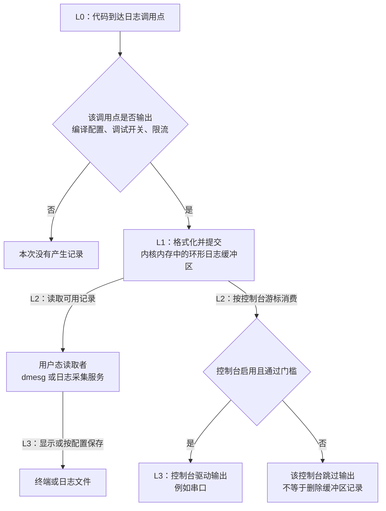
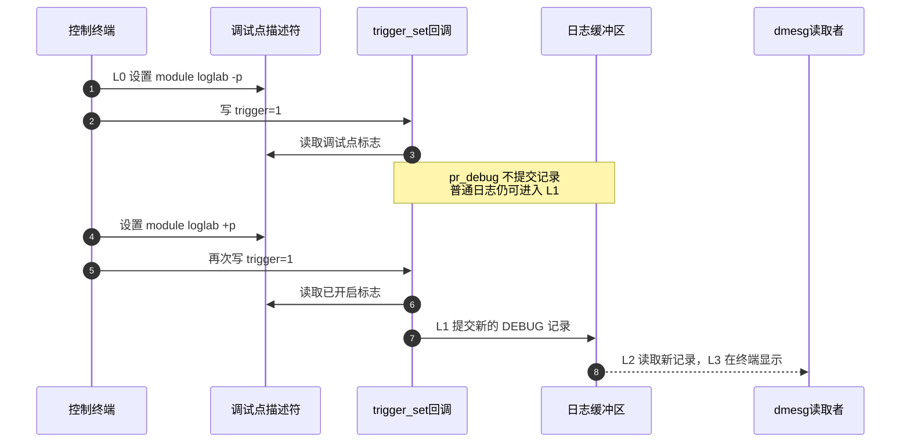

# 第1章\_Linux\_内核日志

驱动执行到了错误分支，串口却一行也没显示。此时不能直接判断分支没有执行：调用点可能根本没有生成输出代码，调试开关可能关闭，消息可能已经保存但没有通过控制台门槛，也可能早已被后来的日志覆盖。

本章把一条日志从产生到被观察的过程拆开，再用一个可以反复触发的模块验证这些边界。接口以 Linux 6.12 系列为准，源码核对固定在 NXP Linux 6.12.20 发布提交 `dfaf2136deb2af2e60b994421281ba42f1c087e0`；不能把旧版本的创建接口、调试标志或打印路径混成同一套实验。

## 1.1\_先分清记录产生与控制台输出

**讲解层次：概念到实现的映射。** `printk()` 是内核的格式化消息接口；`pr_info()`、`pr_err()` 等宏替调用者选择级别，设备日志 `dev_info()`、`dev_err()` 还带上设备身份。它们不是用户态的 `printf()`，也不直接等同于“往当前终端写一行”。

先把正常路径分成四个阶段：L0 调用点决定是否输出，L1 格式化并提交内核记录，L2 不同读取者消费记录，L3 用户或存储端实际得到结果。调用点的动态调试和限流判断发生在前面，控制台等级过滤发生在后面，两者不能互相替代。



**环形缓冲区（ring buffer）** 位于内核内存，容量有限。生产者提交带级别、时间等信息的记录，读取者按自己的进度读取；旧记录可以被新记录覆盖，所以它不是永久档案。`dmesg` 通常读取内核日志；`journalctl -k` 查询的是 journal 中的内核消息，依赖日志服务已经采集到它们，是否落盘又由服务配置决定。

控制台是串口、显示终端等注册到内核的输出设备。它与 `dmesg` 是不同的观察路径。一个 SSH 窗口里启动 `dmesg -w`，是在读取日志，不会让这个窗口自动成为内核控制台。

| 阶段 | 状态存在哪里、由谁改变 | 下一步怎样得知 | 不能据此证明什么 |
| --- | --- | --- | --- |
| L0：调用点筛选 | 编译后的调用点、动态调试描述符或局部限流状态；控制命令和调用路径分别修改它们 | 调用点读取对应条件，决定是否调用记录路径 | 代码经过宏，不等于已经产生消息 |
| L1：记录提交 | 内核环形缓冲区的记录正文、元信息及提交状态；打印路径写入 | 消费者读取已提交记录，等待者按对应路径被唤醒 | 提交不等于串口已经发送完 |
| L2：消费记录 | 用户读取者的读取进度与各控制台进度；消费者推进自己的位置 | 读取返回、控制台输出或后续调度 | 一个消费者读过，不证明另一个消费者也看到 |
| L3：显示或保存 | 终端输出和用户态日志文件；终端、采集服务及存储系统处理 | 用户观察输出，或检查相应文件 | 屏幕显示不等于持久化；没有显示也不等于 L0 未执行 |

这里没有把记录、控制台游标和用户态日志文件当成一个状态机。它们分别推进，覆盖、权限、配置和调度都可能使观察结果不同。具体源码角色与本章阶段的对应见 [日志路径源码阅读索引](../../../../research/source_reading/printk/navigation/P01_Linux_6.12_日志路径源码阅读索引.md#1.2_L0到L3分别由谁推进)。

## 1.2\_等级数字越小为什么越容易显示

严重消息的数字更小。普通控制台过滤的判断是 **消息级别数值 < `console_loglevel`**，不是大于，也不是小于等于。例如门槛为 7 时，INFO 的 6 可以通过，DEBUG 的 7 不通过；要包含 DEBUG，门槛应为 8。

| 级别前缀 | 数值 | 常用宏 | 当前事件含义 |
| --- | --- | --- | --- |
| `KERN_EMERG` | 0 | `pr_emerg()` | 系统不可用等级的紧急事件 |
| `KERN_ALERT` | 1 | `pr_alert()` | 需要立即处理 |
| `KERN_CRIT` | 2 | `pr_crit()` | 严重条件 |
| `KERN_ERR` | 3 | `pr_err()` | 错误 |
| `KERN_WARNING` | 4 | `pr_warn()` | 警告 |
| `KERN_NOTICE` | 5 | `pr_notice()` | 正常但值得注意 |
| `KERN_INFO` | 6 | `pr_info()` | 一般信息 |
| `KERN_DEBUG` | 7 | `pr_debug()` | 调试信息；该宏还受前置开关控制 |

`printk(KERN_INFO "ready\n")` 中，级别宏是与格式串相邻的前缀，不是一个单独整数参数。省略级别时使用默认消息级别。设置 ERROR 等级不会替你返回错误码，设置 EMERG 也不会自动调用 `panic()`；日志描述事件，程序仍须实现实际控制流。

```bash
# Linux 实验机：只读查看当前四项设置。
cat /proc/sys/kernel/printk
```

四项依次为当前控制台门槛、未显式指定时的默认消息级别、最小控制台门槛、默认控制台门槛。不要为了显示 DEBUG，把四项全部随意改掉。下面只调整第一项，并在同一个 shell 中保存原值：

```bash
# Linux 实验机：记录原门槛，只让后续控制台打印包含 DEBUG。
old_console_level=$(awk '{print $1}' /proc/sys/kernel/printk)
sudo dmesg -n 8
```

这不重新生成 L0 被抑制的消息，也不保证控制台重放已经跳过的历史记录。实验后用 `sudo dmesg -n "$old_console_level"` 恢复。只看 `dmesg` 时通常不必调整控制台门槛；`ignore_loglevel`、panic 等特殊路径还会改变普通过滤行为。规则与例子可对照 [Linux 6.12 printk 基础说明](https://www.kernel.org/doc/html/v6.12/core-api/printk-basics.html)，本文实验使用普通运行路径。

## 1.3\_先做一个可以反复触发的日志入口

只在模块初始化中写一次 `pr_debug()`，加载以后才打开开关，会错过唯一一次调用。这里把输出放在一个可写模块参数的回调里：加载只建立设备身份，写入参数才产生本轮日志。这样可以保持同一个模块实例，先关闭、再开启调试点，然后比较两次触发。

实验面向可加载自己构建模块的 Linux 测试机。需要 `CONFIG_MODULES=y`、`CONFIG_PRINTK=y`、与正在运行内核匹配的构建目录，以及允许装载该模块的系统策略。后面的动态开关实验还要求对应调试点已经接入动态调试。Windows 宿主不能执行这些内核步骤；本仓库已做 ARM 语法分支检查，没有将其记作模块装载或运行验证。

创建空目录 `loglab`，将下面两份文件保存在其中。配套副本为 [loglab.c](../../../../labs/kernel/logging/materials/loglab.c) 与 [Makefile](../../../../labs/kernel/logging/materials/Makefile)，正文展示完整内容，不需要从别处拼片段。

`pr_fmt` 必须写在头文件之前，使后续宏使用这个前缀。程序用根设备注册接口取得一个有效 `struct device`；它只提供日志身份，不操作硬件，也不创建可读写的 `/dev/loglab`。

```c
// SPDX-License-Identifier: GPL-2.0-only
#define pr_fmt(fmt) KBUILD_MODNAME ": " fmt

#include <linux/device.h>
#include <linux/err.h>
#include <linux/init.h>
#include <linux/kstrtox.h>
#include <linux/module.h>
#include <linux/moduleparam.h>
#include <linux/mutex.h>
#include <linux/printk.h>

static struct device *loglab_dev;
static DEFINE_MUTEX(loglab_lock);

static int trigger_set(const char *value, const struct kernel_param *parameter)
{
    static const u8 sample[] = {0xde, 0xad, 0xbe, 0xef, 0, 1, 2, 3};
    unsigned int count, index;
    int result;

    /* 只接受有限次数，避免把教学触发器变成无限刷屏入口。 */
    (void)parameter;
    result = kstrtouint(value, 0, &count);
    if (result)
        return result;
    if (count < 1 || count > 32)
        return -EINVAL;

    /* 串行化演示，并与退出时的设备撤销互斥。 */
    mutex_lock(&loglab_lock);
    if (!loglab_dev) {
        result = -ENODEV;
        goto out;
    }
    pr_info("trigger count=%u\n", count);
    printk(KERN_DEBUG "loglab: direct debug\n");
    dev_info(loglab_dev, "device trigger\n");
    for (index = 0; index < count; ++index) {
        pr_debug("debug index=%u\n", index);
        dev_dbg(loglab_dev, "device debug index=%u\n", index);
        pr_warn_once("once at this callsite\n");
        pr_info_ratelimited("limited index=%u\n", index);
    }
    /* 直接转储不由动态调试开关控制，仍带 DEBUG 级别。 */
    print_hex_dump(KERN_DEBUG, "loglab dump: ", DUMP_PREFIX_OFFSET,
                   16, 1, sample, sizeof(sample), true);
    result = 0;
out:
    mutex_unlock(&loglab_lock);
    return result;
}

static const struct kernel_param_ops trigger_ops = {
    .set = trigger_set,
};
module_param_cb(trigger, &trigger_ops, NULL, 0200);
MODULE_PARM_DESC(trigger, "写入1到32触发日志，模块加载后使用");

static int __init loglab_init(void)
{
    struct device *device;

    /* 根设备仅承载日志身份，不申请硬件，也不创建字符设备接口。 */
    device = root_device_register("loglab");
    if (IS_ERR(device))
        return PTR_ERR(device);
    mutex_lock(&loglab_lock);
    loglab_dev = device;
    mutex_unlock(&loglab_lock);
    pr_info("ready; write the trigger parameter\n");
    return 0;
}

static void __exit loglab_exit(void)
{
    mutex_lock(&loglab_lock);
    root_device_unregister(loglab_dev);
    loglab_dev = NULL;
    mutex_unlock(&loglab_lock);
    pr_info("exit\n");
}

module_init(loglab_init);
module_exit(loglab_exit);
MODULE_LICENSE("GPL");
MODULE_DESCRIPTION("可重复触发的内核日志教学模块");
```

`trigger_set()` 先解析 1～32 的次数，再持有互斥锁检查设备仍然存在。循环中的 `once` 调用点保持同一份状态，限流调用点也跨触发保留自己的状态；卸载撤销设备时与回调使用同一把锁。若在模块加载参数中提前写 `trigger=...`，初始化尚未建立设备，会返回 `-ENODEV`，所以本实验只在加载成功后通过 sysfs 触发。

Makefile 中 `kdir` 是本实验的构建目录变量，默认指向当前运行内核；`M=` 告诉 Kbuild 外部模块源码目录在哪里。两条配方的开头使用制表符。

```makefile
obj-m += loglab.o
kdir ?= /lib/modules/$(shell uname -r)/build
module_dir := $(CURDIR)

.PHONY: all clean
all:
	$(MAKE) -C $(kdir) M=$(module_dir) modules

clean:
	$(MAKE) -C $(kdir) M=$(module_dir) clean
```

```bash
# Linux 测试机，loglab 目录：使用匹配当前运行内核的构建目录。
make
```

成功时得到 `loglab.ko`。交叉编译时需要完整匹配目标内核的构建输出和 `ARCH`、`CROSS_COMPILE`，不能用宿主 `uname -r` 推断目标配置。本章不把一次编译成功当成签名、版本及装载条件全部成立。

先在终端 A 开始观察，再在终端 B 加载和触发：

```bash
# 终端 A，Linux 测试机：读取内核日志并跟随新记录。
sudo dmesg -w
```

它可能先显示缓冲区中已有的日志，再等待新记录。使用 `sudo` 是为了满足常见的日志读取权限要求；若仍被系统策略拒绝，应先解决读取权限，不能通过调高控制台门槛修复。

```bash
# 终端 B，loglab 目录：建立模块与设备身份，然后触发一次。
sudo insmod ./loglab.ko
printf '1\n' | sudo tee /sys/module/loglab/parameters/trigger
```

`tee` 回显的 `1` 只是用户态工具输出。终端 A 应寻找 `loglab: trigger count=1`、`loglab: direct debug`、设备身份开头的 `device trigger`、一次性提示、限流消息和八字节转储。`pr_debug` 与 `dev_dbg` 是否出现，取决于下一节的配置与开关。直接 `printk(KERN_DEBUG ...)` 与 `print_hex_dump(KERN_DEBUG, ...)` 没有使用这两个动态调试调用点，不能因为同为 DEBUG 级别就认为开关完全相同。

## 1.4\_让调试点开启以后再走一次路径

**动态调试（dynamic debug）** 给已登记的调用点保存可改变的输出标志。控制文件中的一行对应一个调用点，不是日志缓冲区中的一条历史消息。改变标志影响下一次调用，不把过去被跳过的参数重新计算一遍。

| 编译条件 | 普通 `pr_debug()` / `dev_dbg()` 的行为 |
| --- | --- |
| `CONFIG_DYNAMIC_DEBUG=y` | 接入动态调试，按调用点标志决定是否输出 |
| 只有 `CONFIG_DYNAMIC_DEBUG_CORE=y`，并对该编译单元定义 `DYNAMIC_DEBUG_MODULE` | 选择性接入动态调试；仅打开 CORE 并不会自动登记所有模块 |
| 没有接入动态调试，但定义了 `DEBUG` | 生成 DEBUG 级别输出 |
| 两者都没有 | 不产生这条调试记录；保留相应编译检查并不等于执行输出 |

`DEBUG` 也应在包含相关头文件以前定义，或作为相应编译单元的编译选项。动态调试分支下它还可能影响初始标志；本实验源文件没有定义它，因此先查询实际调用点状态，不把“默认关闭”强加给任何发行版配置。

```bash
# 终端 B：在已加载 loglab 的测试内核中选择实际存在的控制文件。
if test -e /proc/dynamic_debug/control; then
    control_file=/proc/dynamic_debug/control
elif test -e /sys/kernel/debug/dynamic_debug/control; then
    control_file=/sys/kernel/debug/dynamic_debug/control
else
    printf '没有可用的动态调试控制文件，请先核对内核配置和挂载。\n'
fi
```

只有找到了文件才继续使用 `control_file`。若内核支持 debugfs 而该文件系统尚未挂载，可按实验机挂载策略将 debugfs 挂到 `/sys/kernel/debug`；不能仅看到目录存在就反复执行 mount，也不能把挂载操作当成编译打开了动态调试。

```bash
# 终端 B：查询本模块的两个调试调用点。
sudo grep '\[loglab\]' "$control_file"
```

记录包含源码位置、模块、函数、标志和格式串。若没有本模块条目，先核对模块是否成功加载以及上述配置组合，不要直接向全系统下发无选择条件的 `+p`。

```bash
# 终端 B：先关闭再触发，随后打开并重新触发。
printf 'module loglab -p\n' | sudo tee "$control_file"
printf '1\n' | sudo tee /sys/module/loglab/parameters/trigger
printf 'module loglab +p\n' | sudo tee "$control_file"
printf '1\n' | sudo tee /sys/module/loglab/parameters/trigger
```

第二次触发才应该新增 `debug index=0` 与 `device debug index=0`。两次都有的 direct debug 说明“消息级别”与“调用点开关”确实是两个条件。没有重走回调，单独开启 `+p` 不会凭空补出这两行。



步骤 4 只改变未来调用的条件，步骤 5 才重新执行。步骤 7 与步骤 8 分离，正是“记录产生”与“观察结果”的区别；图没有要求当前写参数的线程同步完成所有控制台输出。

更细的选择条件和标志如下。多种选择条件叠加时要求同时匹配，具体格式串、函数名和源码位置以控制文件中的条目为准。

| 选择或标志 | 含义 | 本实验例子 |
| --- | --- | --- |
| `module` / `func` | 模块名或函数名 | `module loglab func trigger_set +p` |
| `file` / `line` | 按支持的文件名模式、行号或范围选择 | 先读取条目，再填写实际文件与行号，避免沿用改写前行号 |
| `format` | 匹配格式串子串 | `module loglab format "debug index" +p` |
| `+p` / `-p` | 开启或关闭输出 | 只修改打印标志 |
| `+f` / `+s` / `+l` | 增加函数名、源文件名、行号 | `module loglab +pfsl` |
| `+m` / `+t` | 增加模块名、线程 ID 或中断标识 | `module loglab +pmt` |
| `=_` | 清除全部标志 | `module loglab =_` |

这里 `t` 不是时间戳，不存在旧笔记中的通用 `+F`、`+T` 选项。带 dynamic debug 的十六进制转储只使用 `p` 标志。需要模块初始化期间的动态日志时，还可在已接入的模块加载时使用 `sudo insmod ./loglab.ko dyndbg=+p`；这使开关在初始化调用前生效，本实验仍通过 trigger 比较重复调用。完整语法依据 [Linux 6.12 动态调试说明](https://www.kernel.org/doc/html/v6.12/admin-guide/dynamic-debug-howto.html)。

## 1.5\_设备前缀回答的是哪个对象

现在再看 `pr_info` 与 `dev_info` 的差别。前者可以通过 `pr_fmt` 带上编译模块名，回答“哪个模块说的”；同一模块可能驱动多个设备，所以设备路径中的日志还需要一个有效 `struct device *`，回答“哪个设备发生了这件事”。

实验的 `KBUILD_MODNAME` 由 Kbuild 提供，对应 `loglab` 模块目标。多源文件组成一个模块时，各源文件可以共享模块名；需要区分源文件时，可使用相应的 `KBUILD_BASENAME` 或明确的自定义前缀。不要把这些构建时提供的名字误当作运行期设备名称。

设备日志通常根据驱动或总线信息与设备名称构造前缀，具体形式取决于设备身份。`dev_*` 使用自己的 `dev_fmt` 约定，不能把它们一概展开成带 `pr_fmt` 的调用。实验根设备没有真实总线实例，所以不要拿它的输出前缀当作 platform、PCI 或 I²C 的固定格式。

| 已在当前驱动中持有的对象 | 日志使用的设备指针 | 边界 |
| --- | --- | --- |
| `struct platform_device *pdev` | `&pdev->dev` | 指针必须在当前执行路径仍然有效 |
| `struct i2c_client *client` | `&client->dev` | 日志不替代客户端生命周期管理 |
| `struct spi_device *spi` | `&spi->dev` | 同上 |
| `struct pci_dev *pdev` | `&pdev->dev` | 设备名通常能帮助区分实例 |
| 成功的 `device_create()` 返回值 | 返回的 `struct device *` | 先检查错误指针，不能把失败返回值交给日志宏 |
| `struct net_device *ndev` | 使用 `netdev_info/err/warn/dbg` 等 | 网络接口专用宏带上网络设备上下文 |

`dev_err_probe(dev, err, ...)` 适合 probe 失败返回路径：它返回传入的错误码，对 `-EPROBE_DEFER` 使用调试日志并记录延迟原因；本次固定版本对 `-ENOMEM` 不再输出，其他错误走错误日志。它不是所有错误的自动限流器。日志参数也必须保持有效，例如将裸指针塞进 `file->private_data` 并不能自动阻止设备被释放。

本章不用 `class_create()` 建类只为打印，避免把字符设备注册流程变成日志前提。若阅读其他 Linux 6.12 示例，该版本 `class_create()` 的调用签名已经不接受旧的 `THIS_MODULE` 参数，不能直接照抄旧版两参数代码。

## 1.6\_控制输出量为什么要保留调用点状态

如果错误在每个数据包上重复发生，日志量可能比原始业务更大。格式化、内存写入和慢速串口都会耗时；旧消息也会更快被覆盖。限流解决的是这类观测成本，代价是主动不记录部分事件，所以日志条数不能再当作事件总数。

`pr_info_ratelimited()` 等宏在调用点保存自己的限流状态，包含时间窗口、允许数量等信息。固定 6.12.20 中的默认间隔为 `5 * HZ`，默认突发数量为 10；`HZ` 是内核计时节拍频率。它按经过的时间与计数判断是否允许本次输出，不应把它解释成每条日志都排队等待以后补发。

```bash
# 终端 B：同一调用点连续尝试32次，再立即尝试32次。
printf '32\n' | sudo tee /sys/module/loglab/parameters/trigger
printf '32\n' | sudo tee /sys/module/loglab/parameters/trigger
```

查找 `limited index=`，通常不会每轮看到 32 条；第二轮也不会因重新写一次参数就取得全新额度。机器速度、控制台耗时和两次操作间隔会影响跨越窗口的位置，因此不要把固定输出条数写成所有环境的断言。等待超过窗口再触发，可观察后续调用重新获得输出机会。

`/proc/sys/kernel/printk_ratelimit` 与 `printk_ratelimit_burst` 控制共享的 `printk_ratelimit()` 状态，**不会统一改写每个 `pr_*_ratelimited` 或 `dev_*_ratelimited` 调用点自己的静态状态**。需要设备级策略时，应设计属于设备的限流状态；同一个 `dev_*_ratelimited` 调用点处理多个设备，也可能共享那个调用点的额度。

`pr_warn_once()` 则在调用点保存“已经输出”的状态。本实验通过互斥锁串行触发，后续写参数不会重复输出该条 once 提示；卸载再加载模块会重建模块静态状态，不能说它永远按整次系统启动只打印一次。`dev_*_once` 的状态同样通常属于调用点，不属于每个设备对象；这些便利宏也不能代替多 CPU 下业务操作的严格执行一次协议。

`pr_cont()` 用于延续已有消息，但多执行者和记录拼接使它不适合作为组装普通日志的默认方式。能够写成一条完整、带换行的格式串时，优先一条完成。日志里的顺序也不是跨 CPU 业务同步证据；不要用“先打印后打印”替代锁、内存屏障或真实完成条件。

## 1.7\_格式化参数必须与数据类型相符

日志函数仍是可变参数接口。编译器能检查一部分类型，不代表任何指针都能交给任何 `%p` 扩展。先知道参数是整数错误码、错误指针、字节数组还是设备地址，才能选择格式。先核对接口的包含入口，避免靠其他头文件偶然间接引入声明：

| 当前用途 | 包含入口或来源 |
| --- | --- |
| `printk`、`pr_*`、级别与十六进制转储 | `<linux/printk.h>` |
| `dev_*`、设备注册接口 | `<linux/device.h>` |
| `netdev_*` | `<linux/netdevice.h>` |
| 错误指针判断与转换 | `<linux/err.h>` |
| 模块参数回调 | `<linux/moduleparam.h>` |
| `KBUILD_MODNAME`、`KBUILD_BASENAME` | 构建系统提供，不通过另一个专用头文件获得 |
| 动态调试控制命令 | 用户态写控制文件，不需要向模块添加头文件来执行命令 |

| 想观察的数据 | 格式与参数 | 应避免的误解 |
| --- | --- | --- |
| 整数错误码 `int ret` | `%d`，传 `ret` | `%pe` 接受错误指针，不接受一个裸 `int` |
| 错误指针 | `%pe`，传错误指针 | 已知错误通常输出符号名，如 `-ENOENT`；不能保证固定为括号数字 |
| 普通指针身份 | `%p`，传指针 | 默认可能哈希，不等于原始虚拟地址 |
| 确实需要原始地址 | `%px`，传指针 | 会暴露实际地址，只在明确需要的诊断中使用 |
| proc/sysfs 虚拟文件中的受限地址 | `%pK`，配合对应文件输出路径与策略 | 不应将它当成 printk 的通用安全替代格式 |
| UUID 的16字节数据 | `%pUb` / `%pUl`，传缓冲区指针 | 区分字节排列，不传字符串指针来冒充原始16字节 |
| IPv4 / IPv6 地址 | `%pI4` / `%pI6`，传地址数据指针 | 需要地址结构中的实际地址数据 |
| socket 地址 | `%pIS`，传 sockaddr 指针；`%pISp` 请求包含端口 | 不能把 `%pIS` 一概说成默认含端口 |
| MAC 地址 | `%pM`，传6字节数据指针 | 它不是时长格式 |
| 资源区间 | `%pr`，传 `struct resource *` | 不是任意两个整数的地址范围 |
| 位图 | `%*pb`，先传位数，再传位图指针 | 星号需要对应的宽度参数 |

这些扩展的类型和边界依据 [Linux 6.12 格式化说明](https://www.kernel.org/doc/html/v6.12/core-api/printk-formats.html)。普通数值也要匹配类型，例如 `size_t` 使用 `%zu`。`printk` 不提供通用浮点输出；不要把用户空间 printf 的所有格式能力直接移植进内核。

实验中的 `print_hex_dump()` 将八个已知字节按十六进制与可打印字符展示，适合核对包头或内存中的协议数据。其参数依次为级别、前缀、前缀类型、每行字节数、分组字节数、缓冲区、长度和 ASCII 开关。`DUMP_PREFIX_OFFSET` 使用偏移，`DUMP_PREFIX_ADDRESS` 使用地址，`DUMP_PREFIX_NONE` 不加这类前缀；常见行宽为 16 或 32，分组为 1、2、4、8。

直接 `print_hex_dump(KERN_DEBUG, ...)` 与可受动态调试/DEBUG 配置影响的 `print_hex_dump_debug()`、`print_hex_dump_bytes()` 要区分。后者的简化形式采用16字节行宽、单字节分组和 ASCII 栏。转储之前还要保证缓冲区有效且长度正确；日志不会替调用者验证对象寿命。

## 1.8\_沿丢失位置排查并结束实验

现在“看不到”已经能拆成可检查的问题：

| 观察 | 优先检查 | 为什么不是先调控制台门槛 |
| --- | --- | --- |
| 模块加载失败，没有 ready | 编译身份、装载错误、设备注册是否成功 | 输出路径可能根本没建立 |
| ready 有，trigger 日志没有 | sysfs 写入是否成功、次数是否有效 | 写入错误或未执行回调属于 L0 以前的问题 |
| 普通日志有，两个动态 debug 没有 | 调试点是否登记、是否开启、开启后是否重新触发 | 门槛不改变调用点生成条件 |
| dmesg 有，串口没有 | 实际 console 注册、门槛与串口输出条件 | 此时才有 L1 已成立的证据 |
| 两处都缺少很早的记录 | 缓冲区覆盖、读取时机、限流及异常抑制路径 | 历史记录未必仍然存在 |
| journalctl 与 dmesg 不一致 | 采集服务、查询启动范围、存储配置与权限 | 两个工具查询的保存链不同 |

即便直接调用 `printk()`，也不能作“永远成功记录”的保证：`CONFIG_PRINTK`、递归保护、panic 期间抑制、记录预留失败或截断等都有边界；后续覆盖又是另一类丢失。源码中的控制台输出还区分传统直接输出、延后输出及支持条件下的新控制台路径，不能把所有配置都写成固定后台线程，或承诺打印对时序完全没有影响。

```bash
# 终端 B：若本次设置了动态标志，先清除本实验模块标志。
printf 'module loglab =_\n' | sudo tee "$control_file"
# 若本次修改了控制台门槛，在同一个 shell 中恢复保存值。
sudo dmesg -n "$old_console_level"
# 等触发命令结束后，卸载本实验模块。
sudo rmmod loglab
```

前两行只在本次确实设置过对应变量和状态时执行；未做动态实验或未改门槛时跳过相应步骤。终端 A 用 Ctrl+C 停止跟随。卸载撤销实验根设备和模块参数，既有日志不会因此自动从内核缓冲区删除。

最后做三次预测：门槛为 7 时 INFO 能否上控制台？动态调试关闭时 raw DEBUG 与 `pr_debug` 是否一样？卸载重载以后 once 提示能否再次出现？答案分别是：INFO 的 6 小于 7，可以通过普通门槛；两者不同，raw DEBUG 没有那一层调用点开关；模块重载重建静态状态，可以再次出现。每个答案都对应一个不同状态位置，不能用一句“日志等级不够”覆盖所有故障。

高频时间测量、启动早期输出和断电后的留存需要进一步选择跟踪设施、早期控制台或持久化机制；本章建立的是普通运行期日志的产生与观察边界，不用大量 printk 替代这些工具。
