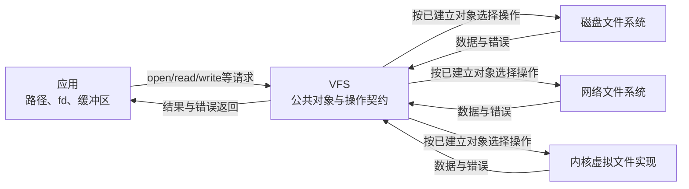
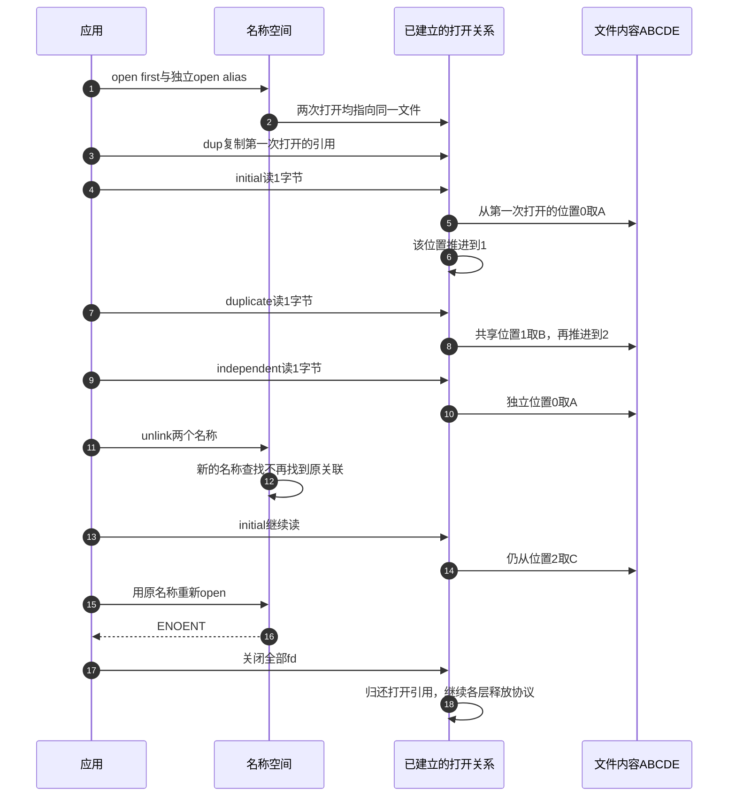

# 第1章\_为什么需要\_VFS

一个程序把配置文件放在磁盘上，另一个程序读取网络共享中的报告，第三个程序读取内核提供的状态文件。它们的数据来源不同，却都希望通过“打开、读取、关闭”完成任务。Linux 的 **虚拟文件系统（Virtual File System，VFS）** 是内核中的统一文件接口层：向应用提供文件操作语义，向下连接不同文件系统和其他文件接口实现。

“虚拟”不意味着数据一定存在内存里，也不意味着每次读取都能成功。我们先用一个普通文件观察几个看似矛盾的现象：同一个文件为什么能有两个名字，两次读取为什么有时共享进度，名字全部删除后为什么还能继续读。本章先把需要解释的问题建立起来，下一章再推导内核为何需要不同对象承载这些状态。

## 1.1\_统一函数入口先解决什么问题

假设系统只支持一种磁盘格式，系统调用入口可以直接调用它的目录查找、数据读取和空间分配代码。这个方案直观，也容易把第一个文件系统做出来。现在增加一种网络文件系统：名字要通过网络请求查找，读取可能等待服务器，身份和缓存有效性也由另一套协议决定。

如果每个系统调用都自己判断文件系统类型，open里要加一种分支，read里再加一种，rename和权限处理又各加一种。问题首先发生在内核：同一种文件操作的公共规则分散到多个入口，各处分支可能在错误码、引用取得或失败清理上不一致。保持应用接口不变仍然可能做到，但内核要为此维护越来越多的重复协调代码，不能简单推论为“应用必然也要重写”。

可以先把公共操作契约放在中间：应用只提交路径、打开方式和缓冲区；公共层负责解释操作，具体实现负责把它变成介质、网络或其他后端动作。新实现只要正确接入约定，原来的读文件程序就有机会继续使用。



ext4是一种磁盘文件系统实现，NFS以网络协议访问远端文件，procfs用于暴露一部分内核和进程信息。这里列出它们是为了说明后端可以不同，不要求先掌握三者内部结构。统一入口也不保证所有后端支持全部操作：普通文件可以定位，某些流式对象不能；某种特性仍可能返回不支持。

## 1.2\_函数相同以后还缺哪一份状态

设文件内容为ABCDE。程序A读走A，下一次希望读B；程序B独立打开同一个文件时，通常仍希望从A开始。如果把读取位置写在“文件本体”里，A的读取就会无意改变B的起点。若只在应用里保存位置，内核又无法正确表达复制打开关系后共享位置的语义。

因此，公共接口还需要共同认可的状态：哪些属于文件本身，哪些属于一次打开，哪些只是应用用来指向这次打开的号码。统一函数名只解决“调用谁”，还没解决“这次调用操作谁的哪份状态”。

应用通过 **文件描述符（file descriptor，fd）** 引用已打开的对象。fd是当前描述符表中的非负整数槽号，不是磁盘块号，也不是永不变化的文件身份。open成功返回一个fd；read根据fd找到相应打开关系，使用并推进读取位置；close解除这个fd与打开关系的关联。

再引入两个已有文件操作。硬链接link增加同一文件的另一个目录名称，不复制文件内容；dup增加指向同一次打开的另一个fd，不等于再次open。删除一个名称的unlink与解除一个fd的close也各有自己的作用。下面用同一份数据把这些区别变成可观察结果。

## 1.3\_在一个完整程序中观察名字与打开关系

程序在Linux用户态运行，需要C编译器，以及支持普通文件和硬链接的本地文件系统。它用mkdtemp创建只属于本次运行的临时目录，在其中建立first和alias两个名字；失败也只清理这些已取得的资源，不操作用户已有文件。示例不要求root权限。若/tmp对应的文件系统不支持硬链接，link失败属于实验环境限制，先选择支持该操作的位置再试。

读代码前先预测：第一次从initial读取后，duplicate会读A还是B？从independent读取呢？两个名字删除后，initial会读失败还是继续取得下一个字节？

```c
/* Linux/POSIX 用户态实验：名称、独立打开和 dup 共享的进度。 */
#define _POSIX_C_SOURCE 200809L
#include <errno.h>
#include <fcntl.h>
#include <stdio.h>
#include <stdlib.h>
#include <sys/stat.h>
#include <unistd.h>

static int read_one(int fd, const char *label)
{
    char value;
    ssize_t count;

    do {
        count = read(fd, &value, 1);
    } while (count < 0 && errno == EINTR);
    if (count < 0) {
        perror("read");
        return -1;
    }
    if (count != 1) {
        fprintf(stderr, "%s: unexpected EOF\n", label);
        return -1;
    }
    printf("%s: %c\n", label, value);
    return 0;
}

int main(void)
{
    char directory[] = "/tmp/vfs-demo-XXXXXX";
    char first[128], alias[128];
    int initial = -1, duplicate = -1, independent = -1;
    int probe = -1, status = EXIT_FAILURE;
    int first_exists = 0, alias_exists = 0;
    struct stat initial_stat, other_stat;
    const char text[] = "ABCDE";
    size_t done = 0;

    /* 只操作本次创建的私有目录，失败时按已取得的资源逆序清理。 */
    if (!mkdtemp(directory)) { perror("mkdtemp"); return status; }
    snprintf(first, sizeof(first), "%s/first", directory);
    snprintf(alias, sizeof(alias), "%s/alias", directory);
    initial = open(first, O_CREAT | O_EXCL | O_RDWR, 0600);
    if (initial < 0) { perror("open first"); goto out; }
    first_exists = 1;
    while (done < sizeof(text) - 1) {
        ssize_t count = write(initial, text + done, sizeof(text) - 1 - done);
        if (count < 0 && errno == EINTR) continue;
        if (count < 0) { perror("write"); goto out; }
        if (count == 0) { fputs("write made no progress\n", stderr); goto out; }
        done += (size_t)count;
    }
    if (lseek(initial, 0, SEEK_SET) < 0) { perror("lseek"); goto out; }
    if (link(first, alias) < 0) { perror("link"); goto out; }
    alias_exists = 1;
    duplicate = dup(initial);
    if (duplicate < 0) { perror("dup"); goto out; }
    independent = open(alias, O_RDONLY);
    if (independent < 0) { perror("open alias"); goto out; }
    if (fstat(initial, &initial_stat) < 0 ||
        fstat(independent, &other_stat) < 0) { perror("fstat"); goto out; }
    printf("same object: %s; names: %lu\n",
           initial_stat.st_dev == other_stat.st_dev &&
           initial_stat.st_ino == other_stat.st_ino ? "yes" : "no",
           (unsigned long)initial_stat.st_nlink);
    if (read_one(initial, "first open") < 0 ||
        read_one(duplicate, "dup of first") < 0 ||
        read_one(independent, "independent open") < 0) goto out;
    if (unlink(first) < 0) { perror("unlink first"); goto out; }
    first_exists = 0;
    if (unlink(alias) < 0) { perror("unlink alias"); goto out; }
    alias_exists = 0;
    if (fstat(initial, &initial_stat) < 0) { perror("fstat after unlink"); goto out; }
    printf("names after unlink: %lu\n", (unsigned long)initial_stat.st_nlink);
    if (read_one(initial, "old open after unlink") < 0) goto out;
    errno = 0;
    probe = open(first, O_RDONLY);
    if (probe >= 0 || errno != ENOENT) {
        fprintf(stderr, "new open did not fail with ENOENT\n");
        goto out;
    }
    puts("new open: ENOENT");
    status = EXIT_SUCCESS;
out:
    /* Linux close 出错也不盲目重试同一个数字，防止误关已复用描述符。 */
    if (probe >= 0 && close(probe) < 0) { perror("close probe"); status = EXIT_FAILURE; }
    if (independent >= 0 && close(independent) < 0) { perror("close independent"); status = EXIT_FAILURE; }
    if (duplicate >= 0 && close(duplicate) < 0) { perror("close duplicate"); status = EXIT_FAILURE; }
    if (initial >= 0 && close(initial) < 0) { perror("close initial"); status = EXIT_FAILURE; }
    if (alias_exists && unlink(alias) < 0) { perror("cleanup alias"); status = EXIT_FAILURE; }
    if (first_exists && unlink(first) < 0) { perror("cleanup first"); status = EXIT_FAILURE; }
    if (rmdir(directory) < 0) { perror("rmdir"); status = EXIT_FAILURE; }
    return status;
}
```

将正文保存为name_open_demo.c，或取用 [同内容材料](../../../labs/kernel/vfs/materials/name_open_demo.c)，在Linux上编译：

```sh
cc -std=c11 -Wall -Wextra -Werror name_open_demo.c -o name_open_demo
```

`-std=c11`选择C语言标准，开头的_POSIX_C_SOURCE声明使用POSIX接口；其余选项把编译警告作为需要处理的问题。成功后运行：

```sh
./name_open_demo
```

在满足前述条件且没有其他程序干预这个私有目录时，预期输出为：

```text
same object: yes; names: 2
first open: A
dup of first: B
independent open: A
names after unlink: 0
old open after unlink: C
new open: ENOENT
```

这是协议推导出的 **预期结果**，不是本次编辑环境的Linux实测记录。Windows宿主没有在这里运行目标Linux程序；实际复现时保留编译器、内核和文件系统信息，并记录失败发生的接口。

### 1.3.1\_按每个结果反推状态归属

程序先写ABCDE，再用lseek把initial的位置移回零。link建立alias后，fstat通过两个已打开的fd读取文件元数据；设备标识st_dev和文件序号st_ino在这个同时存活的本地文件例子中相同，说明两个打开关系指向同一文件。这个组合不是跨复制、跨文件系统或删除重建后永久稳定的全球身份。

第一次read把initial的共享位置从0推进到1；dup得到的duplicate沿用同一个位置，所以读B并把位置推进到2。independent是通过另一次open建立的关系，它有自己的位置，读A后只把自己的位置推进到1。返回的fd具体数字可能变化，实验不依赖它们一定是3、4、5。

接着unlink删除两个名称，st_nlink变为0。这个数统计名称关联，不统计打开次数。旧initial仍维持打开关系，因此接下来读C；新open只能重新查找已经不存在的名字，返回ENOENT。若程序在删除名字后立即把数据销毁，就无法同时实现这两项语义。

程序循环处理短写与EINTR，确保实验数据确实完整写入；每次只读一个字节，所以不会把多字节短读混进本次观察。末尾按取得情况关闭fd并移除私有目录。这些是让实验结果可解释的清理措施，不是文件数据持久化实验；write成功没有证明数据已经抗断电保存。

## 1.4\_同一条运行过程需要两种查找

现在可以把前面的结果画成一条时间线。这里只表示参与职责，不提前把每条箭头解释成某个Linux函数。



图中open要解释路径，而后续read通常直接使用fd对应的打开关系；每次read都重新按原字符串查找，会在删除名字后失败，也会在名字被替换时误读另一个文件。反过来，仅保留一段内容地址也不够，因为两次独立打开的位置必须各自维护。

## 1.5\_统一层的保证与后端的工作在哪里分开

本例已经要求公共层分开管理名称、打开关系、fd和文件身份。再考虑多个文件系统，公共层还需要知道同名文件位于哪一个实例、调用者从哪个目录开始查找。VFS因此是对象和协议的组合，不只是一张read函数表。

| 本次需要的共同语义 | 具体实现仍要完成的工作 |
| --- | --- |
| 名称查找得到对象，名称删除与打开关系分离 | 目录如何存储、查询或向服务器获取 |
| 一次打开保存相应状态，fd可以引用它 | 本实现打开时需要哪些私有资源与检查 |
| 按文件操作契约返回数据量或错误 | 数据来自缓存、磁盘、网络还是即时生成 |
| 引用和撤销相互配合 | 哪些缓存可回收，何时释放后端资源 |
| 公共路径与安全检查接合 | 实现支持哪些权限、特性和附加约束 |

共享语义不意味着共享一种性能：同一个read可能命中内存，也可能等待网络；同一个write可能先接受数据到缓存，稍后才遇到后端错误。后面讨论缓存和同步时，还要把“操作返回”和“持久化完成”分开。

固定版本源码的后续入口见 [VFS源码阅读索引](../../../research/source_reading/vfs/navigation/P01_Linux_6.12_VFS源码阅读索引.md)。本章用可观察接口建立问题；版本化结构、回调和并发实现从第三章开始逐层兑现。

## 1.6\_用小变化检验刚建立的判断

**练习一**：将duplicate的取得改成再次open(first, O_RDONLY)，第二次读取会怎样？参考答案：它获得独立打开关系，应从A开始；initial的位置仍为1，所以删除名字后initial继续读B。

**练习二**：只删除first，保留alias，旧fd还能读，新open(alias)又怎样？参考答案：旧打开继续有效，alias仍可重新打开；新打开的位置从头开始。名称数减少与打开关系是否存在是两个不同问题。

**练习三**：close(initial)以后，duplicate是否立刻失效？参考答案：不会因这一次close自动失效，它仍引用原来的打开关系。后续新open可能复用initial曾使用的数字，因此不能把旧fd数字当永久对象身份。

我们现在能够解释实验需要哪些相互独立的状态，但还没有决定内核怎样组织它们。下一章从最小函数表出发，逐步加入实例、名称、文件本体、打开对象和挂载位置：[VFS抽象机制推演](P02_VFS抽象机制推演.md)。
