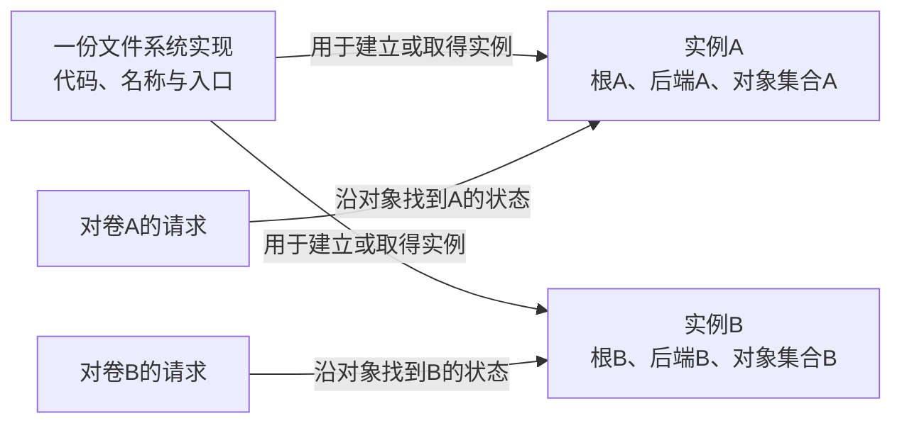
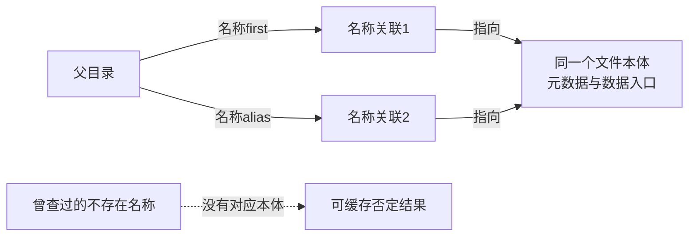
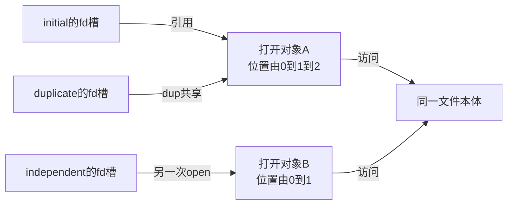
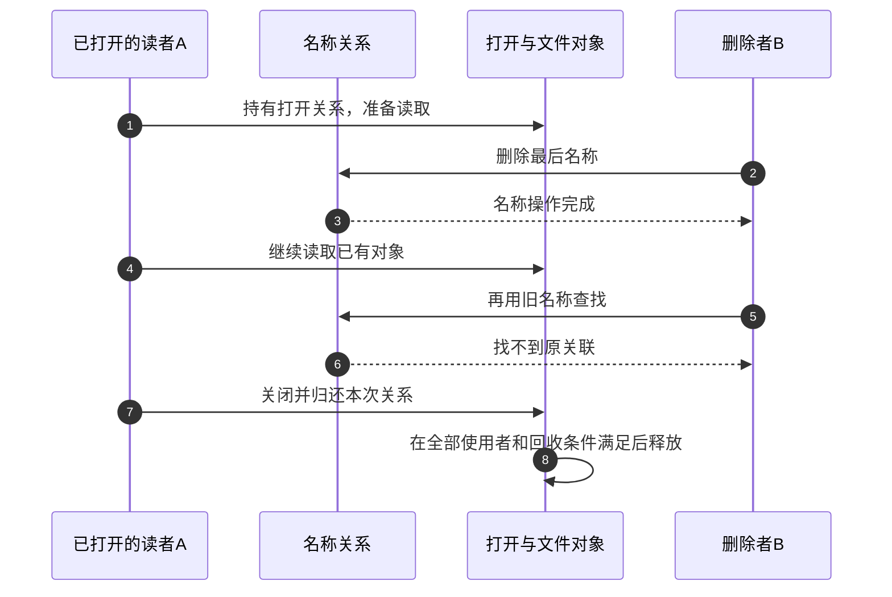

# 第2章\_VFS抽象机制推演

上一章已经观察到，同一文件可以有多个名字；dup共享一次打开的进度，另一次open则有独立进度；删除全部名字也不强制使旧打开失效。现在暂时不背Linux字段，假设由我们设计这个统一层，看看最小方案会在哪些具体条件下失效。

本章每次只增加解决当前问题所需的一类状态。最后再把这些角色与Linux名称对照，第三章才进入真实结构和访问路径。

## 2.1\_一张操作表能先做出什么

最小设计让每种文件系统提供“查找名称、打开、读取、写入、关闭”等操作。公共入口选中正确实现后调用它。这样，磁盘和网络后端都可以保留自己的数据组织，系统调用不必到处展开类型判断。

这个方案已经有价值：它隔离了“通用操作叫什么”和“具体怎样执行”。但操作总要携带运行参数。若只把文件系统类型和路径传入read，就不知道同一进程两次打开同一路径时应推进哪个位置；若每次重新查路径，又无法解释unlink后旧打开继续有效。

所以函数表可以继续保留，缺的不是另一张更大的表，而是 **把操作绑定到当前对象的状态**。下面按共享范围逐层确定对象，不根据最终结构体名单反推一套分类。

## 2.2\_同一实现处理两个实例时状态应该放哪里

设同一套磁盘文件系统代码同时管理卷A和卷B。它们的目录、空闲空间和根对象不同。如果把“当前根对象”写进全局实现描述，挂载B就可能覆盖A的根；即使通过全局锁避免同时改写，也不能让两个卷各自长期保存状态。

自然的修正是分开两层：**实现类型** 保存名称、入口和代码归属；**运行实例** 保存这次文件系统树的根、对象集合及后端状态。操作表可以被多个实例共同使用，每次操作再携带相应实例或实例中的对象。

代价是增加实例分配、共享判断与销毁规则。也不能倒过来规定“调用一次mount就必须创建一个新实例”：有的挂载可以复用已有实例，是否复用由文件系统和请求条件决定。我们需要的是独立表达能力，而非每次操作机械增加对象。

挂载还有一个尚未完成的阶段：参数可能缺失，后端可能打不开，根对象可能建不出来。若把半成品直接发布到可见树上，另一个任务就可能看到不完整状态。于是需要 **配置事务** 暂存参数和构建结果：成功后才进入发布步骤，失败按已取得资源回滚。它和已长期运行的实例不是同一生命周期。

## 2.3\_两个名字为什么不能各自拥有一份文件内容

回到first与alias。若名称记录内直接保存全部文件元数据和内容，link只能复制它们；此后修改first时，要么alias看不到变化，要么每次更新都得寻找所有副本并同步。那已经违背“硬链接指向同一文件”的语义。

可以让 **名称关联** 只保存父目录、局部名称和所指向的 **文件本体**，把共享元数据与数据入口放在本体中。两个名字分别属于两个名称关联，但它们指向同一个本体，修改本体即可通过两个名字观察到同一结果。

父目录也是一个文件系统对象，名称只在某个父目录下有意义。`/a/report`和`/b/report`的最后分量都叫report，却不是同一个名称关联。根目录和特殊路径规则要额外处理，不能把每个对象都当普通叶子文件。

rename改变名称关系，不要求把文件内容复制成另一份。unlink减少一个名称关系，也不直接回答旧打开是否仍引用本体。成本在于现在需要维护两层关系，并处理它们之间的并发变更；收益是共享和生命周期终于能分别表达。

如果某名称查找得到“不存在”，也可以缓存这个否定结果，减少重复后端查找。它仍是名称相关状态，却没有文件本体。后端可能发生变化，所以缓存是否可信还需要验证规则；“缓存一次不存在”不能成为永久判定。

## 2.4\_为什么一次打开还需要独立对象

名称和本体分开后，第一章的读取位置仍没地方放。放在名称关联里会让通过同一名字独立打开的两个读者相互推进；放在本体里又会让通过硬链接打开的读者也相互推进。两者都比接口要求的共享范围更大。

因此再增加 **打开对象**：它指向已找到的文件，保存这一次打开所需的状态，例如位置、状态标志和具体操作。每次独立open建立新的打开对象；dup则增加对已有打开对象的引用。

这个方向很关键：fd槽引用打开对象，打开对象关联文件本体。图不表示文件本体主动为每个fd保存一份进度。普通文件的本体仍可以被多个打开对象共享，某些特殊文件则会在打开过程中建立设备或会话私有状态，后续再讨论。

fd还需要自己的表项状态。例如“执行新程序时关闭这个fd”的标志针对描述符，而共享位置针对打开对象。把所有标志都写在同一对象里，会使dup之后两个描述符不能表达各自的关闭策略。

同样，**共享打开对象** 与 **共享描述符表** 不是一回事。fork后的父子通常有各自的表，但表项引用相同打开对象；共享表的线程则连新增、关闭某个fd的结果也共同看到。第三章会把这两种关系画到实际结构上。

## 2.5\_同一棵文件树为什么还需要挂载位置

现在已有名称树和根对象，可以从根走到某个文件。假设管理员把同一棵树或其中一个子树接到另一个目录入口：到达同一个名称对象时，调用者是经哪个入口进入的？从这个入口根处走`..`，应该回到哪个外层目录？仅凭树内部的父子关系无法回答。

因此还需要 **挂载视图**：它表达某个树根怎样接到外层位置，以及这一视图使用的策略。路径上下文必须同时携带“当前挂载视图”和“该视图中的名称对象”。同一个名称对象可以配上不同视图，所以两者不能互相替代。

多个任务还可能共享或隔离整个挂载拓扑，这一集合就是挂载命名空间所解决的问题。它不会因此复制所有文件内容，也不意味着所有挂载都必须属于可见命名空间：构建中的、内核内部的或已脱离拓扑的挂载还可能有其他持有者。

增加视图的代价是跨挂载点查找、传播和拆除更复杂。它带来的价值是把“文件系统中的对象关系”与“调用者看到的连接关系”分开。下一章只确定这些状态位置，第七章再展开实际挂载和命名空间规则。

## 2.6\_删除操作为什么不能立即释放所有对象

现在检查最小模型能否应对并发。任务A已经得到打开对象并开始read，任务B删除了最后一个名字。如果B因为“名字没了”立即释放本体，A接下来的访问就会落到失效内存。反过来，如果永远不回收，系统就会随着访问不断积累对象。

需要分开至少两个判断：**是否还允许通过某个入口建立新关系**，以及 **已经建立的关系是否全部退出**。unlink使对应名称关系消失；旧打开继续持有自己的访问关系；最后使用者退出后，才由相应缓存与文件系统协议决定何时真正回收。

引用保证对象仍存在，不保证内容不被其他写者修改，也不保证名称关系仍不变。若查找者正在读取父目录和名称，而另一任务同时rename，还要用锁或可验证的快照协议判断观察结果是否一致。引用、互斥和变化检测分别回答不同问题，不能拿“有引用”替代全部并发证明。

Linux使用引用、锁、RCU和序列验证等实现这些目标。它们是具体工程选择；本章推导得到的是需要存续与一致性协议，不能声称所有合理文件系统设计都必然采用同一套Linux同步原语。后面的RCU-walk章节会解释为何高频路径查找希望减少每步引用开销，以及如何为此补上验证和回退。

## 2.7\_把已经推导出的角色对应到Linux名称

现在出现Linux名称时，每个名称都有前面的问题作为依据。

| 本章建立的角色 | Linux对应对象 | 不应混为一谈的对象 |
| --- | --- | --- |
| 实现类型与入口 | file_system_type | 已经挂载的运行实例 |
| 尚在配置的挂载请求 | fs_context | 已公开的挂载视图 |
| 文件系统运行实例 | super_block | 每一次mount调用或每一个挂载位置 |
| 文件本体与元数据 | inode | 名称关联、打开位置 |
| 父目录中的名称缓存关联 | dentry | 磁盘目录记录本身；dentry是内存对象 |
| 一次打开 | struct file | fd数字和文件本体 |
| 描述符表及其表项 | files_struct、fdtable | 表项指向的打开对象 |
| 挂载视图及拓扑 | mount、mnt_namespace | 文件数据与全部名称缓存 |
| 具体路径上下文 | path中的mount与dentry组合 | 单独一个名称对象 |

这不是从第一章现象直接证明Linux源码必然长成某种字段布局，而是先得到职责，再检查Linux如何兑现。真实字段、指针关系、保护方式和阶段由 [VFS状态与对象拓扑](P03_VFS_状态与对象拓扑.md) 接着说明。

**练习与参考答案**：删除最后名字后还能读，是否证明所有文件内容都已在内存？不能，旧打开可以继续通过后端取得数据。两个fd读到同样内容，是否证明它们共享打开对象？不能，独立open也可以读相同文件；要比较位置推进和取得方式。两个mount看到同一文件，是否必须有两份super_block？不必，挂载视图可以引用同一实例。判断的依据始终是状态的共享范围，而不是操作次数或名字数量。
