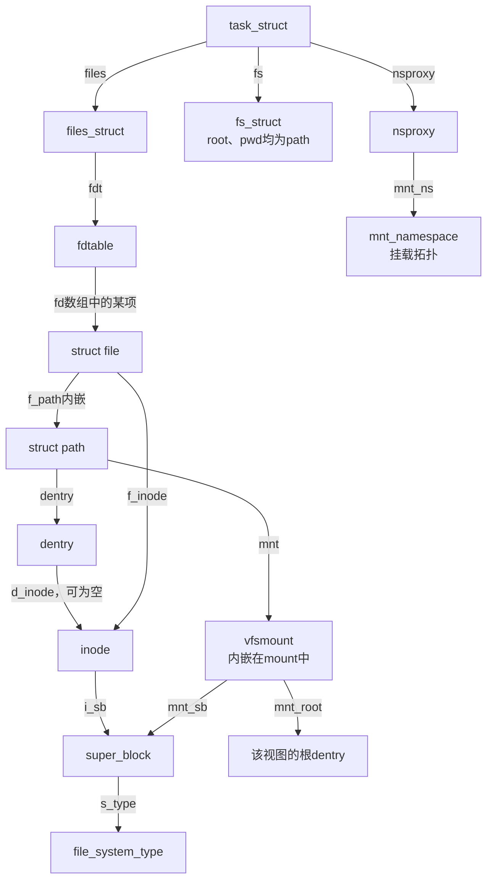
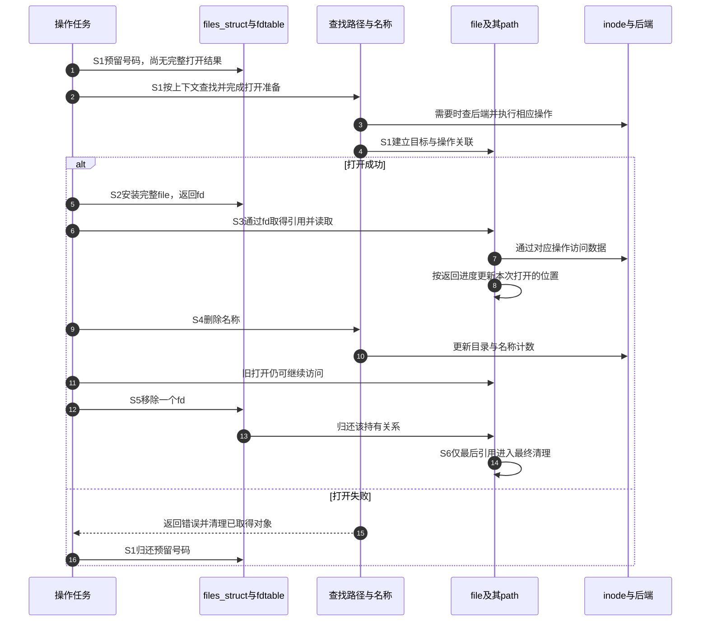
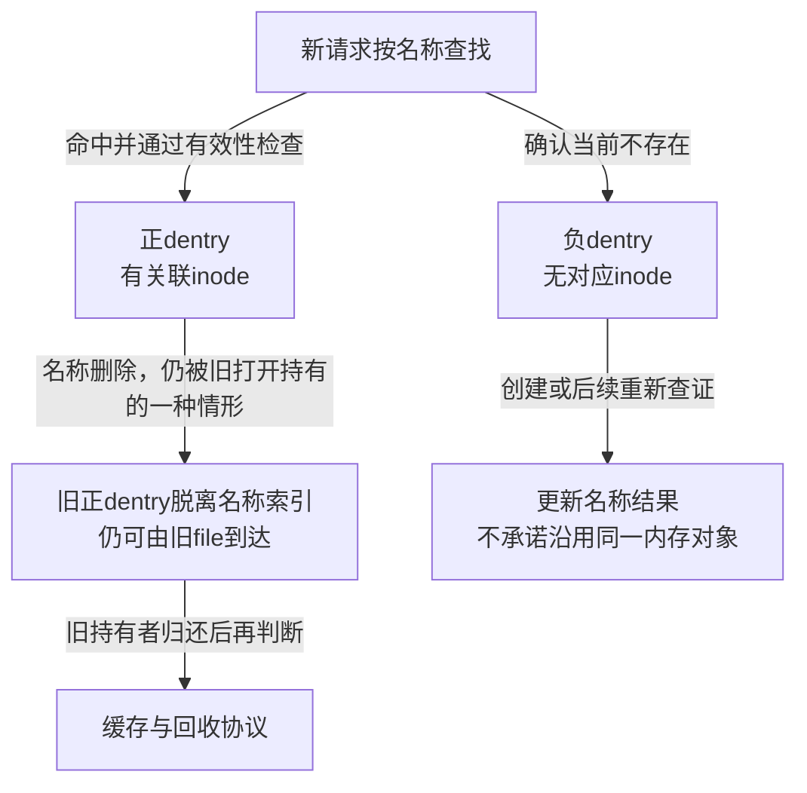

# 第3章\_VFS\_状态与对象拓扑

上一章按共享范围推导出名称、本体、打开、描述符和挂载视图。本章把这些角色落到Linux中的具体状态，同时修正一个常见误会：VFS不是“一个文件从创建走到销毁”的单一状态机。名称是否可查、fd是否已公开、打开引用是否仍在、文件数据是否脏，以及挂载是否仍接入拓扑，可以分别变化。

仍使用第一章的first、alias和三个fd，先追踪同一次操作周期，再讨论并发时哪些保证会失效。本章建立后续章节共用的对象地图，不提前展开每种文件系统的全部回调。固定证据从 [VFS源码阅读索引](../../../research/source_reading/vfs/navigation/P01_Linux_6.12_VFS源码阅读索引.md#1.1_先固定源码身份与运行证据) 进入。

## 3.1\_先把一个文件的状态拆成几条独立轴

first和alias都存在时，两条名称关系指向同一文件；initial与duplicate指向同一次打开；independent指向另一次打开。删除两个名称后，名称轴发生变化，打开轴仍然有效。只有把这些状态分开，才能同时解释“新open找不到”和“旧read能继续”。

| 状态轴 | 本例观察 | Linux主要落点 | 为什么不能合并 |
| --- | --- | --- | --- |
| 名称关联与缓存 | first/alias是否仍能找到原对象 | dentry、目录inode及文件系统后端目录状态 | 名称消失时本体还可能被打开引用 |
| 文件本体 | 同一份元数据和内容入口 | inode、关联address_space及文件系统私有状态 | 两个名称和多个打开可以共同指向它 |
| 一次打开 | 两组独立位置 | struct file | dup共享它，独立open不共享它 |
| 描述符表项 | 哪个数字现在指向哪个打开 | files_struct中的fdtable | 数字可关闭和复用，不是永久身份 |
| 路径视图 | 从哪个挂载和名称进入 | struct path、mount、mnt_namespace | 同一名称对象可通过不同挂载视图访问 |
| 实例与后端运行 | 文件树属于哪次运行实例 | super_block、file_system_type | 一种实现可有多个实例，一个实例可有多个视图 |

address_space在这里先理解为文件数据缓存与相应操作的关联对象，第十五章再讲它怎样组织folio。inode不是一块“装着完整文件字节”的缓冲区；当前名字列表也不完整保存在inode一个字段里。后端内容、名称缓存与打开状态分布在不同对象中。

## 3.2\_从任务出发沿实际字段走到文件

Linux中的task_struct代表任务。任务的files指向描述符表容器，fs指向根和当前目录上下文，nsproxy再关联命名空间。它们是三条不同入口：共享files不等于共享fs，也不等于单凭这个关系就能证明所有命名空间相同。

图中有两种关系：标有成员名的箭头表示相应字段关联；f_path是内嵌值，不是另一次堆分配。path.mnt的静态类型是vfsmount指针，内部mount包含这个vfsmount及父挂载、接入点等信息，不能把它们画成两个彼此无关的挂载实例。

这张图也不是“每条箭头都额外增加一份独立引用”的计数图。f_inode和f_path可以指向同一文件关系，不能看到两个字段就给inode凭空加两次引用；实际取得与归还必须沿初始化和释放路径核对。字段说明及裁剪定义见 [描述符与打开对象](../../../research/source_reading/vfs/source_explanations/P01_描述符表与打开对象的状态归属.md#1.1_表项状态与打开状态的边界) 和 [路径与名称实例关系](../../../research/source_reading/vfs/source_explanations/P02_路径名称与实例的字段关系.md#2.1_任务的查找上下文不是描述符表)。

## 3.3\_用同一组阶段追踪打开到最后归还

下表的S0～S6是本专题的阅读阶段，用于把参与者和状态变化接成一次普通文件周期。它不要求内核把每阶段实现成单独函数；S1包含尚未公开的准备和查找，不能把“已有内存对象”误认为“用户已有可用fd”。

| 阶段与触发 | 修改前后与写入者 | 状态位置及后续读取者 | 退出条件 |
| --- | --- | --- | --- |
| S0：任务进入本次操作 | 已有挂载视图、root/cwd和描述符上下文 | task的fs、files、nsproxy；查找和fd操作将读取 | 操作获得合法参数与访问上下文 |
| S1：open准备 | 核心预留号码、准备file并查找/建立目标；失败仅撤销已取得部分 | fd分配位图、未公开file、查找中的path及名称缓存 | 路径、权限和打开操作成功；否则回滚 |
| S2：发布打开结果 | 完整file装入fdtable对应表项 | fdtable.fd[fd]；之后的fd系统调用可取得它 | 返回可用fd，表项持有相应关系 |
| S3：dup与读取 | dup增加表项引用；读取按契约更新打开位置 | file.f_pos、fd表项；共享此file的读者观察同一进度 | 本次I/O返回字节数或错误 |
| S4：unlink两个名字 | 目录操作去掉名称关联，调整链接计数并维护缓存 | 目录状态、dentry关联、inode.i_nlink；新查找与旧打开各按自己的路径访问 | 名称操作完成，旧file仍可能有效 |
| S5：close一个fd | 表项移除，号码可复用；归还该持有关系 | fdtable与file引用；其他表项或在途使用者仍可能持有 | 本fd不再提供新取得入口 |
| S6：最后使用者归还 | 进入file最终清理，再按各对象协议归还path等资源 | file、dentry、mount、inode及后端；各层回收条件不同 | 不再有合法访问者并满足该层清理条件 |

本版本普通open路径先预留fd号，再执行取得file的路径，成功后才装入表。S1的位图预留和S2的指针公开不能合并：失败可以归还号码，但不能把尚未初始化的file暴露给共享表的另一线程。S3中的dup不重新调用一次普通文件打开流程，也不复制整份内容。

图里的file不会主动等待某个应用来“通知可以释放”；持有者在自己的退出路径归还引用，归零分支触发最终处理。普通fput与特定close同步清理路径不同，最后引用条件也不能省略。已有唯一实现见 [close系统调用的同步清理](../../../research/source_reading/character_device/source_explanations/fs/open.c.md#1.2_close系统调用的同步清理)，不要把“可能延迟”写成所有close必定延迟。

## 3.4\_三个计数与两种共享不能互相代替

第一章S3时，三个fd对应两个file，两个file访问同一个文件。两个名字则是另一层关系。文件引用还可能由在途操作、映射或其他内核使用者持有，因此f_count不保证恰好等于可见fd数量。

| 要问的问题 | 观察哪类状态 | 不应拿来代替的数 |
| --- | --- | --- |
| 有几个任务共享描述符容器 | files_struct.count | 一个file的打开引用数 |
| 某file是否仍有持有者 | file.f_count及合法取得协议 | inode.i_nlink |
| 文件还有多少名称链接 | inode.i_nlink | inode内存引用i_count或fd数量 |

fork常见情形是复制表项关系，父子各有files_struct，却指向原来的file。父进程关闭自己的fd不会自动清空子进程的同号表项，但父子通过同一个file读取普通文件时仍共享位置。使用CLONE_FILES的任务共享描述符表，关闭一个表项会改变共同表中的入口；这是更强的一层共享。

文件位置也不是所有读写的统一共享游标。普通顺序read按相应文件契约使用file位置；带显式偏移的pread不因此推进那个共享位置；管道等流式对象没有普通文件式可定位位置。这里只用普通文件解释本例，第十四章再展开不同I/O入口。

## 3.5\_名称不存在与缓存对象脱链是不同状态

负dentry表示当前缓存中没有对应inode，可用来记录一次不存在的查找。脱离名称哈希表示该缓存对象不再通过那条正常名称索引被找到。这两个维度并不相同：一个旧打开持有的dentry可能仍关联inode，却已经不作为新查找的有效名称入口。

这张图刻意不把dentry的哈希状态、inode链接数、file引用和最终内存释放排成一个统一状态枚举。实际unlink维护缓存时还要考虑引用和文件系统处理，不能规定每次都必须“正dentry直接变负dentry”，也不能规定每次都留下同一个脱链对象。

第三章这里只建立区分，第八章会进入名称缓存与删除分支。S4结束能证明的是相应名称操作完成，不能据此断言所有旧对象已经释放，更不能从一个负缓存结果推断远端文件永久不存在。

## 3.6\_路径对象保留的是视图与名称的组合

fs_struct.root和pwd分别保存任务的根与当前目录，它们都是path。相对路径通常从pwd或给定目录fd提供的路径开始，绝对路径使用相应根；查找还会处理符号链接、`..`和跨挂载点规则。不能只保存一个字符串，再把字符串当作永远有效的对象引用。

path.mnt所指视图的mnt_root可以是某个实例中的子树根，不必等于super_block.s_root。例如bind挂载子目录时，视图从该子目录开始，而实例的根对象没有因此改变。正是这个差别，使同一dentry与不同挂载组合时产生不同的路径上下文。

mount还可能从可见拓扑脱离，而旧path仍被持有。普通卸载与惰性卸载的准入条件和后续退出不同，不能从“命名空间中看不到”推断对象已经没有引用。第七、二十二章分别讨论挂载拓扑和退出，此处先把必须一起携带的两个对象画清楚。

## 3.7\_地址还在不等于观察结果没有改变

假设任务A在S1读到一个dentry地址，任务B同时rename。引用可以使这个对象不被释放，却不能保证A读取的父对象和名称一定来自同一个时刻。只给对象加引用而不验证关系，仍可能把旧父目录与新名字拼在一起。

引用解决存续，锁解决某段操作的互斥，序列验证帮助发现观察期间是否发生变化。RCU-walk尝试在受限条件下减少逐步取得引用的成本，但必须验证相应状态，必要时转成持引用的ref-walk或重新查找；它不是“名称永远不变，也不需要检查”的模式。

| 保护目标 | 应寻找的协议 | 不由它自动保证的事 |
| --- | --- | --- |
| fd表项和表扩容 | files侧发布、锁及RCU规则 | 读到的旧fd数字仍指原file |
| file存续与位置操作 | 合法引用取得；需要时的位置串行化 | 内容不被另一个file的写者修改 |
| 名称和挂载关系 | dentry、rename、mount相关锁与验证 | 后端永不失效、权限永不变化 |
| inode数据与元数据 | inode及文件系统各自同步 | 某个名称仍可查、某个fd仍公开 |
| 实例停止与回收 | 活动引用、写入准入、freeze/unmount协议 | 一次close能代替整个实例排空 |

后续章节要回答每条路径具体取得什么保护，而不是选一把“VFS大锁”包住整个模型。页缓存、写回和映射也各有状态轴，在建立对应问题之前不提前把全部字段塞进本章。

## 3.8\_用对象地图定位下一步问题

字符特殊文件也经过名称与inode路径；打开阶段才按设备号和字符设备分派接入驱动操作。文件本体字段i_rdev描述设备号，不是fd；其完整接合见 [字符设备打开路径](../../driver_model/character_device/P03_打开路径与文件操作.md)。本专题后面的特殊文件章节只补VFS边界，不再复制一套cdev实现。

**练习与参考答案**：i_nlink为0是否可以直接释放inode？不可以，还要考虑打开、缓存及文件系统回收协议。父子fork后有同号fd，是否证明共享同一张表？不证明，通常是不同表项指向同一file。只持有dentry为何不能完整保存路径视图？还缺对应mount，跨挂载关系和视图根不能由dentry单独恢复。

现在已经能沿具体状态解释第一章的现象，但文件系统实现还未被接入。下一章从实例之前的入口开始：[文件系统类型注册](P04_文件系统类型注册.md)，先回答“内核到哪里找到这套实现”，再进入配置与挂载。
