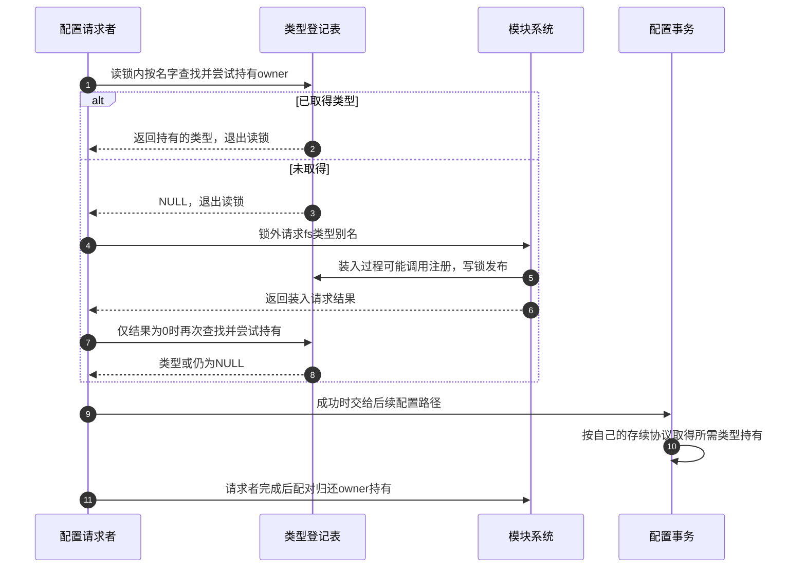

# 第4章\_文件系统类型注册

第三章的S0假设文件系统树已经存在，任务可以从自己的根或当前目录开始查找。现在向前追一步：内核收到“使用某种文件系统”的请求时，到哪里找到那套实现？即使模块已经装入内存，也还需要有一个可查找的入口；即使入口已经登记，也不代表设备已打开、根对象已建立或挂载位置已经公开。

本章只完成实现类型的准备、登记、查找持有和撤销。下一章再把取得的类型用于一次配置事务，避免把“注册文件系统”和“挂载一棵文件树”当成同一动作。

## 4.1\_先用名字找到代码再谈建立实例

设内核中已有两套文件系统实现，它们都能创建根对象，却使用不同参数和后端。如果把每种实现的地址硬编码进挂载系统调用，每增加一种实现就要改通用入口；模块按需装入时，通用入口更不可能预先知道每个地址。

因此让实现主动登记一份 **类型描述**：说明名字是什么、怎样开始配置、如何结束实例、代码属于哪个模块。公共层维护“名字到类型描述”的集合。挂载请求先按名字找到它，再由类型提供的入口开始下一阶段。

Linux用file_system_type表示这种类型。它与super_block的区别已经在第二章建立：类型保存可复用的实现身份和入口，super_block保存某个运行实例。本章登记不会自动产生根dentry、inode集合或mount对象。


最后一条箭头不是注册函数的副作用，它属于后续配置与建树流程。一个类型可以没有当前挂载实例；一个实例也可能被多个挂载视图复用。用操作次数计算对象数量会在这里再次出错。

## 4.2\_类型描述先准备哪些信息

类型通常由实现提供，并在登记期间保持描述及其名字有效。公共层会把这个对象本身链接进表，不是把所有字段复制到另一份永久记录中；把它放在短命的函数栈里再注册会破坏这个约定。

为和第三章的一次打开周期区分，本章用T0～T5标识类型使用过程：T0准备描述，T1登记可见，T2按名称取得持有，T3交给配置或实例使用，T4归还相应持有，T5撤销登记。可见性与持有关系是两个维度，不能把这些标签理解成“到T5就强制清空所有既有使用者”。

| 字段 | 本阶段用途 | 与后续阶段的区别 |
| --- | --- | --- |
| name | 公共查找使用的类型名 | 不是源设备路径，也不是挂载点 |
| fs_flags | 声明类型能力或限制 | 不是某一次mount的全部用户选项 |
| init_fs_context | 初始化该类型的配置事务 | 此时不等于实例已经建好 |
| parameters | 可选参数描述表 | 描述允许的参数，不是本次用户提交的值 |
| mount | 旧式挂载入口的接合字段 | 具体类型使用哪条接入路径要查其定义 |
| kill_sb | 实例最终关闭所需入口 | unregister_filesystem不会代替它销毁全部实例 |
| owner | 实现所属模块 | 内建代码与可卸载模块的持有边界不同 |
| next | 全局类型链表连接 | 由登记协议维护，不能当私有业务链使用 |
| fs_supers | 该类型的实例集合关联 | 不等于全局类型登记表 |
| 各lock_class_key成员 | 为后续对象的锁类标识提供稳定身份 | 不是锁本身，也不是已经创建的实例 |

这里只说明本章用到的选择条件：FS_REQUIRES_DEV表示类型要求设备后端；FS_HAS_SUBTYPE允许类型名后的子类型形式。更多flags与具体实例操作相关，必须在相应问题出现时解释，不能因为字段名带flags就把它当任意位容器。

名字还受注册协议约束：本版本类型名不能含点号，违反时是BUG_ON，不是一个温和的EINVAL返回。因此调用者必须提供合法且存续的描述，不能把注册函数当成对任意外部字符串都安全的校验器。

## 4.3\_登记与查找通过哪份共享状态通信

本版本fs/filesystems.c用全局file_systems保存单链表头，类型的next连接后继，file_systems_lock是读写自旋锁。注册和注销取得写锁，查找与相关遍历取得读锁。这里没有给每种类型分配一个“注册线程”，登记者修改共享表，后来的请求路径读取同一份表。

注册先检查可选参数描述、对象next状态，再在写锁内查找同名项。不存在时才把对象链接到找到的位置；同名或不合适的连接状态返回EBUSY。名字比较同时检查长度边界，不能把某类型名的前缀误当成完整匹配。

参数描述检查还受CONFIG_VALIDATE_FS_PARSER影响。开启时，本版本的描述验证检查同种标志/取值形式的重复参数名；关闭时相关验证入口返回true。它不是对整套文件系统实现、后端参数和所有回调完整性的证明，也不会替用户输入做本次挂载值解析。

如果查找者只在读锁内找到指针，解锁后直接调用模块代码，会留下窗口：模块可能在指针返回后退出。查找因此还必须在表项仍受保护时取得owner对应的模块持有；如果模块正退出而不能取得，便把这次查找视为失败。这样，锁负责表的稳定访问，代码持有负责离开锁后的使用期。

| 对象或状态 | 写入者 | 读取者和结束条件 |
| --- | --- | --- |
| file_systems与type.next | 注册/注销路径在写锁内更新 | 查找、枚举在读锁内遍历 |
| 类型描述及name | 实现准备，在登记与使用期保持有效 | 类型查找、配置事务和实例路径读取 |
| owner模块持有 | 成功查找或已有合法持有者增加 | 消费结束配对归还；不能从任意裸指针开始强行增加 |

固定源码身份见 [VFS源码总索引](../../../research/source_reading/vfs/navigation/P01_Linux_6.12_VFS源码阅读索引.md#1.1_先固定源码身份与运行证据)。锁、比较、返回及配置分支由 [类型登记模块导读](../../../research/source_reading/vfs/navigation/P03_类型描述怎样交给配置请求.md#3.1_先分开类型表与实例集合) 组织，唯一实现见 [类型表发布与代码持有](../../../research/source_reading/vfs/source_explanations/P03_文件系统类型表的发布与持有.md#3.1_类型表在锁内怎样找到插入位置)。

## 4.4\_查不到时为何还会请求装入模块

类型表只包含当前已经登记的实现，不能代表系统磁盘上可能安装的所有模块。get_fs_type第一次查找失败后，可以请求模块系统按`fs-类型名`别名装入实现；等待这次请求返回以后，只有请求返回0才再次查表。模块加载成功与类型登记成功仍是两件事，所以第二次查找也可能得不到类型。

这个可能等待的装入请求放在类型表锁之外，否则模块初始化反过来注册类型时会与持锁等待冲突。查找路径先退出读锁，再请求装入，之后重新取得读锁查表。不能把“锁保护整个查找”理解成始终把锁持有到外部装入结束。



最后一条箭头表示配对归还类型的使用关系，不表示从类型链表删除它。类型查找引用、配置事务持有和实例持有分别有自己的取得归还，不能看到一次put_filesystem就认为实现已经注销。

若名字为`type.subtype`，查找先使用点号前的type；找到了类型以后还要检查FS_HAS_SUBTYPE。不支持时归还刚取得的引用并返回NULL。这个函数不负责证明子类型字符串的全部语义有效，后续配置阶段仍需检查。

自动装入也有环境边界：未启用CONFIG_MODULES时请求入口退化为错误返回；启用时仍依赖模块、别名及装入策略。正文不能把“调用request_module”写成“内核保证找到并挂载任何文件系统”。

类型查找如何在锁内取得代码持有、为何在锁外请求装入，以及子类型拒绝怎样归还，见 [查找实现](../../../research/source_reading/vfs/source_explanations/P03_文件系统类型表的发布与持有.md#3.3_查找如何从锁内观察转为锁外使用)。

## 4.5\_注销结束的是哪个入口

unregister_filesystem在写锁内按对象身份寻找类型，摘链并清next，释放写锁后等待一个RCU宽限期，然后成功返回；未找到返回EINVAL。等待不在自旋锁内进行。这里保留这个真实步骤，但不能据此声称file_systems链表自身采用无锁RCU遍历，它的本章读者仍使用读锁。

更不能把这个宽限期解释成“所有mount和file都已经退出”。注册表只负责停止通过该登记入口的新查找；已经取得的合法持有关系与实例清理属于其他协议。模块正常卸载需要满足代码使用关系的约束，内建或特殊动态描述的提供者也必须自行满足描述生命周期要求。

第三章的close归还某个file，实例关闭归还相应类型持有，类型注销移除全局发现入口，它们分别处于不同层。unregister不遍历全部superblock强行卸载，也不替每个驱动清理仍在使用的私有数据。

摘链、清next与宽限期等待的实际顺序见 [注销实现](../../../research/source_reading/vfs/source_explanations/P03_文件系统类型表的发布与持有.md#3.5_摘链与查询分别能证明什么)；它不执行所有实例的强制关闭。

## 4.6\_用两个只读入口核对注册与挂载

在启用并挂载procfs的Linux上，先查看当前登记类型：

```sh
cat /proc/filesystems
```

每行给出类型名；其中nodev表示该类型没有设置FS_REQUIRES_DEV，不表示“该文件系统的数据必然永不经过任何设备”。这个列表来自类型登记表，并不包含每个挂载实例。

再查看当前任务看到的挂载视图：

```sh
cat /proc/self/mountinfo
```

每条记录描述一个挂载视图，分隔符` - `后包含文件系统类型、源和superblock选项。先只比较类型名是否重复，以及是否有已登记类型没有出现在此处；不要仅凭重复行数推断superblock数量。完整挂载字段到第七章解释。两条命令均为读者验证步骤，本次未在目标Linux执行。

**练习与参考答案**：某类型在/proc/filesystems中出现，能证明一块磁盘已挂载吗？不能，只证明查询时已登记。首次查不到类型就能断言内核永远不支持吗？不能，模块可能按需装入。get_filesystem可否对任意旧指针调用来“补一个引用”？不能，它要求已有合法持有前提；最初按名字取得应遵守查找路径。

现在得到的是可以进入配置的类型身份和使用期保证。下一章继续追踪参数与半成品的所有权：[fs_context挂载事务](P05_fs_context挂载事务.md)。
