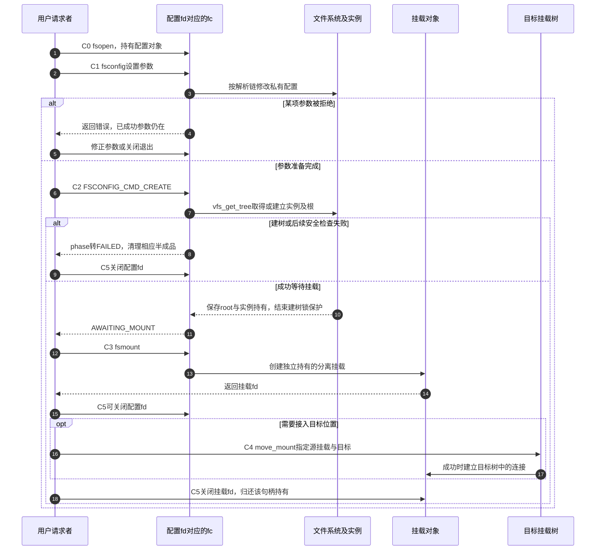

# 第5章\_fs\_context挂载事务

上一章已经找到文件系统类型，并保证配置期间可以使用它的代码。现在请求者还要说明“使用哪个来源、采用哪些选项、准备给谁使用”。例如，登记了tmpfs并不等于已经有一个容量限制为1 MiB的新实例，更不等于某个目录已经能看到它。

本章沿一次新挂载的准备过程，解释参数、半成品与失败退出归谁管理。实例内部怎样建立和复用留给下一章，怎样把挂载接入任务的目录视图留给第七章。

## 5.1\_把多步准备放进一个尚未公开的上下文

最直接的办法是让挂载入口接收一大包参数，立即解析、分配对象并接到目录上。一次调用当然可以实现挂载，旧mount系统调用就是这种外部形式；困难在于它内部仍有多个会失败的步骤。若先公开目录入口，再发现源设备不可用或参数组合不合法，其他任务就可能看到尚未完成的状态；若把临时对象散放在各级栈和全局变量中，失败时又难以分清哪些资源已经归谁所有。

因此先建立一份 **配置上下文**：记录这一次请求选中的类型、选项、权限背景及临时资源；等准备成立，再取得可挂载的根、建立挂载视图并接入目标位置。公共准备逻辑与具体文件系统都围绕这份对象工作。

Linux用struct fs_context承载这些状态。这里称“事务”，指准备、阶段检查、交接与清理的组织方式，**不承诺数据库式原子回滚**。一个成功设置的参数不会因为下一项参数拼错而自动撤销；外部设备或服务上的副作用也不能仅凭这个对象的名字就认定可回滚。


图中的三条后半段箭头必须分开理解：**得到根、创建mount、公开到目标目录** 是三个边界。即使前两步成功，只要还没接入目标位置，普通路径查找就不会因这个新挂载而改走另一棵树。

## 5.2\_上下文保存什么以及谁可以推进它

第四章的临时类型持有只保证找到的实现可用。创建上下文时，fs_context_for_mount通过分配路径取得自己的fs_type持有、调用者凭据和命名空间引用，再调用该类型的init_fs_context。这个回调建立具体文件系统的默认配置与操作表。没有该入口的旧实现由适配路径接入，不要求它突然具备一套新的原生解析函数。

上下文不是后台线程。处理系统调用的任务同步执行解析和建树回调，状态存放在内核分配的fc及其指向的私有配置中；后续请求再通过同一对象继续工作。新API把它挂到一个匿名file的private_data上，用户持有的fd经file找到fc，不能拿这个配置fd去读取文件系统内的普通文件。

| 状态或字段 | 当前用途和写入者 | 结束或交接条件 |
| --- | --- | --- |
| fs_type、ops | 公共层持有类型；初始化回调提供配置操作 | 上下文销毁归还类型，操作表必须在使用期有效 |
| fs_private、s_fs_info、sget_key | 实现保存配置、拟交给实例的数据或实例匹配键 | 具体回调负责区分临时所有权和已交出资源 |
| cred、user_ns、net_ns | 保存凭据及相应命名空间背景，创建或派生时取得引用 | 上下文结束配对归还；不是直接向此处挂入目录 |
| source、security | 源名称与安全选项 | 解析路径记录，清理路径归还，未必已经打开源设备 |
| sb_flags、sb_flags_mask、s_iflags | 拟用于实例的标志、有效修改位及内部标志 | 与mount本身的属性分开，不能混用位集合 |
| purpose、phase | 用途与用户API当前允许的阶段 | 相应入口推进；不是全系统挂载状态的唯一变量 |
| root | 已取得的根dentry及对应实例持有关系 | 建树后保存，退出时归还；重配置上下文开始时就可有root |
| uapi_mutex | 序列化同一上下文的用户API访问 | 不代替实例锁或全局挂载拓扑锁 |
| need_free、log | 指示私有清理责任及保存诊断信息 | 初始化成功才建立正常私有清理责任，诊断只提供辅助原因 |

本章以FOR_MOUNT为主。SUBMOUNT从已有实例派生相关背景，RECONFIGURE则面向已存在实例，不能把所有用途都画成“从空root创建新树”。同样，新API的phase检查也不能机械套到每条内核调用路径：旧mount入口不会把每个用户可见阶段都暴露成独立系统调用。

固定版本身份见 [VFS源码总索引](../../../research/source_reading/vfs/navigation/P01_Linux_6.12_VFS源码阅读索引.md#1.1_先固定源码身份与运行证据)。字段和调用配对从 [配置事务导读](../../../research/source_reading/vfs/navigation/P04_配置状态怎样变成可挂载的根.md#4.1_先确认四个不同的交付物) 进入；后文说明的阶段与失败条件均以该索引中的Linux 6.12.20为边界。

字段声明及公共初始化的持有配对见 [上下文结构](../../../research/source_reading/vfs/source_explanations/P04_配置上下文的资源取得与释放.md#4.1_字段怎样区分配置和已取得的根) 与 [分配路径](../../../research/source_reading/vfs/source_explanations/P04_配置上下文的资源取得与释放.md#4.2_先取得公共引用再初始化私有状态)。

## 5.3\_一项参数怎样被接收或拒绝

参数不仅有名字，还可能是无值标志、字符串、二进制数据、路径或已打开文件。用户API先把相应信息复制或转换成内核的fs_parameter，再交给解析链。关键不只是“谁识别这个名字”，还包括“如果接收后要保留这块内存，谁负责释放”。

vfs_parse_fs_param先检查名字，然后按公共superblock标志、安全模块、具体文件系统、默认source处理的顺序尝试。**-ENOPARAM表示本层不处理，才继续交给下一层**；成功或其他错误都在当前层结束。例如公共ro标志在前面就处理，不会再交给每个后续回调重复解释。安全模块也可能接收或拒绝某项，不能把它简单画成永远旁观的记录器。

以字符串source为例，默认处理确认它是字符串且尚未设置后，把param.string转存到fc.source，并把原指针清成NULL。外层总要清理这一次参数包装，但看到NULL就不会再释放已经交给fc的字符串。没有被接收的值则由外层清理。只写“解析成功保存参数”会漏掉这次所有权转移，也是实现回调时容易产生重复释放的地方。

| 结果 | 本层动作 | 对上下文的含义 |
| --- | --- | --- |
| 0 | 本层已处理该参数 | 值可能已复制、转换或转移到上下文，不能假定仍归原包装 |
| -ENOPARAM | 本层不认识或不负责 | 公共分派尝试下一层；不是立刻向用户报告的最终结果 |
| 其他负错误 | 当前请求失败 | 此项之后不继续分派；此前成功的设置不自动撤销 |
| 所有层都不处理 | 公共层形成未知参数错误 | 当前项被拒绝，普通参数路径本身不会把phase改为FAILED |

“仍可设置参数”与“失败项完全没有副作用”也不同。具体解析回调必须维护自己的失败契约；公共分派不会自动恢复它写过的任意私有字段。下面实验只使用已知的tmpfs未知参数拒绝分支来观察继续配置。

解析链和字符串转移的具体返回分支见 [参数接收实现](../../../research/source_reading/vfs/source_explanations/P04_配置上下文的资源取得与释放.md#4.3_解析链怎样交出参数值)。

## 5.4\_建树完成后为什么还没有目标挂载点

把新API的一次成功路径分成C0～C5：C0创建上下文，C1提交参数，C2请求取得根，C3创建分离挂载，C4接入目标位置，C5归还不再使用的句柄。C5是各个所有者的退出动作，可能在失败分支提前发生；不是必须等挂载被卸载才能关闭配置fd。



C2中的vfs_get_tree让具体实现提供可挂载的根及实例持有，并检查安全选项。它可能取得已有实例，并不保证每次都新分配superblock。用户命令还要完成相应安全检查并释放建树路径持有的s_umount写锁，才进入AWAITING_MOUNT。成功返回但没有设置root是文件系统实现违反契约，在这个版本会触发BUG，不能把它当成用户可以通过重试解决的普通失败。

C3的fsmount创建mount并取得自己的根与实例持有，返回代表分离挂载的fd。Linux为其建立内部匿名挂载命名空间来管理存续，但它还没有接到请求者指定的目录树中；这里的“分离”是这个可见性边界，不表示实现内部绝不关联任何namespace对象。C4才由move_mount接到目标。目标检查或连接失败时，新对象没有因此自动变成目标目录上的挂载。

旧mount的新挂载路径在一次系统调用内部完成类型查找、配置、解析、建树与接入，不先向用户交出配置fd和挂载fd。它会设置oldapi，处理整块历史参数，并可能经旧式适配回调。因此两条路共享上下文和实例机制，**外部调用形态、参数能力与阶段协议仍有差别**。这里仅比较新挂载，bind、移动与重挂载等旧mount分支不是同一条do_new_mount路径。

从命令检查、建树到交出挂载fd的代码分别见 [CREATE阶段](../../../research/source_reading/vfs/source_explanations/P05_建树与分离挂载的阶段交接.md#5.1_命令检查先于状态推进)、[根的交付](../../../research/source_reading/vfs/source_explanations/P05_建树与分离挂载的阶段交接.md#5.2_取得根还没有接到目录树) 与 [fsmount交接](../../../research/source_reading/vfs/source_explanations/P05_建树与分离挂载的阶段交接.md#5.4_清理旧配置与交出fd分属两个时点)。

## 5.5\_失败在哪一步决定该清理什么

普通参数错误、建树错误和挂载对象交付错误不能用一条“失败就回到开始”的箭头表示。新API的主要阶段如下，字段值来自头文件，表格列出本章需要判断的后果。

| phase或失败位置 | 后续可做什么 | 清理边界 |
| --- | --- | --- |
| CREATE_PARAMS | 设置参数或发出CREATE | 参数错误通常保留此阶段，关闭fd清理上下文 |
| CREATING | 内部正在取得根 | 不向同一上下文并发放行另一配置动作 |
| AWAITING_MOUNT | fsmount取得分离挂载 | 此时继续按创建参数设置会返回EBUSY |
| FAILED | 不能继续原配置命令 | 关闭句柄，重新创建所需事务；检查实际失败来源 |
| AWAITING_RECONF | 挂载动作后待重配置初始化 | 不是可再次fsmount的AWAITING_MOUNT |
| RECONF_PARAMS / RECONFIGURING | 设置或执行已有实例的重配置 | 受重配置权限和实例协议约束，本章不展开其全部语义 |

分配上下文时取得的类型、凭据与命名空间由公共清理归还，source和安全选项也有自己的清理路径。初始化回调只有成功后才由公共层设置need_free；若回调初始化一半失败，不能假设之后一定调用其ops.free，它必须处理自己尚未交付的私有半成品。正常初始化成功以后，put_fs_context才按need_free等条件调用私有free。

已有root的上下文退出时还会归还根dentry与实例active持有。若在持有实例写锁的错误点退出，使用对应的fc_drop_locked路径；普通上下文销毁则走另一种释放入口。这些协议将在下一章结合实例的锁和计数解释，不能随手互换。

fsmount还有一个细节：创建mount成功后会清除旧配置并把上下文转为AWAITING_RECONF，之后仍可能在匿名命名空间、文件或fd分配处失败。此时即使系统调用报告失败，原上下文也未必仍能再次执行fsmount。反之，早期参数或权限检查失败可能尚未推进它。调用者必须按失败阶段决定恢复，通用程序可以关闭上下文和已取得句柄后重新准备，不能把所有错误都写成无条件重试循环。

成功交出的mount拥有自己的持有关系，所以关闭配置fd不会销毁仍被挂载fd或目标树持有的挂载。反过来，关闭挂载fd也只归还该句柄的关系；已经接入的挂载由后续卸载协议结束。第三章的“引用归还不是撤销所有其他所有者”在这里仍然成立。

资源析构的锁与持有前提见 [上下文归还](../../../research/source_reading/vfs/source_explanations/P04_配置上下文的资源取得与释放.md#4.4_归还根与私有资源有不同前提)；旧配置清理与下次初始化的分离见 [延后重配置](../../../research/source_reading/vfs/source_explanations/P05_建树与分离挂载的阶段交接.md#5.5_重配置初始化为何延后)。

## 5.6\_只建立分离挂载的最小观察

下面程序为一次新tmpfs设置容量，先故意提交一个未知参数，再继续合法配置。它取得挂载fd后关闭配置fd，使用fstatfs读取剩余挂载的类型，最后关闭挂载fd。**程序没有调用move_mount，不会把新挂载接到现有目录上。** tmpfs容量是该实例的上限，不是这里立即分配1 MiB数据。

需要支持这些系统调用的Linux、提供相应编号和常量的用户态头文件，以及可创建tmpfs挂载的权限。当前固定源码用于核对调用和阶段，本次未在目标Linux编译或运行，下面结果是预期观察。配套完整文件为 [fs_context_demo.c](../../../labs/kernel/vfs/materials/fs_context_demo.c)。

```c
#define _GNU_SOURCE
#include <errno.h>
#include <linux/magic.h>
#include <linux/mount.h>
#include <stdio.h>
#include <stdlib.h>
#include <sys/syscall.h>
#include <sys/vfs.h>
#include <unistd.h>

#if !defined(SYS_fsopen) || !defined(SYS_fsconfig) || !defined(SYS_fsmount)
#error "需要提供 fsopen、fsconfig 和 fsmount 编号的 Linux 用户态头文件"
#endif

static int configure(int fd, unsigned int command, const char *key,
                     const char *value)
{
    return (int)syscall(SYS_fsconfig, fd, command, key, value, 0);
}

int main(void)
{
    int context_fd = -1;
    int mount_fd = -1;
    int result = EXIT_FAILURE;
    struct statfs info;

    context_fd = (int)syscall(SYS_fsopen, "tmpfs", FSOPEN_CLOEXEC);
    if (context_fd < 0) {
        perror("fsopen tmpfs");
        goto out;
    }

    /* 只改变本次新配置；未知参数应被拒绝，随后仍可继续设置。 */
    errno = 0;
    if (configure(context_fd, FSCONFIG_SET_FLAG,
                  "vfs_demo_unknown_option", NULL) != -1 || errno != EINVAL) {
        fprintf(stderr, "未知参数未返回预期的 EINVAL\n");
        goto out;
    }
    puts("未知参数被拒绝，继续配置");
    if (configure(context_fd, FSCONFIG_SET_STRING, "size", "1m") < 0) {
        perror("设置 tmpfs 大小");
        goto out;
    }
    if (configure(context_fd, FSCONFIG_CMD_CREATE, NULL, NULL) < 0) {
        perror("建立可挂载的根");
        goto out;
    }

    /* 建树完成后，创建参数阶段已经结束。 */
    errno = 0;
    if (configure(context_fd, FSCONFIG_SET_STRING, "size", "2m") != -1 ||
        errno != EBUSY) {
        fprintf(stderr, "建树后的参数写入未返回预期的 EBUSY\n");
        goto out;
    }
    mount_fd = (int)syscall(SYS_fsmount, context_fd, FSMOUNT_CLOEXEC,
                           MOUNT_ATTR_NODEV | MOUNT_ATTR_NOSUID |
                           MOUNT_ATTR_NOEXEC);
    if (mount_fd < 0) {
        perror("建立分离挂载");
        goto out;
    }

    /* 没有调用 move_mount：这个挂载没有接入调用者的目录树。 */
    if (close(context_fd) < 0) {
        context_fd = -1; /* Linux 的 close 错误不以重试旧 fd 处理。 */
        perror("关闭配置上下文");
        goto out;
    }
    context_fd = -1;
    if (fstatfs(mount_fd, &info) < 0) {
        perror("读取分离挂载的文件系统信息");
        goto out;
    }
    if ((unsigned long)info.f_type != TMPFS_MAGIC) {
        fprintf(stderr, "返回对象不是预期的 tmpfs\n");
        goto out;
    }
    puts("配置上下文已关闭，挂载 fd 仍持有 tmpfs");
    result = EXIT_SUCCESS;

out:
    if (mount_fd >= 0 && close(mount_fd) < 0) {
        perror("关闭挂载 fd");
        result = EXIT_FAILURE;
    }
    if (context_fd >= 0 && close(context_fd) < 0) {
        perror("关闭配置 fd");
        result = EXIT_FAILURE;
    }
    return result;
}
```

在Linux保存为fs_context_demo.c后编译：

```sh
# 在保存示例源码的目录执行；需要Linux C开发环境。
cc -std=c11 -Wall -Wextra -Werror -O2 fs_context_demo.c -o fs_context_demo
```

SYS_*来自系统调用头文件，程序不写死ARM或其他架构的编号；调用syscall是为了明确观察这些内核接口，不依赖C库是否额外提供同名包装。Linux头文件不满足时先修正开发环境，不自行猜编号。

```sh
# 在允许使用管理员权限的Linux测试环境执行；新建独立mount命名空间。
sudo unshare --mount --propagation private ./fs_context_demo
```

这里unshare建立测试进程自己的挂载视图，private阻止传播关系影响其他视图；程序本身仍只创建分离挂载。预期打印“未知参数被拒绝，继续配置”，然后“配置上下文已关闭，挂载fd仍持有tmpfs”。ENOSYS表示该运行环境未提供对应调用；EPERM可能来自权限、容器策略或安全限制，不能据此认定阶段协议有误。若某一步返回其他错误，程序关闭已经取得的句柄并退出，不继续使用未完成对象。

程序的两次错误检查分别检验C1的可继续配置和C2后的阶段限制，最后一次查询检验两份句柄生命周期独立。它没有验证C4的目标连接，也没有证明断电持久化、并发卸载或所有文件系统的参数失败都没有副作用。

**练习与参考答案**：若在CREATE后、fsmount前关闭配置fd，又没有其他持有者，下一步能用原fd继续吗？不能，号码不再代表原上下文。若fsmount成功并关闭配置fd，为什么挂载fd还有效？它已取得独立的对象持有。若第二个参数错误，是否第一个成功参数也消失？公共分派没有这种整体回滚保证，应检查具体参数契约或重新创建上下文。

现在已经解释了配置状态如何交出可挂载的根，却还没有说明实例怎样复用、谁阻止它在建树期间关闭。下一章进入 [superblock实例状态与生命周期](P06_superblock实例状态与生命周期.md)。
