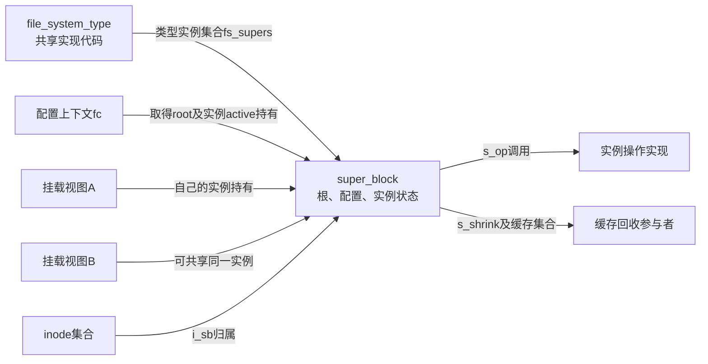
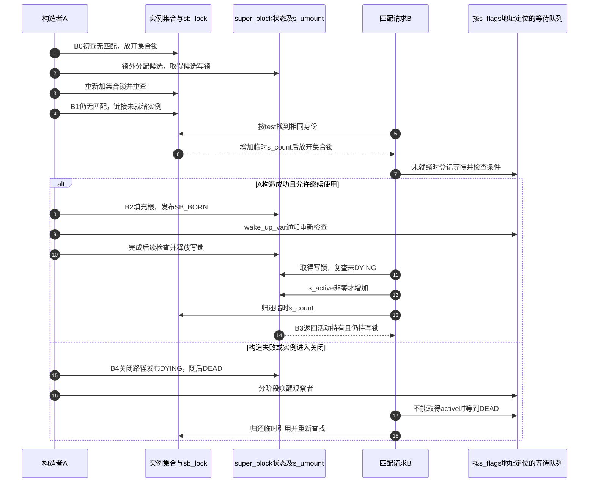

# 第6章\_superblock实例状态与生命周期

第五章把配置上下文交给get_tree，得到可挂载的根。此时还有两个问题：第二个请求遇到同一种文件系统，应该建立新实例还是共享旧实例？如果恰好有人还在构造或关闭它，怎样避免拿到半成品或已经退出的对象？

本章解释实例的选择、初始化交接与最后关闭。沿用tmpfs作为“每次新建”的具体对照，再用按同一身份共享实例的情形推演并发；挂载视图如何接入目录和怎样判断卸载忙，仍由下一章负责。

## 6.1\_为什么操作表之外还需要运行实例

类型描述保存的是可复用的实现。两个独立tmpfs可以使用同一套函数，却分别拥有自己的根、容量限制、inode集合和私有状态；如果把这些内容都放在类型对象中，修改一个实例的限制就会影响另一个。磁盘文件系统还可能记录块设备和磁盘格式信息，但“有磁盘”不是实例存在的前提。

Linux的struct super_block承载这一层共享范围。它关联s_type与s_op，并持有s_root、实例级配置和对象集合。inode经i_sb归属实例，mount经mnt_sb引用实例，写回、缓存回收和关闭也要定位相应实例。**对象有关联，不等于每条指针都直接增加同一引用计数**；例如旧file通常通过path和mount继续保留所需使用关系，不能把inode数量、fd数量或mount行数直接当成s_active。

图中两个mount只是共享关系示例，不表示每种文件系统都把两个新挂载请求合并。第五章已经看到“创建实例”和“创建挂载”分离；本章首先要确定实例共享的依据。

## 6.2\_先决定什么算同一个实例

设两个请求都说“挂载这种文件系统”。仅比较类型名不够：两个不同块设备不能因此共享一份根；两个独立tmpfs也不能因为使用同一实现就合并数据。相反，同一后端在允许共享的条件下可能应复用同一实例，否则两份各自认为独占的数据和缓存会失去协调。

因此公共层不能替所有文件系统写死一个匹配条件。sget_fc接收test和set：test判断已有实例是否匹配本次请求，set为新候选设置公共选择所需的身份。具体文件系统选择怎样的辅助路径，并对选项与共享兼容性负责。匹配成功不代表公共层逐项比较了所有挂载参数。

| 辅助路径 | 本版本的选择方式 | 使用时必须知道的边界 |
| --- | --- | --- |
| get_tree_nodev | 不提供test，不搜索复用实例，建立新实例 | tmpfs、ramfs的新建路径采用它；名字不意味着所有无设备文件系统只能新建 |
| get_tree_single | test对遇到的实例返回匹配 | 仍受用户命名空间一致性、exclusive及实例存续检查约束，不是无条件共享 |
| get_tree_keyed | 以指定指针作为s_fs_info键，比较指针相等 | 不会自动比较键所指内容，更不是通用字符串哈希查找 |
| 块设备相关路径 | 按后端身份及其他条件匹配 | 还要核对设备取得、退役与文件系统自身条件，不能只以类型名判断 |

前三种辅助路径汇入vfs_get_super：取得实例后，仅在没有s_root时调用fill_super建立根，再把根持有交给fc。因此“每次请求都执行fill_super”也不成立。底层匹配、具体实例初始化、用户参数是否能在既有实例上成立，是三个需要分别检查的问题。

## 6.3\_先公开候选再等待就绪解决了什么

假设请求A和B应共享同一身份的实例。若A必须等所有初始化完成才登记，B在这段时间查表看不到A，可能也开始创建一份相同身份的实例。把所有初始化放在全局自旋锁内同样不可行：初始化可能分配内存、等待设备或执行其他可睡眠工作。

本版本采用两段交接。A先在锁外分配候选，再回到sb_lock内重新检查实例集合；如果仍没有匹配项，就把候选放进全局super_blocks和类型的fs_supers。**此时它已能被查到，但还没有完成建树。** sget_fc成功返回时持有该实例的s_umount写锁，初始化者继续填充；其他查找者可以找到身份，却必须按就绪协议等待。

锁外分配后再次检查不可省略：A分配期间B可能已发布候选。若A重查发现B，就处理已有实例并丢弃自己尚未公开的候选。它不是“内存分配失败后重试”，而是把可睡眠分配移出短临界区后，必须重新验证共享事实。

下文用B0～B5标记生命周期：B0选择并准备候选，B1公开未就绪身份，B2完成建树并交接，B3保持或增加活动使用，B4最后活动使用者关闭实例，B5临时观察者退出后释放内存。这些是操作阶段，不是一个名为B的内核枚举。

| 状态位置 | 谁维护 | 它保证什么 |
| --- | --- | --- |
| super_blocks、fs_supers及连接字段 | sget_fc和退出路径在sb_lock下操作 | 实例集合和选择关系稳定，不保证每项已初始化完 |
| s_count | 在sb_lock协议下取得/归还临时持有，并含实例存续所需基础关系 | 允许放开集合锁后继续观察对象内存，不能直接保证文件系统仍可服务 |
| s_active | 配置、挂载及相应活动使用路径 | 最后一份归还触发实例关闭；不是文件数 |
| s_umount | 构造、取得已有实例与退出等路径 | 在协议规定的阶段串行化实例变化；不是保护每次read的全局文件锁 |
| s_flags中的BORN、DYING、DEAD | 建树和关闭路径发布，等待者读取 | 传递就绪或退出进度，还须结合锁和引用判断 |
| s_root、s_op、s_fs_info | 公共层与具体实现按构造/关闭协议维护 | 根、实例操作及私有状态，不以非空单独替代生命周期检查 |

固定源码入口见 [实例交接导读](../../../research/source_reading/vfs/navigation/P05_实例怎样在构造与关闭之间交接.md#5.1_把阶段落到两种引用和三个标志)。新对象并非只存在“未发布→已发布”两个状态；公开给内部发现者与公开为可使用实例是不同承诺。

## 6.4\_等待者怎样得知构造完成或退出

B在sb_lock内找到候选后，先增加s_count，再释放集合锁。现在内存不会仅因集合变化就被回收，B可以在不持自旋锁的情况下等待。但临时引用不允许调用文件系统业务，它还要等BORN或DYING，并取得s_umount写锁重新检查。

这里的等待不是循环占用CPU读寄存器。wait_var_event以`&sb->s_flags`为键，在内核等待队列表中定位队列，准备任务等待项、复查条件并按需调度出去；wake_up_var用同一地址寻找等待者。底层表可由不同地址共享哈希桶，唤醒还核对地址键，不是在每个superblock内放一条独立线程或一套专属队列表。

构造者用release方式发布标志，观察者用acquire方式检查，另有屏障配合登记等待与唤醒，避免“看见就绪却读不到初始化结果”以及错过条件变化。唤醒只使等待者有机会继续执行，不把它直接变成活动所有者；B仍须取得实例锁、复查DYING并执行非零active增加。

为什么醒来后还要查一次？B看到BORN到取得锁之间，实例可能进入关闭。甚至BORN刚发布，A随后的安全检查也可能失败。锁后的复查和非零增加阻止“把零计数重新加活”。若不能得到活动引用，B等待DEAD再重新查找，避免旧实例的后端清理尚未完成就开始替代实例。

## 6.5\_最后活动引用结束后为何还不能立即free

第五章已说明配置上下文与mount各自持有实例。一个mount退出时仍可能有别的mount或配置上下文使用同一实例，因此deactivate只归还自己的活动关系；只有最后一份才进入关闭。对旧file或path是否还使一个mount处于busy状态，需要下一章的视图引用规则，不能直接在这里数fd。

最后活动引用归零时，关闭路径调用类型的kill_sb。常见实现使用generic_shutdown_super完成公共部分：清理dentry、同步文件系统、撤销ACTIVE标志、处理inode以及通知/安全关联，调用实例级put_super等；具体实现还可能有自己的后端清理。**类型的kill_sb回调、s_op中的put_super回调、公共put_super引用函数，是三个不同入口**，不能因为同名片段就当成同一动作。

| 标志 | 本章中的含义 | 不代表什么 |
| --- | --- | --- |
| SB_ACTIVE | 文件系统已进入相应活动运行状态，由建树/关闭路径设置或清除 | 不是s_active引用计数本身 |
| SB_BORN | 已经过建树发布点 | 不意味着永远不再失败，也不单独证明已经接到目标目录 |
| SB_DYING | 已进入相应关闭阶段，新的普通使用者应放弃 | 不表示kill_sb的后续工作已经全部结束 |
| SB_DEAD | 实例已走到允许竞争挂载停止等待旧实例的关闭完成点 | 不表示所有临时观察引用已归还或结构体内存已经释放 |

这些位可能同时存在，不是一组互斥枚举。正常运行过的实例在关闭后仍可能保留BORN位；判断能否使用必须优先遵守退出条件，不能看到BORN就忽略DYING。

generic_shutdown_super发布DYING并释放实例写锁，后端关闭与类型实例集合摘除再按相应kill路径推进到DEAD。有的辅助关闭路径较早完成通知，公共路径会避免重复通知。最后活动持有结束后，仍有等待或遍历者的临时s_count，内存必须继续保留。

当s_count也到零，公共层从全局实例集合移除，经过RCU回调再安排工作队列，最后释放安全关联、用户命名空间与结构内存。工作队列承担可以延后的实际清理，不是用固定延时“猜其他CPU应该用完了”。尚未公开的多余候选则走destroy_unused_super，无须等待从未存在的外部观察者。这解释了为什么不能把所有错误分支都写成同一种kfree。

## 6.6\_用三种交错检验自己的判断

沿前章分离tmpfs程序做纸面预测：两个独立配置分别CREATE，走get_tree_nodev，不按类型名合并实例；一个已有实例经其他挂载视图复用则是另一条路径。若只观察/proc/self/mountinfo行数，不能证明实例数量，因为它列的是该视图中的挂载，前章的分离挂载也没有接入这棵目标树。

再观察共享路径的三个交错：A锁外分配时B先发布，A必须重查并可能销毁自己的多余候选；B看到候选但A尚未发布BORN，B用临时引用等待；B刚看到BORN，A又进入关闭，B锁后复查并放弃取得活动引用。每个分支都可以回指前面的某一个状态位置，不能只用“加了锁所以安全”概括。

**练习与参考答案**：s_count大于零能否证明实例还可以挂载？不能，它也保护正在退出的观察对象。SB_DEAD后能否立刻释放结构体？还要等临时引用与延后回收协议。sget_fc查到同名类型里的实例，是否必定共享？还取决于test、用户命名空间、exclusive与是否能取得活动持有。为何不能在sb_lock内等待BORN？这是自旋锁临界区，等待可能睡眠，也会阻碍需要该锁推进的路径。

本章依据固定代码核对状态与通知，没有执行并发挂载、低内存或卸载压力测试；上述交错是用来检验理解的时序，不是伪造的测试日志。现在能说明实例何时可用、何时退出以及谁仍能观察它。下一章进入 [mount与mount namespace](P07_mount与mount_namespace.md)，解释同一实例如何形成不同目录视图。
