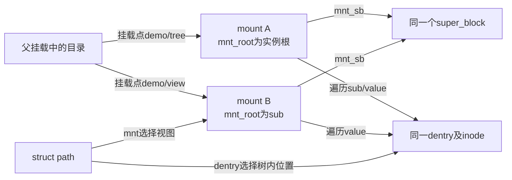
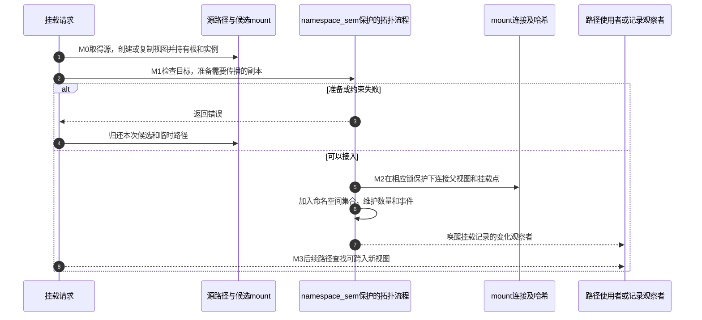
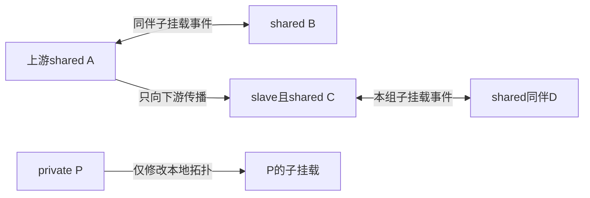
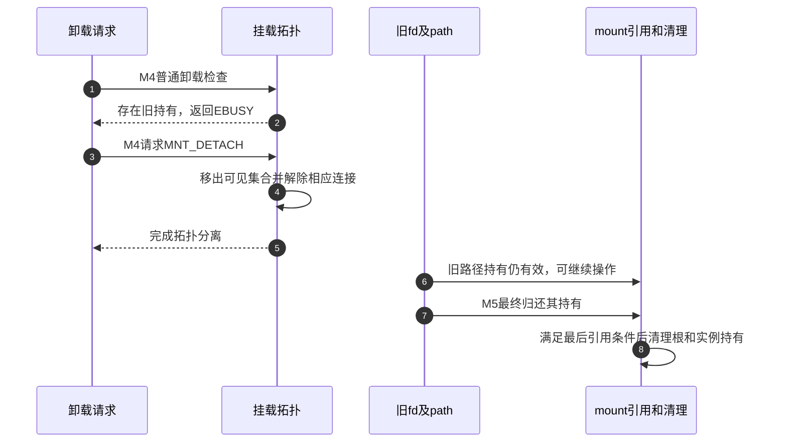

# 第7章\_mount与mount\_namespace

上一章解释了实例何时可用、怎样共享以及何时关闭。现在让同一个实例从两个目录入口出现：一处展示整棵树，另一处只展示其中的子目录。文件内容不需要复制，但“从哪个入口进入、在根处怎样返回上层、这个入口属于谁的视图”已经不同。

本章先从这种差异推导挂载视图，再说明任务的挂载拓扑、传播与退出。路径怎样逐分量查名称留给dcache和路径查找章节；这里先把跨树连接建立清楚。

## 7.1\_同一棵子树为什么需要不同的挂载对象

假设tmpfs挂在/demo/tree，其中有sub/value。现在执行bind，让/demo/view也能进入sub。沿两条路径读取value应到达同一个文件；bind没有把它复制成第二份数据，也不再次调用文件系统建树来创建独立实例。

但两个入口的“根”不同：原挂载根是整个tmpfs根，绑定挂载根是sub。若仅保存dentry，知道自己在sub却不知道当前从哪种视图进入；到达这个视图根时，继续处理上层关系也需要知道外部接入点。因此第三章的path需要同时保存mount与dentry，而不是用一个文件系统内的名称对象表示全部路径位置。

Linux对外常传struct vfsmount，内部struct mount把它内嵌其中，并补充父挂载、挂载点、子挂载、传播和命名空间关联。这里的“内部”是结构层次，不是说只有内核自用挂载才有struct mount。第五章的分离挂载同样有它，只是尚未接到指定目标树。



普通bind复制选中视图，递归bind还需要复制其下相应的挂载拓扑；它们都不意味着复制后端文件数据。unbindable与锁定子挂载等条件会限制复制，不能把递归bind理解成无条件复制任何可见对象。

## 7.2\_任务怎样持有一棵自己的挂载拓扑

如果所有任务只有一张全局挂载表，一个测试进程临时换入的树就会改变其他任务的路径解释。挂载命名空间把“哪些mount连接在一起”组织成可分别持有的拓扑。任务经nsproxy找到mnt_namespace，后者保存根、挂载集合和事件状态；任务的fs_struct另存自己的root与pwd路径，所以挂载命名空间根不等于每个任务当下用于路径解析的根目录。

复制新的挂载命名空间时，公共层复制mount拓扑，并为对应视图取得原实例和dentry的持有；共享的是后端数据，独立的是新mount对象及其连接。没有请求CLONE_NEWNS时，只增加原命名空间的引用，不创建一棵新树。需要调整新fs_struct时，复制路径还会把root/pwd的mount部分换成对应新视图并配对归还旧持有。

| 状态位置 | 保存什么 | 更新或使用路径 |
| --- | --- | --- |
| task.nsproxy.mnt_ns | 任务所属挂载命名空间 | 克隆、unshare或命名空间切换协议维护 |
| mnt_namespace.root、mounts | 根及按挂载身份组织的红黑树集合 | 拓扑写路径更新，枚举路径读取 |
| mount.mnt_parent、mnt_mountpoint | 外部父视图及接入点dentry | 接入、移动、退出时修改 |
| mnt_mounts、mnt_child、mnt_hash | 子树关系与按父视图/挂载点查找的连接 | 拓扑变更和路径跨挂载使用 |
| mnt.mnt_root、mnt.mnt_sb | 本视图的根及共享实例 | 创建或复制时取得持有，最后清理归还 |
| mnt_share、mnt_master及slave连接 | 传播同伴与上下游关系 | 传播类型变更、复制和传播路径维护 |
| namespace.event、poll | 拓扑变化观察计数与等待队列 | 提交变化时更新/唤醒，proc挂载记录的poll路径读取 |

复制一棵拓扑也有成本：新mount、命名空间记录、引用和后续传播关系都需要维护。它不自动复制数据、不提供写入隔离，也不直接替代文件权限。新user namespace还会影响权限和共享降为slave等规则；不能把“创建了新mount namespace”当作获得任意挂载权限的证据。

## 7.3\_接入操作改变哪些共享状态

把一次挂载视图周期记为M0～M5：M0取得源或创建候选，M1准备复制与传播关系，M2接入目标拓扑，M3经路径使用，M4从拓扑退出，M5最后持有归还。bind从已有path开始，第五章的新挂载从已建立的root开始；它们在视图接入处相遇，却有不同的上游准备。

拓扑改变不是把一个指针随手写进dentry。公共层要检查父视图属于相应命名空间、接入点与根是否同为目录或同为非目录、挂载数量及传播约束；随后维护父子连接、mountpoint引用、查找哈希和命名空间集合。某些准备会分配并可能失败，不能把整段流程都放进自旋锁。

在本版本中，namespace_sem序列化相应的拓扑写流程；mount_lock相关保护用于挂载哈希和连接变化，目标目录还有相应锁定。接入时保存父挂载和mountpoint持有，commit_tree将准备好的对象纳入命名空间集合、连接到父树并发布命名空间事件。锁和引用各有负责的状态，不能以“全局挂载锁”概括所有操作的可睡眠条件和顺序。



最后两条箭头不是“先发通知再由用户程序完成挂载”。拓扑修改由内核当前执行路径完成；poll通知只是让观察者知道记录可能变化。读取路径还必须按自身锁、序列验证与引用协议观察，具体快速查找在后面展开。

固定实现从 [挂载视图导读](../../../research/source_reading/vfs/navigation/P06_挂载视图怎样接入传播与退出.md#6.1_先区分视图对象和传播连接) 进入，按M0～M5定位对象复制、接入和退出，不把函数名排列当成状态已经交付的证明。

## 7.4\_为什么新命名空间还需要传播策略

仅复制一次拓扑能够隔离以后的一部分管理操作，却也产生新需求：宿主后来挂入一个设备，某些工作环境希望跟着看到；另一些环境希望自己的临时挂载完全留在本地。如果简单规定所有变化都同步，隔离失去意义；如果全部断开，又得由外部程序逐个重做允许共享的挂载。

传播关系因此描述 **子挂载拓扑事件应送往哪些对应视图**。它不负责把普通write的数据再广播一遍；绑定视图读到同一文件内容，是它们共享后端对象，与是否shared是不同层的问题。

| 传播关系 | 处理挂载/卸载事件的方向 | 选择目的与边界 |
| --- | --- | --- |
| shared | 同一peer group中的对应变化相互传播，并可到下游 | 保持多个入口的挂载布局联动；一处操作可能影响其他视图 |
| slave | 接收master方向的变化，不把本地变化反送上游 | 需要跟随上游又保留本地挂载管理时使用 |
| private | 不沿共享传播关系发送或接收 | 希望本地拓扑变更不参与这种联动时使用 |
| unbindable | 具有private的传播隔离，并限制bind复制 | 防止相应挂载被绑定复制；递归复制还有剪除规则 |

shared和slave还能组合：某视图既接收上游，又在自己的peer group内共享。因而这张表不是“四选一且永不组合”的完整状态枚举。具体关系存放在mount的同伴链、master指针和slave链中；修改传播类型会重组这些连接，不只是换一个显示标签。



实际接入路径在namespace_sem保护下沿目标的peer及slave关系准备副本，验证相应目标是否覆盖接入点，再把这些副本提交到各自拓扑。不是让每个namespace中的后台线程互发命令。副本的分配、数量限制与失败清理也是传播成本，不能只说“自动同步”而忽略它要创建对象。

命名空间克隆可能保留共享联系；跨user namespace时还有shared降为slave及锁住某些挂载树的约束。所以实验先unshare，再把新视图递归改为private，之后才挂入临时树。不能在宿主原视图上先修改传播类型，再声称只是改变测试进程。

## 7.5\_在mountinfo中区分实例根与视图入口

`/proc/self/mountinfo`描述当前读取者相应视图中的挂载记录。下面两行是字段讲解用的构造例子，号码与路径不来自本次机器运行：

```text
100 42 0:52 / /demo/tree rw - tmpfs tmpfs rw,size=1024k
101 42 0:52 /sub /demo/view rw - tmpfs tmpfs rw,size=1024k
```

第二行root为/sub，说明它展示实例内的子树；mountpoint为/demo/view，说明这个视图从调用者路径中的哪里进入。两处字段都像路径，却属于不同坐标。

| 位置或标记 | 含义 | 本例读法与限制 |
| --- | --- | --- |
| mount ID | 当前挂载记录身份 | 100和101不同；传统ID可复用，不是永久对象地址 |
| parent ID | 父挂载身份 | 两者都接在42；父记录可能不在当前可见输出中 |
| major:minor | 实例设备号 | 这里是相同匿名设备号；不能仅凭数字跳过其他身份核对 |
| root | 此视图在文件系统内部的根 | `/`与`/sub`，对应不同mnt_root |
| mount point | 相对读取者根视角的接入路径 | `/demo/tree`与`/demo/view` |
| mount options | 该视图属性 | 分隔符前的ro/rw与mount的只读属性相关 |
| 可选字段 | 如shared、master、propagate_from、unbindable | 数量可变，shared后的数是peer group ID，不是mount ID |
| ` - ` | 固定分隔符 | 不能假定可选字段永远占固定列数 |
| filesystem type、source | 类型和来源显示 | source可由文件系统提供，不能总按块设备路径解析 |
| super options | 实例级标志及具体选项 | 分隔符后的ro/rw与实例状态相关，不等于前面的视图属性 |

真实路径还可能用转义表示空白等字符，解析器应遵守记录格式。看到两个记录也不能直接断言两个superblock，看到相同类型更不能断言共享同一个实例。相同实例能有多个视图，分离挂载又不在本例的目标树中；观察结果必须结合创建路径解释。

## 7.6\_退出拓扑为什么不等于结束所有旧使用者

普通umount要检查挂载及相关传播位置是否仍忙，子挂载、旧path、cwd或打开文件等都可能影响判断。它不是简单检查“此目录里还有没有文件”；空目录中的一个旧打开关系也能持有视图。

MNT_DETACH让挂载先从可见拓扑退出，不走相同的普通busy拒绝路径。后续从原目标路径出发的查找不再通过它，旧fd或已持有path则仍可保留旧视图。若下层原目录为空，新路径可能得到ENOENT；若下层还有另一份文件，则可能到达它。因此“分离后路径必定不存在”只对具体下层布局成立。



在本版本，退出路径维护命名空间集合、父子及查找连接、传播关系和事件，再按RCU保护归还原拓扑持有。lazy子树的某些内部连接可因相应约束保留，不能画成一次性将每条指针全清零。mount最后计数归零后，还可能经task_work或延后工作清理根与实例持有，最终结构释放另有RCU阶段。

这条链和上一章的实例关闭仍然分层：一个mount结束不保证共享的superblock也结束；实例最后活动引用结束又不等于内存立即free。MNT_FORCE也不是通用“无视所有引用并杀掉文件对象”，它只能请求文件系统提供的相应中止动作，并仍受实际退出协议约束。

## 7.7\_在一个完整程序里观察旧fd与新路径

下面实验只建立自己的tmpfs和bind视图。它先创建新mount namespace并递归改为private，再用mkdtemp创建权限受限的临时目录；拓扑隔离不等于/tmp的数据副本，临时目录仍是实际文件系统对象，退出时按本程序成功创建的资源逐项清理。

配套文件为 [mount_view_demo.c](../../../labs/kernel/vfs/materials/mount_view_demo.c)。需要支持命名空间与tmpfs的Linux、Linux C开发环境和相应挂载权限。本次没有目标Linux编译或运行记录；以下打印内容是源码路径支持的预期观察。

```c
#define _GNU_SOURCE
#include <errno.h>
#include <fcntl.h>
#include <sched.h>
#include <stdbool.h>
#include <stdio.h>
#include <stdlib.h>
#include <string.h>
#include <sys/mount.h>
#include <sys/stat.h>
#include <unistd.h>

static int join_path(char *out, size_t size, const char *base,
                     const char *suffix)
{
    int count = snprintf(out, size, "%s/%s", base, suffix);
    if (count < 0 || (size_t)count >= size) {
        errno = ENAMETOOLONG;
        return -1;
    }
    return 0;
}

static int write_all(int fd, const char *data, size_t size)
{
    while (size != 0) {
        ssize_t count = write(fd, data, size);
        if (count < 0) {
            if (errno == EINTR)
                continue;
            return -1;
        }
        if (count == 0) {
            errno = EIO;
            return -1;
        }
        data += count;
        size -= (size_t)count;
    }
    return 0;
}

static int read_exact(int fd, char *data, size_t size)
{
    while (size != 0) {
        ssize_t count = read(fd, data, size);
        if (count < 0) {
            if (errno == EINTR)
                continue;
            return -1;
        }
        if (count == 0) {
            errno = EIO;
            return -1;
        }
        data += count;
        size -= (size_t)count;
    }
    return 0;
}

int main(void)
{
    char workspace[] = "/tmp/vfs-mount-demo-XXXXXX";
    char tree[256], view[256], subtree[256], source_file[256], view_file[256];
    char buffer[32];
    struct stat source_stat, view_stat;
    bool have_workspace = false, have_tree = false, have_view = false;
    bool tree_mounted = false, view_mounted = false;
    int fd = -1, held_fd = -1, result = EXIT_FAILURE;

    /* 先隔离挂载拓扑并切断传播，再创建实验对象。 */
    if (unshare(CLONE_NEWNS) < 0 ||
        mount(NULL, "/", NULL, MS_REC | MS_PRIVATE, NULL) < 0) {
        perror("隔离挂载视图");
        goto out;
    }
    if (!mkdtemp(workspace)) {
        perror("创建实验目录");
        goto out;
    }
    have_workspace = true;
    if (join_path(tree, sizeof(tree), workspace, "tree") < 0 ||
        join_path(view, sizeof(view), workspace, "view") < 0 ||
        join_path(subtree, sizeof(subtree), tree, "sub") < 0 ||
        join_path(source_file, sizeof(source_file), subtree, "value") < 0 ||
        join_path(view_file, sizeof(view_file), view, "value") < 0) {
        perror("生成实验路径");
        goto out;
    }
    if (mkdir(tree, 0700) < 0) {
        perror("创建原树挂载点");
        goto out;
    }
    have_tree = true;
    if (mkdir(view, 0700) < 0) {
        perror("创建别名挂载点");
        goto out;
    }
    have_view = true;
    if (mount("tmpfs", tree, "tmpfs", MS_NODEV | MS_NOSUID | MS_NOEXEC,
              "size=1m") < 0) {
        perror("挂载临时文件系统");
        goto out;
    }
    tree_mounted = true;
    if (mkdir(subtree, 0700) < 0) {
        perror("建立子目录");
        goto out;
    }
    fd = open(source_file, O_CREAT | O_EXCL | O_WRONLY | O_CLOEXEC, 0600);
    if (fd < 0 || write_all(fd, "alpha\n", 6) < 0) {
        perror("建立源文件");
        goto out;
    }
    if (close(fd) < 0) {
        fd = -1;
        perror("关闭源文件");
        goto out;
    }
    fd = -1;
    if (mount(subtree, view, NULL, MS_BIND, NULL) < 0) {
        perror("绑定子树");
        goto out;
    }
    view_mounted = true;
    held_fd = open(view_file, O_RDONLY | O_CLOEXEC);
    if (held_fd < 0 || stat(source_file, &source_stat) < 0 ||
        fstat(held_fd, &view_stat) < 0) {
        perror("核对两条访问路径");
        goto out;
    }
    if (source_stat.st_dev != view_stat.st_dev ||
        source_stat.st_ino != view_stat.st_ino) {
        fprintf(stderr, "绑定视图没有指向预期的同一文件\n");
        goto out;
    }
    puts("两条路径到达同一文件，视图根为原树的 sub");

    errno = 0;
    if (umount2(view, 0) == 0) {
        view_mounted = false;
        fprintf(stderr, "持有视图文件时普通卸载意外成功\n");
        goto out;
    }
    if (errno != EBUSY) {
        perror("普通卸载不是预期的 EBUSY");
        goto out;
    }
    puts("普通卸载返回 EBUSY");
    if (umount2(view, MNT_DETACH) < 0) {
        perror("分离绑定视图");
        goto out;
    }
    view_mounted = false;

    /* 新路径回到下层空目录；旧 fd 仍持有已经分离的视图。 */
    fd = open(view_file, O_RDONLY | O_CLOEXEC);
    if (fd >= 0 || errno != ENOENT) {
        fprintf(stderr, "分离后新路径未返回预期的 ENOENT\n");
        goto out;
    }
    if (read_exact(held_fd, buffer, 6) < 0 ||
        memcmp(buffer, "alpha\n", 6) != 0) {
        fprintf(stderr, "旧 fd 没有读到预期内容\n");
        goto out;
    }
    puts("新路径已不见文件，旧 fd 仍读到 alpha");
    result = EXIT_SUCCESS;

out:
    /* 只处理本程序成功取得的资源，不使用递归目录删除。 */
    if (fd >= 0 && close(fd) < 0)
        result = EXIT_FAILURE;
    if (held_fd >= 0 && close(held_fd) < 0)
        result = EXIT_FAILURE;
    if (view_mounted && umount2(view, MNT_DETACH) < 0) {
        perror("清理绑定视图");
        result = EXIT_FAILURE;
    }
    if (tree_mounted && umount2(tree, MNT_DETACH) < 0) {
        perror("清理临时树");
        result = EXIT_FAILURE;
    }
    if (have_view && rmdir(view) < 0) {
        perror("清理视图目录");
        result = EXIT_FAILURE;
    }
    if (have_tree && rmdir(tree) < 0) {
        perror("清理原树目录");
        result = EXIT_FAILURE;
    }
    if (have_workspace && rmdir(workspace) < 0) {
        perror("清理实验目录");
        result = EXIT_FAILURE;
    }
    return result;
}
```

先在Linux保存源码并编译：

```sh
# 在保存mount_view_demo.c的目录执行。
cc -std=c11 -Wall -Wextra -Werror -O2 mount_view_demo.c -o mount_view_demo
```

程序使用Linux的unshare、mount和umount2接口，不模拟挂载对象。write_all与read_exact处理短读写和EINTR；清理阶段不重试旧fd号，也不使用递归删除目录。任意前置步骤失败都会停止当前实验并清理已取得对象。

```sh
# 在允许使用管理员权限的Linux测试环境运行；程序自行创建独立挂载视图。
sudo ./mount_view_demo
```

预期依次看到：两条路径到达同一文件、普通卸载返回EBUSY、新路径已不见文件而旧fd仍读到alpha。第一项结合已知bind操作与设备号/inode号核对共享对象，第二项观察旧路径持有，第三项区分M4拓扑分离与M5最终归还。程序保留原tree挂载至退出，所以不能把最后读成功解释成整个实例已经关闭后又被复活。

若unshare或mount返回EPERM，应检查能力、容器和安全策略；若不支持相应配置，应先核对运行内核。不要删掉隔离与private步骤只为了让后面的命令执行。实验不验证跨命名空间传播、强制卸载或并发路径重试；这些不能由一次正常运行代为证明。

## 7.8\_把三种共享关系分开再进入路径查找

**练习与参考答案**：复制mount namespace是否复制文件内容？没有，它复制挂载视图并持有已有后端。private bind写文件为何仍能从另一个入口读到修改？它们共享文件对象，private只切断挂载拓扑传播。lazy umount后旧fd为什么还能读？它保留旧path和视图，而新路径按改变后的拓扑查找。看到shared:7能否把7当作该挂载ID？不能，那是同伴组身份。

现在已经建立三层关系：实例决定一套运行中的文件系统状态，mount决定树从哪里进入，mount namespace组织一组视图及其连接。下一步才是在某个确定视图内按名字逐级前进：[dcache与名称状态](P08_dcache与名称状态.md)。
