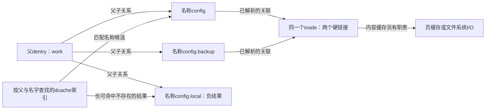
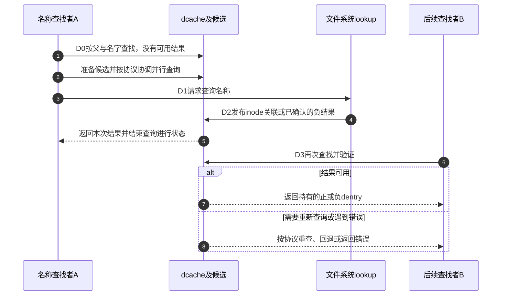
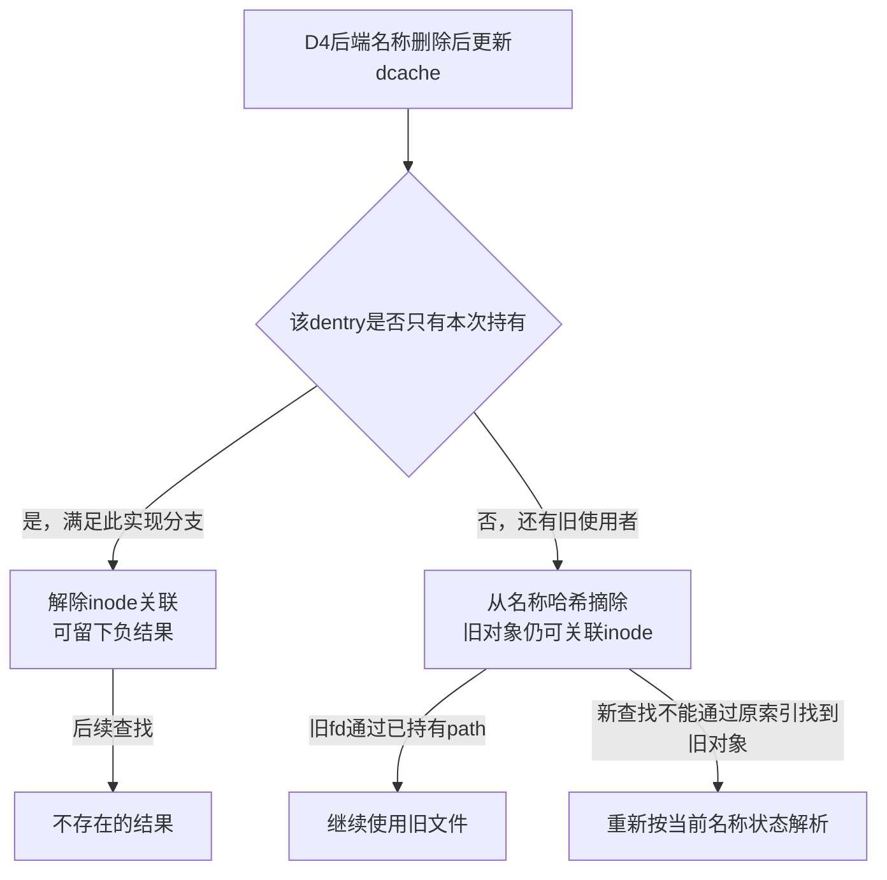

# 第8章\_dcache与名称状态

上一章已经确定“从哪个挂载视图进入哪棵树”。现在站在一个目录中查找 value：内核是否每次都必须请文件系统重新搜索目录？如果刚查过 missing 并确认不存在，下一次是否还要重复同样的工作？本章解决的是名字查询结果的缓存，以及名字变化后旧使用者怎样继续存活。

先限定普通目录和普通文件模型，再补充重新验证与并发条件。完整路径怎样处理符号链接、挂载跨越和最后分量，留给下一章；这里不把一次名称命中误写成整条路径操作已经完成。

## 8.1\_为什么查名字也需要缓存不存在的结果

设程序反复打开 `/work/config`，又不断探测可选文件 `/work/config.local`。没有名称缓存时，每次都要重新取得父目录里的对应记录；后端可能要访问目录数据、运行自己的索引算法，甚至向远端服务器询问。即使文件内容已经在页缓存中，找到文件本体之前仍要先解决名称。

dcache 是 dentry cache，即目录项缓存。这里的 dentry 是内存中的名称关联对象，不等同于磁盘上某一种目录记录格式。它记住 **某个父目录中的名字对应什么**：已有对象时关联 inode，已确认不存在时也可保留负结果。反复探测可选文件因此不必每次都重新发起后端查找。

缓存有代价：每个名称对象、名字存储、索引与同步状态都占内存，还需处理重命名、创建、删除和远端变化。负结果能减少重复失败查询，也可能因大量不同的不存在名称占用资源。它是可回收的查询状态，不是“不存在”这个事实的永久承诺。

上图的两个名字是教学中的硬链接，不能推广成任意两个相同字符串都指向同一 inode。查询键包含父目录；两个目录下都叫 config，仍是两项不同查询。不同挂载视图又可以共享同一树内 dentry，上一章的 mount 与本章的名称缓存各负责一层坐标。

## 8.2\_正负结果与能否被索引找到是两组状态

先看两个不同的问题：这个名称对象是否已关联 inode？后续按父目录和名字查询时，还能否在正常名称哈希中找到它？这两组状态可以独立变化，此外还要区分查询是否完成、是否有引用、是否进入回收。

| 观察维度 | 要区分的状态 | 为什么不能合并 |
| --- | --- | --- |
| 结果与对象关联 | 普通模型中的正结果或负结果 | 负结果也可能已被缓存并成功命中 |
| 正常名称索引 | hashed 或 unhashed | 正对象可从索引退出而被旧 path 保留 |
| 查询进度 | 候选、并行查询进行中、已发布结果 | 刚分配时没有 inode，不证明后端已回答不存在 |
| 使用与保留 | 有引用、零引用缓存、回收处理中 | 零引用不必立即释放；索引退出也不表示引用归零 |

普通文件系统中的正 dentry 关联 inode；负 dentry 没有关联 inode。但这只描述当前对象关联，不能把“正”直接解释为“此旧路径名现在仍然存在”。例如 unlink 时仍有打开文件，旧 dentry 可以保持正关联并从名称索引摘除，新查找却得到不存在。

Linux 还支持堆叠文件系统与特殊名称语义。实际 d_is_negative/d_is_positive 使用类型标志，不能把任何调用场景都替换成作者自行检查 d_inode 的表达式。本章先用普通模型理解两组状态，具体接口仍按目标文件系统契约使用。

## 8.3\_把名称查询结果从候选交给后续使用者

沿一个普通名称对象的周期记六个阶段：D0 分配尚未公开的候选；D1 查询或建立后端关联；D2 发布可供名称索引发现的结果；D3 查找者验证并取得持有；D4 名称变化或缓存失效；D5 引用归还及按条件回收。这不是六个互斥枚举值，而是用于追踪前一节多组状态的阶段。

候选需要名字、父关系和自身引用，但不能仅因完成分配就告诉其他人“文件不存在”。文件系统完成查询后可以发布正结果，也可以发布负结果；已有结果再次命中时仍可能需要重新验证。创建与普通查找的调用契约不同，不能把所有路径都写成同一个无条件的 d_add 调用。

| 状态位置 | 谁写入或维护 | 谁依靠它继续 |
| --- | --- | --- |
| d_parent、d_name | 分配和受保护的名称变更路径 | 按父和名字比较的查找者 |
| d_hash | 发布、失效及名称移动路径 | 正常 dcache 哈希遍历 |
| d_inode、类型标志、inode 的别名链 | 实例化、发布或解除 inode 关联的路径 | 名称解析和对象操作 |
| d_lockref | 查找取得持有、dget/dput 等引用路径 | 跨临界区使用者与最后归还路径 |
| d_lock、d_seq | 修改者按协议保护并标记更新 | 锁内查找或序列验证读者 |
| d_lru 与实例的 dentry LRU | 零引用保留及回收路径 | 内存回收与再次命中 |

并行未命中时，Linux 有专门的 in-lookup 登记与等待完成协议；等待者不能把进行中的空 inode 当成负结果。这里先建立“未完成”和“负完成”不同的要求，具体路径状态机后续再展开。这个协议也不意味着用户态每个查询者都要轮询一个布尔值。

固定版本的对象发布与引用实现从 [名称缓存导读](../../../research/source_reading/vfs/navigation/P07_名称结果怎样发布失效与回收.md#7.1_把名称结果拆成几组可独立变化的状态) 进入。

## 8.4\_缓存命中之后为什么还要验证

先考虑普通 rename：查找者可能正在扫哈希链，另一个执行者却把对象移到新名字或新父目录。如果只看到“没扫到”就立即断言不存在，可能接受一次因并发移动造成的遗漏。持引用查找 d_lookup 因此用 rename_lock 的序列检查保护未命中结果；底层 __d_lookup 在 RCU 遍历中锁住候选、核对父和名字以及索引状态，再增加引用。

已有指针的引用保护内存存续，不冻结名称。快速路径还需要 d_seq 等状态验证观察期间是否发生变化；它不把每次访问都变成对整个目录树加锁。RCU-walk 和带引用遍历的完整取舍到第十章比较。

第二类变化来自后端。远端文件系统可能被其他客户端更新，本地哈希里仍有旧名称结果；文件系统的 d_revalidate 可以要求重新确认。其返回不是简单真/假：有效结果可继续，无效结果通常要失效并重查，错误也有自己的传播或回退规则。需要阻塞的验证不能硬塞在不允许睡眠的快速读路径中。

所以 **内存中的候选命中、名称结果有效、整条路径操作成功** 是三个不同结论。缓存解决重复工作，却必须付出重新验证、冲突重试和慢路径回退的成本。

## 8.5\_删除名字时为什么有两种缓存处理

现在给 config 打开一个 fd，再删除目录中的 config。文件系统删除名称的操作已经发生，dcache 随后要反映这个变化。若当前路径是该 dentry 的唯一使用者，可以解除 inode 关联，将原对象留作负结果；若还有其他使用者，就不能把他们手中的旧对象直接改成“没有文件”，而应撤销正常名称索引入口，保留旧关联到使用者退出。下图的不存在结果以没有其他执行者重建该名字为前提。

d_drop 只撤销索引，不等于删除磁盘目录记录，也不等于立即释放 dentry；d_delete 是配合名称删除维护缓存的公共函数，也不是用户态 unlink 系统调用本身。名称删除的权限、目录锁与文件系统操作会在后面的修改章节展开。

rename 则可能重组名字、父关系和哈希位置。同一个旧 dentry 地址不再意味着同一个原路径字符串；多个硬链接又可各有自己的 dentry 而共享 inode。把 fd、路径名、dentry 地址和 inode 身份混为一谈，会让这些操作看起来互相矛盾。

## 8.6\_最后一个使用者离开后为什么还可能保留缓存

若每次 dput 使引用降到零都立刻销毁对象，下次查询又要重做缓存的全部工作。可继续通过索引发现、允许缓存的对象可以在零引用时保留到 LRU；后续命中重新取得引用，内存回收也可选择它退出。因此“无人正在持有”不等于“没有缓存价值”。

unhashed、disconnected、显式不缓存或文件系统回调要求删除等条件会改变保留决定。快速归还无法决定时会进入持锁复查；在加锁前别人可能已经重新取得引用，不能沿用之前看到的零计数直接销毁。

需要销毁时，内核要撤销哈希、inode 别名和父子关系，归还 inode 与父 dentry 持有；父对象也可能因此成为最后使用者退出的候选。对曾向 RCU 读者公开的对象，最终内存释放还要遵守延迟释放协议。不同资源的归还时间不能压成一个 kfree 动作。

这也解释了缓存成本的边界：保留减少未来重复查询，却继续占用内存并维护索引；快速观察减少频繁持有操作，却把一致性判断放到序列验证与回退中。它们都不是“读者零成本且对象永远不变”。

## 8.7\_用已有实验检查哪些结论能从用户态看见

重新运行第一章的 [完整名称与打开对象程序](../../../labs/kernel/vfs/materials/name_open_demo.c)，先按该章的编译和运行步骤准备。程序建立两个硬链接与打开关系，并在删除名称后继续读取已打开对象。本次仍没有目标 Linux 运行记录；这里要求对照程序路径判断预期，不把它写成实测日志。

观察时分两栏记录：一栏写 stat/open/unlink/read 的外部结果，另一栏写支持该结果的对象关系推断。旧 fd 能读取，说明已打开关系没有随着名称删除失效；它不直接告诉你那个 dentry 是否已经上 LRU、用了哪条 RCU 快路径，或者本次总共发生几次文件系统 lookup。

同样，连续两次探测不存在名称都得到 ENOENT，也不能只凭返回值证明第二次命中了负 dentry；两次都去后端查询也可能得到相同结果。若要证明缓存命中和性能收益，需要目标文件系统、稳定负载与相应追踪证据。不要用两次耗时的偶然差异替代这层证明。

## 8.8\_从单个名称结果走向完整路径

**练习与参考答案**：负 dentry 和缓存未命中相同吗？不同，前者可以是已缓存的不存在结果，后者没有找到可用候选。unhashed 对象一定没有 inode 吗？不一定，旧打开可持有正关联。引用降到零一定释放吗？不一定，符合条件时可保留在缓存。刚分配的候选没有 inode 能否直接作为 ENOENT 返回？不能，仅这个事实无法证明查询已经完成。

现在可以解释名称缓存为何同时保存成功和失败结果，以及名字退出和旧引用存活为何不冲突。下一章把单个名称查找放回 root/cwd/dirfd、挂载跨越和符号链接组成的完整流程：[路径查找状态机](P09_路径查找状态机.md)。
