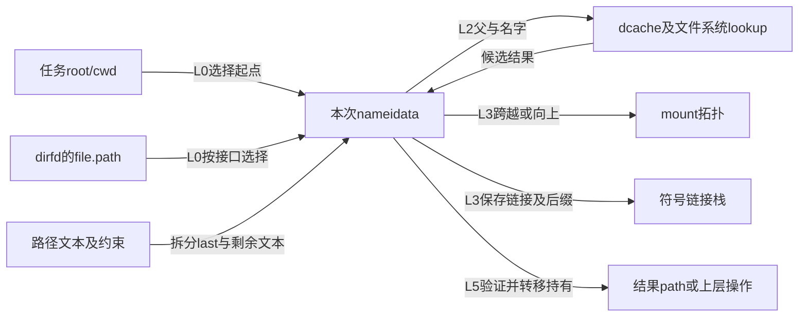
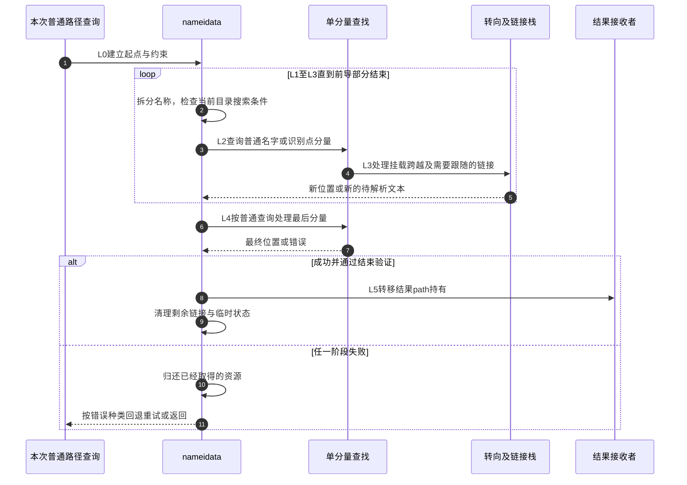

# 第9章\_路径查找状态机

上一章已经解决“给定父目录，怎样找到并持有一个名字的结果”。但 `/a/b/../c` 不能只做一次名称哈希：起点由任务上下文决定，中途可能进入新挂载，某个名字可能是符号链接，最后的 c 还可能是准备创建的名字。

本章把这些步骤放进一次完整遍历，先按语义理解当前位置、剩余文本和约束，再映射到 nameidata。快速遍历与带引用遍历如何切换到下一章细讲；这里先把二者共同要兑现的路径含义建立起来。

## 9.1\_为什么不能先把路径当字符串化简

在同一实验目录中放置下面的对象。target 与 other/target 是两个不同文件，a 是一个内容为 other/inner 的相对符号链接，inner 是空目录。

```text
实验目录/
├── target             内容 R
├── a -> other/inner
└── other/
    ├── target         内容 N
    └── inner/
```

现在从实验目录打开 `a/../target`。若先在字符串中删掉 `a/..`，剩下 target，会读到 R；真正查找先发现 a 是链接，解释它的目标 other/inner，再处理尚未走完的 ../target，于是从 inner 回到 other，最终读到 N。

| 走到的内容 | 当前目录或动作 | 尚未完成的部分 |
| --- | --- | --- |
| 起点 | 实验目录 | a/../target |
| a | 发现相对符号链接，保存原后缀 | 先走other/inner，再继续../target |
| other | 进入实验目录下的other | inner，再接原后缀 |
| inner | 进入other/inner | ../target |
| .. | 按实际父关系回到other | target |
| target | 取得other/target | 后续由打开操作取得file |

这也说明某个分量不存在、不是目录或没有搜索权限时，内核不能因后面有 `..` 就跳过它。路径解析要执行对象和权限协议，不能用文本清理替代。

## 9.2\_同一段相对路径为什么会有不同起点

相对路径本身没有提供完整坐标。普通相对访问从任务 cwd 开始；`*at()` 接口可以指定目录 fd；普通绝对路径从任务可见 root 开始。root 与 cwd 来自 fs_struct，目录 fd 经描述符表取得 file.path，实际跨挂载关系则由所在视图解释。

| 输入和约束 | 起点规则 | 容易混淆的边界 |
| --- | --- | --- |
| 普通绝对路径 `/x` | 任务可见root | 不是全机器唯一且不变的全局根 |
| 普通相对路径，dfd为AT_FDCWD | 当前cwd | 其他线程若共享fs_struct，cwd变化也须按协议观察 |
| 相对路径和有效目录fd | 该file的path | fd固定目录对象持有，不固定它原来的字符串位置 |
| 普通绝对路径传给openat | 按绝对路径规则 | 不能仅因提供dirfd就认为被限制在该目录内 |
| openat2使用RESOLVE_IN_ROOT | 本次把dirfd对应目录作为根边界 | 与普通openat不同，也不永久改变任务root |

空路径是否允许由具体接口及标志决定，不能一律改成 `.`。目录 fd 对非空路径还需要能作为目录搜索起点；权限检查也不是因为已经打开这个 fd 就全部免除。

## 9.3\_一次遍历要同时保存哪些状态

只保存 inode 不能继续遍历：在挂载根向上需要 mount，解析相对链接要知道链接所在位置，处理完链接目标还要恢复先前剩余文本。Linux 的 nameidata 因此保存本次遍历状态，它不是目录树本身，也不是交给用户的 fd。

把一次普通路径查询分为 L0 建立起点和约束，L1 拆分并检查前导分量，L2 查询一个名字，L3 处理挂载、点分量和链接造成的转向，L4 按调用目的处理最后分量，L5 验证、交付结果并清理。L1～L3 可以重复，链接目标也可重新引入待走的文本。

| 状态位置 | 保存内容 | 推进时点 |
| --- | --- | --- |
| nameidata.path、inode | 当前视图位置与对应inode | 起点建立、普通分量进入、挂载或链接转向 |
| root、root_seq及state | 本次根边界与其持有/观察状态 | 需要根或建立受限查找时设置 |
| last、last_type | 当前待处理名称及普通/点/点点等分类 | 拆分分量时写入，单分量与末项路径消费 |
| flags | 查找目的、遍历模式与限制 | 上层请求建立，过程按契约调整 |
| seq、next_seq、m_seq、r_seq | dentry、mount及rename观察凭据 | 快速观察与边界验证使用，不是文件版本号 |
| stack、depth、total_link_count | 链接路径、待恢复文本、清理动作及跟随预算 | 遇到链接压入，完成或退出时配对释放 |



代码中当前任务也记录正在使用的 nameidata，以支持相关回调和嵌套查找；结束后必须恢复原来的上下文。状态内容属于本次操作，不能拿它代替全局名称缓存。

## 9.4\_前导分量与最后分量为什么不能同样处理

假设要打开 `other/new`。对于 other，后续还要继续找名字，因此必须能够作为目录搜索；对于 new，普通查询要求找到已有对象，而带创建目的的打开可能允许它不存在。删除、重命名和创建又需要父目录与最后名字，在父目录操作协议中处理末项。

link_path_walk 因此主要处理前导部分，把最后名称及分类留在 nameidata。普通 path_lookupat 随后用 lookup_last 进入末项，再完成验证；请求父路径的 path_parentat 则把父结果交给上层。open 有自己的末项处理链，不能宣称所有文件系统系统调用都完整经过 filename_lookup。



末尾斜杠也有语义：普通查询末项为普通名称且后面有斜杠时，会要求目录并按相应规则跟随链接。`file` 和 `file/` 不能无条件等价。最终取得 path 只完成名称定位，并不表示已经建立可读写的 file，更不代表设备或文件操作已经执行。

## 9.5\_点分量挂载和链接怎样改变当前位置

`.` 留在当前位置；`..` 需要按实际父关系前进。在挂载根处，它还可能先回到父挂载的接入位置，再继续处理上层。普通根边界阻止继续向外，而受限查找可以要求尝试越界直接失败。因此简单执行 `dentry = dentry->d_parent` 无法完整处理 `..`。

普通名字命中后先处理该位置的挂载关系，可能从父视图切换到另一个 mount 的根。之后若是应跟随的符号链接，则保留链接对象和清理动作，取得目标文本：相对目标按链接所在目录解释，绝对目标跳到本次查找的根，再继续未完成后缀。

链接跟随必须有上限，否则循环链接可无限消耗时间和栈。固定 Linux 6.12.20 的 MAXSYMLINKS 为40，reserve_stack 累计跟随数，超过预算返回 ELOOP；这个总预算不等于此刻嵌套栈的深度。内联栈只是小规模优化，需要时扩展，并按当前遍历模式处理分配失败或回退。

普通文本链接之外，某些 procfs 链接可通过专门回调直接跳到已解析的 path。这类 magic link 不应画成必定先拼接一段字符串，其边界由专门的限制检查控制。这里建立语义区别，不要求读者提前实现这种文件系统。

## 9.6\_把限制交给本次查找而非事后比较字符串

目录 fd 提供可靠起点，但普通 openat 不禁止 `..`、绝对链接或跨挂载。若调用者要求本次解析留在一个范围内，应让解析过程检查约束；先得到一个字符串再检查前缀，无法替代中途的真实路径关系和并发变化验证。

openat2 的 open_how 包含 flags、mode、resolve，前两项描述打开方式及创建模式，resolve 描述路径解析限制。下表是该固定版本的公开标志，内核内部 LOOKUP_* 的位值另有定义，不能把两套位掩码直接互换。

| resolve标志 | 值 | 本次解析的约束与边界 |
| --- | --- | --- |
| RESOLVE_NO_XDEV | 0x01 | 禁止跨挂载，包括bind边界；不只是禁止换块设备 |
| RESOLVE_NO_MAGICLINKS | 0x02 | 禁止通过magic link跳转，普通符号链接另按规则处理 |
| RESOLVE_NO_SYMLINKS | 0x04 | 禁止遍历符号链接；与仅控制末项的普通O_NOFOLLOW用途不同 |
| RESOLVE_BENEATH | 0x08 | 不允许解析逃出dirfd起点范围；绝对路径和绝对跳转会被拒绝 |
| RESOLVE_IN_ROOT | 0x10 | 本次将dirfd视为根来解释绝对路径及根处的上行 |
| RESOLVE_CACHED | 0x20 | 要求用可接受的缓存查找完成，不能完成时可返回EAGAIN |

BENEATH 与 IN_ROOT 在本版本不能同时设置。禁止遍历链接也不等于禁止取得链接对象本身：适用的 O_PATH 与末项不跟随组合有自己的打开语义，后续打开章节再处理。这里的限制既不冻结整个目录树，也不保证返回后其他任务永远不能移动对象。

固定实现的根、分量和结果交接从 [路径遍历导读](../../../research/source_reading/vfs/navigation/P08_路径怎样从起点推进到结果交付.md#8.1_把位置文本与约束放进同一周期) 进入。约束表依据同一提交的 openat2.h、namei.h 和 fs/open.c 映射，不把新接口的语义混入普通openat。

## 9.7\_用完整程序观察链接改变点点的含义

下面的 [path_walk_demo.c](../../../labs/kernel/vfs/materials/path_walk_demo.c) 建立本章目录关系，从同一 dirfd 分别读取 a/../target 与 target。它不修改 cwd，也不需要挂载；创建对象后逐项记录成功状态，退出时只清理自己取得的资源。本次没有目标 Linux 编译和运行记录，输出解释是预期。

```c
#define _GNU_SOURCE
#include <errno.h>
#include <fcntl.h>
#include <stdbool.h>
#include <stdio.h>
#include <stdlib.h>
#include <sys/stat.h>
#include <unistd.h>

static int create_value(int dir_fd, const char *name, char value, bool *created)
{
    int fd = openat(dir_fd, name, O_CREAT | O_EXCL | O_WRONLY | O_CLOEXEC, 0600);
    ssize_t count;
    if (fd < 0)
        return -1;
    *created = true;
    do {
        count = write(fd, &value, 1);
    } while (count < 0 && errno == EINTR);
    if (count != 1) {
        int saved_errno = count < 0 ? errno : EIO;
        close(fd);
        errno = saved_errno;
        return -1;
    }
    /* Linux 上不因 close 失败而重试同一个数字。 */
    return close(fd);
}

static int read_value(int dir_fd, const char *name, char *value)
{
    int fd = openat(dir_fd, name, O_RDONLY | O_CLOEXEC);
    ssize_t count;
    if (fd < 0)
        return -1;
    do {
        count = read(fd, value, 1);
    } while (count < 0 && errno == EINTR);
    if (count != 1) {
        int saved_errno = count < 0 ? errno : EIO;
        close(fd);
        errno = saved_errno;
        return -1;
    }
    return close(fd);
}

int main(void)
{
    char workspace[] = "/tmp/vfs-path-demo-XXXXXX";
    char walked, simplified;
    int dir_fd = -1, result = EXIT_FAILURE;
    bool have_workspace = false, have_other = false, have_inner = false;
    bool have_root_file = false, have_other_file = false, have_link = false;

    if (!mkdtemp(workspace)) {
        perror("创建实验目录");
        goto out;
    }
    have_workspace = true;
    dir_fd = open(workspace, O_RDONLY | O_DIRECTORY | O_CLOEXEC);
    if (dir_fd < 0) {
        perror("打开实验起点");
        goto out;
    }
    if (mkdirat(dir_fd, "other", 0700) < 0) {
        perror("创建 other");
        goto out;
    }
    have_other = true;
    if (mkdirat(dir_fd, "other/inner", 0700) < 0) {
        perror("创建 inner");
        goto out;
    }
    have_inner = true;
    if (create_value(dir_fd, "target", 'R', &have_root_file) < 0 ||
        create_value(dir_fd, "other/target", 'N', &have_other_file) < 0) {
        perror("建立两个不同文件");
        goto out;
    }
    /* 相对链接目标以链接所在目录为起点解释。 */
    if (symlinkat("other/inner", dir_fd, "a") < 0) {
        perror("创建符号链接");
        goto out;
    }
    have_link = true;
    if (read_value(dir_fd, "a/../target", &walked) < 0 ||
        read_value(dir_fd, "target", &simplified) < 0) {
        perror("读取两条路径");
        goto out;
    }
    if (walked != 'N' || simplified != 'R') {
        fprintf(stderr, "路径结果不符合已建立的目录关系\n");
        goto out;
    }
    printf("a/../target -> %c，直接 target -> %c\n", walked, simplified);
    result = EXIT_SUCCESS;

out:
    /* 仅删除本次成功创建的对象，从子项向父目录配对清理。 */
    if (have_link && unlinkat(dir_fd, "a", 0) < 0)
        result = EXIT_FAILURE;
    if (have_other_file && unlinkat(dir_fd, "other/target", 0) < 0)
        result = EXIT_FAILURE;
    if (have_root_file && unlinkat(dir_fd, "target", 0) < 0)
        result = EXIT_FAILURE;
    if (have_inner && unlinkat(dir_fd, "other/inner", AT_REMOVEDIR) < 0)
        result = EXIT_FAILURE;
    if (have_other && unlinkat(dir_fd, "other", AT_REMOVEDIR) < 0)
        result = EXIT_FAILURE;
    if (dir_fd >= 0 && close(dir_fd) < 0)
        result = EXIT_FAILURE;
    if (have_workspace && rmdir(workspace) < 0)
        result = EXIT_FAILURE;
    if (result != EXIT_SUCCESS)
        fprintf(stderr, "实验或配对清理失败，请核对先前错误及实验目录\n");
    return result;
}
```

```sh
# 在保存源码的目录内用Linux C开发环境执行。
cc -std=c11 -Wall -Wextra -Werror -O2 path_walk_demo.c -o path_walk_demo
./path_walk_demo
```

预期第一条读到 N，直接 target 读到 R。程序读取一个字节，重试 EINTR，并把提前结束视为错误；清理不递归删除任意目录。这个实验只证明特定目录布局下的路径语义，不验证 RCU 模式、并发 rename 或受限查找的所有拒绝分支。

## 9.8\_结束验证为何还可能触发重新遍历

走到最后一个对象仍需 complete_walk：快速观察必须转成可交付的持有，受限查找要做边界检查，发生跳转的结果可能需要弱重新验证。成功时把结果 path 从 nameidata 转移给接收者，再清理剩余状态；失败时按当前模式归还已有引用或退出 RCU，不交付半成品。

filename_lookup 的普通查询入口先尝试 RCU 模式，特定 ECHILD 结果会重做带引用查询，ESTALE 还可要求重新验证。这些是内部协议分支，不等于向用户宣称“子进程错误”，也不是对任意错误无限重试。RESOLVE_CACHED 等约束还会改变允许的回退行为。

**练习与参考答案**：能否删除 a/.. 后再提交路径？不能，a 可能是链接或不存在。dirfd 是否自动禁止逃出目录？普通openat没有这种保证。取得最终path是否已经完成open？没有，打开仍需末项和file建立协议。路径结果是否是全程冻结的快照？不是，内核按访问协议验证能够接受的观察；要求全树不变是更强的另一项保证。

现在能够把起点、当前位置、剩余文本、最后分量和结束清理连成一条链。接下来专门回答这条链怎样在并发修改下减少频繁引用操作，又能安全回退：[RCU-walk与ref-walk](P10_RCU-walk与ref-walk.md)。
