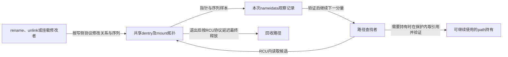
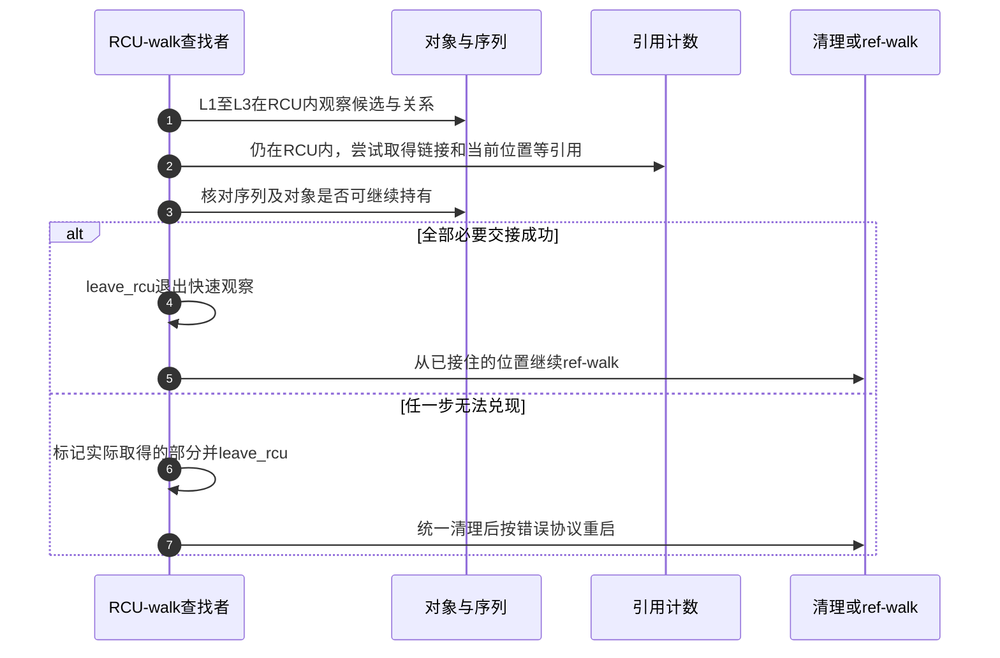
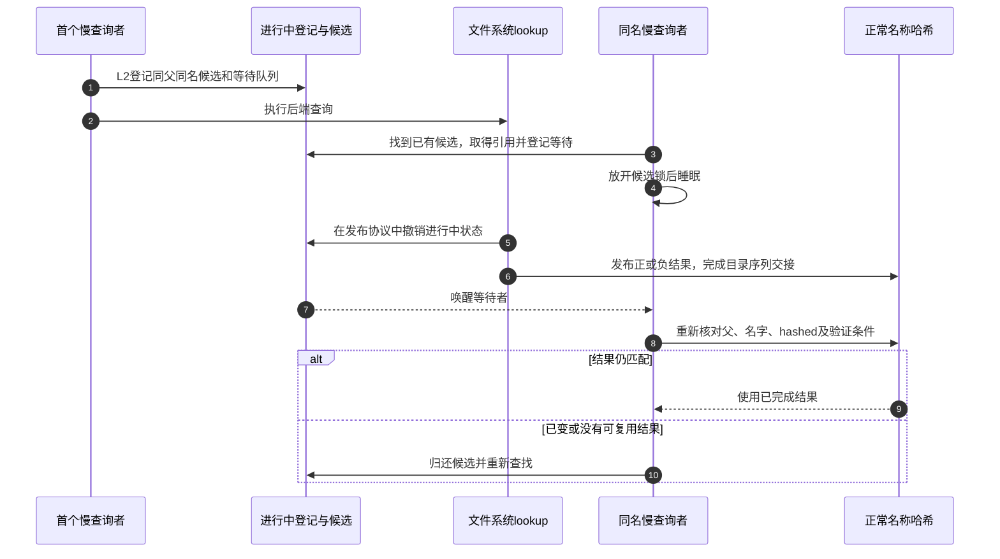

# 第10章\_RCU-walk与ref-walk

上一章已经建立 L0～L5 的路径周期：确定起点，逐分量前进，处理转向和末项，最后交付一个被持有的 path。现在考虑很多任务反复走同一组热门目录：怎样减少每一步取得和归还引用的成本，又不把正在重命名或退出的对象当成稳定事实？

本章比较同一条路径的两种执行模式，并继续解释切到慢查询后如何协调同名请求。它们共同兑现上一章的路径语义，差别在观察方式、对象持有和允许执行的工作。

## 10.1\_先有带引用遍历再考虑减少共享写入

最直接的办法是每推进一个分量，都为当前使用的 dentry 和 mount 取得必要引用，在离开时配对归还。这样即使目录随后改变，执行者仍有合法对象可以检查、使用或清理；需要后端查询时，也可进入允许睡眠的路径。这就是 ref-walk 的核心价值。

但引用不是免费的数字。以多 CPU 反复访问同一热门目录为条件场景，dentry 的共享 lockref 状态会被不同执行者修改。一个 CPU 更新计数所需的缓存行写权限可能使其他 CPU 的副本失效；另一个 CPU 随后修改又需取得写权限。目录层级越多、并行查询越集中，重复的取放引用和锁状态写入越可能成为成本。具体成本取决于处理器、配置和负载，不能只凭源码给出固定耗时。

RCU-walk 尝试移除高频正常路径上逐分量的这种持有写入：先在 RCU 保护内观察对象，并保存序列信息；只有能够验证这些观察时才继续。它仍需要读取对象与序列、执行检查和 RCU 读侧协议，遇到不满足条件的工作还要取得引用或重试，不能称为“完全无同步”。

本仓库固定源码基线的配置没有启用 SMP，因此上述多 CPU 缓存一致性过程是用于解释设计压力的条件模型，不是这棵配置的实测报告。RCU 的读侧记录也随配置变化，不宜统一画成每 CPU 上某一个永远相同的字段。

## 10.2\_快速观察必须同时回答存续与关系两个问题

RCU 保护让读者在协议允许的窗口内安全观察尚未最终释放的对象；它不冻结名字、父关系或挂载连接。dentry 序列与 mount/rename 序列另用于判断读到的关系是否仍能被接受。只取其中一种保护都不够。

| 状态或凭据 | 保存位置 | 它能证明与不能证明的内容 |
| --- | --- | --- |
| RCU读侧保护 | 当前执行上下文，具体承载随配置变化 | 保护相关观察窗口；不证明名称不变 |
| dentry序列 | dentry.d_seq，副本在nameidata.seq/next_seq | 检查候选及前后分量关系；不等于文件内容版本 |
| 挂载序列 | mount_lock，副本在nameidata.m_seq | 检查相应挂载变化及持有交接 |
| rename序列 | rename_lock，副本在相应查找状态 | 按调用路径处理遗漏或范围约束；并非每次命中都全局重试 |
| 显式引用 | dentry的lockref和mount计数 | 支持离开观察窗口后继续持有；不冻结路径名 |

固定版本入口见 [VFS源码索引](../../../research/source_reading/vfs/navigation/P01_Linux_6.12_VFS源码阅读索引.md)。[__d_lookup_rcu](../../../research/source_reading/vfs/source_explanations/P16_候选读取与快速路径验证.md#16.1_返回候选时同时交出尚待验证的序列) 返回候选和序列样本，不为结果增加普通引用，也不替所有调用者完成最终验证。路径层先核对父的观察，再在进入候选等位置验证子序列；相邻步骤的验证相互衔接，使结果对应协议允许的遍历。它不是在某一时刻复制整棵目录树的快照。

ref-walk 也可以命中 dcache。两种模式的区别不是“缓存与磁盘”，而是当前如何保护、验证和持有路径对象；函数名带 fast 也不证明当前一定处于 RCU-walk。

## 10.3\_切换模式必须先接住引用再离开保护窗口

假设当前已用 RCU 观察到目录，但下一步需要睡眠查询。若先退出 RCU，再尝试对原指针增加引用，对象可能在这两步之间被回收。正确交接必须在保护仍有效时尝试取得相应引用，并验证取得的对象仍对应此前可接受的观察。

[try_to_unlazy](../../../research/source_reading/vfs/source_explanations/P17_从RCU观察交接到路径引用.md#17.4_全部必要持有取得后才退出RCU) 按顺序处理已保存链接、当前位置和需要的 root。成功后才 leave_rcu，后续以 ref-walk 继续；如果验证失败，也会整理状态并退出，由 terminate_walk 归还实际取得的部分，再让上层按协议重新查找。失败的 nameidata 不能继续当成一个正常位置推进。

如果已经选中了下一个 dentry，[try_to_unlazy_next](../../../research/source_reading/vfs/source_explanations/P17_从RCU观察交接到路径引用.md#17.5_已经选出的下一候选需要额外持有) 还要接住它；不能只固定父目录就把子候选当成自动安全。挂载持有的验证也不是一次加计数：[__legitimize_mnt](../../../research/source_reading/vfs/source_explanations/P17_从RCU观察交接到路径引用.md#17.1_挂载引用的取得与序列检查必须配对) 先检查序列、增加持有并配对屏障，再复查；不同失败返回说明是否仍有一份持有需要调用者归还。

L5 成功交付最终结果同样需要引用持有。RCU-walk 节省的是许多中间步骤的反复取放，并没有让成功 path 变成一个在退出 RCU 后可随意使用的裸指针。

## 10.4\_原地继续重头再走和直接失败要分开

缓存未命中时，如果能合法接住当前位置，就可从这个位置进入慢查询，而不是必定从根重做。若序列验证无法成立，已经走过的观察不足以支持继续，普通入口可能清理后重新以带引用模式遍历。真正的权限、类型或不存在错误则不能全部吞掉重试。

| 遇到的条件 | 典型处理 | 不能外推的结论 |
| --- | --- | --- |
| 快速名称查询没有候选 | 尝试固定当前位置，再进入慢查询 | 未命中不直接证明后端不存在 |
| revalidate要求可阻塞上下文 | 固定父和下一候选，再按协议重新验证 | 不是所有验证失败都表示同一种错误 |
| dentry或mount验证不通过 | 返回相应重试信号并清理，必要时重头走 | 不能沿用旧裸指针继续 |
| 链接、权限或管理回调需要慢操作 | 在允许情况下转换模式 | 不保证每种回调都支持快速模式 |
| 真正的权限、非目录等失败 | 按具体错误返回 | 不能为了“查到为止”无限重试 |
| 请求RESOLVE_CACHED却必须做不允许的慢查询 | 失败并向调用者报告相应EAGAIN | 不能悄悄违背缓存限定 |

RESOLVE_CACHED 限制需要完成的查找工作，并不禁止在 L5 为已找到结果取得最后的合法持有。[complete_walk](../../../research/source_reading/vfs/source_explanations/P13_路径起点与结果持有的交接.md#13.3_结束验证把快速观察变成可交付结果) 在相应完成路径清除 LOOKUP_CACHED 再执行交接；这与未命中后去后端查找是不同阶段。

候选验证、跨挂载与权限检查分别见 [lookup_fast](../../../research/source_reading/vfs/source_explanations/P16_候选读取与快速路径验证.md#16.2_快速查询按当前模式解释同一个返回形态)、[挂载回退](../../../research/source_reading/vfs/source_explanations/P16_候选读取与快速路径验证.md#16.3_跨挂载失败后先恢复候选再交接模式) 和 [may_lookup](../../../research/source_reading/vfs/source_explanations/P16_候选读取与快速路径验证.md#16.5_权限检查也必须说明能否阻塞)。固定实现和返回值清理从 [快慢遍历导读](../../../research/source_reading/vfs/navigation/P09_快速观察怎样转为引用并协调慢查询.md#9.1_把观察凭据与持有交接分开) 进入。上一章已有普通入口的有限重试链，此处继续核对每条转换到底取得了哪些资源。

## 10.5\_切到慢路径后同名查询为什么还要协调

两个任务可能几乎同时发现同一父目录下的名字没有缓存结果。父目录共享锁允许多个读查询并行，不能只靠它保证同一个名字只有一个执行者调用文件系统 lookup。如果两边各创建候选、独立发布，就会重复后端工作并使结果交接复杂化。

Linux 为正在查询的名称维护单独的 in-lookup 哈希。[d_alloc_parallel登记](../../../research/source_reading/vfs/source_explanations/P18_并行查询的登记等待与结果发布.md#18.2_先查正常结果再争取进行中登记) 的对象带 DCACHE_PAR_LOOKUP，并暂存 d_wait 指向发起查询路径的等待队列；正常结果仍进入普通名称哈希。发起者保存状态，其他同名查询者取得候选持有后等待完成，不把“尚无inode”当作已完成的负结果。

| 承载位置 | 写入与读取者 | 对应通信 |
| --- | --- | --- |
| in-lookup哈希及候选标志 | d_alloc_parallel登记；完成路径撤销 | 同名查询发现已有工作者 |
| 候选d_wait | 发起者把本次查询的队列地址登记到候选 | 后来者按此队列睡眠，完成者唤醒 |
| 父inode.i_dir_seq | 发布路径进入和结束时更新，分配者读取并复查 | 防止从正常哈希与进行中哈希之间的转换缝隙作出错误判断 |
| 正常dentry哈希与关联 | 发布者填充，等待结束者重新核对 | 交付已完成结果，而不是仅交付一次唤醒 |

上图选择文件系统正常发布结果的分支，对应 [目录序列](../../../research/source_reading/vfs/source_explanations/P18_并行查询的登记等待与结果发布.md#18.4_目录序列把两个哈希之间的转换连接起来) 与 [完成交接](../../../research/source_reading/vfs/source_explanations/P18_并行查询的登记等待与结果发布.md#18.5_完成先撤销进行中身份再交付结果或重查机会)。等待者的栈上记录和队列寿命见 [d_wait_lookup](../../../research/source_reading/vfs/source_explanations/P18_并行查询的登记等待与结果发布.md#18.3_等待者睡眠前登记并在醒来后重查)。错误或替代结果也必须结束进行中登记，等待者可能重查而不能复用原候选。醒来只意味着应重新检查条件；它不证明原名字永远没变，也不保证每个等待者得到同一个最终返回值。

这套流程用共享候选、桶锁、目录发布序列、引用和等待队列替代重复后端查询。不同名字仍可并行；热点同名缺失则可能排队。它付出的状态和唤醒成本是明确的，不是“慢路径加一把锁”就可以省略全部通信。

## 10.6\_怎样判断收益与验证边界

缓存结果稳定、路径组件热门且查询频繁时，减少中间分量的共享引用写入有价值。后端经常需要重新验证、名字持续变化或大量查询未命中时，转换、重试与等待会增加成本。ref-walk 是正确处理这些工作的必要路径；不能为了只保留快速路径而取消验证或不调用必要的文件系统操作。

重新运行上一章 [path_walk_demo.c](../../../labs/kernel/vfs/materials/path_walk_demo.c) 可以观察路径语义，但同样的 N/R 输出可能来自不同内部模式。只测一次耗时或看到一次 lookup_fast 调用，都不足以证明走完 RCU-walk。若要在目标上验证，应同时记录内核身份、文件系统、冷热缓存和并发条件，再区分 LOOKUP_RCU、模式转换、重启、后端查询及最终结果；本次没有这类运行追踪。

**练习与参考答案**：可以先退出 RCU 再对原候选加引用吗？不能，这会使观察与持有之间失去保护。ref-walk 一定访问存储设备吗？不一定，它也可命中缓存。成功的 RCU-walk 完全没有引用成本吗？不是，最终结果仍需合法持有。同名查询被唤醒后能否直接相信原候选？不能，要检查完成条件和身份。切换失败时能否凭剩余几个非空指针继续？不能，部分取得状态只供规定的清理路径使用。

现在读侧的正常观察、模式交接、并行未命中和错误退出已能连成一条链。下一章转到写侧，解释它怎样在锁和文件系统操作下建立或撤销名称：[创建、删除、链接与重命名](P11_创建删除链接与重命名.md)。
