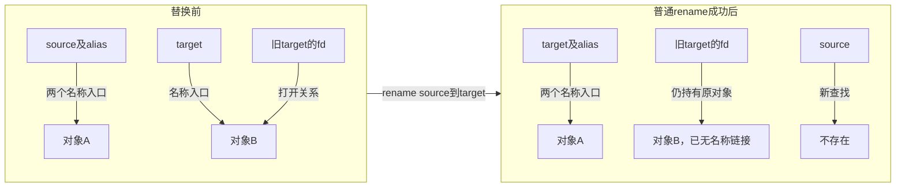
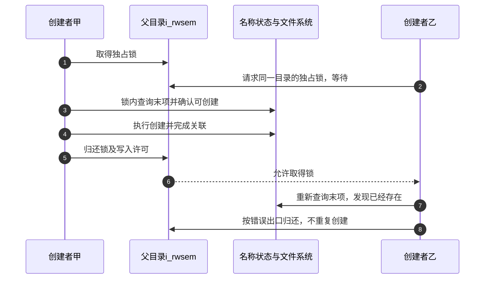
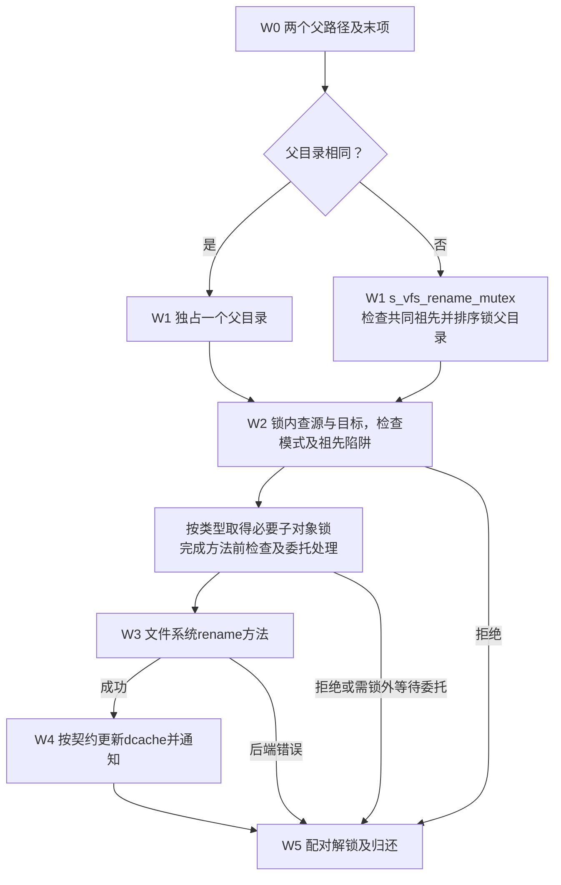

# 第11章\_创建删除链接与重命名

前两章解释了读者怎样逐步查找名称，以及关系变化时怎样验证或重试。现在换到修改者：两个任务都发现同一个名字不存在，是否都能创建？一个任务把新文件替换到旧名字上，原来打开旧文件的程序会读到什么？本章用这些问题建立名称修改的锁、状态和交付过程。

这里先研究目录中的名称关系。普通文件创建如何与打开、截断和fd发布组合，到下一章再进入完整open事务。

## 11.1\_先区分新增对象新增名称与替换入口

在一个只有本实验修改的目录中，source指向对象A，target指向对象B。为source建立硬链接alias以后，source和alias是两个名称入口，共同指向A；没有复制A的文件内容，也没有把两个目录项变成同一个dentry。

随后执行普通rename(source,target)。成功后target找到A，source这个旧入口消失；alias仍找到A。替换前已经打开B的fd继续持有B，不会因为target改指A就自动转向A。名称与打开关系分离，正是允许“发布新版本，同时让已有读者完成旧版本访问”的基础。



这不是用新数据覆盖B的内容。若需求是让所有已经打开B的读者也看到一次原地内容更新，rename不会自动实现那种语义；内容写入和名称替换是不同操作。反过来，先unlink(target)再rename(source,target)会引入一个target缺失的窗口，也不等价于一次替换。

| 操作 | 名称与对象发生的变化 | 不应混同的动作 |
| --- | --- | --- |
| create或mkdir | 在受保护的父目录中建立新对象及名称关联 | 不是只分配一个inode就完成发布 |
| link | 新名称关联到已有非目录对象，增加相应链接数 | 不是复制内容或建立符号链接文本 |
| unlink | 撤销一个非目录名称，改变链接数 | 不关闭已经存在的fd |
| rename | 移动或替换名称关系，已有打开关系保持原对象 | 不等于原地写文件，也不保证落盘 |

## 11.2\_为什么检查不存在与创建必须连在一起

设任务甲先查到new不存在，准备创建；在甲进入文件系统之前，任务乙也查到不存在并创建成功。若甲仅凭先前结果继续建立对象，就会把一个过时的观察当成当前修改资格。持有父path只能保证对象存续，不能阻止另一个任务修改该目录的内容。

修改路径因此先取得父目录的独占inode锁，在锁内重新处理最后名称，检查存在性和权限，再调用文件系统操作。此前的路径遍历负责把我们带到父目录；父锁保护的是最终检查与修改这段协议。第十章允许多个慢查询共享父锁，与这里排他修改并不矛盾。



还需要取得挂载写入许可。它参与只读切换等写入协议，不等于持有目录锁，也不等于磁盘写入已经完成。路径取得、写许可、锁和dentry引用是不同资源，错误出口必须按实际取得情况逐项归还。

## 11.3\_把一次名称修改分成可以追踪的阶段

名称修改涉及几组正交状态：目录关系、对象链接数、临时引用与锁、后端状态以及通知。它们不是一个名为“文件已删除”的布尔量。以下W0～W5表示一次修改周期，不声称所有文件系统都在完全相同的函数里完成每一步。

| 阶段 | 触发与读写者 | 状态承载及下一步条件 |
| --- | --- | --- |
| W0 定位父与末项 | 调用路径查找取得父path，保存最后名称 | 本次调用栈中的path、qstr；尚无修改资格 |
| W1 建立修改保护 | 调用者取得写许可和所需目录锁 | mount写入状态、inode.i_rwsem；多父目录还要拓扑协调 |
| W2 锁内解析与检查 | 查找最后dentry，检查存在性、类型、权限、限制 | dentry关联、inode字段、挂载身份及安全钩子；失败只做配对退出 |
| W3 执行后端修改 | vfs入口调用inode_operations对应方法 | 文件系统负责对象和目录事实，可能改变链接数、元数据和关联 |
| W4 完成缓存与通知交接 | 文件系统与VFS按方法契约协作 | dentry哈希、名字及父关系、序列和fsnotify；具体顺序按操作核对 |
| W5 归还临时资源 | 调用者解锁、归还引用及写许可 | 对已打开对象的其他持有不受此清理代替；成功也不等于持久化完成 |

普通mkdir的一条具体链是[filename_create](../../../research/source_reading/vfs/source_explanations/P19_末项创建的检查与资源交接.md#19.1_父路径到手还不代表可以建立最后名称)取得父path、写许可和父锁，返回可创建的候选；do_mkdirat执行路径安全检查，再进入vfs_mkdir；文件系统方法成功后通知，[done_path_create](../../../research/source_reading/vfs/source_explanations/P19_末项创建的检查与资源交接.md#19.4_mkdir调用者把成功和失败都送入配对清理)配对归还。filename_create成功时携带的是一组待归还资源，不能把它当成普通无副作用查询函数。

源码身份从 [VFS阅读索引](../../../research/source_reading/vfs/navigation/P01_Linux_6.12_VFS源码阅读索引.md#1.1_先固定源码身份与运行证据) 进入，本章W0～W5对应 [名称修改导读](../../../research/source_reading/vfs/navigation/P10_名称修改怎样锁定检查与交付.md#10.1_沿修改周期区分保护与结果)。本次固定NXP Linux 6.12.20，不把某一种后端的元数据更新方式当成所有文件系统的统一实现。

## 11.4\_unlink结束名称使用却不结束所有对象使用

unlink的调用者在父锁内找到对象；[vfs_unlink](../../../research/source_reading/vfs/source_explanations/P20_名称链接的增加撤销与通知.md#20.1_删除方法成功后仍要兑现缓存和通知契约)还要检查删除资格并锁住目标inode。文件系统unlink成功后，普通路径执行[d_delete_notify](../../../research/source_reading/vfs/source_explanations/P20_名称链接的增加撤销与通知.md#20.2_删除通知之前先撤销对应缓存名称)：暂时持有inode，先d_delete撤销相应名称缓存关系，再发出删除通知，最后归还临时持有。存在NFS延迟删除等特殊分支，不能把普通路径的动作硬套到所有后端。

第八章已经说明d_delete可能把候选变负，也可能在仍有其他使用者时只撤销正常哈希。因此“旧dentry仍指着inode”不能单独证明名称仍可查到。反之，链接数为零也不证明内存或数据已经回收：file等持有仍可能允许后续访问。

[do_unlinkat](../../../research/source_reading/vfs/source_explanations/P20_名称链接的增加撤销与通知.md#20.3_最后inode归还放到父锁之外)额外ihold目标，并在释放父目录锁之后iput，避免可能耗时的最后对象处理长期占住父目录锁。这个细节说明归还位置本身也是协议的一部分，不是把所有put随意塞进一个统一尾部即可。

硬链接创建走另一方向：在新父目录保护内确认新名称可建立，再锁住源inode检查链接限制并调用link方法。不能用一个仍打开但已无名称的普通inode随意复活文件；固定实现对零链接对象有专门的[I_LINKABLE](../../../research/source_reading/vfs/source_explanations/P20_名称链接的增加撤销与通知.md#20.4_增加硬链接要同时检查新父与旧对象)条件。用户路径的[linkat](../../../research/source_reading/vfs/source_explanations/P20_名称链接的增加撤销与通知.md#20.5_用户路径还要维持挂载和重试边界)还检查挂载身份，即使两个路径最终涉及同一superblock，不同挂载入口也可能返回EXDEV。

## 11.5\_rename为何需要额外防止目录环和锁环

先看两个目录P、Q。一个线程要把P下的项移到Q，另一个线程做反方向移动；若各自先锁自己的父目录再等对方，两边都可能无法前进。目录移动还可能把一个祖先搬进自己的后代，例如把a移动到a/b内部；这会让父子关系形成环，之后连向上查找都无法按树解释。

跨父目录rename因此先取得该文件系统的[s_vfs_rename_mutex](../../../research/source_reading/vfs/source_explanations/P21_重命名的拓扑检查与锁顺序.md#21.1_父目录锁序在稳定拓扑下决定)，稳定用于决定锁序和祖先关系的拓扑。父目录按祖先优先原则锁定；源和目标末项在父锁下查找，陷阱节点用于拒绝成环操作。随后按类型锁定必要子对象，非目录对象使用inode地址顺序，不能把所有对象混成任意加锁列表。

同父目录的rename只需锁同一个父目录，不必机械取得跨目录那一层互斥锁。各层锁承担不同范围：s_vfs_rename_mutex协调跨目录拓扑，i_rwsem保护目录及必要对象操作，dcache更新还用rename_lock及dentry锁和序列。rename_lock不是前者的别名，也不是覆盖整个可能睡眠的文件系统rename回调的大自旋锁。



固定版本有一处需要按实际调用辨认：无祖先关系时，[lock_two_directories](../../../research/source_reading/vfs/source_explanations/P21_重命名的拓扑检查与锁顺序.md#21.1_父目录锁序在稳定拓扑下决定)按传入的p1、p2顺序锁父目录；do_renameat2传入的是新父、旧父。随树文档概括的“源父先行”不能直接代替这里的参数核对。两者共同依赖跨目录互斥锁已经持有；不得据此改成没有上层保护的任意两锁顺序。

## 11.6\_替换交换通知与持久化各有自己的承诺

普通rename成功后，文件系统的目录事实和dcache必须共同兑现新关系。本版本默认由VFS调用[d_move](../../../research/source_reading/vfs/source_explanations/P22_缓存名称移动与读侧序列交接.md#22.1_全局序列只围绕缓存移动这段短更新)，交换则调用d_exchange；声明[FS_RENAME_DOES_D_MOVE](../../../research/source_reading/vfs/source_explanations/P21_重命名的拓扑检查与锁顺序.md#21.4_后端成功后才执行对应缓存交接)的实现承担相应缓存移动责任，不能再重复做一次。缓存移动在rename_lock写侧及相关dentry序列保护下，摘除旧索引、修改名字和父关系、重新发布。第十章的读侧正是据这些序列判断观察是否可接受。

| renameat2标志 | 语义与前提 | 不应推断的保证 |
| --- | --- | --- |
| 0 | 普通移动；目标存在时按类型及后端规则替换 | 已有fd不会转向新对象 |
| RENAME_NOREPLACE，1 | 目标存在则拒绝覆盖 | 不能用先stat后普通rename等价替代 |
| RENAME_EXCHANGE，2 | 两个已存在名称交换所指对象 | 不能与NOREPLACE或WHITEOUT组合 |
| RENAME_WHITEOUT，4 | 支持的文件系统在源处留下whiteout，供叠加层等使用 | 需要后端与权限支持，不是普通文件移动的默认效果 |

接口定义与参数拒绝来自固定版本include/uapi/linux/fs.h和do_renameat2；WHITEOUT的完整叠加文件系统策略不在本章展开。不同挂载、类型不匹配、非空目录和安全策略等仍可能阻止操作。一次rename提供的名称替换语义也不意味着多个独立的stat/open调用组成同一份快照；并发读者可能在不同调用中看到不同阶段。

通知有明确的发生次序，但不会冻结世界。普通unlink在删除缓存关系之后通知，rename使用旧名称快照生成移动事件；接收者稍后查询时，另一任务可能已再次创建同名对象。不要把事件中的名称当成一个永不变化的对象句柄。

同样，rename成功与掉电后仍保存新目录项是不同问题。若把名称替换用于可靠发布，还须按具体文件系统和应用协议处理文件数据、目录更新及同步错误；fsync与回写章节再闭合这个问题。仅靠本章的锁和序列无法推出持久化承诺。

## 11.7\_用完整程序观察名称退出与旧打开关系

以下程序在私有临时目录中建立A、B，给A增加alias，再用A替换target，最后删除A剩余的两个名称。它检查target的新身份以及两个对象的链接数，并通过旧fd分别读到A和B。实验前提是Linux上支持普通硬链接和rename的文件系统，且没有其他任务修改此临时目录。

```c
#define _GNU_SOURCE
#include <errno.h>
#include <fcntl.h>
#include <stdbool.h>
#include <stdio.h>
#include <stdlib.h>
#include <sys/stat.h>
#include <unistd.h>

static int make_file(int dir_fd, const char *name, char value, bool *created)
{
    int fd = openat(dir_fd, name, O_RDWR | O_CREAT | O_EXCL | O_CLOEXEC, 0600);
    ssize_t count;
    if (fd < 0)
        return -1;
    *created = true;
    do {
        count = write(fd, &value, 1);
    } while (count < 0 && errno == EINTR);
    if (count != 1) {
        int saved_errno = count < 0 ? errno : EIO;
        close(fd);
        errno = saved_errno;
        return -1;
    }
    return fd;
}

static int read_at_start(int fd, char *value)
{
    ssize_t count;
    /* 使用显式偏移，避免前面的写入偏移干扰观察。 */
    do {
        count = pread(fd, value, 1, 0);
    } while (count < 0 && errno == EINTR);
    if (count == 1)
        return 0;
    if (count >= 0)
        errno = EIO;
    return -1;
}

int main(void)
{
    char workspace[] = "/tmp/vfs-replace-demo-XXXXXX";
    int dir_fd = -1, source_fd = -1, victim_fd = -1;
    int result = EXIT_FAILURE;
    bool have_workspace = false, have_source = false;
    bool have_target = false, have_alias = false;
    struct stat source_stat, target_stat, victim_stat;
    char source_value, victim_value;

    if (!mkdtemp(workspace))
        goto error;
    have_workspace = true;
    dir_fd = open(workspace, O_RDONLY | O_DIRECTORY | O_CLOEXEC);
    if (dir_fd < 0)
        goto error;
    source_fd = make_file(dir_fd, "source", 'A', &have_source);
    if (source_fd < 0)
        goto error;
    victim_fd = make_file(dir_fd, "target", 'B', &have_target);
    if (victim_fd < 0)
        goto error;
    if (linkat(dir_fd, "source", dir_fd, "alias", 0) < 0)
        goto error;
    have_alias = true;

    /* 替换名称入口，两个已经打开的 fd 均保持原来的对象身份。 */
    if (renameat(dir_fd, "source", dir_fd, "target") < 0)
        goto error;
    have_source = false;
    if (fstat(source_fd, &source_stat) < 0 ||
        fstatat(dir_fd, "target", &target_stat, 0) < 0 ||
        fstat(victim_fd, &victim_stat) < 0)
        goto error;
    if (source_stat.st_dev != target_stat.st_dev ||
        source_stat.st_ino != target_stat.st_ino ||
        source_stat.st_nlink != 2 || victim_stat.st_nlink != 0) {
        fprintf(stderr, "重命名后的身份或链接数不符合实验前提\n");
        goto out;
    }
    if (unlinkat(dir_fd, "target", 0) < 0)
        goto error;
    have_target = false;
    if (unlinkat(dir_fd, "alias", 0) < 0)
        goto error;
    have_alias = false;
    if (fstat(source_fd, &source_stat) < 0 ||
        read_at_start(source_fd, &source_value) < 0 ||
        read_at_start(victim_fd, &victim_value) < 0)
        goto error;
    if (source_stat.st_nlink != 0 || source_value != 'A' || victim_value != 'B') {
        fprintf(stderr, "名称退出后旧打开关系未产生预期结果\n");
        goto out;
    }
    printf("两个对象的名称链接数均为0，旧fd仍读到 %c 和 %c\n",
           source_value, victim_value);
    result = EXIT_SUCCESS;
    goto out;

error:
    perror("名称替换实验");
out:
    /* 只清理本次建立且尚未成功移除的名称；不重试 Linux close。 */
    if (have_alias && unlinkat(dir_fd, "alias", 0) < 0)
        result = EXIT_FAILURE;
    if (have_source && unlinkat(dir_fd, "source", 0) < 0)
        result = EXIT_FAILURE;
    if (have_target && unlinkat(dir_fd, "target", 0) < 0)
        result = EXIT_FAILURE;
    if (source_fd >= 0 && close(source_fd) < 0)
        result = EXIT_FAILURE;
    if (victim_fd >= 0 && close(victim_fd) < 0)
        result = EXIT_FAILURE;
    if (dir_fd >= 0 && close(dir_fd) < 0)
        result = EXIT_FAILURE;
    if (have_workspace && rmdir(workspace) < 0)
        result = EXIT_FAILURE;
    if (result != EXIT_SUCCESS)
        fprintf(stderr, "实验或清理失败；实验目录：%s\n", workspace);
    return result;
}
```

材料文件为 [name_replace_demo.c](../../../labs/kernel/vfs/materials/name_replace_demo.c)。在Linux上先编译：

```sh
cc -std=c11 -Wall -Wextra -Werror name_replace_demo.c -o name_replace_demo
```

`-std=c11`选语言版本，警告选项让潜在错误阻止构建，`-o`指定生成程序。源码启用GNU接口声明以使用这里的Linux/POSIX接口，不需要root。编译成功后运行：

```sh
./name_replace_demo
```

预期输出是“两个对象的名称链接数均为0，旧fd仍读到 A 和 B”。程序只清理自己建立的名称，失败时报告临时目录便于核对；不是在用户工作目录里覆盖同名文件。本次未在目标Linux编译或运行，输出是依据代码和契约的预期。

观察顺序可以用下表核对，而不是只盯最后一行：

| 时点 | A的名称 | B的名称 | 已打开fd |
| --- | --- | --- | --- |
| 创建和link后 | source、alias | target | 各自持有A、B |
| rename后 | target、alias | 无 | 仍各自持有A、B |
| 两次unlink后 | 无 | 无 | 仍可分别读到A、B |
| 最后close后 | 无 | 无 | 本程序的打开持有归还；实际回收依赖其他条件 |

这个实验不测跨目录锁顺序、通知队列、NFS委托、并发原子性或掉电恢复。串行结果成立不能代替这些验证。

## 11.8\_怎样判断一次修改究竟完成了什么

检查结果时先问：目录名称是否变化，已有打开关系是否仍指向原对象，当前调用取得的保护和引用是否已归还，持久化是否另有证据。这四个问题不能用一句“文件删掉了”代答。

**练习与参考答案**：甲查到不存在后不锁父目录就创建，缺在哪里？检查与修改之间允许乙改变同名关系，需要按写侧协议在保护下重新处理末项。target被替换后旧fd是否读A？仍读原对象B。收到删除事件后同名路径一定不存在吗？不一定，之后可能已重建。跨目录rename为什么不能只用rename_lock？它保护dcache短更新，不能代替可睡眠的目录操作与拓扑锁协议。

现在已经能解释名称的建立、撤销、替换以及它们与存续对象的区别。下一章继续问：创建成功后，权限、具体open或fd发布失败时还剩什么，进入 [open状态机](P12_open状态机.md)。
