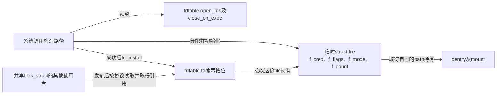
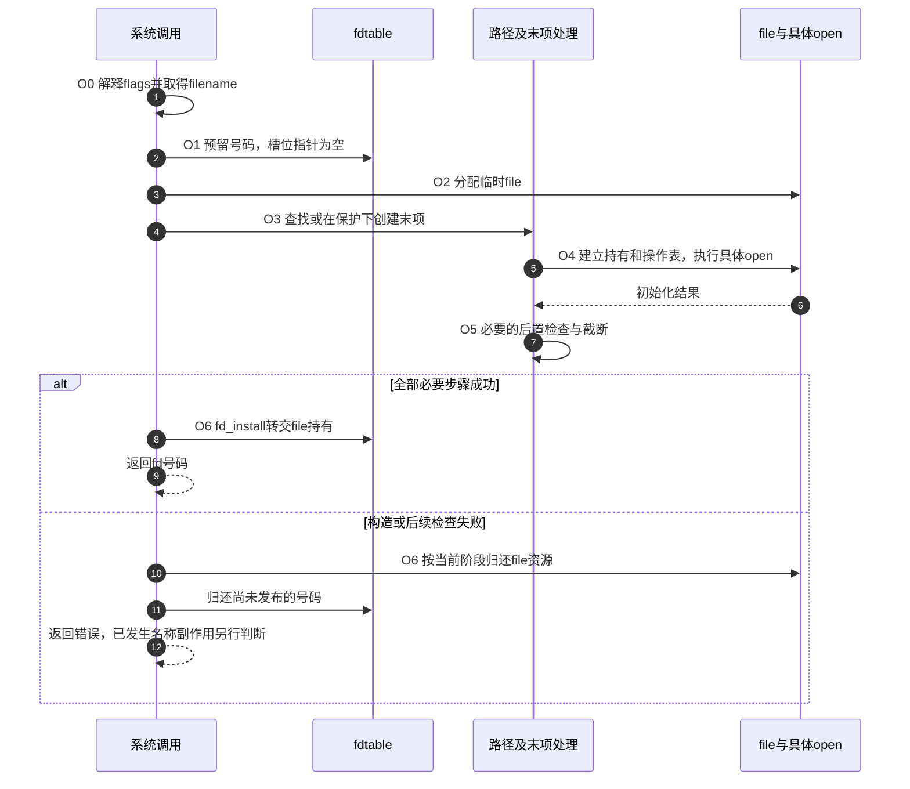

# 第12章\_open状态机

上一章已经能创建和替换名称，但一个名字存在还不等于应用能通过fd读写。打开时还要解释访问意图、取得权限、建立本次打开状态、运行具体文件操作，最后把它交给描述符表。若中间失败，哪些资源需要归还，已经创建的名称又是否自动消失？

本章从“取得一个可使用的打开关系”出发，区分创建、打开和发布三个完成点。沿普通open主线建立模型后，再解释组合操作、O_PATH和无名称临时文件为何改变其中的阶段。

## 12.1\_同一个路径需要不同的打开意图

假设value已经存在并保存一个字节A。只读打开希望保留内容；写入且O_TRUNC希望把长度变为零；O_CREAT表示缺失时创建，但存在时通常继续打开；O_CREAT与O_EXCL组合则要求名称原先不存在。它们查的是同一个路径，后续允许的动作不同。

不能先把路径普通lookup一遍，再把所有标志交给最后一个回调。例如排他创建发现名称已经存在，就应返回EEXIST，不能先截断原对象再报告失败；创建也不能在锁外凭过时的负结果执行。上一章的末项保护因此进入open流程，且必须与这次意图一起处理。

| 请求信息 | 本次作用 | 常见误读 |
| --- | --- | --- |
| 访问模式O_RDONLY、O_WRONLY、O_RDWR | 决定普通打开希望取得的读写能力 | 不是任意三个可独立叠加的开关 |
| O_CREAT与mode | 允许缺失时创建，mode参与新对象权限准备 | mode不是现存文件的重新授权 |
| O_EXCL与O_CREAT | 要求排他创建；现存名称拒绝 | 不是先检查不存在再另做普通创建 |
| O_TRUNC | 对符合条件的现存普通文件执行截断 | 不是路径解析前无条件清空 |
| O_NOFOLLOW、O_DIRECTORY | 限制最后对象的跟随或类型 | O_NOFOLLOW不等于禁止所有中间符号链接 |
| O_CLOEXEC | 建立描述符槽位的exec时关闭状态 | 不是file对象的普通读写状态 |
| openat2的RESOLVE约束 | 限制整个解析过程，见路径章节 | 普通dirfd本身不自动约束逃逸 |

旧open/openat接口和openat2还具有不同的参数检查入口：旧接口会按其约定规整部分输入；openat2通过open_how的flags、mode、resolve明确表达请求，并严格检查无效位和组合。不能因为后面汇入同一个内部函数，就宣称所有输入错误都一样处理。

## 12.2\_预留号码初始化对象与发布指针是三个阶段

先考虑最直观的失败：若先创建并打开文件，最后才发现进程没有可用fd，就已经做了许多无法交付给调用者的工作。普通系统调用因此先预留号码，再构造file；预留失败时不进入后面的路径打开。

预留时，files_struct所属fdtable的占用位已经标记，close_on_exec位也按请求设置，但fd数组中的对应file指针仍为空。其他操作不能把这个半成品当成已打开文件。随后分配的struct file保存本次打开的凭据、标志、引用和私有状态，仍由构造路径持有。

只有所有必要步骤成功，fd_install才把file指针放入已预留槽位，并把这份持有转交给描述符表。发布可能早于原调用线程从系统调用返回；共享描述符表的另一线程在发布后就可能看到它，不能用“调用者尚未收到返回值”作为额外保护。



表项占用、file构造和名称关联是正交状态；它们不能压缩为一个opened布尔量。fd表扩容及并发读取的完整算法留到下一章，本章先固定发布前后的所有权边界。

## 12.3\_沿一次打开追踪七个阶段

普通路径使用以下O0～O6。第九章L0～L5的遍历嵌在O3中，第十一章W周期的部分创建协议也嵌在其中；这些是不同层次的操作周期，不是把已有阶段重新编号成另一套对象。

| 阶段 | 执行者与状态位置 | 离开条件与失败责任 |
| --- | --- | --- |
| O0 解释输入 | 系统调用栈上的open_how和open_flags，复制的filename | 拒绝无效请求，未取得的资源无需归还 |
| O1 预留fd | 当前files_struct的占用和exec位 | 取得号码但没有公开file；后续失败归还号码 |
| O2 构造临时file | 分配器初始化凭据、标志、锁和引用 | 构造路径持有，尚未进入具体打开 |
| O3 解析及可能创建末项 | nameidata、父目录保护、dentry及文件系统方法 | 取得候选或建立名称；创建结果不等于file已打开 |
| O4 建立打开状态 | file取得path、inode、mapping和操作表，运行具体open | 必要初始化完成后标记FMODE_OPENED |
| O5 打开后检查与截断 | 安全检查、必要写许可和截断操作 | 仍可能失败，已打开的file需要相应退出处理 |
| O6 发布或清理 | fd_install成功交付；失败走file和号码各自清理 | 不再由构造者持有同一份已转交引用 |



固定版本依据从 [VFS总阅读索引](../../../research/source_reading/vfs/navigation/P01_Linux_6.12_VFS源码阅读索引.md#1.1_先固定源码身份与运行证据) 及 [打开模块导读](../../../research/source_reading/vfs/navigation/P11_打开请求怎样变成可发布的file.md#11.1_先区分意图构造与公开状态) 进入。外层的号码预留、失败归还与成功交付见 [do_sys_openat2实现](../../../research/source_reading/vfs/source_explanations/P23_打开参数与描述符发布的外层事务.md#23.2_预留槽位与转交file分别发生在两端)。下面按这些阶段解释为什么不能把open压成lookup加一个回调。

## 12.4\_最后名称可以只查询也可以创建或组合打开

现存正候选可以进入后续打开；需要创建的负候选则必须退到允许取得父锁的上下文。O_CREAT路径独占父目录，普通慢查询共享父目录。查询仍复用第十章的进行中登记与等待，不能因为这次最终目标是open，就绕开同名候选的完成协议。

lookup_open处理的不是单纯“存在还是不存在”。它可能已经取得正候选，也可能需要后端lookup，或者在许可条件下调用create。写入许可或创建权限失败时，还要分辨是否确实需要创建：已有对象的O_CREAT打开不应仅因无法新建文件就被错误拒绝。固定实现暂存create_error并收紧传给后端的创建意图，保留必要的查询机会。

有些文件系统提供inode_operations.atomic_open，将最后查询、可能创建和打开组合处理，减少独立往返或保留后端需要的原子操作边界。这里的atomic不表示某条CPU原子指令，也不表示整个系统调用的所有副作用都能事务回滚。后端可以完成打开，也可以仅交付查询结果，让上层继续。

两种完成辅助的引用契约尤其不同：finish_open建立file打开状态，但不消耗调用者传入的dentry引用；finish_no_open只交付候选，交接其引用，后续仍需真正打开。读者应根据FMODE_OPENED和返回结果判断接下来由谁处理，不能仅凭回调名字猜测已经完成。

FMODE_CREATED表示本次创建路径的阶段标记，但固定实现可能在调用create之前置位；只有结合函数成功结果才能作创建成功的判断。FMODE_OPENED则表示file已进入打开后的生命周期，仍不证明O5检查通过或fd已发布。这两个标志都不是系统调用成功的替代品。具体分支见 [锁内查询与创建](../../../research/source_reading/vfs/source_explanations/P24_打开末项的查询创建与再检查.md#24.2_锁内查询还要区分是否真的需要创建)，两种finish的引用契约见 [组合交接](../../../research/source_reading/vfs/source_explanations/P25_组合打开与特殊路径的交接契约.md#25.2_两个finish辅助消费不同的引用)。

## 12.5\_具体open之后为什么仍可能失败

普通do_dentry_open先给file取得自己的path持有，设置inode和mapping，取得必要读写访问与操作表模块持有，再经过安全检查和租约处理，才调用具体file_operations.open。该回调可以初始化驱动私有状态，也可以因设备不可用等原因拒绝。

若具体open返回失败，回调应清理自己尚未成功交出的私有资源；不能指望正常release必然再来一次。框架归还自己的操作表、访问许可和path，并按未完成打开的状态退出。相反，具体open已经成功后再遇到某项检查失败，file可能已经标记FMODE_OPENED，外层fput便按打开后的生命周期处理，最终可能调用release。

一个具体例子是本版本对不支持的O_DIRECT的检查位于FMODE_OPENED之后；它直接返回错误，依赖外层归还已打开的file。普通do_open还在vfs_open之后调用后置安全检查，并在要求截断现存普通文件时执行handle_truncate。不能把“具体open返回0”画成通往fd_install的无条件直线。

| 失败位置 | 本次资源如何退出 | 不能自动推断的回滚 |
| --- | --- | --- |
| 预留号码之前 | 按已取得输入资源清理 | 不存在需要关闭的file |
| 临时file尚未完成具体open | 框架清理已取得资源；回调负责自身失败分配 | 不保证调用正常release |
| file已经打开，后续检查失败 | fput按打开后的生命周期归还，可能延后处理 | 不保证清理就在当前语句同步结束 |
| 名称已创建但后续失败 | 清理当前持有，不自动执行一次unlink | 新名称可能继续存在 |
| 截断等后端操作发生后 | 返回错误并清理资源，按操作契约判断效果 | 错误不等于恢复原内容或原介质状态 |

普通vfs_open的打开通知也可能早于后置检查和最终发布。因此监测到一次打开事件不能独立证明应用已经得到fd；事件消费还要考虑后续关闭、队列及其他变化。固定实现中的 [具体打开与早失败清理](../../../research/source_reading/vfs/source_explanations/P26_file初始化与打开后失败清理.md#26.3_具体打开前取得自己的持有与操作表) 和 [后置检查](../../../research/source_reading/vfs/source_explanations/P26_file初始化与打开后失败清理.md#26.4_打开许可与后置检查保持不同时间点) 分别承担这两个边界。

## 12.6\_路径句柄与无名称临时文件改变哪些步骤

O_PATH用于持有路径位置，不能拿它当普通数据打开。该分支仍需要完成路径解析并取得file自己的path持有，但安装空的操作表并标记路径模式，不执行普通数据open的整段流程；随后仍可发布一个fd。路径遍历所需的检查不因此全部消失，读写这个fd的文件数据也不会自动获得许可。

O_TMPFILE则先解析一个目录，再由支持的文件系统方法建立无普通名称链接的临时对象，并完成相应打开。它不是在目录中先用一个可见随机名创建、再偷偷unlink；是否支持和是否允许以后添加链接都有专门条件。本版本在没有O_EXCL限制时通过I_LINKABLE允许相应后续链接协议，仍需满足链接入口的其他条件。

这两条分支在path_openat里与普通末项循环分开。用普通O_CREAT时间线解释它们会漏掉关键区别，所以先建立普通路径，再指出它们跳过或替换了哪些阶段。对应实现分别是 [路径句柄](../../../research/source_reading/vfs/source_explanations/P25_组合打开与特殊路径的交接契约.md#25.3_O_PATH持有位置而跳过普通数据打开) 和 [无名称临时对象](../../../research/source_reading/vfs/source_explanations/P25_组合打开与特殊路径的交接契约.md#25.4_临时文件从目录请求建立无普通名称的对象)。

## 12.7\_在一个程序中区分排他创建路径句柄与截断

本实验在私有临时目录里保存A，先尝试对现存名称执行O_CREAT、O_EXCL、O_TRUNC组合，再检查原内容未变；然后取得O_PATH句柄验证它不能read，最后用普通O_TRUNC观察同一对象长度变为零。它不尝试通过不确定的设备或安全策略制造打开后失败。

```c
#define _GNU_SOURCE
#include <errno.h>
#include <fcntl.h>
#include <stdbool.h>
#include <stdio.h>
#include <stdlib.h>
#include <sys/stat.h>
#include <unistd.h>

static int close_owned(int *fd)
{
    int number = *fd;
    *fd = -1;
    /* Linux close 失败也不重试原号码，避免误关已复用的槽位。 */
    return number < 0 ? 0 : close(number);
}

int main(void)
{
    char workspace[] = "/tmp/vfs-open-demo-XXXXXX";
    int dir_fd = -1, original_fd = -1, probe_fd = -1;
    int result = EXIT_FAILURE;
    bool have_workspace = false, have_file = false;
    char value = 'A';
    ssize_t count;
    struct stat original_stat, truncated_stat;

    if (!mkdtemp(workspace))
        goto error;
    have_workspace = true;
    dir_fd = open(workspace, O_RDONLY | O_DIRECTORY | O_CLOEXEC);
    if (dir_fd < 0)
        goto error;
    original_fd = openat(dir_fd, "value", O_RDWR | O_CREAT | O_EXCL | O_CLOEXEC, 0600);
    if (original_fd < 0)
        goto error;
    have_file = true;
    do {
        count = write(original_fd, &value, 1);
    } while (count < 0 && errno == EINTR);
    if (count != 1) {
        if (count >= 0)
            errno = EIO;
        goto error;
    }

    /* 排他创建遇到现存名称应拒绝，不能先截断后再报告 EEXIST。 */
    probe_fd = openat(dir_fd, "value",
                      O_WRONLY | O_CREAT | O_EXCL | O_TRUNC | O_CLOEXEC, 0600);
    if (probe_fd >= 0 || errno != EEXIST) {
        fprintf(stderr, "排他创建未产生预期的 EEXIST\n");
        goto out;
    }
    do {
        count = pread(original_fd, &value, 1, 0);
    } while (count < 0 && errno == EINTR);
    if (count != 1 || value != 'A') {
        fprintf(stderr, "拒绝排他创建后原数据未保留\n");
        goto out;
    }

    /* O_PATH 取得路径句柄，不建立可读写文件数据的普通打开关系。 */
    probe_fd = openat(dir_fd, "value", O_PATH | O_CLOEXEC);
    if (probe_fd < 0)
        goto error;
    errno = 0;
    if (read(probe_fd, &value, 1) != -1 || errno != EBADF) {
        fprintf(stderr, "O_PATH 读取未产生预期的 EBADF\n");
        goto out;
    }
    if (close_owned(&probe_fd) < 0)
        goto error;

    probe_fd = openat(dir_fd, "value", O_WRONLY | O_TRUNC | O_CLOEXEC);
    if (probe_fd < 0)
        goto error;
    if (fstat(original_fd, &original_stat) < 0 ||
        fstat(probe_fd, &truncated_stat) < 0)
        goto error;
    if (original_stat.st_dev != truncated_stat.st_dev ||
        original_stat.st_ino != truncated_stat.st_ino ||
        original_stat.st_size != 0 || truncated_stat.st_size != 0) {
        fprintf(stderr, "截断后的对象身份或长度不符合预期\n");
        goto out;
    }
    puts("排他创建被拒绝且A保留；O_PATH不能read；普通O_TRUNC使同一对象长度变0");
    result = EXIT_SUCCESS;
    goto out;

error:
    perror("打开意图实验");
out:
    if (close_owned(&probe_fd) < 0)
        result = EXIT_FAILURE;
    if (close_owned(&original_fd) < 0)
        result = EXIT_FAILURE;
    if (have_file && unlinkat(dir_fd, "value", 0) < 0)
        result = EXIT_FAILURE;
    if (close_owned(&dir_fd) < 0)
        result = EXIT_FAILURE;
    if (have_workspace && rmdir(workspace) < 0)
        result = EXIT_FAILURE;
    if (result != EXIT_SUCCESS)
        fprintf(stderr, "实验或清理失败；实验目录：%s\n", workspace);
    return result;
}
```

材料文件为 [open_intent_demo.c](../../../labs/kernel/vfs/materials/open_intent_demo.c)。在Linux上编译：

```sh
cc -std=c11 -Wall -Wextra -Werror open_intent_demo.c -o open_intent_demo
```

语言版本选项固定为C11，警告作为错误处理，`-o`指定输出程序；源码中的_GNU_SOURCE使这里使用的Linux接口获得声明。编译成功后运行：

```sh
./open_intent_demo
```

预期输出依次确认“排他创建被拒绝且A保留”“O_PATH不能read”“普通O_TRUNC使同一对象长度变0”。程序只操作本次创建的临时目录，错误时保留错误提示并配对清理，不要求root。本次尚未在目标Linux编译或运行，因此这些是预期而非实测。

实验说明标志改变的是执行意图，不是内核内部每一步都已被追踪。后置安全检查、atomic_open、O_DIRECT失败、并发描述符读取与资源耗尽仍需单独的可控环境验证。

## 12.8\_用所有权而不是函数名判断打开是否完成

**练习与参考答案**：预留fd就能读取file吗？不能，槽位可能仍为空。FMODE_CREATED置位就能忽略返回错误吗？不能，它是阶段状态，需结合结果。具体open失败一定会调用release吗？不一定，失败回调必须处理自己的部分初始化。最终open失败会自动删除新建名称吗？不会按通用规则自动unlink。已经收到fsnotify打开事件是否证明fd交付成功？仍不能，后续检查可能失败。

现在可以从输入意图追踪到最终发布，也能按实际取得的资源解释失败。下一章处理发布之后的共享、复制和退出：[fd table与file生命周期](P13_fd_table与file生命周期.md)。
