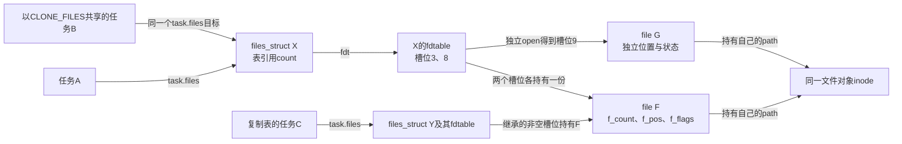
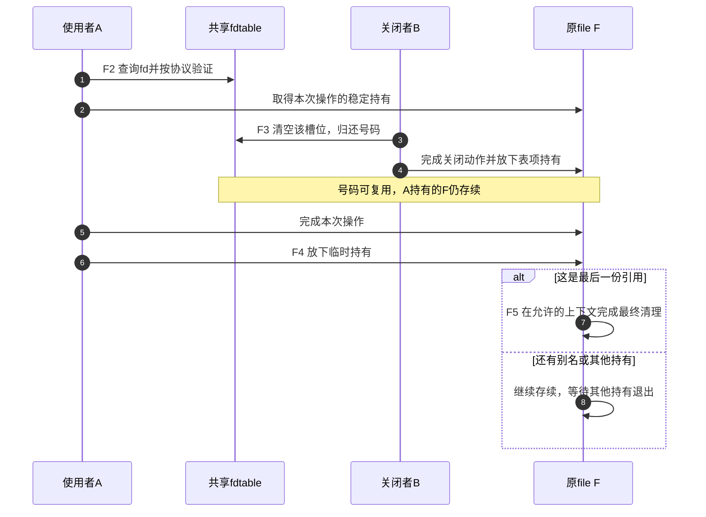

# 第13章\_fd\_table与file生命周期

上一章把已经构造好的file发布到预留槽位。现在应用拿到了整数fd，但后续还会dup、fork、close，其他线程也可能同时读写。一个号码关闭后，正在进行的读取为何还能继续？同一个数字再次出现，为什么不能继续当成原文件的身份？

第一章已经观察过dup共享位置、再次open拥有独立位置。本章在这个经验上建立所有权模型：先区分槽位、表和打开关系，再加入表扩容、并发查询与最后释放。我们追踪的是谁还持有file，不能用“进程还在”或“名字还在”代替这份证据。

## 13.1\_共享号码表与共享打开关系是两回事

fd是某个files_struct所使用的fdtable中的槽位编号。file是一次打开的状态，保存当前位置、状态标志、操作表及路径持有。同一个file可以被同表的两个槽位引用，也可以被不同表引用。多个任务还可以直接共享同一张表。

设A执行open得到fd 3，再dup得到fd 8。这两项指向同一file，所以经3读一个字节后，经8继续读会从更新后的位置开始。再次open同一名称得到另一file，位置独立，但两次打开可以仍指向同一个inode，文件内容并不会因此复制两份。



这里有两层计数。files_struct.count保护共享的表容器；file.f_count保护打开关系。带CLONE_FILES共享表时，增加表的引用，**不会为每个共享任务把所有槽位的file引用再加一遍**。普通复制表则建立新容器，并为复制得到的每个非空槽位增加file持有。某任务退出共享表，只放下自己的表引用；表还有其他持有者时，不应关闭整张表。

| 动作 | 表怎样变化 | 打开关系怎样变化 |
| --- | --- | --- |
| dup | 同表新增槽位 | 指向原file，增加一份持有 |
| 再次open | 新增槽位 | 构造新的file，位置与状态独立 |
| 复制描述符表 | 建立新files_struct与表 | 新表的非空项持有原file |
| CLONE_FILES共享 | 继续使用同一files_struct | 增加表持有，不逐项复制 |
| close一个fd | 撤销这个表项 | 放下该项持有，其他持有可继续 |

描述符标志和文件状态标志也分属不同层。FD_CLOEXEC在槽位对应的位图中；O_APPEND等状态保存在file中。对dup别名设置O_APPEND会影响同一打开关系，而只设置一个fd的FD_CLOEXEC不会自动改动另一个槽位。dup的新项默认不带FD_CLOEXEC；需要复制时同时设置该标志，可选择具有相应参数的dup3或fcntl接口。

## 13.2\_发布后的生命周期要沿两条状态轴追踪

上一章O6完成发布，但它没有规定file何时最后释放。下面的F0～F5沿一个表项进入、使用、脱离和最后清理；在F2可以产生额外表项或临时使用者，所以某项到F3之后，file仍可能停留在F4。

| 阶段 | 状态地址与执行者 | 继续条件 |
| --- | --- | --- |
| F0 预留 | 分配路径在fdtable.open_fds登记，fd指针为空 | 本次构造成功才能发布，否则归还号码 |
| F1 发布 | fd_install把file引用交给fdtable.fd对应槽位 | 使用者按读取协议取得目标 |
| F2 持有与共享 | 查询路径取得file引用，dup或复制表建立额外持有 | 每份持有都必须有相应退出责任 |
| F3 槽位脱离 | 关闭路径在file_lock下清空指针并归还占用位 | 数字可以复用，原file并不一定死亡 |
| F4 剩余使用完成 | 其他槽位或操作放下各自file引用 | 最后一份引用归还才启动最终清理 |
| F5 最终清理 | 允许的上下文调用具体release并归还path等资源 | file资源退出，其他层对象按各自持有决定存续 |

例如线程A在F2已成功取得file，随后线程B关闭同一个fd，B只撤销表项那份持有。A仍有自己的持有，可以继续本次操作；它以后再用原整数发起一次新操作，则可能遇到EBADF或新复用对象。**一次操作取得的file持有与以后再次解释同一整数，是不同的动作。**



这里描述的是已建立稳定持有的正常关系，不是鼓励应用用close取消其他线程的I/O。是否能够取消、如何唤醒阻塞者，需要该接口自己的取消协议。

## 13.3\_表扩容为什么不能只替换数组指针

fd越来越多时，初始内嵌数组不够用。一个朴素方案是在每次查询和修改时都锁整张表，这容易保证地址稳定，但每次高频查询都要参与同一把锁。当前实现让受协议保护的读侧查询与部分安装避开这把锁，因此扩容必须额外解决“读到哪版布局”和“安装写到了哪版表”的问题。

表布局不仅有file数组，还有容量和位图。如果先替换数组、后更新容量，读者可能按不匹配的边界访问。fdtable把这些组成一版布局，由files_struct.fdt发布。分配新布局时可能睡眠，扩容者暂时放下file_lock；重新取得锁后再复制当前表，发布新指针。旧动态表延后到RCU允许时释放，正在读旧表的访问不会因立即释放而越界。

还差一个写侧窗口：fd_install可能已经开始向旧表安装file，而扩容者正准备复制。实现先登记resize_in_progress，使后来安装者进入加锁路径；共享表场景还等待此前相关RCU读侧退出，然后才复制。发布新表、清除扩容状态与安装侧读取之间也有成对顺序要求。其他扩容者在resize_wait上等待，醒来必须重新检查容量，不能把“被唤醒”当作自己的号码已分配。

这套安排以协调成本换取普通查询较少争用；它没有消除锁、等待和引用计数，也不保证每次扩容只有固定延迟。当前核对配置是单核ARM与Tiny RCU，不能用它证明多核吞吐收益。

版本入口见 [VFS总索引](../../../research/source_reading/vfs/navigation/P01_Linux_6.12_VFS源码阅读索引.md#1.1_先固定源码身份与运行证据) 和 [描述符生命周期导读](../../../research/source_reading/vfs/navigation/P12_描述符共享查询与关闭的交接.md#12.1_沿同一生命周期区分表与file)。具体握手见 [扩容与安装](../../../research/source_reading/vfs/source_explanations/P27_描述符预留扩容与发布协议.md#27.3_扩容先让安装者改道再复制当前布局)。

## 13.4\_看到file地址还不等于取得正确对象

读侧先找到fd槽位，但在它增加file引用以前，另一个线程可能已经关闭槽位，最后引用归零，甚至同一地址被分配器复用。仅说“在RCU里，所以指针安全”不足以证明对象身份；此版本的file分配使用SLAB_TYPESAFE_BY_RCU，类型存储的保护不等于原对象永远不被复用。

查询先尝试把非零引用加一；失败就重试。成功后再检查槽位仍指向取得的对象，而且files_struct.fdt仍是刚才观察的布局。如果不匹配，归还临时取得的引用并重来。只有验证完成才检查所需模式并返回。这样取得的是一次有效查询中的对象，不是“这个号码从未改变过”的保证。

常用的fget取得普通引用；fget_raw允许路径模式对象，普通fget会过滤FMODE_PATH。fdget则还可能使用有边界的借用：表不共享且调用者遵守本次系统调用内使用、不在期间关闭或克隆等条件时，已有槽位持有足够支撑访问，省掉一次file引用增减。返回的struct fd记录是否需要fput，调用者必须配对fdput，不能把借用指针存到异步工作里。

共享位置还有自己的锁。保护file存续不等于保护f_pos读改写；需要时fdget_pos取得f_pos_lock，并把解锁责任编码进返回值，fdput_pos负责解锁与归还。下一章会把这个持有范围放入实际read/write路径。引用验证与借用边界见 [查询实现](../../../research/source_reading/vfs/source_explanations/P28_描述符查询的引用验证与轻量借用.md#28.1_取得引用之后还要验证槽位与表版本)。

## 13.5\_复制和关闭各自在哪个点改变可见关系

复制表时，原表可能有“占位但尚未发布file”的槽位。新表不能把它当作自己的未完成open；复制实现遇到空指针会清除新表相应占位，让新表可以正常分配。带CLONE_FILES则不复制这份状态，双方仍观察同一构造进度。

定向复制dup2/dup3还要处理目标槽位。目标已有file时，先把新关系接入目标槽位，再在锁外关闭旧目标持有；目标仅被其他open预留时，固定Linux实现返回EBUSY，避免抢占另一构造者的号码。dup2在源和目标相同且源有效时返回原号；dup3对相同号码拒绝。这些边界见 [复制与替换](../../../research/source_reading/vfs/source_explanations/P29_描述符复制与表共享的两层引用.md#29.3_定向替换不能抢走尚未完成的预留)。

关闭则先撤销槽位，再进行可能阻塞或出错的关闭动作，所以错误不意味着号码还属于旧对象。驱动或文件系统的flush与最终release也不同：flush可以在每次关闭一份描述符关系时调用，release属于最后file引用的清理；flush这个名字不能当作已经执行fsync或已经持久化的证明。

本固定源码的用户close入口在filp_flush之后使用__fput_sync，若它放下最后引用便当场进入最终清理。其他调用方使用filp_close时，经普通fput可能把最后清理安排到task_work或延后工作。**是否延后取决于实际入口和上下文，不能一概说close必然延后，也不能把任意fput当作同步释放。** 具体路径见 [关闭入口与最终释放](../../../research/source_reading/vfs/source_explanations/P30_描述符脱离与最后file引用的释放.md#30.2_用户关闭与内部关闭选择不同的最后归还方式)。

file最终清理归还自己的path、操作表等持有，inode和mount仍按各自引用与缓存协议存续。文件名可能早已unlink，也可能还有其他名称；关闭与名称生命周期不能相互替代。

## 13.6\_用标志和号码复用验证共享边界

本实验扩展第一章的位置观察：dup共享位置与O_APPEND，槽位的FD_CLOEXEC独立；关闭最初号码后别名继续有效，再用dup2把旧号码改指向另一打开关系。程序是单线程并使用自己创建的目录，不依赖猜测下次open返回的数字。

```c
#define _GNU_SOURCE
#include <errno.h>
#include <fcntl.h>
#include <stdbool.h>
#include <stdio.h>
#include <stdlib.h>
#include <unistd.h>

static int close_owned(int *fd)
{
    int number = *fd;
    *fd = -1;
    /* Linux 已经撤销槽位后，不能因关闭错误重试可能被复用的号码。 */
    return number < 0 ? 0 : close(number);
}

static int expect_byte(int fd, char expected)
{
    char value;
    ssize_t count;
    do {
        count = read(fd, &value, 1);
    } while (count < 0 && errno == EINTR);
    if (count == 1 && value == expected)
        return 0;
    if (count >= 0)
        errno = EIO;
    return -1;
}

int main(void)
{
    char workspace[] = "/tmp/vfs-fd-demo-XXXXXX";
    const char text[] = "ABC";
    int dir_fd = -1, first_fd = -1, alias_fd = -1, independent_fd = -1;
    int reused_fd = -1, old_number = -1, flags, alias_flags, other_flags;
    int result = EXIT_FAILURE;
    bool have_workspace = false, have_file = false;
    size_t written = 0;

    if (!mkdtemp(workspace))
        goto error;
    have_workspace = true;
    dir_fd = open(workspace, O_RDONLY | O_DIRECTORY | O_CLOEXEC);
    if (dir_fd < 0)
        goto error;
    first_fd = openat(dir_fd, "value", O_RDWR | O_CREAT | O_EXCL, 0600);
    if (first_fd < 0)
        goto error;
    have_file = true;
    while (written < sizeof(text) - 1) {
        ssize_t count = write(first_fd, text + written, sizeof(text) - 1 - written);
        if (count < 0 && errno == EINTR)
            continue;
        if (count <= 0) {
            if (count == 0)
                errno = EIO;
            goto error;
        }
        written += (size_t)count;
    }
    if (lseek(first_fd, 0, SEEK_SET) < 0)
        goto error;
    alias_fd = dup(first_fd);
    independent_fd = openat(dir_fd, "value", O_RDONLY | O_CLOEXEC);
    if (alias_fd < 0 || independent_fd < 0)
        goto error;
    if (expect_byte(first_fd, 'A') || expect_byte(alias_fd, 'B') ||
        expect_byte(independent_fd, 'A'))
        goto error;

    /* 描述符标志属于各自槽位，状态标志属于共享的打开关系。 */
    if (fcntl(first_fd, F_SETFD, FD_CLOEXEC) < 0)
        goto error;
    alias_flags = fcntl(alias_fd, F_GETFD);
    if (alias_flags < 0)
        goto error;
    if (alias_flags & FD_CLOEXEC) {
        errno = EIO;
        goto error;
    }
    flags = fcntl(alias_fd, F_GETFL);
    if (flags < 0 || fcntl(alias_fd, F_SETFL, flags | O_APPEND) < 0)
        goto error;
    flags = fcntl(first_fd, F_GETFL);
    other_flags = fcntl(independent_fd, F_GETFL);
    if (flags < 0 || other_flags < 0)
        goto error;
    if (!(flags & O_APPEND) || (other_flags & O_APPEND)) {
        errno = EIO;
        goto error;
    }

    old_number = first_fd;
    if (close_owned(&first_fd) < 0 || expect_byte(alias_fd, 'C'))
        goto error;
    /* 在这个单线程程序中定向复用旧槽位，不假定下次 open 的号码。 */
    reused_fd = dup2(independent_fd, old_number);
    if (reused_fd < 0 || expect_byte(reused_fd, 'B'))
        goto error;
    puts("dup共享位置与状态标志；CLOEXEC独立；关闭一项后别名仍有效；旧号码已改指另一打开关系");
    result = EXIT_SUCCESS;
    goto out;
error:
    perror("描述符生命周期实验");
out:
    if (close_owned(&reused_fd) < 0)
        result = EXIT_FAILURE;
    if (close_owned(&first_fd) < 0)
        result = EXIT_FAILURE;
    if (close_owned(&alias_fd) < 0)
        result = EXIT_FAILURE;
    if (close_owned(&independent_fd) < 0)
        result = EXIT_FAILURE;
    if (have_file && unlinkat(dir_fd, "value", 0) < 0)
        result = EXIT_FAILURE;
    if (close_owned(&dir_fd) < 0)
        result = EXIT_FAILURE;
    if (have_workspace && rmdir(workspace) < 0)
        result = EXIT_FAILURE;
    if (result != EXIT_SUCCESS)
        fprintf(stderr, "实验或清理失败；实验目录：%s\n", workspace);
    return result;
}
```

完整材料：[fd_lifetime_demo.c](../../../labs/kernel/vfs/materials/fd_lifetime_demo.c)。在Linux中，将当前目录切到该源码所在目录后编译：

```sh
cc -std=c11 -Wall -Wextra -Werror fd_lifetime_demo.c -o fd_lifetime_demo
```

C11固定语言规则，警告按错误处理，输出程序名由-o指定。编译成功后执行：

```sh
./fd_lifetime_demo
```

预期先读出A、B、A：前两个来自同一位置，第三个来自独立打开。随后O_APPEND检查和CLOEXEC检查分别验证两层标志；原号码关闭后别名读C，旧号码被改指独立打开后读B。任何检查失败都返回非零，并尝试清理自己的目录。本次没有目标Linux编译运行记录，这些仍是预期。

F_GETFD/F_SETFD访问描述符标志，F_GETFL/F_SETFL访问允许查询或修改的文件状态标志；不是所有open标志都能经F_SETFL改变。程序只测试O_APPEND，不测试实际追加写原子性。它也不能观测内核引用的精确数值、并发扩容或release的执行时间。

## 13.7\_从持有关系判断何时可以结束

练习一：A与B共享files_struct，B退出就应把每个file减一次吗？参考答案：B先归还表的持有，只有表最后持有退出才关闭其中关系。

练习二：fdget返回后，把fd_file结果放进稍后执行的工作并先fdput，有什么缺口？参考答案：返回值可能只是借用；即使取得了新引用，fdput也可能已经归还它，异步工作必须有自己明确取得且保留的持有。

练习三：close报告错误后重试同一整数为何危险？参考答案：槽位可能早已撤销并复用，重试可能关闭新的关系；应按具体接口错误处理，而不是机械重试。

现在能区分号码失效、某份持有退出和file最后清理。下一章把取得的file放入 [read/write分派](P14_VFS_read_write分派.md)，继续追踪操作表、位置与数据传送。
