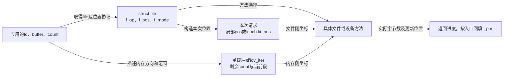
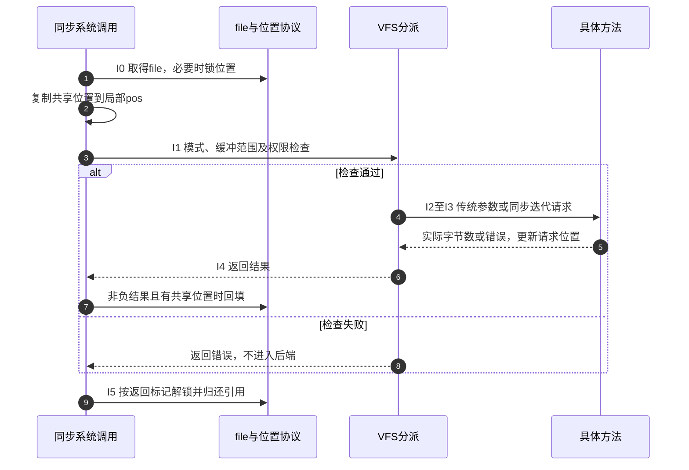

# 第14章\_VFS\_read\_write分派

上一章已经能从fd安全取得file，并配对位置锁和引用。现在程序调用read，内核不必重新查找当初的路径；真正未解决的问题是：这次请求从哪里开始、数据进入哪块缓冲区、由哪个方法执行，以及部分完成时应向调用者报告什么。

本章先沿同步read/write建立一次完整交接，再把单缓冲扩展到readv/writev。页缓存如何填充、直接I/O如何提交设备，都留在后续数据通路章节；这里先弄清分派层向后端交付的契约。

## 14.1\_一次读写同时携带位置与缓冲区

设文件保存ABC，程序希望从偏移1读两个字节到buffer。文件侧的偏移1确定取B和C；内存侧的buffer及长度2确定放到哪里。这两个坐标不能合并：改buffer地址不会改变文件位置，改变文件位置也不会替程序分配新的缓冲区。

file保存持久于一次系统调用的打开状态，包含操作表和共享位置。这次请求还要保存临时位置、缓冲范围及返回进度。后端可以是普通文件系统、管道或设备；同名read操作并不意味着全部进入磁盘页缓存。



传统file_operations.read/write直接接收file、用户缓冲区、长度与位置指针。read_iter/write_iter则接收两个专门描述：kiocb保存本次I/O的file、位置、标志等，iov_iter保存缓冲区类型、方向和剩余范围。分开以后，同一个后端可以逐步处理单段或多段缓冲，不必为每种用户缓冲形式重复设计数据传送算法。

这是表达方式的统一，不是数据自动复制、页面自动固定或操作自动异步化。创建iov_iter只建立访问描述，真正触碰用户内存仍可能缺页或失败。

## 14.2\_从取得file到归还责任的一次同步周期

下面用I0～I5追踪普通同步调用。描述符章节的F2嵌入I0，I5再配对归还；一次读写不需要重新执行open的名称解析周期。

| 阶段 | 状态与执行者 | 结果和责任 |
| --- | --- | --- |
| I0 取得file与位置协议 | fdget_pos返回持有或借用，并在需要时锁f_pos | 无有效file则EBADF；成功返回带退出责任 |
| I1 检查请求 | VFS检查访问模式、方法能力、缓冲地址范围、位置范围与权限钩子 | 拒绝时不进入数据方法，但仍需归还I0资源 |
| I2 准备具体接口 | 传统方法直接使用参数；迭代方法构造同步kiocb与iov_iter | 请求对象与缓冲描述在有效生命周期内 |
| I3 后端执行 | 具体方法消费缓冲范围、处理数据并更新请求位置；普通文件写侧保护在分派层配对进入和退出 | 可能等待，可能只完成部分字节；先结束写侧范围，再向系统调用入口返回 |
| I4 解释结果 | 返回字节数，普通入口按条件把局部位置回填file | 实际进度不同于原请求长度 |
| I5 配对退出 | 系统调用入口释放需要的位置锁与引用 | 不能遗留锁，也不能把借用指针交给稍后使用 |



固定实现从 [VFS总索引](../../../research/source_reading/vfs/navigation/P01_Linux_6.12_VFS源码阅读索引.md#1.1_先固定源码身份与运行证据) 和 [读写模块导读](../../../research/source_reading/vfs/navigation/P13_读写请求的位置缓冲与结果交接.md#13.1_把请求状态放回一次同步周期) 进入，普通入口的位置保存与回填见 [ksys_read与ksys_write](../../../research/source_reading/vfs/source_explanations/P31_读写入口的位置选择与结果回填.md#31.1_普通入口先把共享位置变成本次局部位置)。

## 14.3\_分派顺序取决于进入的是哪类接口

先看标量read/write，即一次传入一个buffer和count。固定Linux 6.12.20实现的vfs_read先检查.read，存在就调用它；没有.read才尝试.read_iter。vfs_write对.write和.write_iter采用同样顺序。不能把“迭代接口较通用”写成“VFS总是优先迭代方法”。

向量readv/writev则先导入iovec数组，获得统一的迭代描述，再优先调用迭代方法；没有对应迭代方法时，使用传统方法按段执行。这是两个入口的适配方向不同，不是任意挑选一个回调。实际回调顺序见 [标量分派](../../../research/source_reading/vfs/source_explanations/P32_读写资格检查与文件操作分派.md#32.2_标量读写先检查传统方法再适配迭代接口) 与 [向量分派](../../../research/source_reading/vfs/source_explanations/P33_同步迭代请求与向量缓冲区的交接.md#33.3_向量入口先导入描述再选择后端)。

| 入口与形式 | 交给后端的内容 | 当前选择原则 |
| --- | --- | --- |
| read/write单缓冲 | 传统参数或包装后的同步请求 | 传统方法存在时先使用它 |
| readv/writev多缓冲 | 导入的iov_iter | 迭代方法存在时先使用它，否则逐段传统调用 |
| 明确的vfs_iter接口 | 已有迭代描述 | 要求对应迭代方法，不能当作任意file的通用后备入口 |

检查也有层次。FMODE_READ/WRITE表示本次打开的访问模式；FMODE_CAN_READ/WRITE表示已经建立的方法能力。access_ok检查地址范围，不保证这片内存当前已映射、已经复制或永不变化。rw_verify_area检查本次范围并进入相应权限钩子，不重新执行完整open，也不代替后端对文件大小、追加写或设备状态的处理。

因此“前置检查通过”不等于后端必然成功。实际数据复制仍可能故障，文件系统可能限制长度，设备也可能只提供部分数据。正文应沿这些实际阶段理解结果，而不是把所有拒绝都归给一个抽象的权限检查。

## 14.4\_共享位置显式位置与流式对象分别处理

普通read/write取得需要的位置锁，将f_pos复制为局部pos。后端更新局部位置，入口在返回非负且存在位置指针时写回f_pos，最后解锁。这样一次位置读改写处在同一保护范围内；这把锁保护的是该file的相关位置操作，不是整个inode的数据修改。

pread/pwrite带显式位置，使用局部参数，不回填共享f_pos，也不为了共享位置使用fdget_pos。它们仍需有效file、相应模式和后端支持；管道等不提供这种定位能力的对象可返回ESPIPE。相反，FMODE_STREAM对象的普通入口传空位置指针，不能强迫所有设备都拥有有意义的文件偏移。

显式位置也不能盖过所有其他意图。Linux中带O_APPEND的写请求可仍按追加语义把后端位置改到文件尾；“pwrite不更新共享f_pos”不等于“任何标志组合下都写入指定偏移”。本章实验明确不设置O_APPEND。相关边界见 [显式位置入口](../../../research/source_reading/vfs/source_explanations/P31_读写入口的位置选择与结果回填.md#31.2_显式位置不回填共享位置但仍受打开意图约束)。

## 14.5\_缓冲进度与返回结果怎样一起解释

read把数据写入用户缓冲区，所以迭代器方向是ITER_DEST；write从用户缓冲区取数据，所以方向是ITER_SOURCE。这个命名以缓冲区在数据流中的角色为准，不以“谁调用谁”为准。

多段缓冲的iov_iter维护当前段、段内偏移及剩余count；kiocb.ki_pos维护文件侧位置。后端消费一部分内存范围后，后续应从未完成处继续，不能每次都从第一段开头重传。readv返回的是全部段合计完成的字节数，并不保证每个段都填满。

同步适配器使用栈上的kiocb和iov_iter，要求方法在返回前完成这次请求，不能把这些地址保存起来再返回“异步已排队”。真正异步请求必须另有足够长的对象生命周期与完成协议；函数名包含iter并不自动建立这种协议。源码中的同步适配见 [请求构造与完成](../../../research/source_reading/vfs/source_explanations/P33_同步迭代请求与向量缓冲区的交接.md#33.2_栈上的同步请求必须在返回前完成)。

| 应用观察 | 可以推出什么 | 不能推出什么 |
| --- | --- | --- |
| 正字节数小于请求 | 已完成这部分进度，可按具体接口处理剩余范围 | 不能把它直接当作零进度失败重传全部 |
| 普通文件非零长度读取返回0 | 当前位置没有更多可读取字节，通常到达EOF | 不表示文件永远不会增长；零长度请求也可能返回0 |
| C库接口返回-1并设置errno | 本次报告错误，应按接口语义处理 | 不等于所有状态或介质变化都已回滚 |
| 内核方法返回负错误码 | 内核错误传播形式 | 不应直接当作用户C程序的返回约定 |

传统向量后备路径若已经完成前段，后段出错会保留已有正进度；第一次就失败才返回负错误。短传输则停止当前调用，由调用者根据契约决定是否继续。不要把“VFS保证不丢进度”理解成框架能修复任意错误后端：具体方法仍必须正确报告已完成字节，返回错误也不提供通用事务回滚。

## 14.6\_写侧保护和通知不是持久化确认

普通文件写入还要与文件系统冻结协调。file_start_write/file_end_write围住相应执行范围，使冻结协议能阻止新进入的写者并等待已进入者退出；这两个辅助对非普通文件不会建立同样的superblock写侧保护。它们不是把所有写入用一把数据锁串行化，也不是等待数据已经落盘。

追加位置、文件长度限制及具体缓存更新由相应后端或公共写辅助继续处理。VFS分派层不能仅凭一个方法返回正数就宣布介质持久化。正进度后的fsnotify和任务字节统计也属于事件及记账，不能当成块设备传输了同样字节数的证明。不同入口对零结果的通知条件还可能不同，应按实际函数核对。

权限通知发生在数据访问前，修改/访问事件通常发生在结果阶段，两者承担不同任务。本次配置未启用fanotify，不能把源码保留的权限事件路径写成已经发生的用户态批准。分派中的保护和通知位置见 [写侧责任](../../../research/source_reading/vfs/source_explanations/P32_读写资格检查与文件操作分派.md#32.3_写侧保护通知与统计各有自己的边界)。

## 14.7\_观察显式位置短读取与向量缓冲

下面的程序创建ABC，普通读取A后用pread读取偏移2的C，再普通读取B。接着用总容量4的两个缓冲区读取，此时文件只剩C，所以合计返回1；再读一次才得到0。最后pwrite把开头改成X，同时核对共享位置不变。

```c
#define _GNU_SOURCE
#include <errno.h>
#include <fcntl.h>
#include <stdbool.h>
#include <stdio.h>
#include <stdlib.h>
#include <string.h>
#include <sys/uio.h>
#include <unistd.h>

static int close_owned(int *fd)
{
    int number = *fd;
    *fd = -1;
    return number < 0 ? 0 : close(number);
}

static ssize_t read_retry(int fd, void *buffer, size_t length)
{
    ssize_t count;
    do {
        count = read(fd, buffer, length);
    } while (count < 0 && errno == EINTR);
    return count;
}

int main(void)
{
    char workspace[] = "/tmp/vfs-io-demo-XXXXXX";
    const char initial[] = "ABC";
    char value = 0, first[2] = {0}, second[2] = {0}, final[3];
    struct iovec vectors[] = {
        {.iov_base = first, .iov_len = sizeof(first)},
        {.iov_base = second, .iov_len = sizeof(second)}
    };
    int dir_fd = -1, file_fd = -1, result = EXIT_FAILURE;
    bool have_workspace = false, have_file = false;
    size_t written = 0;
    ssize_t count;

    if (!mkdtemp(workspace))
        goto error;
    have_workspace = true;
    dir_fd = open(workspace, O_RDONLY | O_DIRECTORY | O_CLOEXEC);
    if (dir_fd < 0)
        goto error;
    /* 本实验没有O_APPEND，显式位置不会受到追加意图影响。 */
    file_fd = openat(dir_fd, "value", O_RDWR | O_CREAT | O_EXCL | O_CLOEXEC, 0600);
    if (file_fd < 0)
        goto error;
    have_file = true;
    while (written < sizeof(initial) - 1) {
        count = write(file_fd, initial + written, sizeof(initial) - 1 - written);
        if (count < 0 && errno == EINTR)
            continue;
        if (count <= 0) {
            if (count == 0)
                errno = EIO;
            goto error;
        }
        written += (size_t)count;
    }
    if (lseek(file_fd, 0, SEEK_SET) < 0)
        goto error;
    if (read_retry(file_fd, &value, 1) != 1 || value != 'A')
        goto mismatch;
    do {
        count = pread(file_fd, &value, 1, 2);
    } while (count < 0 && errno == EINTR);
    if (count != 1 || value != 'C' || lseek(file_fd, 0, SEEK_CUR) != 1)
        goto mismatch;
    if (read_retry(file_fd, &value, 1) != 1 || value != 'B')
        goto mismatch;

    /* 总缓冲容量为4，但当前位置到EOF只剩1字节。 */
    do {
        count = readv(file_fd, vectors, 2);
    } while (count < 0 && errno == EINTR);
    if (count != 1 || first[0] != 'C' || second[0] != 0 ||
        lseek(file_fd, 0, SEEK_CUR) != 3)
        goto mismatch;
    if (read_retry(file_fd, &value, 1) != 0)
        goto mismatch;

    do {
        count = pwrite(file_fd, "X", 1, 0);
    } while (count < 0 && errno == EINTR);
    if (count != 1 || lseek(file_fd, 0, SEEK_CUR) != 3)
        goto mismatch;
    do {
        count = pread(file_fd, final, sizeof(final), 0);
    } while (count < 0 && errno == EINTR);
    if (count != (ssize_t)sizeof(final) || memcmp(final, "XBC", sizeof(final)))
        goto mismatch;
    puts("普通读推进位置；显式读写不改共享位置；向量读只返回剩余1字节；再次读得到EOF");
    result = EXIT_SUCCESS;
    goto out;
mismatch:
    fprintf(stderr, "观察结果未满足本实验预期\n");
    goto out;
error:
    perror("读写位置实验");
out:
    if (close_owned(&file_fd) < 0)
        result = EXIT_FAILURE;
    if (have_file && unlinkat(dir_fd, "value", 0) < 0)
        result = EXIT_FAILURE;
    if (close_owned(&dir_fd) < 0)
        result = EXIT_FAILURE;
    if (have_workspace && rmdir(workspace) < 0)
        result = EXIT_FAILURE;
    if (result != EXIT_SUCCESS)
        fprintf(stderr, "实验或清理失败；实验目录：%s\n", workspace);
    return result;
}
```

材料文件：[io_position_demo.c](../../../labs/kernel/vfs/materials/io_position_demo.c)。在Linux的源码所在目录编译：

```sh
cc -std=c11 -Wall -Wextra -Werror io_position_demo.c -o io_position_demo
```

编译采用C11，启用警告并将其当作错误；sys/uio.h声明向量I/O接口。成功后运行：

```sh
./io_position_demo
```

预期输出说明普通读推进位置、显式读写保持共享位置、readv只完成剩余1字节，最后内容为XBC。程序检查每步结果并清理自己的临时目录，无需root。本次没有在目标Linux编译运行，以上是预期结果；缓冲故障、冻结竞争和异步完成均未由该实验覆盖。

练习一：把pread的偏移从2改为0，下一次普通read应改变吗？参考答案：显式读取将得到A，但共享位置仍为1，下一次普通read仍取B。

练习二：把两个向量容量改成1和1，readv是否必须返回2？参考答案：不必须，本例到EOF只剩1字节，容量不创造文件数据。

现在能把一个fd请求追踪到操作表、位置和缓冲区，并解释返回的实际进度。下一章进入普通文件的 [address_space、folio与页缓存](P15_address_space_folio与页缓存.md)，观察后端怎样找到、填充和修改数据。
