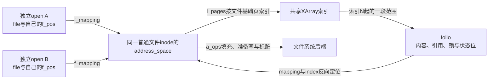
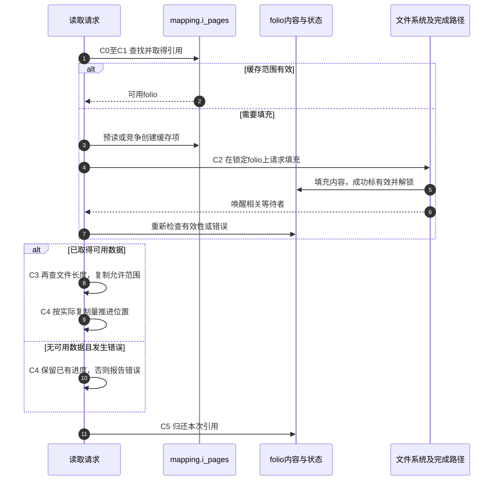

# 第15章\_address\_space\_folio与页缓存

上一章把一次读写交给了具体方法，也分清了文件位置与用户缓冲。现在以普通文件的缓冲I/O为例继续向下：后端总要从存储设备重新取同一段内容吗？两个独立open得到不同file，怎样仍然读到同一份修改？

本章建立文件内容在内存中的共享组织，再沿查找、填充、复制和修改追踪它的状态。写回何时完成、错误怎样交给fsync留给下一章；这里先确定系统调用使用的是哪份内容，以及谁负责让它有效。

## 15.1\_为什么缓存应跟随文件而不是一次打开

设两个进程先后读取同一日志的前几千字节。若每次都从存储后端取数，重复请求要支付设备或远程服务访问的等待；若每个open私自保存一份缓存，进程A改了内容，B还可能使用自己的旧副本。要让重复读取复用内容，并让多次打开围绕同一份修改工作，需要一个以文件对象和偏移定位的共享缓存。

Linux的 **页缓存（page cache）** 用内存保存可缓存文件内容。普通文件inode关联的 **address_space** 组织这些内容；file保留打开状态和位置，通常通过f_mapping指向该共享对象。这里的address_space不是进程虚拟地址空间，也不是“整个文件已经连续装入内存”的保证。

共享缓存减少的是重复获取已有有效内容的需要，代价是占用内存、维护索引和状态，并处理回收、并发修改与后端一致性。只读一次的巨大数据流可能挤占其他工作集；某些设备或专用I/O路径也不采用这套缓存。因此“经过VFS”不能直接推出“经过普通文件页缓存”。

## 15.2\_共享索引与folio的几组独立状态

address_space中的i_pages按文件偏移组织缓存项。索引的单位是 **基础页**，页大小由目标系统决定；**folio** 是内核按一组连续基础页管理内容与状态的对象，可以覆盖一个或多个基础页。大folio的index仍是起始基础页编号，不能把每个索引都画成一个不同的folio。



一个folio不是沿“Locked→Uptodate→Dirty→Writeback”单线前进。它同时回答几个独立问题：是否仍属于这个缓存、是否有人持有、内容操作是否锁定、所需内容是否有效、是否有尚需处理的修改、是否有某轮写回正在进行。持有引用的folio可以被移出缓存；数据有效的folio仍可被锁定修改；写回中的folio也可以再次变脏。

| 状态或关系 | 它回答的问题 | 不能替代的判断 |
| --- | --- | --- |
| mapping与i_pages成员关系 | 这个偏移当前由哪个缓存对象表示 | 不保证对象已持有或数据已填好 |
| folio引用 | 调用者是否有权在相应范围内继续使用对象 | 不保证它仍属于原文件缓存 |
| Locked | 当前内容操作是否尚未交接 | 不直接表达数据成功或失败 |
| Uptodate | 全folio内容是否有效；某些后端另有局部有效信息 | 不表示内容已经持久化 |
| Dirty | 是否存在需要后端处理的修改 | 不表示某轮写回已经提交 |
| Writeback | 是否有一轮写回正在处理 | 不排除同时产生新的Dirty |

例如Dirty=1、Writeback=0可表示有修改尚未进入写回；Dirty=0、Writeback=1可表示当前轮已取走待写责任但尚未完成；Dirty=1、Writeback=1表示当前轮之外又有待处理修改。这里是理解状态组合，不承诺所有后端使用同一种写回实现，ramfs式内存文件甚至没有设备写回。

固定实现入口见 [VFS总索引](../../../research/source_reading/vfs/navigation/P01_Linux_6.12_VFS源码阅读索引.md#1.1_先固定源码身份与运行证据) 与 [页缓存模块导读](../../../research/source_reading/vfs/navigation/P14_页缓存的数据有效性与修改交接.md#14.1_把共享缓存与单次请求分开追踪)，字段与初始化见 [mapping归属](../../../research/source_reading/vfs/source_explanations/P34_页缓存归属索引与竞争插入.md#34.1_mapping把共享对象与偏移索引连起来)。

## 15.3\_一次缓存读如何从索引走到用户缓冲

设请求读取偏移N附近的一小段。内核先依据mapping查找folio并取得引用。如果所需内容已经有效，就可以按文件长度限制复制；如果没有缓存，先尝试预读，再在需要时分配、插入并请求后端填充。预读提前准备邻近内容，使用每个file的访问历史，但结果进入共享缓存。

用C0～C5连接一次请求。阶段表示责任交接，不是单一状态枚举；填充方的解锁发生在C2，读取者的引用归还发生在C5。

| 阶段 | 读路径的状态与动作 | 写路径对应的责任 |
| --- | --- | --- |
| C0 选择对象 | 由file取得mapping、位置和目标缓冲 | 取得mapping、位置和源缓冲 |
| C1 定位并持有 | 按索引查询引用；必要时竞争插入 | 准备方法定位或创建可写folio |
| C2 建立可用条件 | 检查有效范围，必要时提交填充并等待完成 | write_begin准备旧内容及后端资源，返回锁定folio |
| C3 使用内容 | 按当前文件长度复制到用户缓冲 | 从用户缓冲实际复制copied字节 |
| C4 交付结果 | 按实际复制更新位置和返回量 | write_end接纳修改、更新长度及脏状态 |
| C5 归还本次资源 | 逐个归还批次引用 | 准备方法取得的锁、引用和上下文按结束协议归还 |



后端read_folio返回0不一定意味着I/O已经完成；请求可能已经提交，完成路径随后更新状态并解锁。等待者睡眠在相应等待条件上，唤醒只让它重新运行，仍须检查内容是否有效。失败也要结束锁定范围，使等待者能够得到错误而不是永久等待。

另一种情况是缓存中已有尚未完成的预读。读取者通常等待该操作，随后重新查找或验证，而不是再为同一偏移无条件提交第二份填充。完整过程见 [缓存读入口](../../../research/source_reading/vfs/source_explanations/P35_缓存读的填充等待与有效范围.md#35.1_读入口把批次与实际复制进度连接起来) 与 [完成通知](../../../research/source_reading/vfs/source_explanations/P35_缓存读的填充等待与有效范围.md#35.4_完成方更新状态再唤醒对应等待者)。

## 15.4\_两个读取者与截断者怎样划分责任

假设A和B同时没查到同一偏移。两者都可能分配内存，但插入索引必须串行核对冲突：先成功者成为当前缓存项；后到者发现已有真实folio，撤销自己的候选并重新查询。这样统一的是已发布的成员关系，不是禁止临时出现两个尚未发布的分配对象。

查询者也不能只拿一个裸指针就离开保护范围。它先取得引用，再检查索引仍指向同一对象；否则归还并重试。具体交接见 [竞争插入](../../../research/source_reading/vfs/source_explanations/P34_页缓存归属索引与竞争插入.md#34.2_插入者在共享索引中决出归属) 与 [查询验证](../../../research/source_reading/vfs/source_explanations/P34_页缓存归属索引与竞争插入.md#34.3_查询取得引用后仍要复查索引)。

即便引用取得成功，另一个线程还可能truncate文件。引用使对象不因本次持有而被释放，却不冻结文件大小和后端块映射。填充路径因此还用invalidate_lock协调失效，并在取得folio锁后复查归属；复制前再次读取i_size限制范围。不同保护分别负责索引、对象生命期、内容准备和文件长度，不能用“一把页缓存锁”概括。

有效缓存的读取并不保证整个copy期间都持有folio锁，也不保证与任意并发写之间形成整块内容快照。应用若要求多字段原子可见，需要自己的同步或文件系统提供的更强协议。本章的共享可见性实验按顺序执行，避免把顺序结果解释成并发原子性。

## 15.5\_缓冲写为什么要先准备再接纳

设一个存储块保存ABCDEFGH，现在只覆盖CD。若直接创建空白缓存并写入两字节，未修改的AB和EFGH就可能丢失。后端必须先保证将要保留的旧内容可用，还可能需要分配空间和准备文件系统元数据。这正是write_begin不能被一个普通memcpy替代的原因。

通用缓冲写循环先尽量处理源用户缓冲缺页，再请write_begin交出锁定folio与私有上下文；随后复制，最后调用write_end确认接纳量并结束准备范围。源缓冲在预触以后仍可能变化或失效，因此“计划写bytes”“实际复制copied”“后端接纳status”必须分别计量。

若write_end只接纳一部分，通用循环撤回迭代器中尚未接纳部分的进度，按实际接纳量推进文件位置。撤回描述进度不是自动把内存内容恢复成旧值，后端仍负责自己的有效范围和失败协议。完整实现见 [缓冲写循环](../../../research/source_reading/vfs/source_explanations/P36_缓冲写的准备接纳与标脏.md#36.1_通用循环以接纳量提交进度)。


ramfs式内存文件可以用零填充和最小结束辅助，因为没有需要从设备保留的旧块；它的脏位也不引出设备写回。磁盘文件系统需要自己的块映射、元数据与回写协议。这个对照见 [ram_aops的最小实现](../../../research/source_reading/vfs/source_explanations/P36_缓冲写的准备接纳与标脏.md#36.2_ram_aops怎样兑现最小准备和结束协议)。不能看见所有路径都叫write_end，就认为它们提供相同持久化保证。

## 15.6\_缩短文件与零填充间隙怎样约束缓存

truncate缩短文件时，修改i_size还不够：超出新文件范围的缓存、映射和后端空间都要按协议处理。否则旧内容可能再次从缓存暴露，或新填充仍使用将被释放的块映射。内核的truncate_setsize与truncate_pagecache分别连接长度更新和缓存处理，调用方必须同时满足文件系统对写、截断与块释放的锁定要求；不能把一个通用辅助当成完整文件系统截断事务。

稀疏文件中，逻辑长度以内某些区间可能没有分配存储块，读取这些间隙应得到零。零可由后端合成，不要求为了读取先分配实际数据块；反过来，读到零也不能证明该区间一定没有物理块。页缓存保存的是文件语义要求的内容，不是磁盘块分配表的直接副本。

mmap缺页、read、write和writeback也可能围绕同一mapping交互。引用、失效协议、映射撤销和完成状态分别处理存续及内容关系。后续的映射与直接I/O章节再展开这些路径，本章不把不同访问方式画成各自独立而无需协调的缓存。

## 15.7\_观察共享内容与长度变化

下面创建一个私有文件，通过两次独立open访问它。A写入ABC，B读取；A缩短文件后，B在新EOF读取；A再在偏移4096写Z，B检查中间未写范围为零。4096只是方便选择的文件偏移，实验不假设它等于页大小。

```c
#define _GNU_SOURCE
#include <errno.h>
#include <fcntl.h>
#include <stdbool.h>
#include <stdio.h>
#include <stdlib.h>
#include <string.h>
#include <sys/stat.h>
#include <unistd.h>

static int close_owned(int *fd)
{
    int number = *fd;
    *fd = -1;
    return number < 0 ? 0 : close(number);
}

static int write_at(int fd, const void *buffer, size_t length, off_t pos)
{
    const char *bytes = buffer;
    size_t done = 0;
    while (done < length) {
        ssize_t count = pwrite(fd, bytes + done, length - done, pos + (off_t)done);
        if (count < 0 && errno == EINTR)
            continue;
        if (count <= 0) {
            if (count == 0)
                errno = EIO;
            return -1;
        }
        done += (size_t)count;
    }
    return 0;
}

static ssize_t read_at(int fd, void *buffer, size_t length, off_t pos)
{
    ssize_t count;
    do {
        count = pread(fd, buffer, length, pos);
    } while (count < 0 && errno == EINTR);
    return count;
}

int main(void)
{
    char workspace[] = "/tmp/vfs-cache-demo-XXXXXX";
    char buffer[3], value = 0;
    struct stat first_stat, second_stat;
    int dir_fd = -1, first_fd = -1, second_fd = -1, result = EXIT_FAILURE;
    bool have_workspace = false, have_file = false;
    if (!mkdtemp(workspace))
        goto error;
    have_workspace = true;
    dir_fd = open(workspace, O_RDONLY | O_DIRECTORY | O_CLOEXEC);
    if (dir_fd < 0)
        goto error;
    first_fd = openat(dir_fd, "value", O_CREAT | O_EXCL | O_RDWR | O_CLOEXEC, 0600);
    if (first_fd < 0)
        goto error;
    have_file = true;
    second_fd = openat(dir_fd, "value", O_RDONLY | O_CLOEXEC);
    if (second_fd < 0 || fstat(first_fd, &first_stat) < 0 ||
        fstat(second_fd, &second_stat) < 0)
        goto error;
    if (first_stat.st_dev != second_stat.st_dev || first_stat.st_ino != second_stat.st_ino)
        goto mismatch;
    /* 独立打开对象观察同一文件；本程序不统计缓存命中。 */
    if (write_at(first_fd, "ABC", 3, 0) < 0)
        goto error;
    if (read_at(second_fd, buffer, sizeof(buffer), 0) != 3 || memcmp(buffer, "ABC", 3))
        goto mismatch;
    if (ftruncate(first_fd, 1) < 0)
        goto error;
    if (read_at(second_fd, &value, 1, 1) != 0)
        goto mismatch;
    /* 4096只是选定的文件偏移，程序不假设系统页大小为4096。 */
    if (write_at(first_fd, "Z", 1, 4096) < 0)
        goto error;
    if (read_at(second_fd, &value, 1, 2048) != 1 || value != 0)
        goto mismatch;
    if (read_at(second_fd, &value, 1, 4096) != 1 || value != 'Z')
        goto mismatch;
    if (fstat(second_fd, &second_stat) < 0)
        goto error;
    if (second_stat.st_size != 4097)
        goto mismatch;
    puts("独立打开可见ABC；缩短后偏移1为EOF；扩展后的间隙为零，偏移4096为Z");
    result = EXIT_SUCCESS;
    goto out;
mismatch:
    fprintf(stderr, "观察结果未满足本实验预期\n");
    goto out;
error:
    perror("共享文件内容实验");
out:
    if (close_owned(&second_fd) < 0)
        result = EXIT_FAILURE;
    if (close_owned(&first_fd) < 0)
        result = EXIT_FAILURE;
    if (have_file && unlinkat(dir_fd, "value", 0) < 0)
        result = EXIT_FAILURE;
    if (close_owned(&dir_fd) < 0)
        result = EXIT_FAILURE;
    if (have_workspace && rmdir(workspace) < 0)
        result = EXIT_FAILURE;
    if (result != EXIT_SUCCESS)
        fprintf(stderr, "实验或清理失败；实验目录：%s\n", workspace);
    return result;
}
```

材料文件：[cache_visibility_demo.c](../../../labs/kernel/vfs/materials/cache_visibility_demo.c)。在Linux中进入材料所在目录，编译并运行：

```sh
cc -std=c11 -Wall -Wextra -Werror cache_visibility_demo.c -o cache_visibility_demo
./cache_visibility_demo
```

程序启用C11和警告检查，核对两个打开对象的设备号及inode号，检查结果并清理自己的临时目录，无需root。预期输出依次说明ABC可见、缩短后的EOF，以及扩展间隙为零、末尾为Z。本次未在目标Linux编译运行；没有用这段顺序实验验证并发截断、缓存命中率、设备I/O次数或持久化。

练习一：B没有重新open，为什么仍能看到A修改后的长度？参考答案：独立file拥有自己的打开状态，但访问同一inode及文件内容关系；文件长度不是每次open各自冻结的副本。

练习二：读到零能否断定磁盘没有分配块？参考答案：不能。零也可能实际存储在已分配块中，逻辑读取结果与物理分配状态需要分别观察。

练习三：完成方解除了folio锁，但没有建立有效内容，读取者应直接复制吗？参考答案：不应，解锁只是结束本次占用；读取路径还要检查有效性，并在失败时报告错误或按协议重试。

现在可以从一次请求找到共享缓存，追踪内容准备、使用和归还，并解释为什么可见修改不等于持久化。下一章追踪 [writeback、fsync与错误传播](P16_writeback_fsync与错误传播.md)，继续回答脏修改如何交给后端，以及延后失败由谁报告。
