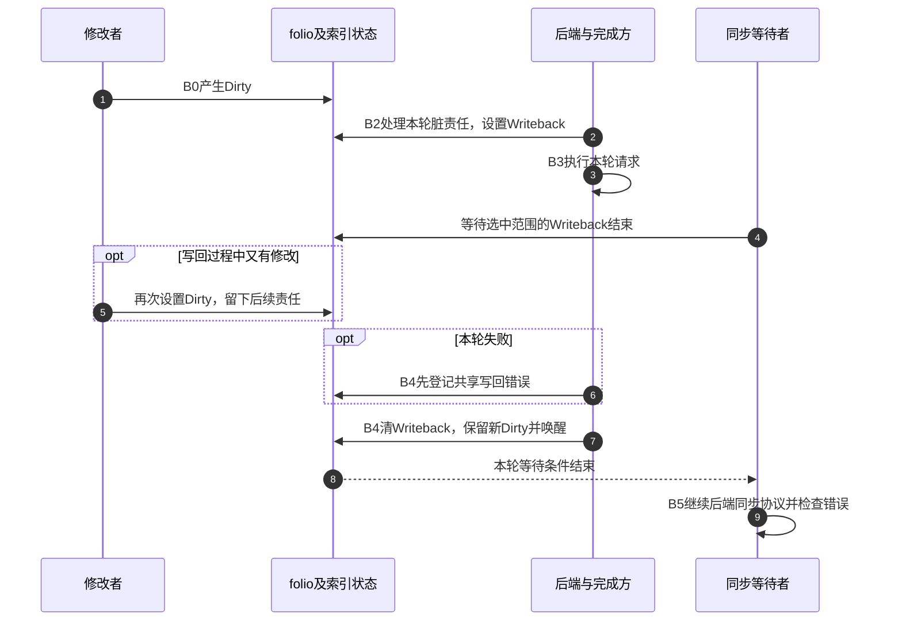

# 第16章\_writeback\_fsync与错误传播

上一章的缓冲写已经将内容交给共享缓存，并按后端接纳量返回。现在程序写入一份新配置，write返回成功后立即告诉用户“保存完成”。如果设备实际写入在稍后才失败，这个成功究竟证明了什么？

本章从这段时间差出发，追踪脏修改怎样被发现、提交、完成和报告错误。我们先把数据责任与执行任务分开，再进入fsync的文件系统实现；不把所有“同步”压缩成一个等待磁盘的动作。

## 16.1\_写成功以后为什么还需要完成协议

把多次小修改先留在缓存，可以合并写入，避免每次修改都等待存储后端。代价是用户请求的返回与后端持久化分离：程序可能继续执行，缓存中的新版本却还没有完成设备写入；这一阶段断电或写回失败，都不能靠此前的正字节数排除。

若要求每个小写入都等待完整存储协议，返回语义可以更强，但等待和设备交互成本也更高。缓冲写选择延后处理，需要额外保存“还有哪些修改待办”“哪一轮已经提交”“失败留在哪里”，并提供调用者主动请求完成的接口。应用根据恢复需求选择同步点，而不是只凭写入速度判断保存正确。

**写回（writeback）** 把待处理缓存内容交给后端；**fsync** 请求具体文件系统完成该文件数据与相关元数据的同步要求。前者可以为内存回收或后台策略服务，后者还需要连接错误观察和文件系统自己的持久化协议。它们不是同一个层次的同义词。

## 16.2\_一次修改怎样变成可发现的写回责任

假设多个进程修改同一文件的不同偏移。后台工作者不认识这些进程的栈变量，必须通过共享状态发现待办。存储文件系统通常同时维护folio脏位、文件内缓存索引的脏标记，以及inode的脏状态和所属写回队列；每一层减少下一层需要搜索的范围。


写回实例wb关联后端设备信息，也保存脏inode队列、显式工作列表和延后执行项。首次形成待处理脏队列时，可能安排延后工作；周期检查、压力阈值和显式同步还有各自入口。因此标脏不是“每写一个字节就唤醒线程”，也不是完全没有调度通知。延后时间提供处理机会，不构成所有数据届时完成的保证。

沿B0～B5看一个完整周期。Dirty、Writeback、inode队列责任和错误游标是多组相关状态，表中阶段只负责串起交接。

| 阶段 | 谁改变什么 | 后续如何继续 |
| --- | --- | --- |
| B0 登记修改 | 修改路径设置内容脏状态、索引标记和inode责任 | 后台或同步路径可从共享状态找到待办 |
| B1 选择工作 | 工作项或同步调用选取inode和文件范围 | 按后端能力进入实际写回方法 |
| B2 建立本轮责任 | 文件系统准备提交，处理脏位并设置Writeback | 当前轮与随后新增修改分开跟踪 |
| B3 后端执行 | 文件系统、块层或其他后端处理请求 | 完成路径产生成功或错误结果 |
| B4 结束本轮 | 完成方保存错误、结束Writeback并唤醒等待者 | 新Dirty仍可留下，错误跨调用保存 |
| B5 调用者观察 | fsync后端完成必要元数据/日志/设备协议，再检查本file错误游标 | 返回本次同步结果，游标按观察推进 |

B0不保证每次重新挂队列，B1也不保证每次都运行独立后台线程：显式同步可以主动进入范围提交。固定源码从 [VFS总索引](../../../research/source_reading/vfs/navigation/P01_Linux_6.12_VFS源码阅读索引.md#1.1_先固定源码身份与运行证据) 和 [写回模块导读](../../../research/source_reading/vfs/navigation/P15_写回提交完成与错误观察.md#15.1_沿同一周期区分责任与结果) 进入，登记与调度见 [脏状态汇聚](../../../research/source_reading/vfs/source_explanations/P37_脏状态登记与写回调度.md#37.1_从folio脏位汇聚到inode待处理状态)。

## 16.3\_提交与完成为什么需要独立状态

某folio的一轮写回已经提交，进程又修改了它。如果只保留一个“脏/干净”开关，完成方清开关时就可能连后来这次修改一起抹掉。独立的Writeback描述当前轮是否结束，Dirty描述是否还有后续修改责任；两者可以同时成立。

开始写回时，系统把当前待写责任转交给本轮处理，并维护索引中的WRITEBACK标记。完成方结束的是本轮，不顺手清除再次产生的Dirty。写回执行者清理inode旧责任后，还会复查索引脏标记，与修改者的登记协议配合，避免双方都误以为对方会处理新修改。



等待者按写回标记取得有引用的folio，再睡眠等待对应位解除。对象引用、写回状态和错误记录分别处理存续、完成和结果；唤醒不能代替成功判断。具体开始/结束与引用交接见 [写回状态](../../../research/source_reading/vfs/source_explanations/P38_写回标记与范围完成等待.md#38.1_把本轮责任从Dirty交给Writeback) 和 [完成唤醒](../../../research/source_reading/vfs/source_explanations/P38_写回标记与范围完成等待.md#38.3_完成方先结束本轮状态再唤醒)。

后台写回可以跳过暂时不适合处理的对象，再通过后续工作完成；完整性同步请求有更强的处理和等待要求。内存压力下写入者还可能被节流，所以“先写入内存”不等于任何规模下都不阻塞。

## 16.4\_fsync怎样把数据元数据与后端完成连起来

fsync入口从fd取得file，再调用这个file的同步方法。通用VFS不知道所有文件系统如何分配块、管理日志、提交远端请求，因此把范围和datasync要求交给具体后端；没有同步方法的对象不能自动获得持久化能力。

| 请求或动作 | 主要范围 | 不能由此替代的工作 |
| --- | --- | --- |
| 后台写回 | 按老化、压力或任务选择脏数据 | 不替应用确定自己的恢复边界 |
| fdatasync | 文件数据及恢复这些数据必需的元数据 | 不能省掉文件长度等必要状态 |
| fsync | 文件数据及相关元数据同步 | 不自动保证任意父目录名称变化已持久化 |
| sync | 更广的系统范围同步 | 不为某个应用设计多对象事务协议 |
| CPU数据缓存维护 | 处理特定体系结构上的内存可见性 | 不等于设备缓存flush或文件持久化 |

以本版本ext4为例，有日志的路径先处理数据范围，再完成需要的事务，并按日志及barrier条件决定是否另发设备flush；无日志路径有自己的缓冲元数据与父目录处理。日志、数据范围和设备缓存是不同完成条件，不能把“进入块层”直接等同于完成持久化。实现入口见 [同步分派](../../../research/source_reading/vfs/source_explanations/P39_同步入口与文件系统持久化.md#39.1_系统调用先取得file再交给其同步方法) 和 [ext4的分支](../../../research/source_reading/vfs/source_explanations/P39_同步入口与文件系统持久化.md#39.3_ext4按日志配置选择不同的完成路径)。

这里解释接口和实现协议，没有核对当前挂载模式或设备在掉电时的行为。应用必须检查fsync返回，才能知道后端是否报告本次要求成功；一次成功也不能替代对先前写回失败的处理。

## 16.5\_延后错误怎样交给每个打开者

若后台失败只返回给工作线程，原write调用者已无法收到；若错误只有一个全局开关，第一个fsync清掉后，其他独立打开者又可能错过。Linux在mapping保存共享错误序列，在每个file保存观察游标：共享记录说“最近出现了什么变化”，游标说“这个打开对象已经观察到哪里”。

文件打开时建立游标，后续同步检查在必要时加file的锁并推进它。dup只是让另一个号码指向同一file，因此共享这个游标；独立open通常有自己的游标。错误可能由别的写入者造成，记录不提供逐字节或逐调用的责任归因。

还要保留两个边界。第一，错误序列不是完整错误日志：多次未观察错误可以只留下最新错误，有限计数有回绕边界。第二，初次采样会特殊处理尚未确认的错误，因此新open仍可能观察到更早但尚无人确认的错误；不能把它概括成严格只看open之后的事件。

具体状态见 [错误记录与游标](../../../research/source_reading/vfs/source_explanations/P40_写回错误序列与每file观察.md#40.1_共享记录与观察游标分别保存)。某次fsync报告EIO以后，再次调用返回0可能只是游标已推进、没有新的错误；它不证明丢失的数据已经重新写好。应用需要按自己的数据来源、重试和恢复协议处理失败，而不是循环到0就抹掉失败记录。

## 16.6\_区分内容持久化与名称持久化

保存一份配置还涉及目录中的名字。把新内容写入临时文件并fsync这个文件，解决的是文件内容及相关元数据；随后rename改变目录项，若需要持久化这个名称变化，还要按目标文件系统契约同步相应目录。单次rename的运行时原子可见性，也不等于多个文件组成的事务已经具备崩溃恢复能力。

Linux手册明确区分文件同步与目录项同步，并说明fdatasync仍包含恢复数据所必需的元数据，例如文件长度。参见 [fsync与fdatasync手册](https://man7.org/linux/man-pages/man2/fsync.2.html)（man-pages 6.19，页日期2026-02-08）。跨目录移动、新建目录链和多文件提交需要进一步确定各目录与恢复记录的责任，不能仅复制一个文件fsync就推断整个操作已完成。

因此有实际恢复要求时，应先列出必须共同恢复的对象和名称关系，再安排同步及恢复协议。下一节只演示一个私有目录中的局部顺序，帮助检查返回值；它没有实现通用数据库事务，也不模拟掉电。

## 16.7\_练习检查同步返回与发布顺序

下面创建私有目录和临时文件，完整写入一行配置，检查文件fsync成功后发布名称，再检查目录fsync。只有这几步均成功才报告该段流程成功；EINTR可以重试，EIO等错误直接作为失败处理。

```c
#define _GNU_SOURCE
#include <errno.h>
#include <fcntl.h>
#include <stdbool.h>
#include <stdio.h>
#include <stdlib.h>
#include <unistd.h>

static int close_owned(int *fd)
{
    int number = *fd;
    *fd = -1;
    return number < 0 ? 0 : close(number);
}

static int sync_retry(int fd)
{
    int result;
    do {
        result = fsync(fd);
    } while (result < 0 && errno == EINTR);
    return result;
}

int main(void)
{
    char workspace[] = "/tmp/vfs-sync-demo-XXXXXX";
    const char content[] = "version=1\n";
    size_t written = 0;
    int dir_fd = -1, file_fd = -1, result = EXIT_FAILURE;
    bool have_workspace = false, have_temp = false, have_final = false;
    if (!mkdtemp(workspace))
        goto error;
    have_workspace = true;
    dir_fd = open(workspace, O_RDONLY | O_DIRECTORY | O_CLOEXEC);
    if (dir_fd < 0)
        goto error;
    file_fd = openat(dir_fd, "pending", O_CREAT | O_EXCL | O_WRONLY | O_CLOEXEC, 0600);
    if (file_fd < 0)
        goto error;
    have_temp = true;
    while (written < sizeof(content) - 1) {
        ssize_t count = write(file_fd, content + written, sizeof(content) - 1 - written);
        if (count < 0 && errno == EINTR)
            continue;
        if (count <= 0) {
            if (count == 0)
                errno = EIO;
            goto error;
        }
        written += (size_t)count;
    }
    /* 先检查文件数据与必要元数据的同步结果。EIO等错误不能循环到成功后忽略。 */
    if (sync_retry(file_fd) < 0)
        goto error;
    if (renameat(dir_fd, "pending", dir_fd, "published") < 0)
        goto error;
    have_temp = false;
    have_final = true;
    /* 名称变化属于目录，不能由前一次文件fsync代替。 */
    if (sync_retry(dir_fd) < 0)
        goto error;
    puts("文件fsync、名称发布和目录fsync均返回成功；本程序没有模拟掉电");
    result = EXIT_SUCCESS;
    goto out;
error:
    perror("同步与名称发布实验");
out:
    if (close_owned(&file_fd) < 0)
        result = EXIT_FAILURE;
    if (have_temp && unlinkat(dir_fd, "pending", 0) < 0)
        result = EXIT_FAILURE;
    if (have_final && unlinkat(dir_fd, "published", 0) < 0)
        result = EXIT_FAILURE;
    if (close_owned(&dir_fd) < 0)
        result = EXIT_FAILURE;
    if (have_workspace && rmdir(workspace) < 0)
        result = EXIT_FAILURE;
    if (result != EXIT_SUCCESS)
        fprintf(stderr, "实验或清理失败；实验目录：%s\n", workspace);
    return result;
}
```

材料文件：[sync_publish_demo.c](../../../labs/kernel/vfs/materials/sync_publish_demo.c)。在Linux材料目录编译运行：

```sh
cc -std=c11 -Wall -Wextra -Werror sync_publish_demo.c -o sync_publish_demo
./sync_publish_demo
```

程序使用C11和完整警告检查，无需root，只清理自己创建的文件与目录。预期输出说明文件fsync、名称发布与目录fsync返回成功；若文件系统不支持目录同步或实际发生错误，程序报告失败。本次未在目标Linux编译运行。

临时工作目录只用于隔离实验，程序最后删除产物，没有对其父目录创建过程设计持久化协议。因此输出只用于观察局部调用顺序和返回处理，不是掉电恢复、设备可靠性或完整应用保存协议的证明。也没有注入延后写回错误来验证游标行为。

练习一：为何文件写完后只close不足以表达本章的保存要求？参考答案：close处理打开关系的退出，不替应用完成全部同步要求；应在关闭前检查相应同步结果，关闭错误本身也不能忽略。

练习二：A和dup得到的B分别fsync，是否一定各收到同一错误一次？参考答案：不一定，它们共享file和观察游标，第一次推进后另一调用可能已没有新的差异。独立open的游标关系不同。

练习三：Writeback结束时Dirty仍为1，是状态机出错吗？参考答案：不是。当前轮之外可能又产生修改，新的脏责任需要后续处理，不能被当前轮完成顺手清掉。

现在能够沿共享状态和执行任务找到写回，再追踪完成与错误观察。下一章进入 [Direct I/O与异步完成](P17_Direct_IO与异步完成.md)，检验绕过普通页缓存以后，缓冲生命周期和完成责任怎样改变。
