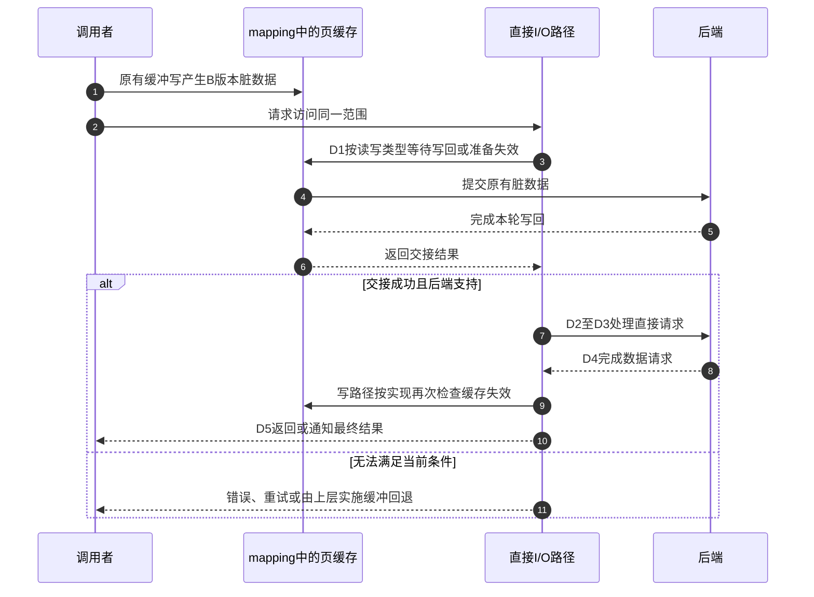
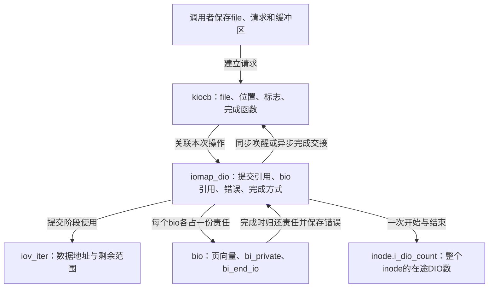
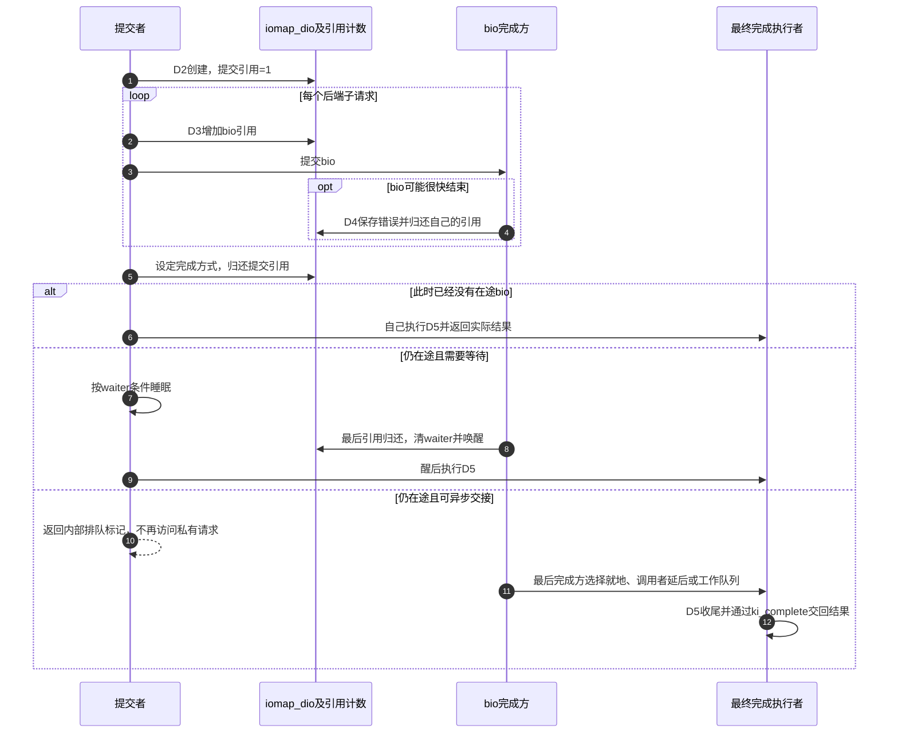

# 第17章\_Direct\_IO与异步完成

上一章已经把写入接纳与持久化分开。现在换一个负载：数据库在用户态保存自己的数据页，决定哪些页保留、何时淘汰、如何成批提交。若每次读写还要经过普通文件页缓存，同一份内容可能同时占据应用缓存和内核缓存，两个层次也各自作出回收与预读决定。

这并不意味着页缓存设计错误。它为不想自己管理缓存的程序提供共享、预读和合并写回。问题是：当应用已经承担这些职责，能否选择另一条数据路径？本章由此引出直接I/O，再追踪一个请求拆成多个后端请求以后，谁负责等完、通知和释放。

## 17.1\_直接I/O改变数据路径但不承包所有保证

**直接输入输出（Direct I/O，DIO）** 允许文件系统尝试直接在调用者的数据缓冲区与后端之间完成传输，减少普通文件数据页缓存的参与。用户通常用O_DIRECT表达这一选择；它仍然经由file操作、文件偏移映射、文件大小及后端协议，不是让用户地址直接充当设备扇区号。

继续看数据库的一次读取。缓冲路径先在文件缓存查找有效内容，缺失时填充，再复制给应用；直接路径根据文件范围取得后端映射，并为传输准备调用者缓冲区。应用减少一层缓存的收益，换来了对齐、缓冲区生命期、请求规模和自身缓存策略的责任。一次性的小读、共享热点文件或普通应用，仍可能从内核预读与缓存命中中获益。

三种选择要分开：**是否经过页缓存、是否在调用现场等待完成、需要何种持久化保证**。它们不是同一个开关。

| 选择 | 回答的问题 | 仍需另外处理 |
| --- | --- | --- |
| 缓冲或直接路径 | 文件数据通过哪种缓存/传输路径 | 完成通知、错误和持久化 |
| 同步或异步接口 | 调用者怎样取得最终结果 | 数据路径和恢复要求 |
| fsync、O_DSYNC或O_SYNC | 需要完成哪些数据和元数据要求 | 多对象事务、目录名称与恢复协议 |

因此O_DIRECT不等于O_SYNC，也不保证任何场景都更快。直接I/O也不意味着没有内存复制或必然发生DMA：读取空洞可以向目标缓冲区补零，某些内联数据有自己的复制路径。判断性能必须固定文件系统、访问范围、并发度和缓存负载；不能仅比较标志名称。

## 17.2\_绕开缓存以后为什么仍要与缓存交接

设缓存中同一文件的第一个数据块已经从A改成B，但B还没有写回。若直接读立即从后端读，它可能读到A。反过来，直接写把后端改成C，而干净缓存仍保存A，随后缓冲读又可能返回旧内容；更严重的是旧脏页稍后写回，还会覆盖直接写入的版本。

所以直接路径不是“看不见缓存”。读路径在需要时先完成重叠脏数据的写回；写路径在提交前处理相关缓存，完成后可能再尝试失效新进入的干净页。不能安全完成交接时，具体实现可以报错、返回需要重试的结果，或由调用者选择缓冲回退。



这组动作不等于给任意混合访问提供一个总锁。尤其是mmap写入、文件截断和不同实现的锁范围，可能与直接I/O交错；有些组合明确不受完整支持。应用应避免让不同路径并发修改同一重叠范围，需要混合时先建立自己的阶段交接和目标文件系统保证。固定版本的通用缓存准备见 [缓存交接实现](../../../research/source_reading/vfs/source_explanations/P41_直接IO的缓存交接与实现入口.md#41.1_提交以前先处理同范围缓存)。

首次进入本章源码证据，可从 [VFS总索引](../../../research/source_reading/vfs/navigation/P01_Linux_6.12_VFS源码阅读索引.md#1.1_先固定源码身份与运行证据) 与 [直接I/O模块导读](../../../research/source_reading/vfs/navigation/P16_直接IO请求与完成责任.md#16.1_先分清请求对象与执行上下文) 定位版本。本章以iomap库的一条实现为主线，旧的blockdev_direct_IO实现另有算法，不能把两个direct-io.c拼成同一调用链。

## 17.3\_一个请求为什么需要独立的完成责任

文件范围可能跨越多个后端映射，还可能因向量容量拆成多个bio。**bio** 是内核向块层描述一段I/O的数据结构，并不是设备本身，也不是用户线程。先提交的bio可能在后面的bio还没有建立时就完成，因此“某个设备请求完成”不能直接代表整次文件请求完成。

本版本iomap为这次操作分配iomap_dio，把它与kiocb、数据迭代器、结果和完成方式关联。kiocb描述一次内核文件I/O请求；iov_iter描述尚待处理的数据范围；iomap_dio汇聚这一次直接I/O的子请求。三者职责不同，执行它们的仍是提交任务与后端完成路径。



| 阶段 | 关键状态与所有者 | 退出条件 |
| --- | --- | --- |
| D0 接受请求 | 调用者建立kiocb并维持file、缓冲区生命期 | 范围与执行方式确定 |
| D1 准备 | 文件系统协调范围与锁，直接路径处理缓存 | 支持当前请求，或报错/回退 |
| D2 登记 | iomap_dio保留提交引用，inode登记一次DIO | 即使早完成也不能提前销毁请求 |
| D3 拆分提交 | 每个bio取得一份引用并持有传输需要的页 | 提交循环结束，释放提交引用 |
| D4 汇聚 | 完成方保存错误、归还bio引用 | 最后责任归还时选定完成执行者 |
| D5 交回结果 | 完成执行者做文件系统收尾、位置推进及必要同步 | 返回结果或通知调用者，释放本次私有请求 |

提交引用是关键：若只统计已经提交的bio，第一个bio快速完成时计数可能降到0，但提交者还准备继续添加第二个。多保留一份提交责任，直到循环结束才归还，就把“尚可产生新子请求”纳入了完成条件。inode上的计数又是另一层，它汇聚整个inode的在途DIO供截断等路径协调，不能替代单请求的bio引用。

详细的登记、迭代与引用交接见 [请求建立](../../../research/source_reading/vfs/source_explanations/P42_iomap直接IO的请求建立与提交.md#42.2_提交引用封住子请求提前完成的窗口)。

## 17.4\_同步等待与异步回调怎样共享结果

同步请求可以由当前任务等待；异步请求提供最终结果的回调，但这不保证每次都异步排队。如果提交结束时所有子请求已经完成，提交者可以直接完成并返回实际结果；只有仍有在途责任且选择异步交接时，内部才返回-EIOCBQUEUED。这是内核调用协议，不是用户C程序应当当作errno处理的普通返回值。

异步交接后，完成方还可能在提交函数真正返回给上层之前就运行回调。外层请求必须支持这个交错，不能以“还没收到排队返回值”为理由假定回调尚未发生。下图展示其中一条允许的时间线，不给返回与回调额外规定固定先后。

最后一个bio结束时也不一定能直接做所有收尾。读请求可能可以就地完成；写请求若还要转换未写区间、更新元数据或执行同步，就需要适合这些动作的任务上下文。本版本提供工作队列以及经调用者约定的延后完成通道，不是任何回调都能在任意上下文睡眠。



缓冲区在最终完成前不能释放、重用或被其他写入改坏。内核固定传输所需页面，主要解决映射与页面生命期，并不意味着应用可以在设备仍访问时随意修改内容。私有映射缓冲区与fork还有额外约束；本章实验不创建线程或fork，使用同步调用保持生命期简单。异步取消也必须确认最终完成，不能只因提交入口返回就回收。

具体上下文选择与释放顺序见 [完成分派](../../../research/source_reading/vfs/source_explanations/P44_iomap直接IO的完成汇聚与通知.md#44.1_最后一个bio决定怎样继续收尾)。io_uring和AIO负责各自的提交/通知容器、file引用及取消协议，本章只解释它们进入文件操作后的完成契约，不把环队列或用户态通知误画成iomap内部对象。

## 17.5\_对齐和持久化应当分别检查

对齐至少有三个对象：缓冲区起始地址、文件偏移、每段传输长度。要求取决于文件系统、文件特征及设备，不能统一硬编码成4096；不满足要求时也不能假设一定回退或一定EINVAL。Linux提供STATX_DIOALIGN查询入口，必须同时检查返回掩码，确认字段确实有效。

O_DIRECT改变传输路径，持久化仍按前章的同步协议判断。iomap可以为带同步要求的写入使用设备FUA等能力或后置同步，但这是有前提的实现分支；不是每个bio天然具有同样保证。一次直接写失败还可能已有部分范围被改变，应用不能把负返回当成“文件完全没动”。

上述用户接口边界见 [open手册](https://man7.org/linux/man-pages/man2/open.2.html) 与 [statx手册](https://man7.org/linux/man-pages/man2/statx.2.html)，本次于2026-10-18核对；源码主线仍固定在Linux 6.12.20。这里使用两个DIOALIGN字段，不把较新内核新增的读专用对齐字段倒推到本版本。

选择时先问：应用是否确实要自己管理数据缓存，是否能按要求组织范围和缓冲区，是否已经定义完成及恢复协议？若答案不成立，先使用缓冲I/O通常更容易得到正确实现。需要直接路径时，再比较相同工作负载下的资源占用和延迟，而不是先认定“直接”意味着更快。

## 17.6\_实验先查询约束再验证一次读写

下面程序在指定目录内创建独占的临时工作目录，查询该文件的直接I/O对齐要求，分配两个缓冲区，再执行一次同步pwrite、pread和fsync。它没有混用同范围mmap，没有异步回调，也没有性能测量；目的是让每个前提和返回值都有明确处理。

| 接口或检查 | 本例作用 | 误用后果与实现入口 |
| --- | --- | --- |
| statx与stx_mask | 检查当前文件是否报告对齐能力 | 不把未返回字段的0猜成无限制；查询语义见本节前的手册 |
| posix_memalign | 建立满足内存对齐的缓冲区 | 返回错误码本身，不用旧errno解释分配失败 |
| pwrite/pread | 固定偏移的一次同步请求 | 必须检查实际长度；内核同步请求适配见 [第33章](../../../research/source_reading/vfs/source_explanations/P33_同步迭代请求与向量缓冲区的交接.md#33.2_栈上的同步请求必须在返回前完成) |
| 直接路径与缓存交接 | 处理文件范围、后端能力及先前缓存 | 不把O_DIRECT当作绕开一切；见 [第41章](../../../research/source_reading/vfs/source_explanations/P41_直接IO的缓存交接与实现入口.md#41.2_通用读写入口如何表达回退) |
| fsync | 单独检查同步结果 | 不把读回一致当成掉电后仍存在；见 [同步分派](../../../research/source_reading/vfs/source_explanations/P39_同步入口与文件系统持久化.md#39.1_系统调用先取得file再交给其同步方法) |

```c
#define _GNU_SOURCE
#define _FILE_OFFSET_BITS 64
#include <errno.h>
#include <fcntl.h>
#include <stdint.h>
#include <stdio.h>
#include <stdlib.h>
#include <string.h>
#include <sys/stat.h>
#include <unistd.h>

static int close_owned(int *fd)
{
    int number = *fd;
    *fd = -1;
    return number < 0 ? 0 : close(number);
}

int main(int argc, char **argv)
{
    char *workspace = NULL;
    void *out_buffer = NULL, *in_buffer = NULL;
    struct statx info = {0};
    size_t alignment, length;
    int dir_fd = -1, file_fd = -1, result = EXIT_FAILURE;
    int have_dir = 0, have_file = 0, error;
    ssize_t count;
    if (argc != 2) {
        fprintf(stderr, "用法：%s <可写测试目录>\n", argv[0]);
        return EXIT_FAILURE;
    }
    if (asprintf(&workspace, "%s/vfs-dio-XXXXXX", argv[1]) < 0)
        goto error;
    if (!mkdtemp(workspace))
        goto error;
    have_dir = 1;
    dir_fd = open(workspace, O_RDONLY | O_DIRECTORY | O_CLOEXEC);
    if (dir_fd < 0)
        goto error;
    /* 先建立独占文件，确保之后不支持O_DIRECT时也知道应清理哪个文件。 */
    file_fd = openat(dir_fd, "data", O_CREAT | O_EXCL | O_RDWR | O_CLOEXEC, 0600);
    if (file_fd < 0)
        goto error;
    have_file = 1;
    if (statx(file_fd, "", AT_EMPTY_PATH, STATX_DIOALIGN, &info) < 0)
        goto error;
    if (!(info.stx_mask & STATX_DIOALIGN) || !info.stx_dio_mem_align ||
        !info.stx_dio_offset_align) {
        puts("跳过：此文件未提供可用的直接I/O对齐要求");
        result = 77;
        goto out;
    }
    alignment = info.stx_dio_mem_align;
    length = info.stx_dio_offset_align;
    if ((alignment & (alignment - 1)) || length > 8U * 1024U * 1024U) {
        puts("跳过：对齐或长度超出这个小实验的分配方案");
        result = 77;
        goto out;
    }
    if (alignment < sizeof(void *))
        alignment = sizeof(void *);
    error = posix_memalign(&out_buffer, alignment, length);
    if (error) {
        errno = error;
        goto error;
    }
    error = posix_memalign(&in_buffer, alignment, length);
    if (error) {
        errno = error;
        goto error;
    }
    memset(out_buffer, 0x5a, length);
    memset(in_buffer, 0, length);
    if (close_owned(&file_fd) < 0)
        goto error;
    file_fd = openat(dir_fd, "data", O_RDWR | O_DIRECT | O_CLOEXEC);
    if (file_fd < 0)
        goto error;
    /* 同步调用返回前缓冲区保持不变；短写不盲目拆成可能失去对齐的尾请求。 */
    do {
        count = pwrite(file_fd, out_buffer, length, 0);
    } while (count < 0 && errno == EINTR);
    if (count != (ssize_t)length) {
        if (count >= 0)
            errno = EIO;
        goto error;
    }
    do {
        count = pread(file_fd, in_buffer, length, 0);
    } while (count < 0 && errno == EINTR);
    if (count != (ssize_t)length || memcmp(out_buffer, in_buffer, length)) {
        if (count >= 0)
            errno = EIO;
        goto error;
    }
    /* O_DIRECT本身不替代同步要求，独立检查fsync。 */
    do {
        error = fsync(file_fd);
    } while (error < 0 && errno == EINTR);
    if (error < 0)
        goto error;
    printf("对齐内存=%u 偏移及长度=%u；读回一致，fsync成功\n",
           info.stx_dio_mem_align, info.stx_dio_offset_align);
    result = EXIT_SUCCESS;
    goto out;
error:
    perror("直接I/O实验");
out:
    if (close_owned(&file_fd) < 0)
        result = EXIT_FAILURE;
    free(in_buffer);
    free(out_buffer);
    if (have_file && unlinkat(dir_fd, "data", 0) < 0)
        result = EXIT_FAILURE;
    if (close_owned(&dir_fd) < 0)
        result = EXIT_FAILURE;
    if (have_dir && rmdir(workspace) < 0)
        result = EXIT_FAILURE;
    if (result == EXIT_FAILURE && workspace)
        fprintf(stderr, "实验或清理失败，请检查：%s\n", workspace);
    free(workspace);
    return result;
}
```

完整材料：[direct_io_demo.c](../../../labs/kernel/vfs/materials/direct_io_demo.c)。需要提供STATX_DIOALIGN结构字段的Linux开发头文件和glibc；在目标Linux中执行：

```bash
cc -std=c11 -Wall -Wextra -O2 labs/kernel/vfs/materials/direct_io_demo.c -o /tmp/direct_io_demo
/tmp/direct_io_demo /path/to/writable/test_directory
```

将第二行目录换成你明确用于测试的可写文件系统目录。程序只清理自己新建的文件与目录。退出0表示本次等长读写、比较及fsync均成功；77表示文件未报告能力或超出本实验的分配边界；其他失败需要保留错误检查环境。缺少statx系统调用或发生其他调用错误时明确失败，不自行猜对齐。

本轮没有在目标Linux编译运行，以上是可复现材料和预期解释，不是实测结果。程序结束会清理文件；没有验证名称持久化、掉电恢复、缓存旁路比例、页固定和异步完成时序。

练习一：如果成功写入一半就返回，为什么不能无条件把剩余部分重新提交？参考答案：剩余地址、偏移和长度可能失去对齐，且需要明确部分修改的恢复策略。

练习二：三个bio中两个已经完成，但提交引用仍在，谁可以释放iomap_dio？参考答案：任何一方都不能仅凭这两个完成释放；必须遵守最后引用与完成方式的交接。

练习三：读回一致但未检查fsync，能否证明掉电恢复？参考答案：不能，读取结果、后端完成与持久化是不同证据，甚至成功fsync也没有替本实验实施掉电测试。

现在可以沿数据路径、完成方式和持久化要求分别判断直接I/O。下一章进入 [文件mmap与page fault](P18_文件mmap与page_fault.md)：当数据通过长期地址映射访问，缺页、缓存对象与文件变化又怎样协调？
