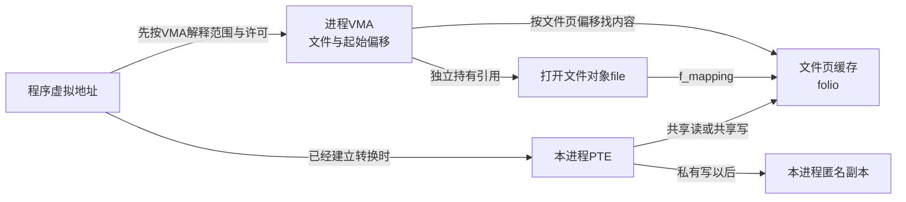
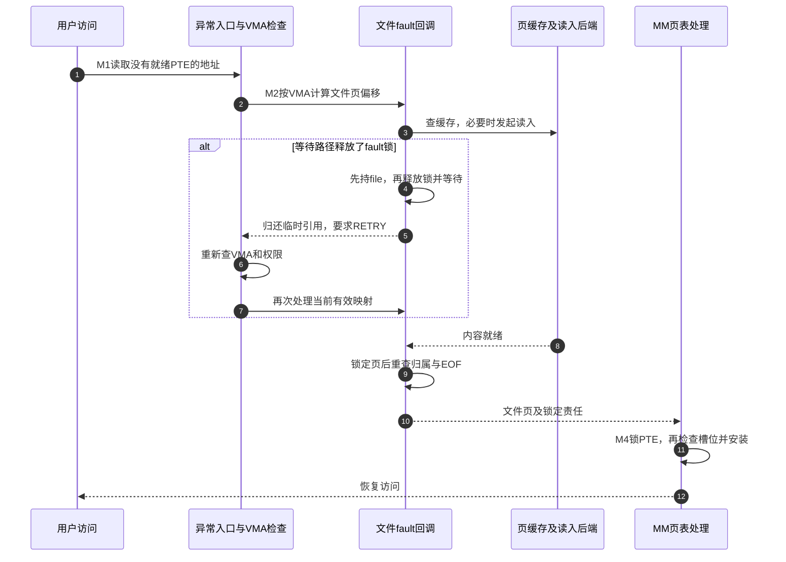

# 第18章\_文件mmap与page\_fault

上一章沿Direct I/O请求追踪了缓冲区、子请求和完成通知。无论走缓冲I/O还是直接I/O，应用都显式提交一个读写请求。本章换一个使用场景：程序需要反复查询一个文件里的索引节点，希望像访问数组一样，按偏移直接读取字段。这样的访问怎样接到文件内容，文件缩小以后旧指针又会怎样？

本章讨论普通文件、MMU开启、页缓存支持的映射。设备寄存器映射、DAX和匿名内存各有额外协议，不把它们混成同一条数据路径。

## 18.1\_把反复读文件改为地址访问带来了什么

假设索引文件按页存放节点。使用pread时，程序知道节点偏移，准备缓冲区，调用pread，再从返回的字节中解析。这个方案有清楚的边界：在哪次调用发生错误、拿到了多少字节、缓冲区何时可以复用，都由返回值表达。对于顺序流式读取或需要明确控制I/O提交时机的程序，这仍然很合适。

如果一次查询要多次跳到不同节点，应用需要反复维护“文件偏移→缓冲区”的对应关系。热点节点可能已经在内核页缓存里，却仍需复制到用户缓冲区。文件映射提出另一种办法：先登记一段虚拟地址与文件偏移的关系，让页表把可访问地址接到相应文件页。以后程序使用load/store，缺少转换或写权限时再由缺页处理补齐。

省掉逐次显式读取和部分复制，代价是把工作转移到缺页、页表、地址空间管理与失效协调上。一次看似普通的读指针可能睡眠、分配内存，甚至因文件被截断而收到信号。大量稀疏访问也会产生页表和缺页成本。因此，不能从“像内存一样访问”推出“不会I/O”“不会阻塞”或“一定比read快”。

先记住这个选择条件：反复按偏移访问稳定文件、能够接受缺页及映射生命周期管理时，可以评估mmap；需要批次提交、明确的短读错误边界或流式缓冲管理时，pread/read通常更直接。性能选择仍需相同文件、访问分布和缓存条件下测量。

## 18.2\_映射关系与已经装好的页表是两件事

mmap返回一个地址，首先表示内核接受了映射关系。为了理解后面的行为，需要分开三份状态，而不是只记“文件被映射进内存”。

**VMA（Virtual Memory Area，虚拟内存区域）** 描述一段地址的范围、访问许可、文件和起始文件页偏移。它回答“访问这里应该怎样解释”。**页缓存** 按文件mapping和页索引保存内容，回答“文件这一段目前有哪些可用数据”。**PTE（Page Table Entry，页表项）** 则参与当前进程的实际地址转换，回答“此刻这个虚拟页指向哪页、是否允许此次访问”。



图中的两条地址路径不是每次load都执行两遍软件查询。PTE已就绪时，处理器按地址转换访问页面；只有缺页等事件才回到软件，按VMA和文件状态处理。

| 状态 | 建立或修改者 | 不能单凭它推出什么 |
| --- | --- | --- |
| VMA范围、许可、文件偏移 | mmap、munmap及其他地址空间操作 | VMA存在不保证每页已读入、PTE已建立，也不保证文件仍有那么长 |
| 文件folio、内容有效和脏状态 | 缓冲I/O、缺页、写回和截断 | 缓存存在不保证当前进程已经映射，更不保证脏内容持久化 |
| 本进程PTE及写权限 | MM缺页、写保护、回收和失效流程 | PTE曾经建立不保证以后不被撤销或重新写保护 |
| VMA所持file引用 | 映射建立、拆分/合并和最后拆除 | file存活不保证旧文件偏移仍有效 |

新文件VMA持有自己的file引用，因此close(fd)以后映射通常仍可用；munmap负责解除地址关系。一次mmap也可能和相邻区域合并，不能把每次调用机械对应成一个永不变化的VMA对象。接口契约可追溯到[mmap手册](https://man7.org/linux/man-pages/man2/mmap.2.html)；版本实现从[VFS源码总索引](../../../research/source_reading/vfs/navigation/P01_Linux_6.12_VFS源码阅读索引.md)进入[文件映射导读](../../../research/source_reading/vfs/navigation/P17_文件映射的缺页与状态交接.md#17.1_沿一次映射访问找到状态落点)。

具体的`get_file → 后端mmap → 发布VMA`及失败回滚，见[映射发布](../../../research/source_reading/vfs/source_explanations/P45_文件映射的发布与引用归还.md#45.1_新VMA先取得后备文件再发布)；关闭映射时的引用归还见[最终拆除](../../../research/source_reading/vfs/source_explanations/P45_文件映射的发布与引用归还.md#45.3_两棵索引与最后一份文件引用分别收尾)。

## 18.3\_第一次访问为什么可能睡眠和重试

现在让程序读取映射中的第一个索引节点。假设相应PTE尚未建立，且采用普通单页文件缺页路径。处理器产生异常，内核先查地址是否仍属于可读VMA，再由文件页偏移查缓存。热缓存可以复用内容；冷缓存可能需要分配folio、发起读入并等待完成。文件系统提供内容，MM负责后续页表安装，这两步不能画成“文件系统直接把普通PTE全部装好”。

一次访问使用下面的阶段贯穿后文。它不是只有一个整数状态的状态机，而是VMA、folio、PTE和文件大小多组状态之间的协议。

| 阶段 | 触发、状态与交接 |
| --- | --- |
| M0 建立关系 | mmap校验并发布文件VMA，取得后备对象引用 |
| M1 解释故障 | 缺少转换或写许可时，查VMA和访问类型；地址/权限不合法进入错误处理 |
| M2 取得文件内容 | 查缓存、读入并验证页面归属、内容有效和EOF；必要时释放fault锁并要求重试 |
| M3 准备写入 | 读访问跳过；共享写让后端准备，私有写选择独立副本 |
| M4 发布访问 | 在PTE锁下再次检查槽位，安装/更新转换，移交相应页引用，再恢复用户访问 |
| M5 同步或失效 | 脏数据进入写回；同步等待指定保证；截断撤销失效页表和缓存，后续访问可能重新fault |
| M6 解除关系 | munmap或进程退出拆除映射，归还相应页表及file责任 |

等待I/O时一直占用整个地址空间的锁，会阻挡其他地址空间操作。内核在允许重试的路径先临时持有file，再释放fault锁去等待。此时另一个线程可能munmap，原VMA便不能继续直接使用。返回RETRY后必须重新查VMA与许可；file引用只保住后备对象，不会把地址空间冻结。



表和图描述正常分工，不保证每个fault都产生物理磁盘I/O，也不保证一页一次：已有PTE不会走这条软件路径，fault-around还可预先映射邻近已就绪页。两线程同时fault同址时，后拿到PTE锁的一方可能发现别人已经装好，必须放弃自己多取得的引用。

`filemap_fault`的归属与EOF复查见[文件页验证](../../../research/source_reading/vfs/source_explanations/P46_文件缺页的缓存验证与重试.md#46.2_页面存在以后仍要核对归属与EOF)，`finish_fault`的槽位复查和引用交接见[MM安装](../../../research/source_reading/vfs/source_explanations/P47_文件页到进程页表的安装.md#47.2_拿到文件页以后在PTE锁下再次确认)。锁释放也有RETRY_NOWAIT等特例，不能只看返回位名字推断锁已经释放。

## 18.4\_同一个文件的两种写入为什么走向不同页面

假设两个映射起初都读取文件页里的字母S。一个调用方希望修改就是文件内容的一部分；另一个只想临时修改自己的工作视图。若两者都直接开放原文件页的写权限，第二个调用方会破坏原文件。区别因此必须落在最终写入哪一页，而不仅是给VMA贴不同名字。

**MAP_SHARED** 的写入仍指向文件页。文件系统可能需要准备存储空间、处理日志或与写回/截断协调，所以MM在开放写权限前调用其page_mkwrite方法。准备成功后安装或更新PTE，并把文件页纳入脏状态跟踪。以后真正的数据写入、写回完成和同步返回仍是不同事件；共享映射也不自动提供多线程数据结构的互斥与发布协议。

**MAP_PRIVATE** 的写入需要与文件分离。缺失PTE时的写故障先准备新匿名页，再取得并复制文件内容；若此前已经读取并映射了文件页，后续写保护故障走另一条入口，仍需复制到匿名页并切换PTE。已有安全独占的匿名页可以复用，不是每次写入都再复制。原VMA仍记录文件关系，但相应PTE已经指向私有内容。

| 同一场景 | 共享写 | 私有写 |
| --- | --- | --- |
| 准备的目标 | 原文件folio，先完成后端写准备 | 新匿名副本，或可安全复用的既有匿名页 |
| 当前进程PTE | 指向可写文件页 | 指向私有匿名页 |
| 文件后续读到的内容 | 修改属于文件内容，仍需同步协议保证持久化 | 不因这份私有修改而改变 |
| 额外成本 | 写准备、脏跟踪、写回及同步协调 | 复制、匿名页占用、PTE与反向映射切换 |
| 不应误解为 | 自动加锁或写完即落盘 | mmap时刻整个文件的稳定快照 |

私有映射不保证mmap之后外部修改是否可见；需要稳定快照的程序应另行建立文件版本或快照协议，不能把“我的写不会回文件”理解成“文件以后怎样改都与我无关”。这是[mmap接口契约](https://man7.org/linux/man-pages/man2/mmap.2.html)的边界。

从源码追踪两类写入，可分别读[私有首次写](../../../research/source_reading/vfs/source_explanations/P48_私有文件映射的写时复制.md#48.1_首次写缺页先准备独立匿名页)、[已有PTE的COW](../../../research/source_reading/vfs/source_explanations/P48_私有文件映射的写时复制.md#48.3_复制期间PTE可能已变化所以发布前再比较)和[共享写准备](../../../research/source_reading/vfs/source_explanations/P49_共享映射的写入准备与脏页登记.md#49.1_让文件系统先准备可写页面)。

## 18.5\_同步修改和撤销失效页面分别解决什么

共享写入以后，用户能读回新值，只能证明当前内存视图有了这些内容。要把指定映射范围交给文件同步，可调用msync并检查结果；Linux的MS_SYNC路径把虚拟范围换算成文件范围，再进入文件系统同步方法。MS_ASYNC在本章核对版本不主动启动I/O。msync也不会把MAP_PRIVATE生成的匿名副本写回原文件。[msync接口说明](https://man7.org/linux/man-pages/man2/msync.2.html)和[范围换算实现](../../../research/source_reading/vfs/source_explanations/P50_映射同步与截断撤销.md#50.1_msync把虚拟地址范围翻译回文件范围)分别给出接口与版本依据。

同步要解决的是“修改何时满足后端保证”。截断则提出相反方向的问题：原来允许访问的文件偏移现在已不存在，怎样阻止进程继续通过旧PTE读写？仅删页缓存不够，因为进程可能已经有指向旧页的页表。内核通过mapping的文件区间索引找到相关VMA，撤销PTE，处理缓存，再补一次撤销以覆盖并发私有复制窗口。

这没有把整个VMA删除。下一次访问旧虚拟地址仍可能找到VMA，但文件fault发现页偏移完整超出新EOF，于是返回SIGBUS。file的生命期与文件长度是两个约束：持有file能防对象被回收，不能保证长度永远不变。文件末尾部分页、完整越界页以及文件范围内的洞必须区分；洞通常读为零，不能把打洞和truncate都概括成SIGBUS。

两次撤销的原因见[截断交接](../../../research/source_reading/vfs/source_explanations/P50_映射同步与截断撤销.md#50.2_截断在缓存删除前后各撤销一次页表)。应用若长期保存文件映射指针，就必须对文件替换、缩小和并发写入另行规定协作协议，不能只依赖第一次mmap成功。

## 18.6\_实验分别观察引用共享与截断

下面程序在Linux的临时私有目录里创建一个整页文件，建立共享和私有映射，关闭原fd后再访问。它先检查共享修改可从文件读到，再检查私有修改不改变文件，最后截断到0，让子进程访问旧共享地址并检查SIGBUS。父进程负责清理，不在信号处理函数里跳回故障指令。

完整材料：[file_mmap_demo.c](../../../labs/kernel/vfs/materials/file_mmap_demo.c)。程序只操作自己创建的目录和文件，结束后删除实验文件；它不是保存数据的工具。

```c
#define _POSIX_C_SOURCE 200809L
#include <errno.h>
#include <fcntl.h>
#include <signal.h>
#include <stdio.h>
#include <stdlib.h>
#include <sys/mman.h>
#include <sys/resource.h>
#include <sys/stat.h>
#include <sys/wait.h>
#include <unistd.h>

int main(void)
{
    char dir[] = "/tmp/vfs_mmap_XXXXXX";
    char path[sizeof(dir) + 16];
    unsigned char *shared = MAP_FAILED, *private = MAP_FAILED;
    int fd = -1, created = 0, result = EXIT_FAILURE, status;
    long page_size = sysconf(_SC_PAGESIZE);
    size_t length;
    unsigned char byte;
    pid_t child, waited;
    if (page_size <= 0 || page_size > 1024 * 1024) {
        fprintf(stderr, "无法取得适合本实验的页大小\n");
        return EXIT_FAILURE;
    }
    length = (size_t)page_size;
    if (!mkdtemp(dir)) { perror("mkdtemp"); return EXIT_FAILURE; }
    snprintf(path, sizeof(path), "%s/data", dir);
    fd = open(path, O_CREAT | O_EXCL | O_RDWR, 0600);
    if (fd < 0) { perror("open"); goto done; }
    created = 1;
    if (ftruncate(fd, (off_t)length) < 0) { perror("ftruncate"); goto done; }
    shared = mmap(NULL, length, PROT_READ | PROT_WRITE, MAP_SHARED, fd, 0);
    if (shared == MAP_FAILED) { perror("mmap shared"); goto done; }
    private = mmap(NULL, length, PROT_READ | PROT_WRITE, MAP_PRIVATE, fd, 0);
    if (private == MAP_FAILED) { perror("mmap private"); goto done; }
    /* 映射持有自己的后备对象引用；原描述符关闭后仍然可以访问。 */
    if (close(fd) < 0) { fd = -1; perror("close"); goto done; }
    fd = -1;
    shared[0] = 'S';
    if (msync(shared, length, MS_SYNC) < 0) { perror("msync"); goto done; }
    fd = open(path, O_RDWR);
    if (fd < 0) { perror("reopen"); goto done; }
    if (pread(fd, &byte, 1, 0) != 1 || byte != 'S') {
        fprintf(stderr, "共享写入检查失败\n"); goto done;
    }
    /* 不依赖私有映射在首次写入前是否看见外部更新。 */
    private[0] = 'P';
    if (private[0] != 'P' || shared[0] != 'S' ||
        pread(fd, &byte, 1, 0) != 1 || byte != 'S') {
        fprintf(stderr, "私有写入检查失败\n"); goto done;
    }
    puts("关闭原fd后共享写入可见；私有写入没有改动文件");
    if (ftruncate(fd, 0) < 0) { perror("truncate to zero"); goto done; }
    child = fork();
    if (child < 0) { perror("fork"); goto done; }
    if (child == 0) {
        struct rlimit core_limit = {0, 0};
        struct sigaction action = {0};
        sigset_t unblock;
        /* 子进程只探测已截断的共享页，不在父进程中恢复故障指令。 */
        if (setrlimit(RLIMIT_CORE, &core_limit) < 0) _exit(2);
        action.sa_handler = SIG_DFL;
        sigemptyset(&action.sa_mask);
        sigemptyset(&unblock);
        sigaddset(&unblock, SIGBUS);
        if (sigaction(SIGBUS, &action, NULL) < 0 ||
            sigprocmask(SIG_UNBLOCK, &unblock, NULL) < 0) _exit(2);
        byte = *(volatile unsigned char *)shared;
        (void)byte;
        _exit(3);
    }
    do { waited = waitpid(child, &status, 0); } while (waited < 0 && errno == EINTR);
    if (waited < 0) { perror("waitpid"); goto done; }
    if (!WIFSIGNALED(status) || WTERMSIG(status) != SIGBUS) {
        fprintf(stderr, "没有观察到预期SIGBUS，wait状态=%d\n", status); goto done;
    }
    puts("截断到零后，仍存在的映射访问收到SIGBUS");
    result = EXIT_SUCCESS;
done:
    /* 只清理由本次实验创建的映射、文件和私有目录。 */
    if (private != MAP_FAILED && munmap(private, length) < 0) {
        perror("munmap private"); result = EXIT_FAILURE;
    }
    if (shared != MAP_FAILED && munmap(shared, length) < 0) {
        perror("munmap shared"); result = EXIT_FAILURE;
    }
    if (fd >= 0 && close(fd) < 0) { perror("close"); result = EXIT_FAILURE; }
    if (created && unlink(path) < 0) { perror("unlink"); result = EXIT_FAILURE; }
    if (rmdir(dir) < 0) { perror("rmdir"); result = EXIT_FAILURE; }
    return result;
}
```

在仓库根目录、具有Linux C开发环境的终端运行：

```bash
cc -std=c11 -Wall -Wextra -O2 labs/kernel/vfs/materials/file_mmap_demo.c -o /tmp/file_mmap_demo
/tmp/file_mmap_demo
```

预期先输出共享/私有检查通过，再输出截断后的SIGBUS检查通过。该输出证明这次运行的接口现象；不证明页缓存命中次数、实际磁盘I/O次数、性能优势或掉电持久性。这里已核对源码、程序流程和材料一致性，当前编辑环境没有目标Linux运行结果，不能把上述预期写成实测。

将实验与实现对照时，关注四个检查点：mmap成功后close仍能访问对应M0的file引用；共享写对应M3后端准备与标脏；私有写对应M3～M4的新页和PTE切换；truncate后SIGBUS对应M5撤销及M2的EOF重查。实验没有主动制造并发munmap、读入失败或内存不足，那些仍是单独的故障验证工作。

## 18.7\_回顾与练习

mmap把访问方式变为地址访问，同时引入长期映射关系和缺页责任。VMA、文件页、页表、文件大小与file引用必须分别推理；只有把它们连起来，才能解释close后仍能读、私有写不改文件、截断后地址仍在却收到SIGBUS。

1. 文件页已经在页缓存中，本进程第一次读映射地址还可能fault吗？
2. 为什么复制私有页以后不能直接覆盖PTE，必须再次比较原PTE？
3. 为什么msync成功不能证明某个MAP_PRIVATE副本已经写回文件？
4. 如果实验只把文件缩小到半页，再访问本页尾部，能否照搬“完整越过EOF的页”结论？

参考答案：第一题可能，页缓存就绪与本进程PTE就绪不同。第二题因为复制期间释放了PTE锁，其他线程可能已改变槽位；强行覆盖会破坏新的映射和引用。第三题因为私有写的目标是匿名副本，文件同步不负责把它反向复制到后备文件。第四题不能，部分末页有独立的尾部规则，本实验截断到0就是为了观察完整越界页。

现在能够说明地址如何找到文件页，以及何时必须重新验证访问。还没有解释“调用者凭什么获得这份访问许可”。下一章进入[权限、凭据与安全钩子](P19_权限凭据与安全钩子.md)，从访问主体和检查时机继续追踪。
