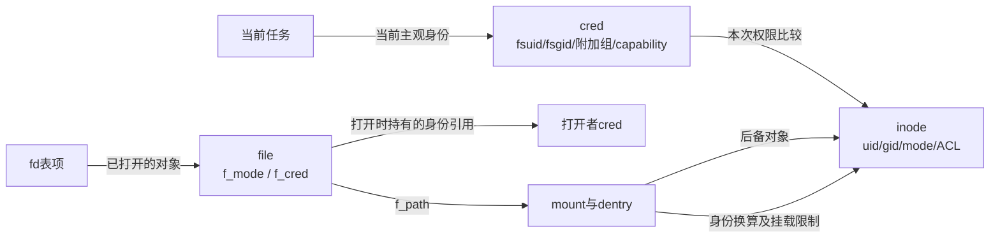
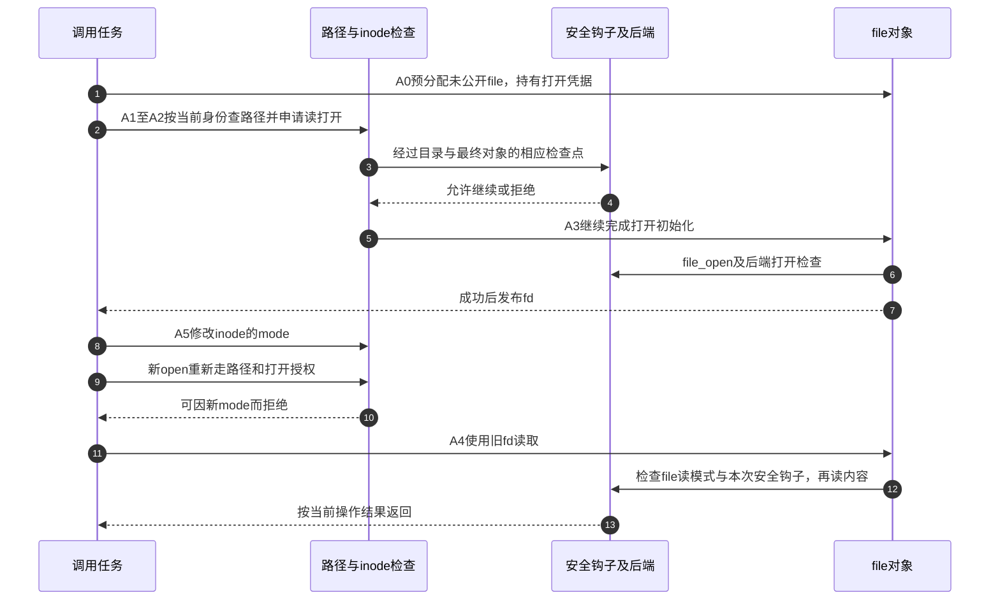
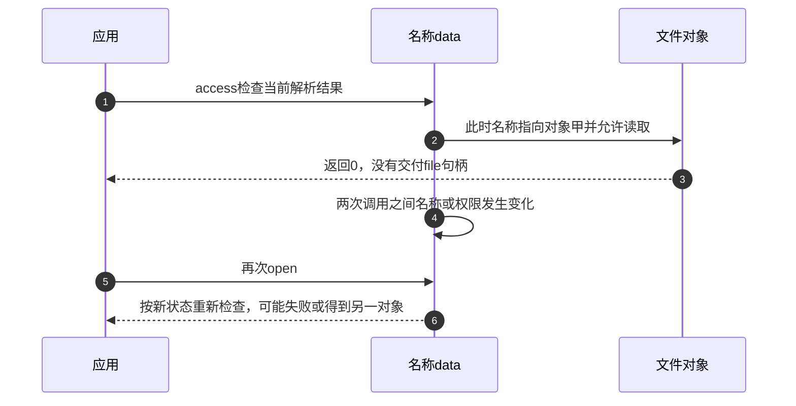

# 第19章\_权限凭据与安全钩子

上一章解释了文件映射如何在缺页时取得内容、建立页表，以及截断为什么能让旧地址失效。但在进入这些路径以前，还有一个问题没有回答：调用者凭什么获得这份访问权？同一个文件，为什么有人能打开、有人不能；为什么chmod以后，新open失败了，旧fd却仍可能继续读取？

本章从普通本地文件的访问过程建立判断模型，再引入ACL、capability、挂载身份映射和安全模块。文件系统可以提供额外检查，网络服务端也可能重新授权；不要把某个本地实验的结果当作所有后端的规则。

## 19.1\_权限问题必须同时说清主体对象和动作

假设进程想读`/srv/index/data`。只看data的读权限还不够：内核要依次经过srv和index，目录必须允许搜索，才有资格继续解释后面的名称。目录的搜索权限通常由执行位表达，它允许沿已知名称走到子对象；目录的读权限则支持列出目录项。两者不是“目录里所有文件都能读取”的总开关。

找到最后对象以后，再根据操作要求检查。读取文件内容和删除这个文件名修改的是不同对象：前者使用文件内容，后者修改父目录的名称关系。因此，删除通常检查父目录的写与搜索许可，并继续考虑sticky位等限制；不能用“文件本人只读”推断“它的名字一定不能删除”。这个区别与前面名称和inode分离的模型一致。

| 要做的事 | 首先要回答的权限问题 | 额外边界 |
| --- | --- | --- |
| 沿路径找到文件 | 每级目录是否允许搜索 | 后续目录可被重命名，路径遍历仍需前章的同步协议 |
| 打开现有文件读取/写入 | 本次主体是否被允许以所请求方式打开 | 对象类型、挂载限制、后端和安全策略还可拒绝 |
| 创建一个名字 | 父目录是否允许写与搜索 | 名称是否已存在、只读状态和后端资源还要检查 |
| 删除或重命名名字 | 涉及的父目录与对象是否满足操作约束 | sticky位、挂载点和拓扑约束不能由普通读写位替代 |
| 使用已经打开的fd | file是否以该方式打开，本次操作是否继续被允许 | 不等于重新走一次路径和传统mode检查，也不等于永远免检 |

这里没有一个可以提前永久缓存的“用户对文件有权限”布尔值。至少要说明主体身份、对象、动作和检查时刻；其中任意一项改变，原结论都可能不再适用。

## 19.2\_当前身份和打开时身份为什么要分别保存

程序不是把用户名字符串交给每个文件系统。内核使用 **凭据（credential）** 描述任务的身份和可用权限。与本章相关的字段包括真实用户/组ID、有效用户/组ID、文件系统访问ID（fsuid/fsgid）、附加组集合和capability集合。普通程序中这些ID常常相同，所以差别不显眼；临时代表其他主体访问、特权程序或命名空间引入后，便不能再把它们混成一个“当前用户”。

VFS的传统权限比较主要使用fsuid/fsgid与附加组。当前任务的主观凭据表达“此刻以谁的身份实施操作”，必要时内核可以在限定的调用范围内临时替换并在退出时恢复。已经公开的身份记录按复制后替换的方式更新，避免一个读者看到半旧半新的身份组合；引用计数等生命周期状态仍会变化，指向的共享keyring内容也不是全局冻结的。

成功打开文件后，file保留打开时凭据的引用`f_cred`，并记录读写模式。fd随后可能被dup、继承或传递，实际使用者不必永远是打开者。后续实现因而需要同时知道“这份打开对象来自哪次授权”和“本次是谁在使用它”。具体安全策略决定消费哪份信息，不能说有了f_cred以后所有检查都忽略当前任务。



源码版本入口见[VFS总索引](../../../research/source_reading/vfs/navigation/P01_Linux_6.12_VFS源码阅读索引.md)及[访问身份导读](../../../research/source_reading/vfs/navigation/P18_访问身份与权限检查的时间边界.md#18.1_先找本次使用的身份与对象)。file取得凭据引用的实现已经在[初始化章节](../../../research/source_reading/vfs/source_explanations/P26_file初始化与打开后失败清理.md#26.1_分配成功只建立最初的凭据锁与引用)展开，本章继续追踪这些身份怎样参与判断。

## 19.3\_先从三组权限位推导ACL的补充作用

设data的所有者是用户甲，所属组是项目组，mode为0640：所有者可读写，所属组可读，其他人没有权限。普通DAC（Discretionary Access Control，自主访问控制）先判断调用者属于哪一类，再检查该类是否包含本次要求的全部位。

类别不是“先试所有者、不行再试组、还不行再试其他人”。如果调用者就是所有者，却没有所需的所有者权限，不能因为other位更宽松便降格使用other。附加组则使任务可以通过多个组身份参与所属组判断。这里的比较还要先经过挂载身份换算，不能只拿两个显示出来的十进制UID直接比。

三组权限位适合简单共享关系，但如果只想额外允许某位不在项目组的用户读取，单纯放开other会扩大到所有人，另建组又可能牵动其他文件的共享安排。**ACL（Access Control List，访问控制列表）** 为对象增加具名用户、具名组等条目，让这类授权直接记录在文件上。

扩展POSIX ACL还有mask条目。具名用户和组类条目要同时满足自身权限与mask上限；所有者和other不受这个mask限制。因此，“ACL里写了rw”不一定实际有写权限，还要看mask。匹配到某个具名用户或组类以后，也不能在被拒绝时随意落到更宽松的other。

| 判断材料 | 表达的范围 | 常见误读 |
| --- | --- | --- |
| mode所有者位 | 文件所有者类别 | 所有者被拒绝后可以改用other |
| mode组/other位 | 所属组与其余主体；扩展ACL下组位还反映mask | 只看ls显示的组位就知道所有ACL条目 |
| ACL具名用户/组 | 针对额外身份的授权 | 多个条目随意合并成任意权限 |
| ACL mask | 具名用户和组类的权限上限 | mask限制所有者，或mask本身授予任何人访问 |

Linux通用检查在ACL拒绝为EACCES时还可能进入capability判断，下一节继续解释这一层。无法在快速路径读取ACL时则要求退回可阻塞路径重新检查，不能把“暂时拿不到ACL”当作“没有ACL所以允许”。[基本权限分派](../../../research/source_reading/vfs/source_explanations/P52_inode权限的基本检查与分派.md#52.2_类别选择与拒绝结果不能混用)和[ACL读取及判断](../../../research/source_reading/vfs/source_explanations/P53_挂载身份换算与ACL判断.md#53.2_读取ACL时区分不存在与尚未缓存)分别展开这两个边界。

## 19.4\_特权与挂载视图分别补上哪种约束

管理程序有时必须越过普通DAC限制。如果把所有此类权限合成一个“root什么都能做”，既无法限制程序只做必要工作，也无法解释容器中的root为何不能支配所有宿主文件。**capability** 将特权拆成按用途检查的能力，而且检查带有user namespace作用范围。

例如CAP_DAC_READ_SEARCH可绕过相应读取/目录搜索限制，不能据此获得目录写权限；CAP_DAC_OVERRIDE允许更广的DAC越权，但对普通文件请求执行时仍要求至少有一个执行位。它们不会让只读文件系统变可写，也不会让后续LSM检查失效。这里的“具备能力”还要求能力所在命名空间与目标对象的身份范围符合规则，而不只是某个进程显示UID为0。

挂载视图解决另一组问题。同一个inode可以经不同mount被访问。一个视图只读，另一个视图允许写；容器希望把一段文件所有者ID解释成另一段身份，又不想递归修改磁盘上每个inode。idmapped mount提供视图中的ID换算，权限比较使用换算结果，文件的原始所有者记录并未因此被批量改写。

| 约束 | 影响哪类行为 | 不等于什么 |
| --- | --- | --- |
| 只读文件系统或只读挂载 | 相应写入/修改操作 | 有DAC写权限就能绕过只读 |
| noexec | 经该路径执行文件、建立受限的可执行映射等 | 不能把文件当普通数据读取 |
| nodev | 通过此挂载打开设备节点的设备访问语义 | 删除所有设备节点名字或禁止读取任意普通文件 |
| nosuid | 执行时是否允许采用文件set-ID及文件capability等提权信息 | 普通读写全部禁止 |
| idmapped mount | inode/ACL中的身份如何进入当前视图的比较 | 自动授予权限或改写磁盘UID |

这些限制分布在相应操作入口，不是每次inode_permission都把表里所有项统一检查一遍。具体capability范围见[特权作用域实现](../../../research/source_reading/vfs/source_explanations/P54_capability的命名空间与对象边界.md#54.1_DAC越权也要确认能力作用范围)，身份换算见[挂载ID映射](../../../research/source_reading/vfs/source_explanations/P53_挂载身份换算与ACL判断.md#53.1_先把文件身份放到当前挂载视图)。

## 19.5\_LSM为什么还要在打开以后再检查

mode、ACL和capability建立了传统权限与特权模型，但有些策略还要约束“某类服务只能访问某类数据”，或者在打开之后因策略更新而重新判断使用资格。**LSM（Linux Security Modules，Linux安全模块框架）** 在路径、inode、file等操作点给具体安全实现提供检查入口。SELinux、AppArmor是使用这套框架的不同策略实现；它们不是一个统一的额外权限位。

在本章关注的通用路径里，inode检查先完成文件系统权限与其他必要限制，再调用对应安全钩子；普通打开还有file_open钩子，后续read/write有file_permission钩子。任何一层拒绝都不能由“前面的mode已经通过”抵消。安全钩子也有自己的时间边界：每次映射内存的load/store不会重新走read/write系统调用的file_permission，需要映射控制的策略必须在相应映射路径实现约束。

为了跟清同一份打开对象，使用下面的阶段。它们描述检查和责任交接，不假设所有权限状态在整个周期内保持不变。

| 阶段 | 本次要成立的条件 |
| --- | --- |
| A0 确定主体 | 从当前操作的凭据来源取得身份，区分临时覆盖与打开时快照 |
| A1 遍历路径 | 每级目录的搜索与路径同步协议成立，才能继续查名称 |
| A2 检查最终动作 | 结合对象类型、mode/ACL、必要特权和挂载限制决定是否允许尝试 |
| A3 完成打开授权 | 未公开file的模式与后端初始化成立，安全打开钩子完成检查，成功后才发布fd |
| A4 使用已打开对象 | 依据file模式和本次操作钩子检查，然后交给后端；不重新做全部路径查找 |
| A5 状态后来改变 | chmod、身份或策略变化会影响后续检查；不自动把所有既有file当作从未授权 |



修改普通文件的mode，并不会把既有file的读模式直接清除，所以旧fd可能继续读；安全策略或后端若有再次授权机制，仍可能拒绝。不能把两者合成“chmod完全撤销所有访问”，也不能反过来说“打开以后永远不检查”。

版本证据见[安全检查槽位](../../../research/source_reading/vfs/source_explanations/P55_VFS安全钩子的登记与调用.md#55.3_打开与使用阶段调用不同的钩子)和已展开的[读写资格检查](../../../research/source_reading/vfs/source_explanations/P32_读写资格检查与文件操作分派.md#32.1_范围检查与访问许可发生在数据方法之前)。本次核对配置没有启用通用CONFIG_SECURITY，部分LSM包装退化为允许继续；capability仍有实际默认实现，不能写成“安全检查全部关闭”。编译配置也不证明另一个运行内核加载了哪些策略。

## 19.6\_为什么access不能替下一次open作保证

`access(path, R_OK)`只检查当时那次路径解析及相应主体是否满足条件，不返回一个绑定该对象的打开句柄。检查返回后，目录项可被替换，文件mode可改变，挂载也可变化；后面的open是另一次实际操作。此外，access默认按真实UID/GID语义判断，而实际文件操作使用的身份可能不同。[access接口说明](https://man7.org/linux/man-pages/man2/access.2.html)明确区分这种预检语义。



这是 **检查与使用之间的时间差（TOCTOU）**，不靠再加一次access消失。通常应直接尝试所需操作并处理返回值；若目标还要求受约束的路径解析，再使用前文建立的目录句柄与解析限制，并检查实际得到的对象。不要把UI显示的“当前可读”转换成跳过真实操作检查的授权凭证。

access内部的临时身份覆盖与所有出口恢复，见[预检身份实现](../../../research/source_reading/vfs/source_explanations/P51_当前身份与access临时凭据.md#51.2_预检按自己的身份语义临时覆盖)。它说明预检本身不是错误接口，错误在于把它当作另一次操作的持久保证。

## 19.7\_实验把新打开和旧句柄分开观察

下面程序只在自己创建的临时目录里操作一个文件：先按0600创建并确认能打开，再通过原fd把mode改为0000。随后分别检查旧fd读取和新open，最后恢复权限并清理。普通非特权用户、支持POSIX权限的本地文件系统是实验前提。

完整材料：[permission_demo.c](../../../labs/kernel/vfs/materials/permission_demo.c)。返回77表示当前身份或后端不适合这个对照，不算通过；额外安全策略若拒绝旧fd读取，程序报告该结果，不把它掩盖成普遍不可能。

```c
#define _POSIX_C_SOURCE 200809L
#include <errno.h>
#include <fcntl.h>
#include <stdio.h>
#include <stdlib.h>
#include <sys/stat.h>
#include <unistd.h>

int main(void)
{
    char directory[] = "/tmp/vfs_permission_XXXXXX";
    char path[sizeof(directory) + 16];
    int fd = -1, other_fd = -1, created = 0, result = EXIT_FAILURE;
    unsigned char value;
    struct stat state;
    /* 特权用户可能绕过本实验要观察的传统DAC拒绝。 */
    if (geteuid() == 0) {
        puts("跳过：请使用普通非特权用户观察mode权限检查");
        return 77;
    }
    if (!mkdtemp(directory)) { perror("mkdtemp"); return EXIT_FAILURE; }
    snprintf(path, sizeof(path), "%s/data", directory);
    fd = open(path, O_CREAT | O_EXCL | O_RDWR, 0600);
    if (fd < 0) { perror("create"); goto done; }
    created = 1;
    if (fchmod(fd, 0600) < 0) { perror("initialize mode"); goto done; }
    if (pwrite(fd, "K", 1, 0) != 1) {
        fprintf(stderr, "初始化单字节写入失败\n"); goto done;
    }
    other_fd = open(path, O_RDONLY);
    if (other_fd < 0) { perror("baseline open"); goto done; }
    if (close(other_fd) < 0) { other_fd = -1; perror("close baseline"); goto done; }
    other_fd = -1;
    /* 改变inode的mode，不改变已经取得的file的打开模式。 */
    if (fchmod(fd, 0000) < 0 || fstat(fd, &state) < 0) {
        perror("chmod/stat"); goto done;
    }
    if ((state.st_mode & 0777) != 0) {
        fprintf(stderr, "文件系统没有呈现预期的mode，跳过\n");
        result = 77; goto done;
    }
    if (pread(fd, &value, 1, 0) != 1 || value != 'K') {
        fprintf(stderr, "旧fd读取未通过；需检查后端或额外安全策略\n");
        goto done;
    }
    other_fd = open(path, O_RDONLY);
    if (other_fd >= 0) {
        puts("跳过：mode为零仍可新打开，当前身份或后端不满足非特权DAC前提");
        result = 77; goto done;
    }
    if (errno != EACCES) { perror("new open"); goto done; }
    puts("旧fd仍能读取K；新open因权限不足被拒绝");
    result = EXIT_SUCCESS;
done:
    /* 只恢复和清理本次创建的对象；不改动其他路径的权限。 */
    if (other_fd >= 0 && close(other_fd) < 0) { perror("close other"); result = EXIT_FAILURE; }
    if (fd >= 0) {
        if (fchmod(fd, 0600) < 0) { perror("restore mode"); result = EXIT_FAILURE; }
        if (close(fd) < 0) { perror("close"); result = EXIT_FAILURE; }
    }
    if (created && unlink(path) < 0) { perror("unlink"); result = EXIT_FAILURE; }
    if (rmdir(directory) < 0) { perror("rmdir"); result = EXIT_FAILURE; }
    return result;
}
```

在Linux开发环境、仓库根目录执行：

```bash
cc -std=c11 -Wall -Wextra -O2 labs/kernel/vfs/materials/permission_demo.c -o /tmp/permission_demo
/tmp/permission_demo
```

预期结果是旧fd仍读到K，而新open返回EACCES。它对应A5的mode改变、A2的新打开检查与A4的既有file使用，不证明ACL、LSM、网络后端或全部特权组合的行为。当前编辑环境未在目标Linux编译运行，以上为待验证预期。[fchmod接口](https://man7.org/linux/man-pages/man2/fchmod.2.html)提供权限修改的用户接口依据。

回顾时可以自问三个问题：文件只读为什么仍可能被删除？打开者凭据保存下来为什么不等于所有后续操作都只看它？access成功为什么仍不能保证下一次open？答案分别是目录名称修改与内容访问对象不同、具体策略有不同身份消费者，以及两次调用既没有绑定同一对象也没有冻结中间状态。

现在能够定位一次访问为何被允许或拒绝。操作真正发生以后，其他程序怎样知道内容或名称变了，还需要通知机制。下一章进入[fsnotify、inotify与fanotify](P20_fsnotify_inotify与fanotify.md)，并继续区分“操作前请求许可”和“操作后报告事件”。
