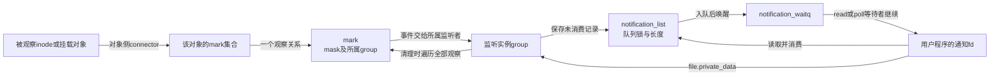
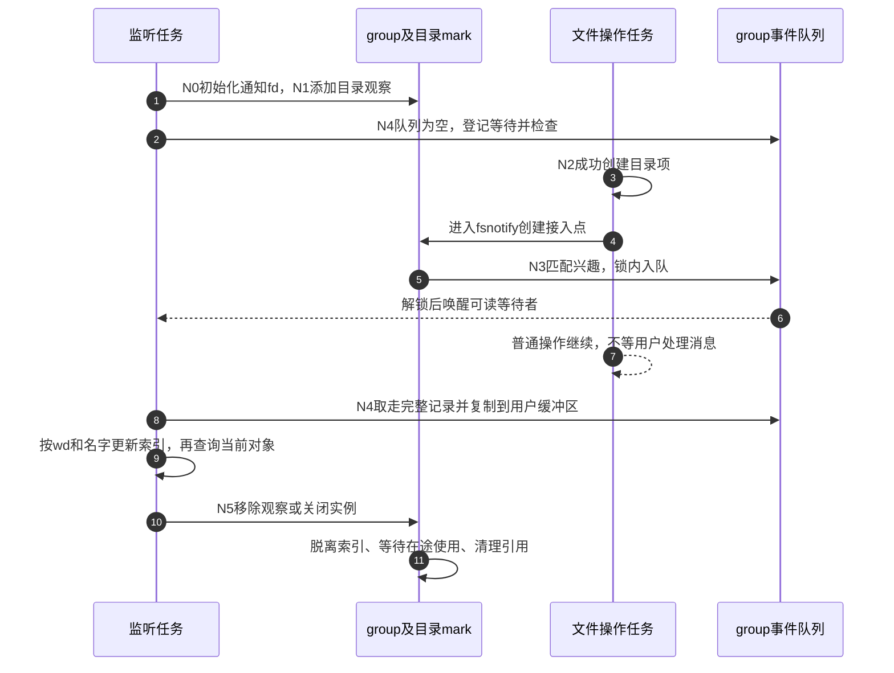
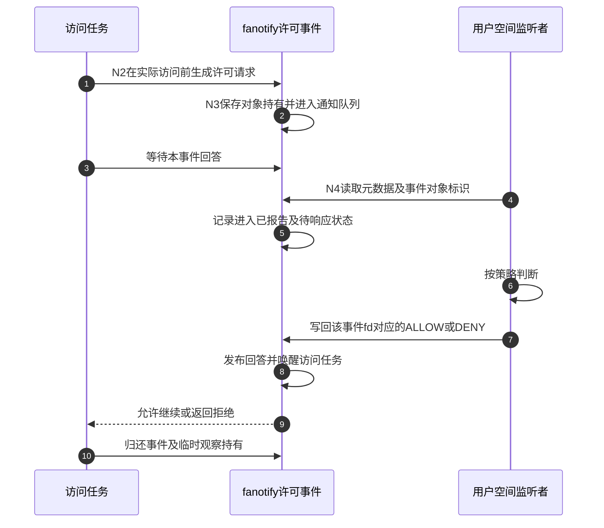

# 第20章\_fsnotify\_inotify与fanotify

上一章把访问许可拆成主体、对象和检查时刻。现在假设一个索引服务已经有权读取目录：它第一次扫描完目录以后，怎样知道后来新增、改名或删除了哪些文件？每次全部重扫可以重新发现当前状态，却可能反复检查成千上万个未变化的名字；把扫描间隔拉长，又会延迟发现变化。

本章先从这个观察问题推导事件通知，再把它放回Linux的fsnotify、inotify和fanotify。随后再增加一个不同要求：某些访问必须等用户空间给出许可才能继续。普通变化通知和访问前许可使用部分共同设施，但发生时点、等待对象和失败后果必须分别讲清。

## 20.1\_让变化产生者报告消息能省下什么

假设目录有十万个条目，每秒只变化几个。周期扫描的价值是直接观察现状，但若每秒扫描一次，大多数查找都只为证明“仍然没变”；若每分钟扫描一次，服务就可能一分钟后才知道变化。还存在一种无论怎样选择间隔都不能保证捕捉的过程：某个文件在两次扫描之间创建又删除，两个目录快照里都没有它。

一个自然的改进是让真正执行创建、写入和改名的路径报告消息。观察者先登记兴趣，产生者在明确的操作点检查有没有人关心，再把必要信息放入队列。观察者不再为了发现单个变化总是重走整个目录，可以睡眠等待队列可读。

代价也转移了：内核需要保存观察关系、匹配事件并分配队列记录，用户程序必须及时消费。消息有容量上限，处理消息时对象可能已发生下一次变化。因此通知适合驱动增量更新，却不能替代读取内容、检查对象身份和必要的重新扫描。变化频率很低、目录很小或后端不提供可靠通知时，简单扫描仍可能更合适。

**讲解层次：概念到Linux实现的映射。** 以下先建立Linux通知层的职责；涉及具体失败分支时，以Linux 6.12.20固定源码为边界。这里的 **fsnotify** 是VFS内部的事件分派基础；**inotify** 和 **fanotify** 是向用户程序提供不同观察方式的接口。它们不是三个逐级升级的文件系统，也不是三个独立监控线程。登记调用由监听者执行，事件接入代码运行在触发文件操作的内核路径，用户程序稍后通过自己的通知fd取走记录。

## 20.2\_先把观察关系和事件队列分开

如果两个程序都观察同一个目录，它们可能关心不同事件、以不同速度读取。因此“对象有人观察”与“某个监听者还有哪些未读事件”不能保存在同一个全局队列里。fsnotify用 **mark** 表示一个group对某对象的兴趣，用 **group** 汇集一个监听实例的观察关系、处理方法和事件队列。

对象一侧通过connector连接多个mark，mark再指向所属group；group也保留自己的mark集合，方便撤销全部观察。事件发生时从对象找观察者，关闭监听实例时从group找全部对象，两种遍历方向服务于不同问题。



inotify再给同一实例内的每个观察关系分配一个 **watch descriptor，wd**。wd不是另一个可read的fd，也不是全系统的inode编号。通知fd选择实例，事件中的wd选择实例内的观察关系；它们有不同的名字空间和生命周期。

| 对象 | 保存什么 | 谁写、谁读 |
| --- | --- | --- |
| 通知fd及其file | 到group的private_data关系 | 初始化建立，read/poll/release使用 |
| group | mark集合、事件队列、容量、等待队列 | 登记与退出维护mark集合，产生者入队，消费者出队 |
| mark与connector | 对象到监听者的关联及事件mask | add/remove watch维护，事件分派读取 |
| inotify实例内的wd索引 | wd到mark的映射 | 新观察分配，移除观察查找；不保存文件内容 |
| 事件记录 | 事件类型、wd、可选名字和改名关联cookie | 触发路径构造，read编码后交给用户；不锁住对象的未来状态 |

固定版本的入口见 [VFS源码索引](../../../research/source_reading/vfs/navigation/P01_Linux_6.12_VFS源码阅读索引.md)和 [通知周期导读](../../../research/source_reading/vfs/navigation/P19_事件观察与许可响应的交接.md#19.1_沿通知周期定位状态与执行者)。[实例与观察登记](../../../research/source_reading/vfs/source_explanations/P56_inotify实例与观察编号的建立.md#56.1_通知fd先绑定独立group)以及 [mark连接](../../../research/source_reading/vfs/source_explanations/P57_观察标记的连接撤销与延后回收.md#57.1_对象侧与group侧分别建立索引)解释真实地址与引用责任。

## 20.3\_从登记到读取追踪同一次变化

选择“观察目录，然后在目录里创建文件”作为普通通知周期。监听者必须先建立group并完成目录mark登记，事件发生时才能匹配；事后加一个观察不会补发此前的全部历史。

| 阶段 | 谁推进 | 状态变化与退出条件 |
| --- | --- | --- |
| N0 建立实例 | 监听任务 | group、队列和通知file准备完成，交付通知fd |
| N1 登记观察 | 监听任务 | 路径解析到对象，检查资格，建立或更新mark与wd |
| N2 产生事件 | 文件操作任务 | 在规定接入点携带事件mask、对象和必要名字；普通通知此时已有对应变化 |
| N3 匹配并排队 | 同一操作的内核路径 | 从对象mark找到group，匹配后构造记录；可能合并、入队或报告溢出 |
| N4 消费 | 监听任务 | 被唤醒后取队列记录，转换为ABI数据；应用更新自己的索引或重新查询 |
| N5 撤销与收尾 | 移除观察、对象退出或最后通知file释放路径 | 先取消观察与新排队，再等待在途使用并归还事件、mark和group |



图中步骤5先发布记录，步骤6才唤醒；步骤8取走的消息可能已经落后于对象的新状态。唤醒只告诉任务“检查队列的条件可能成立”，真正的记录在notification_list；它不是把文件内容当作消息直接塞进用户进程。read等待方先登记等待，再在队列锁下检查，避免把“检查为空”和“开始睡眠”之间的入队遗漏掉。非阻塞fd在没有可交付记录时返回EAGAIN，poll/epoll则提供可读性通知。

[事件分派](../../../research/source_reading/vfs/source_explanations/P58_fsnotify事件匹配与分派.md#58.2_按group汇合不同对象的观察)与 [事件队列](../../../research/source_reading/vfs/source_explanations/P59_事件合并排队与溢出.md#59.2_队列容量与记录所有权一起交接)分别负责N3的选择和保存；[读取及退出](../../../research/source_reading/vfs/source_explanations/P60_通知读取与监听实例退出.md#60.1_先取得完整记录再复制给用户)解释N4、N5。队列锁保护消息交接，不把文件系统对象锁到监听者处理完成。

## 20.4\_事件字段为什么不能当作现状证明

inotify_read返回的缓冲区可以包含多个变长记录。固定头后面的len表示名称区占用字节数，包含结尾零字节与填充；下一条记录的位置是“当前地址加固定头大小再加len”，不是按sizeof固定步长，也不是只跳过strlen个字节。

| inotify_event字段 | 含义 | 使用边界 |
| --- | --- | --- |
| `wd` | 所属实例内的观察编号 | 不是可直接读文件的fd；overflow使用-1 |
| `mask` | 创建、修改、移动、删除等事件位及附加标志 | 应按位测试，不能假设只含一个比特 |
| `cookie` | 将一次改名的FROM和TO记录关联 | 不是对象持久ID；另一端可能在未观察范围或因溢出缺失 |
| `len` | 名称区总字节数 | 先验证整条记录在本次read缓冲内，再访问名称 |
| `name` | 被观察目录中的子项名字；自身事件可无名字 | 是该事件的相对名字，不是文件现在仍位于该路径的保证 |

同一个对象的直接观察与父目录观察含义不同。直接观察文件跟踪的是解析到的inode；经其他硬链接访问同一inode也可能触发它。目录观察则报告经该目录发生的直接子项事件，不能据此自动观察整棵后代目录树，也不能把目录外硬链接的所有活动归入这里。

编辑器常用“写临时文件，再rename覆盖目标”保存。若只观察旧目标inode，替换以后新名字可能已经指向另一个inode；观察父目录才能发现名字绑定发生变化，再按需要重建目标观察。这个例子回到VFS前面建立的区别：名字、inode与打开对象不是同一件事。

接口字段和观察语义可追溯到 [inotify接口手册](https://man7.org/linux/man-pages/man7/inotify.7.html)。内核怎样保留名字、匹配对象和编码记录，正文已在N2～N4交代，链接用于核对ABI细节。

## 20.5\_合并与溢出要求应用怎样恢复

如果观察者尚未取走上一条MODIFY，同一对象又产生相同可合并记录，内核可能只保留一条提示。因此不能把“读到五条MODIFY”当作“只写了五次”。合并省下队列空间，但它维护的是变化提示，不是逐操作审计日志。

队列满或构造事件失败时，inotify用IN_Q_OVERFLOW提示观察者：历史已经不完整。这个事件不属于某个普通wd，应用不能仅修复最后一条消息指向的对象；它应把依赖连续历史的缓存标为不可信，并重新扫描、重建观察或采用业务自己的版本协议。只扩大队列会推迟溢出，不能保证消费者永远追得上。

改名的两条记录也可能跨越两次read，不能只在一个缓冲区里找配对；只看到移出或移入并不必然是内核漏事件，另一个目录可能不在观察范围。IN_IGNORED表示观察关系被撤销，应用应更新wd映射，不能把该编号永久绑定在旧对象上。IN_UNMOUNT则要求处理后备文件系统离开的情况。

初始扫描还有登记窗口。先扫描、后加观察，会漏掉中间变化；先登记、再扫描并处理积压事件可以缩小这个缺口，但并不会凭空得到原子目录快照。稳健索引应让“发现同名对象”“重复事件”“已不存在对象”都可安全重做，在溢出后重新建立基线。若必须保证某一时刻的精确完整状态，需要快照、业务版本号或由修改方配合的更强协议。

## 20.6\_实验观察已经删除的名字仍在消息中

下面程序先观察自己创建的临时目录，再执行创建、写入、关闭、改名和删除，最后才读取事件。读者应先预测：读取消息时文件已经不存在，为什么仍能看到before和after？因为队列保存了此前操作的通知记录，并未要求文件一直存在到消费时。

实验需要Linux的inotify及支持这些操作的本地文件系统。完整材料为 [notify_demo.c](../../../labs/kernel/vfs/materials/notify_demo.c)。程序核对事件种类与本次单一改名的cookie，不把事件数量当作写入次数；遇到overflow直接报告对照无效。

```c
#define _POSIX_C_SOURCE 200809L
#include <errno.h>
#include <fcntl.h>
#include <inttypes.h>
#include <poll.h>
#include <stdint.h>
#include <stdio.h>
#include <stdlib.h>
#include <string.h>
#include <sys/inotify.h>
#include <unistd.h>

int main(void)
{
    char directory[] = "/tmp/vfs_notify_XXXXXX";
    char before[sizeof(directory) + 16], after[sizeof(directory) + 16];
    unsigned char buffer[4096];
    int notify_fd = -1, data_fd = -1, wd = -1, location = 0;
    int result = EXIT_FAILURE, seen_create = 0, seen_modify = 0;
    int seen_close = 0, seen_from = 0, seen_to = 0, seen_delete = 0;
    uint32_t from_cookie = 0, to_cookie = 0;

    if (!mkdtemp(directory)) { perror("mkdtemp"); return EXIT_FAILURE; }
    snprintf(before, sizeof(before), "%s/before", directory);
    snprintf(after, sizeof(after), "%s/after", directory);
    notify_fd = inotify_init1(IN_NONBLOCK | IN_CLOEXEC);
    if (notify_fd < 0) { perror("inotify_init1"); goto done; }
    /* 先建立观察，再制造变化；目录观察只覆盖这里的直接子项。 */
    wd = inotify_add_watch(notify_fd, directory,
                          IN_CREATE | IN_MODIFY | IN_CLOSE_WRITE |
                          IN_MOVED_FROM | IN_MOVED_TO | IN_DELETE | IN_ONLYDIR);
    if (wd < 0) { perror("inotify_add_watch"); goto done; }
    data_fd = open(before, O_CREAT | O_EXCL | O_WRONLY, 0600);
    if (data_fd < 0) { perror("create"); goto done; }
    location = 1;
    if (write(data_fd, "N", 1) != 1) {
        fputs("写入单字节失败\n", stderr); goto done;
    }
    if (close(data_fd) < 0) { data_fd = -1; perror("close data"); goto done; }
    data_fd = -1;
    if (rename(before, after) < 0) { perror("rename"); goto done; }
    location = 2;
    if (unlink(after) < 0) { perror("unlink"); goto done; }
    location = 0;

    /* 操作已经结束，接下来读到的是历史提示，文件现在已经不存在。 */
    struct pollfd ready = { .fd = notify_fd, .events = POLLIN };
    int poll_result;
    do { poll_result = poll(&ready, 1, 5000); } while (poll_result < 0 && errno == EINTR);
    if (poll_result < 0) { perror("poll"); goto done; }
    if (poll_result == 0 || !(ready.revents & POLLIN) ||
        (ready.revents & (POLLERR | POLLHUP | POLLNVAL))) {
        fputs("未取得可读取的事件队列\n", stderr); goto done;
    }
    for (;;) {
        ssize_t count = read(notify_fd, buffer, sizeof(buffer));
        if (count < 0 && errno == EINTR) continue;
        if (count < 0 && errno == EAGAIN) break;
        if (count <= 0) { fputs("读取事件失败\n", stderr); goto done; }
        size_t offset = 0;
        while (offset < (size_t)count) {
            struct inotify_event event;
            size_t remaining = (size_t)count - offset;
            /* memcpy读取固定头，避免把任意字节地址直接当作对齐的结构体。 */
            if (remaining < sizeof(event)) { fputs("事件头不完整\n", stderr); goto done; }
            memcpy(&event, buffer + offset, sizeof(event));
            if (event.len > remaining - sizeof(event)) {
                fputs("事件名称区越界\n", stderr); goto done;
            }
            const char *name = (const char *)buffer + offset + sizeof(event);
            if (event.len && !memchr(name, '\0', event.len)) {
                fputs("事件名称没有结束符\n", stderr); goto done;
            }
            if (event.mask & IN_Q_OVERFLOW) {
                fputs("队列溢出，事件历史不完整，应重新扫描\n", stderr); goto done;
            }
            if (event.wd != wd || (event.mask & (IN_IGNORED | IN_UNMOUNT))) {
                fputs("观察关系已变化，本次对照无法完成\n", stderr); goto done;
            }
            printf("wd=%d mask=0x%08" PRIx32 " cookie=%" PRIu32 " name=%s\n",
                   event.wd, event.mask, event.cookie, event.len ? name : "(自身)");
            if (event.len && strcmp(name, "before") == 0) {
                if (event.mask & IN_CREATE) seen_create = 1;
                if (event.mask & IN_MODIFY) seen_modify = 1;
                if (event.mask & IN_CLOSE_WRITE) seen_close = 1;
                if (event.mask & IN_MOVED_FROM) { seen_from = 1; from_cookie = event.cookie; }
            }
            if (event.len && strcmp(name, "after") == 0) {
                if (event.mask & IN_MOVED_TO) { seen_to = 1; to_cookie = event.cookie; }
                if (event.mask & IN_DELETE) seen_delete = 1;
            }
            offset += sizeof(event) + event.len;
        }
    }
    if (!(seen_create && seen_modify && seen_close && seen_from && seen_to && seen_delete) ||
        from_cookie != to_cookie) {
        fputs("事件集合或rename配对不符合本次受控实验\n", stderr); goto done;
    }
    puts("观察到创建、修改、关闭、改名和删除；名称来自过去事件，不代表文件仍存在");
    result = EXIT_SUCCESS;
done:
    /* 每个路径只在本程序仍拥有相应文件时清理。 */
    if (data_fd >= 0 && close(data_fd) < 0) { perror("close cleanup"); result = EXIT_FAILURE; }
    if (location && unlink(location == 1 ? before : after) < 0) {
        perror("unlink cleanup"); result = EXIT_FAILURE;
    }
    if (wd >= 0 && inotify_rm_watch(notify_fd, wd) < 0 && errno != EINVAL) {
        perror("inotify_rm_watch"); result = EXIT_FAILURE;
    }
    if (notify_fd >= 0 && close(notify_fd) < 0) { perror("close notify"); result = EXIT_FAILURE; }
    if (rmdir(directory) < 0) { perror("rmdir"); result = EXIT_FAILURE; }
    return result;
}
```

在Linux开发环境、仓库根目录执行：

```bash
cc -std=c11 -Wall -Wextra -O2 labs/kernel/vfs/materials/notify_demo.c -o /tmp/notify_demo
/tmp/notify_demo
```

程序打印每条记录的wd、mask、cookie和名字。预期包含before的CREATE/MODIFY/CLOSE_WRITE、改名的FROM/TO配对，以及after的DELETE；不要依赖示例之外的具体cookie数值。输出中的名字已经过长度与结束符检查，消费循环按固定头加len前进，读到EAGAIN才说明本轮队列已取空。

清理先处理本次仍存在的文件，再撤销观察并关闭通知fd。IN_IGNORED也可能在撤销后排队，但此实验不继续消费清理消息；最后关闭实例会释放剩余记录。当前编辑环境没有目标Linux编译运行结果，以上是待验证预期，不能据此宣称已通过运行验收。

可作两步修改练习：先把两次相同写入放在读取事件以前，观察为什么不应要求两条MODIFY；再只观察文件本身并采用临时文件rename覆盖，比较观察inode与观察父目录名字的差别。不要为了制造溢出修改全机限制，本章的恢复模型不依赖实际耗尽系统资源。

## 20.7\_许可事件为什么需要另一条返回通路

索引服务只需知道变化，内容扫描服务则可能要求“先检查，再允许打开”。事后收到OPEN消息无法撤销已经交付的访问权，因此需要在操作前的接入点产生 **permission event，许可事件**，让发起操作的任务等待监听者回答。

fanotify除了普通通知，还提供受配置、实例类别、权限和文件系统能力约束的许可事件。监听实例仍有事件队列，但许可记录被读取以后不能立即释放：它还要进入待响应集合，保存回答、状态及关联事件fd，直到操作方取得允许或拒绝结论。



步骤5的REPORTED首先表示读取方接管，用户复制还可能失败；步骤8发布回答后，步骤10仍需归还事件和观察持有。这里有两种fd：fanotify实例fd用于读事件和写响应；某条事件提供的fd指向被观察对象，并用于关联该许可响应，应用还要按协议关闭它。采用FID报告模式的通知则可用文件句柄信息表达对象，不能把所有fanotify记录都假设成“必定附一个打开fd”。FID也不是路径字符串。

| fanotify元数据与响应 | 当前用途 |
| --- | --- |
| `event_len/metadata_len/vers` | 验证记录版本、固定元数据和整条变长记录边界，额外信息记录按类型和长度继续解析 |
| `mask` | 区分普通事件与OPEN_PERM、ACCESS_PERM等许可请求 |
| `fd/pid` | 按实例报告模式提供对象fd及触发任务信息；特殊值、非特权限制和失败报告不能当作正常fd使用 |
| `fanotify_response.fd/response` | 向实例fd写回答，关联此前许可事件fd并给出ALLOW或DENY；不能用关闭事件fd代替回答 |

许可链增加了等待与用户程序故障的成本。监听者若访问自己的受监控路径，也需考虑递归请求和相互等待；内核生成的事件fd使用相应非通知属性避免特定自反馈，但不能据此推断任意业务访问都不会造成依赖环。

本章固定版本里，许可事件分配失败、队列无法接纳、监听实例退出以及操作任务被信号终止有不同处理，不能笼统写成“失败默认拒绝”。例如监听实例释放会模拟允许来解除等待；队列满导致未接纳的许可事件在该实现中也返回允许，而事件分配失败会返回错误。等待接口没有一个可凭注释假定的固定自动超时。安全方案必须按实际版本选择和验证故障策略，不能只看正常ALLOW/DENY箭头。[等待与引用交接](../../../research/source_reading/vfs/source_explanations/P61_fanotify许可等待与观察持有.md#61.2_等待用户以前先转移观察责任)和 [响应及退出](../../../research/source_reading/vfs/source_explanations/P62_fanotify响应状态与退出收尾.md#62.3_回答与取消决定谁释放事件)逐分支解释这些结果。接口追溯见 [fanotify手册](https://man7.org/linux/man-pages/man7/fanotify.7.html)。

## 20.8\_按对象范围与失败要求选择观察方式

inotify适合围绕明确对象或目录维护增量状态，代价主要是逐对象登记、目录树管理及消息恢复。fanotify可按inode、mount或文件系统建立不同范围的观察，支持的事件、报告方式和权限条件需要一起核对；它不是自动递归且无条件可用的inotify替代品。普通非特权fanotify实例有受限通知能力，不能据此取得挂载范围标记或许可裁决能力。

| 需求 | 应先核对的条件 |
| --- | --- |
| 小目录、低变化频率 | 扫描成本是否已经足够低，是否需要事件历史 |
| 指定文件或目录的增量索引 | inotify的inode/直接子项语义，替换保存、递归登记及overflow恢复 |
| 更广范围的文件系统观察 | fanotify标记范围、权限、后端支持与报告模式 |
| 用户空间参与访问前许可 | FANOTIFY_ACCESS_PERMISSIONS、实例类别、权限与全部失败路径；不是只启用普通通知 |
| 精确审计每次操作或获得一致快照 | 不能仅靠合并且可溢出的通知；需要满足该保证的另外协议 |

本次源码核对配置开启FSNOTIFY和INOTIFY_USER，关闭FANOTIFY与CONFIG_SECURITY；许可配置还依赖后两者。源代码支持某条路径不代表当前目标已经启用它。至此可以沿对象到mark、group到队列以及消息到用户响应的方向解释通知；下一章回到 [file、dentry、inode与superblock回收](P21_file_dentry_inode与superblock回收.md)，把对象退出与仍在途的观察责任放进统一生命周期。
