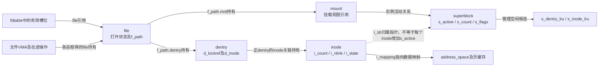
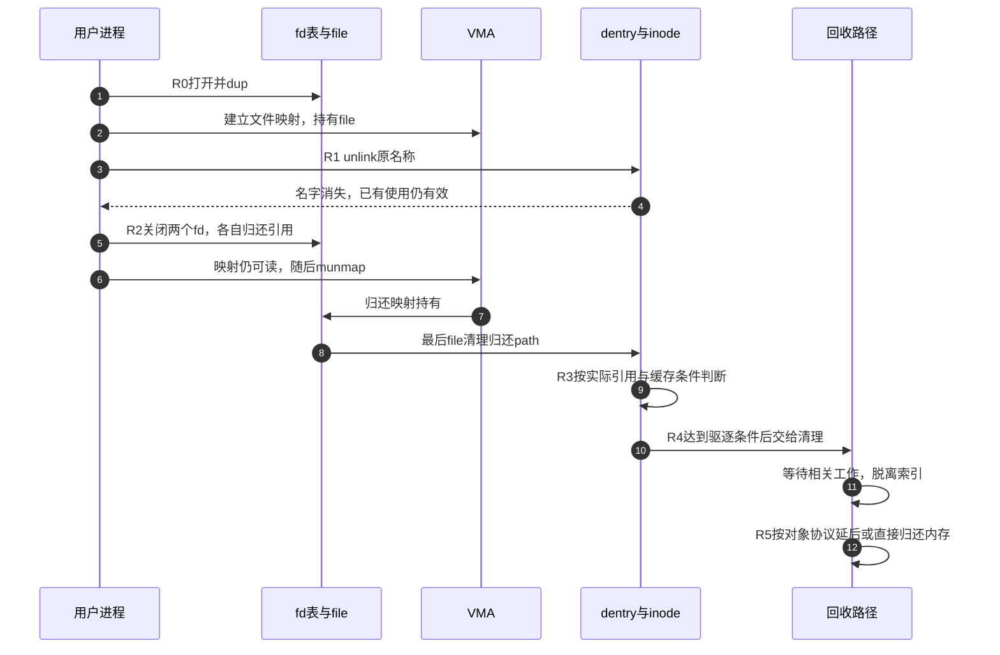

# 第21章\_file\_dentry\_inode与superblock回收

上一章的事件记录可以在文件名称消失以后继续被读取；更早的映射实验也表明，close以后VMA仍能保留文件访问关系。这些现象把问题推到了同一个终点：一个文件“删除了”，到底是哪种关系消失，什么对象还能继续存在，谁负责最终清理？

本章把file、dentry、inode和superblock的退出放在一张关系图里，再沿“打开、映射、unlink、关闭、解除映射”逐步归还持有。重点是每次动作能够证明什么；下一章才将冻结写入、解除挂载和关闭实例组合成完整退出协议。

## 21.1\_先区分名字消失与使用结束

设想一个进程正在读取日志，另一个进程把日志名字删除。如果unlink立刻释放所有内核对象和数据，前者的下一次read就会访问失效内存；如果必须等所有读者退出才允许删名字，又会让目录更新受任意长的读取阻塞。Linux将两个责任分开：目录名字可以先撤销，已经取得的打开对象继续按其持有关系使用文件。

这仍然不是“任何旧指针都可继续使用”。文件描述符、正在执行的内核操作、文件映射等需要各自按协议持有对象；仅仅曾经见过一个地址不构成持有。最后一个使用者离开以后，还可能存在缓存保留、写回和延后回收的工作，因此引用归零也不能一律翻译成“这一行马上kfree”。

**讲解层次：概念到Linux对象模型的映射。** file表示一次打开产生的使用状态；dentry表示目录项缓存关系，inode表示文件元数据与数据映射的内核对象，superblock表示文件系统实例。它们相互连接，但没有一个统一引用计数覆盖所有对象。

| 动作 | 直接改变的关系 | 不能由此推出的结论 |
| --- | --- | --- |
| unlink名字 | 目录名字绑定及文件链接数 | 所有旧fd和VMA都失效 |
| close一个fd | 从fd表撤销一份file持有 | 同一file没有dup、VMA或在途使用 |
| munmap一段映射 | 撤销相应VMA与页表使用关系 | 所有其他映射、缓存页和文件对象均已释放 |
| dput路径中的dentry | 归还一次dentry引用 | dentry一定立即离开缓存并释放 |
| 最后inode使用引用归还 | 进入缓存保留或驱逐决策 | 磁盘数据必须立即擦除，或superblock立刻关闭 |
| 最后活动实例持有退出 | 按实例关闭协议停止并清理 | 结构内存不再有临时观察者，需要的延后清理已全部执行 |

## 21.2\_沿真实持有关系找到各自的终点

先沿打开对象看：fd表持有file，文件映射也会持有file；file的路径又保持dentry及mount。正dentry通过与inode的关联保持文件对象。挂载视图持有superblock的活动关系，使实例不能在仍有合法路径使用时随意关闭。



实线标明当前讨论的持有或管理动作，虚线只表达归属。inode.i_sb能找到实例，但不能凭这一根指针画出“每个inode归零就对s_active减一”的代码。实例关闭与inode清理之间有集合、锁和退出协议，必须按实际路径核对。

这里还有两种名字容易混淆的计数。**i_nlink** 记录文件的硬链接数量；**i_count** 记录当前内核使用持有。一个普通文件可以i_nlink为0而i_count仍非0，也可以仍有名字、i_count为0并暂留缓存。文件映射通过file等关系间接延长对象生命，不需要把每一种上层使用都硬画成直接递增同一个inode计数。

固定实现的阅读入口为 [VFS源码总索引](../../../research/source_reading/vfs/navigation/P01_Linux_6.12_VFS源码阅读索引.md)和 [对象回收导读](../../../research/source_reading/vfs/navigation/P20_对象退出与缓存回收的条件.md#20.1_按退出阶段找持有与状态)。这里采用Linux 6.12.20固定源码，源代码中的锁、计数与回调分支在对应实现篇展开。

## 21.3\_用同一次退出串起六个阶段

这不是四种对象共用一个简单状态机。file引用、dentry缓存资格、inode的脏/写回/驱逐状态和实例活动状态相互关联，却有各自的转换条件。下面的R0～R5只为同一次退出建立观察顺序，不声称所有对象必须同步到达某个全局阶段。

| 阶段 | 当前动作及状态 | 后续由谁接手 |
| --- | --- | --- |
| R0 建立使用 | 打开、dup、映射各自取得关系 | fd表、file及VMA等持有者 |
| R1 撤销名字 | unlink移除目录绑定，旧使用仍可能成立 | 旧file和VMA继续使用对象 |
| R2 退出使用 | 逐个撤销fd、映射及在途使用，最后file进入清理 | file释放路径归还自己的path及其他依赖 |
| R3 判断缓存 | dentry和inode各按引用及缓存条件选择保留或销毁 | LRU扫描、后续使用或驱逐路径 |
| R4 逻辑驱逐 | 阻止对象重新进入正常使用，等待相关写回并清理后端状态 | 文件系统回调与通用清理 |
| R5 归还内存 | 已脱离索引并完成必要延后等待，实际释放内存 | RCU回调、工作队列或所选后端释放方法 |



步骤8以“没有其他file持有”为前提，实际清理还受执行上下文影响。步骤9没有承诺马上走步骤10：可保留缓存的对象可能被再次命中，也可能很久以后才由内存压力扫描。图中的阶段不是每一步耗时固定的硬件流水线。

## 21.4\_实验让名字和两个fd先退出

下面程序只操作自己新建的临时目录。先写入alive，再dup和建立只读共享映射；unlink以后确认原名字不存在，而已有fd看到链接数为0；关闭两个fd以后，再从原映射读同一数据。

运行前先作预测：哪一步会让stat原路径返回ENOENT？哪一步之后通过旧fd读取仍有保证？两个fd全部关闭以后，为什么这块映射还能被访问？这些问题分别对应R1和R2，不能用一句“内核有缓存”解释所有现象。

```c
#define _POSIX_C_SOURCE 200809L
#include <errno.h>
#include <fcntl.h>
#include <stdio.h>
#include <stdlib.h>
#include <string.h>
#include <sys/mman.h>
#include <sys/stat.h>
#include <unistd.h>

int main(void)
{
    char directory[] = "/tmp/vfs_reclaim_XXXXXX";
    char pathname[sizeof(directory) + 16];
    const char payload[] = "alive";
    char observed[sizeof(payload)];
    const size_t length = sizeof(payload);
    struct stat status;
    int first_fd = -1, second_fd = -1, named = 0;
    int result = EXIT_FAILURE;
    void *mapping = MAP_FAILED;
    size_t done = 0;

    if (!mkdtemp(directory)) { perror("mkdtemp"); return EXIT_FAILURE; }
    snprintf(pathname, sizeof(pathname), "%s/object", directory);
    first_fd = open(pathname, O_CREAT | O_EXCL | O_RDWR, 0600);
    if (first_fd < 0) { perror("open"); goto cleanup; }
    named = 1;
    while (done < length) {
        ssize_t count = write(first_fd, payload + done, length - done);
        if (count < 0 && errno == EINTR) continue;
        if (count <= 0) { fputs("写入失败\n", stderr); goto cleanup; }
        done += (size_t)count;
    }
    second_fd = dup(first_fd);
    if (second_fd < 0) { perror("dup"); goto cleanup; }
    mapping = mmap(NULL, length, PROT_READ, MAP_SHARED, first_fd, 0);
    if (mapping == MAP_FAILED) { perror("mmap"); goto cleanup; }

    /* 名称撤销后，用已有fd检查链接数；不以路径存在性判断对象存活。 */
    if (unlink(pathname) < 0) { perror("unlink"); goto cleanup; }
    named = 0;
    if (fstat(first_fd, &status) < 0) { perror("fstat"); goto cleanup; }
    if (status.st_nlink != 0) { fputs("链接数并非零\n", stderr); goto cleanup; }
    errno = 0;
    if (stat(pathname, &status) == 0 || errno != ENOENT) {
        fputs("原名称没有按预期消失\n", stderr); goto cleanup;
    }
    puts("R1：名称已经消失，但已有对象的链接数仍可通过fd观察为零");

    if (close(first_fd) < 0) { first_fd = -1; perror("close first"); goto cleanup; }
    first_fd = -1;
    /* dup共享同一个打开对象；pread避免依赖此前write留下的共享文件位置。 */
    done = 0;
    while (done < length) {
        ssize_t count = pread(second_fd, observed + done, length - done, (off_t)done);
        if (count < 0 && errno == EINTR) continue;
        if (count <= 0) { fputs("旧fd读取失败\n", stderr); goto cleanup; }
        done += (size_t)count;
    }
    if (memcmp(observed, payload, length)) { fputs("fd内容不符\n", stderr); goto cleanup; }
    if (close(second_fd) < 0) { second_fd = -1; perror("close second"); goto cleanup; }
    second_fd = -1;

    /* 两个fd都已关闭，映射仍独立持有file；只读文件实际长度范围内的字节。 */
    if (memcmp(mapping, payload, length)) { fputs("映射内容不符\n", stderr); goto cleanup; }
    puts("R2：两个fd都已关闭，先前映射仍能读取alive");
    if (munmap(mapping, length) < 0) { perror("munmap"); goto cleanup; }
    mapping = MAP_FAILED;
    puts("已归还本程序最后一份映射；此输出不能证明内核内存或磁盘空间已经最终回收");
    result = EXIT_SUCCESS;

cleanup:
    if (mapping != MAP_FAILED && munmap(mapping, length) < 0) {
        perror("munmap cleanup"); result = EXIT_FAILURE;
    }
    if (first_fd >= 0 && close(first_fd) < 0) { perror("close cleanup"); result = EXIT_FAILURE; }
    if (second_fd >= 0 && close(second_fd) < 0) { perror("close dup cleanup"); result = EXIT_FAILURE; }
    if (named && unlink(pathname) < 0) { perror("unlink cleanup"); result = EXIT_FAILURE; }
    if (rmdir(directory) < 0) { perror("rmdir"); result = EXIT_FAILURE; }
    return result;
}
```

在Linux开发环境、仓库根目录执行，完整材料见 [reclaim_demo.c](../../../labs/kernel/vfs/materials/reclaim_demo.c)：

```bash
cc -std=c11 -Wall -Wextra -O2 labs/kernel/vfs/materials/reclaim_demo.c -o /tmp/reclaim_demo
/tmp/reclaim_demo
```

程序预期报告名称消失、旧对象链接数为0，以及两个fd关闭后映射仍能读到alive。pread使用显式偏移，避免dup共享文件位置造成另一种实验差异；映射只读取文件实际长度范围，未触碰超过文件末尾的地址。

本实验能观察“上层入口撤销后，另一个合法持有仍可访问”，不能看到内核i_count的精确值、最终RCU回调时刻或磁盘空间归还。munmap以后程序也不再解引用旧地址。当前没有目标Linux编译运行结果，这些输出是待验证预期。

修改练习可以先去掉dup，观察映射仍可独立延续；也可以先munmap再关闭最后fd，比较持有归还次序。不要在解除映射后读旧指针来“测释放”，那会把非法访问混入生命周期观察。

## 21.5\_引用归零为何还要判断缓存资格

如果每次用户离开都立即销毁dentry和inode，反复打开同一文件就会反复重建相同元数据。保留不用的缓存对象能节省后续查找与加载，但占用内存，需要在压力出现时让出空间。因此“当前无人使用”和“应该立即销毁”是两个不同判断。

dentry最后归还时会检查是否仍可查找、后端删除策略及缓存标志；合适对象可以保留，不合适对象进入kill流程，并在释放inode关联、父关系和后端状态以后归还内存。其实现沿用 [dentry缓存资格](../../../research/source_reading/vfs/source_explanations/P12_名称失效与最后使用者退出.md#12.3_零引用保留必须同时满足缓存条件)与 [最终销毁](../../../research/source_reading/vfs/source_explanations/P12_名称失效与最后使用者退出.md#12.6_销毁同时归还别名父关系和最终内存)。

inode最后使用引用归还时先询问文件系统drop_inode策略；通用默认策略把无链接或已脱离inode哈希的对象判为应驱逐。允许保留、没有DONTCACHE且实例仍活动时，可以留下缓存；但“保留对象”不等于一定立刻加入LRU。脏状态、正在写回、页缓存情况及配置仍可能使它暂不成为空闲扫描候选。

内存压力下，扫描方还要重查引用和状态，因为候选入队以后可能再次被使用或弄脏。近期使用标志给对象第二次机会；需要处理页缓存时还要暂时建立隔离保护并在锁外清理。这些成本解释了为什么不能把LRU当作完全精确、永不变化的空闲对象名单。[最后引用决策](../../../research/source_reading/vfs/source_explanations/P63_最后inode引用与缓存保留.md#63.1_最后使用引用先进入缓存或驱逐决策)及 [空闲扫描](../../../research/source_reading/vfs/source_explanations/P65_空闲inode扫描与卸载驱逐.md#65.2_扫描候选仍要重新检查引用与缓存)给出分支证据。

## 21.6\_驱逐完成与内存释放仍有时间差

决定驱逐以后，inode先进入FREEING并离开空闲链，防止其他路径把它重新排入正常工作。驱逐等待已有写回和必要的LRU隔离处理结束，再让文件系统evict_inode清理后端；没有专用回调时，通用路径清页缓存并clear_inode。最后再移除inode哈希、唤醒相关等待者并进入结构销毁。

这里至少有三个不同动作：**清理文件系统对象资源、撤销内核索引中的可见性、释放内核结构内存**。对仍有名字的缓存inode做驱逐，并不等于删除磁盘文件；以后查找可以重新加载。对无链接文件做最后清理，后端还要完成自己的数据、元数据和日志协议。不能仅从通用函数名evict推出具体块设备已经完成持久删除。

同样，destroy_inode和free_inode是不同回调职责。通用路径可以先清理公共与后端状态，再通过RCU等待旧观察者后释放结构；某些后端拥有自己的销毁安排，必须按其回调组合核对，不能把每一种inode都画成同一个kfree出口。具体见 [inode驱逐与释放](../../../research/source_reading/vfs/source_explanations/P64_inode驱逐与最终释放.md#64.1_先退出工作集合再让后端清理)。

file也有类似的上下文边界：fput最后归还可能把清理交给task_work或延后工作，而用户close使用的路径有自己的同步要求；不能只凭“最后引用”推导当前指令已经执行全部release。已有 [file最终清理](../../../research/source_reading/vfs/source_explanations/P30_描述符脱离与最后file引用的释放.md#30.3_最后引用归零后把清理交给可执行的上下文)将这些入口分别展开。

## 21.7\_实例关闭不能靠强行清零内层引用

文件系统实例可能被多个挂载视图共享。一个视图退出，只归还它自己的活动关系；最后活动持有退出以后，实例关闭路径停止回收入口、清目录缓存、同步并清理可驱逐inode，还要处理通知、安全及后端私有状态。

实例的s_active用于活动使用，s_count还保护临时观察与结构生命。关闭过程发布DYING、DEAD等阶段，使竞争查找知道不能继续把旧实例当作正常活动实例；但这些标志仍不等于所有临时观察者消失。最终结构释放可能继续经过RCU和工作队列。[实例关闭实现](../../../research/source_reading/vfs/source_explanations/P07_实例关闭通知与最终内存回收.md#7.3_最后临时引用与实际释放仍然分开)保留了这层区别。

因此，遇到“卸载后仍有busy inode”，不能用强行将引用计数置零来修补。应沿仍有持有的file、路径、映射、通知或其他内核使用检查责任是否归还。正常退出协议保证合法使用结束以后再销毁；诊断宏只能暴露违反前提的路径，不会自动创造一个安全的补救顺序。

现在可以回答章首的问题：unlink决定名字还能否被新查找找到，close和munmap归还各自持有，缓存与驱逐控制对象何时离开内核，实例关闭又有外层条件。下一章继续 [冻结与卸载](P22_freeze_unmount与故障退出.md)，解释如何先限制新写入，再让这些退出条件有序成立。
