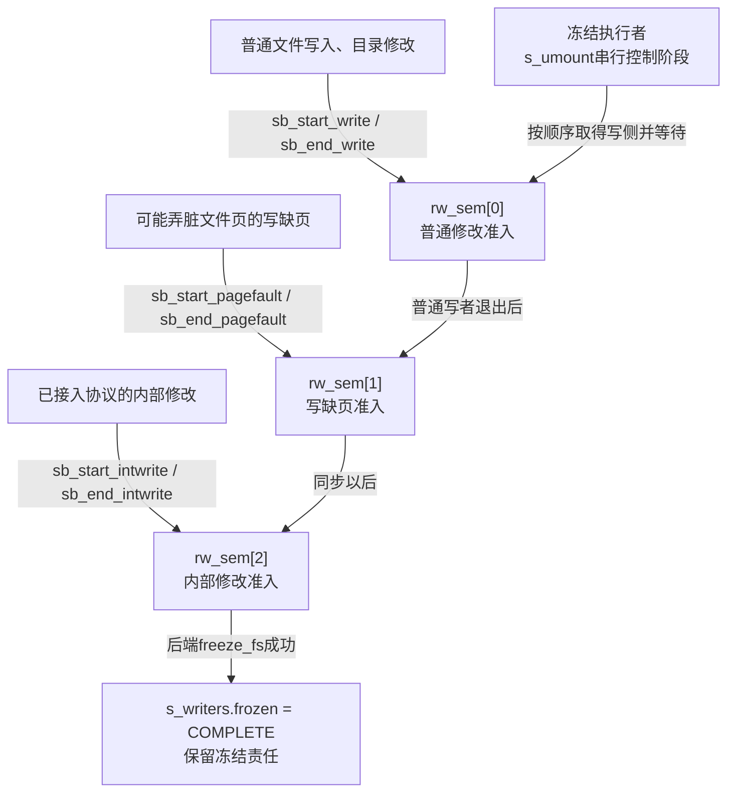
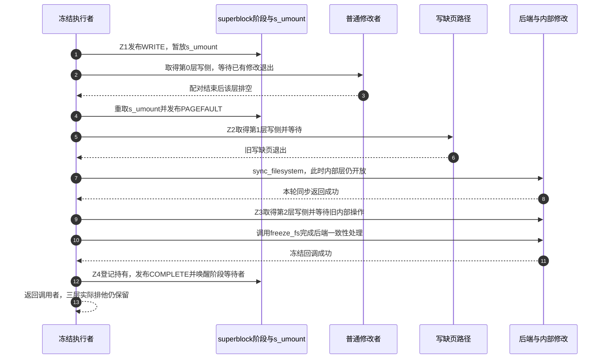
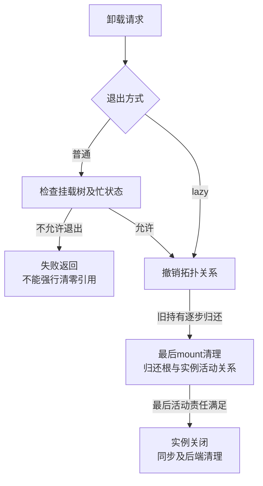

# 第22章\_freeze\_unmount与故障退出

上一章已经区分名字撤销、使用归还、缓存驱逐与最终释放。现在还缺一个外层条件：当系统要取得稳定快照、移除挂载，或者设备已经失效时，怎样阻止新的活动继续制造工作？这些场景都可能让操作停下来，但目的和完成条件并不相同。

本章先从快照需要的稳定修改边界推导冻结，再解释解冻、卸载和故障停止服务。它们共享部分对象与等待机制，却不是“正常→冻结→卸载→故障”的一条必经流程。

## 22.1\_为什么同步以后仍需要限制新修改

设想备份程序要复制一个正在使用的文件系统。只调用一次同步，可以推动已有脏数据和元数据的写回，但同步返回后另一个进程仍可继续修改。复制不同块的时间不同，读到的内容便可能来自不同更新时刻；“刚做过sync”无法替后续复制建立一个持续稳定区间。

冻结要解决这个缺口：先让相关修改入口停止接纳新工作，等已经进入的修改退出，再同步并完成后端一致性处理，保持这个边界直到解冻。代价是新修改可能等待，快照或维护方必须及时归还冻结责任。对于只需要确认单个文件提交完成的应用，应使用前面建立的fsync等协议；没有稳定整个实例的需要，就不应把冻结当作每次写入的常规步骤。

**讲解层次：概念到Linux实现的映射。** 冻结作用于文件系统实例superblock，可能影响共享该实例的多个挂载视图；卸载首先作用于挂载拓扑，故障状态则由具体文件系统和设备协议决定。把它们按对象分清以后，才能比较保证。

| 操作 | 当前要解决的问题 | 保留的关系及边界 |
| --- | --- | --- |
| 同步 | 推动已有修改达到所选完成条件 | 一般不持续阻止后续修改 |
| 冻结与解冻 | 建立并结束实例的稳定修改区间 | fd、挂载和对象仍可存在；不是销毁实例 |
| 普通卸载 | 在允许退出时撤销挂载视图 | 忙检查可能失败；其他共享实例的挂载可能仍存在 |
| lazy卸载 | 先从当前拓扑分离，旧持有稍后退出 | 返回不证明旧file、映射和实例已经释放 |
| 故障停止服务 | 防止已失效状态继续被当作正常服务使用 | 不能保证脏数据已保存，也不自动撤销全部挂载 |

冻结保证依赖文件系统正确接入各修改路径以及后端回调。它不是“停止整个CPU”，也不天然协调数据库中尚未提交到文件系统的应用内存状态。需要应用一致性的备份还应由应用完成自己的检查点或暂停协议。

## 22.2\_三个修改入口为什么要依次关闭

先考虑最直接的方法：一把开关挡住所有修改，然后等待原有工作退出。问题在于，原有工作为了结束，可能还需要更内部的元数据操作、日志推进或回写。如果把这些内部入口同时关掉，冻结方等旧工作，旧工作又等被冻结的内部入口，系统就无法完成收尾。

Linux把冻结保护分成三个等级。普通写入与目录修改使用第一层，可能弄脏文件页的写缺页使用第二层，文件系统内部修改使用第三层。它们的先后关系使外层先停止增加工作，同时给内部收尾留下通道。

在Linux 6.12.20中，各层由 `sb.s_writers.rw_sem[0..2]` 承载。修改操作取得相应信号量的读侧，表示“这一类工作正在进行”；冻结方取得写侧，表示“挡住后来者并等待当前读侧全部退出”。这里的读/写是信号量角色，**文件写入也在冻结门上取得读侧**，不能把锁模式直接理解成文件I/O方向。



图中三组准入状态与一个frozen阶段字段共同构成协议；仅写一个枚举值不会自动让所有CPU停写。阶段字段告诉控制路径进展到哪里，真正的排他由信号量及后端协作兑现。图中的第三层只覆盖实际接入这项协议的内部修改，不能假定任何内核线程都会自动被它阻塞。

固定源码从 [VFS总索引](../../../research/source_reading/vfs/navigation/P01_Linux_6.12_VFS源码阅读索引.md) 和 [冻结退出导读](../../../research/source_reading/vfs/navigation/P21_冻结卸载与故障状态的边界.md#21.1_按冻结周期定位状态与参与者)进入；各辅助接口及信号量下标见 [分级准入实现](../../../research/source_reading/vfs/source_explanations/P66_冻结写入的分级准入.md#66.1_修改者在冻结门上取得读侧)。

## 22.3\_一次冻结怎样走到稳定区间

下面选择一个可写、支持冻结回调的实例。Z0～Z5沿一次冻结周期编号；只读实例和并发持有的分支随后单独处理，不把它们强塞进同一条成功时间线。

| 阶段 | 修改的状态与完成条件 | 此时仍需要保留的进展 |
| --- | --- | --- |
| Z0 正常 | 三层准入可用 | 修改者正常进入并配对退出 |
| Z1 收口普通修改 | 发布WRITE，取得第0层写侧并等旧使用者退出 | 写缺页与内部收尾仍可进行 |
| Z2 收口写缺页 | 发布PAGEFAULT，等第1层退出，然后sync_filesystem | 同步仍可使用所需内部路径 |
| Z3 收口内部修改 | 发布FS，等第2层退出，再执行freeze_fs | 后端完成自己的日志和一致性处理 |
| Z4 保持冻结 | 发布COMPLETE，登记冻结持有并保留准入排他 | 快照或维护方操作；相关新修改等待 |
| Z5 解冻 | 最后冻结责任归还，后端恢复后开放准入 | 等待者按自己的条件恢复，而非所有任务同时完成 |



步骤1暂放s_umount不是放弃控制，而是避免与“先取得普通修改准入、再取得s_umount”的路径形成反向等待；步骤4重新取得后继续推进。步骤7前写缺页入口已经收口，后续同步将文件系统中的修改收敛到后端要求的状态；单纯关闭普通write入口并不能覆盖共享映射制造的修改。

步骤12的唤醒是通知并发冻结控制路径检查阶段，步骤13并未开放写入。固定实现此时还会归还lockdep的任务持锁记录，因为之后可能由另一个任务解冻；这只是诊断记录交接，真实信号量写侧仍保持。否则“冻结返回后写入又立即进入”就失去了稳定区间。[冻结推进与回退](../../../research/source_reading/vfs/source_explanations/P67_冻结阶段推进与失败回退.md#67.1_逐级收口并把同步放在内部关闭之前)展开这个区别。

若步骤7同步失败，恢复UNFROZEN并开放已经关闭的前两层；若freeze_fs失败，则开放三层并归还本次临时活动引用。失败不是一个较弱版本的冻结成功。后端回调还须处理自己的部分工作，通用层只负责它掌握的准入与实例持有。

## 22.4\_用小模型观察先挡后来者再等已有者

下面是单线程C教学模型，不调用Linux冻结接口，也不模拟磁盘或线程调度。active表示已经进入的操作数，closed表示不再接纳后来者。手工安排一名普通写者、一名写缺页者和一名内部操作者，便能看到“门关上”与“旧工作排空”为什么是两件事。

先预测：关闭第一层以后能否立即报告冻结完成？第二层排空时为什么还不能提前关闭内部层再做同步？模拟同步失败后，哪些入口必须恢复？

```c
#include <stdio.h>
#include <stdlib.h>

/* 单线程教学模型：计数表示已进入的操作，closed表示不再接纳新操作。 */
struct freeze_model {
    unsigned active[3];
    int closed[3];
    unsigned phase; /* 0正常，1至3逐级收口，4冻结完成。 */
};

static int enter(struct freeze_model *model, unsigned level)
{
    if (level >= 3 || model->closed[level]) return 0;
    ++model->active[level];
    return 1;
}

static int leave(struct freeze_model *model, unsigned level)
{
    if (level >= 3 || model->active[level] == 0) return 0;
    --model->active[level];
    return 1;
}

static int begin_freeze(struct freeze_model *model)
{
    if (model->phase != 0) return 0;
    model->phase = 1;
    model->closed[0] = 1;
    return 1;
}

/* 只在当前层已进入者全部退出时推进；阶段2显式模拟同步成功与否。 */
static int advance(struct freeze_model *model, int sync_ok)
{
    if (model->phase < 1 || model->phase > 3) return 0;
    if (model->active[model->phase - 1] != 0) return 0;
    if (model->phase == 2 && !sync_ok) {
        for (unsigned index = 0; index < 3; ++index) model->closed[index] = 0;
        model->phase = 0;
        return -1;
    }
    ++model->phase;
    if (model->phase < 4) model->closed[model->phase - 1] = 1;
    return 1;
}

static void require(int condition, const char *message)
{
    if (!condition) { fprintf(stderr, "模型前提不符：%s\n", message); exit(EXIT_FAILURE); }
}

int main(void)
{
    struct freeze_model model = {0};
    require(enter(&model, 0), "普通写者先进入");
    require(begin_freeze(&model), "开始冻结");
    require(!enter(&model, 0) && advance(&model, 1) == 0, "新写者被挡住，但旧写者尚未退出");
    require(enter(&model, 1) && enter(&model, 2), "此时写缺页和内部操作仍可进入");
    puts("Z1：挡住新普通写者，不能因此宣称旧写者已排空");
    require(leave(&model, 0) && advance(&model, 1) == 1, "普通写者退出后推进第二层");
    require(!enter(&model, 1) && advance(&model, 1) == 0, "新写缺页被挡住，旧写缺页仍需退出");
    require(leave(&model, 1) && advance(&model, 1) == 1, "写缺页退出并完成模拟同步");
    puts("Z2：模拟同步时内部层仍开放，之后才关闭第三层");
    require(!enter(&model, 2) && advance(&model, 1) == 0, "第三层仍有先前进入的操作");
    require(leave(&model, 2) && advance(&model, 1) == 1, "内部操作退出后完成模拟冻结");
    require(model.phase == 4, "冻结完成");
    puts("Z4：三层都已关闭且原有操作退出；模型没有执行磁盘同步");

    /* 另起一次模型周期，观察同步失败需要恢复已关闭的准入。 */
    model = (struct freeze_model){0};
    require(begin_freeze(&model) && advance(&model, 1) == 1, "第二次到达同步前");
    require(advance(&model, 0) == -1 && model.phase == 0, "同步失败回到正常准入");
    require(enter(&model, 0) && enter(&model, 1), "失败回退后前两层重新允许进入");
    puts("失败分支：回退准入状态，不把失败记录成冻结成功");
    return EXIT_SUCCESS;
}
```

在有C编译器的环境、仓库根目录执行，材料见 [freeze_model.c](../../../labs/kernel/vfs/materials/freeze_model.c)：

```bash
cc -std=c11 -Wall -Wextra -Werror labs/kernel/vfs/materials/freeze_model.c -o freeze_model
./freeze_model
```

程序依次报告Z1的新旧修改区别、Z2同步前保留内部通道、Z4的模型完成，以及同步失败恢复准入。Z3由代码中第三层已有操作者退出体现。输出里的“模拟同步”只是显式输入的成功条件，不代表已执行fsync，更没有证明Linux内核的并发实现。

练习可以把第一次leave普通写者的动作移到advance之后：推进应返回0，因为阻止新操作不能替代已有操作归还。再让模拟同步返回失败，观察模型回到阶段0且前两层重新可进入。真实系统还需信号量、内存顺序和唤醒来实现这些条件，模型不能用来预测实际冻结耗时。

## 22.5\_解冻归还的是谁的责任

一个用户空间请求与一个内核请求可以同时要求实例保持冻结。只要还有任一责任未归还，就不能开放修改；某些允许嵌套的入口还会累计同类责任。因此冻结状态不能只用一个“发起进程ID”表示。

Linux 6.12.20用freeze_ucount和freeze_kcount分别记录用户与内核类别，所有冻结持有共享一份活动实例引用。它们不是逐进程句柄，也不是每多一次请求就永久多持一份s_active。最终解冻才归还这份共享活动责任。

最后持有退出时，先调用后端unfreeze_fs；成功以后发布UNFROZEN、通知阶段等待者，再开放三层准入。后端失败时恢复该类计数、继续保持冻结。只读实例走更短的标志与计数路径，因为此前没有按可写实例的步骤取得三层排他。

这个固定版本还有一个必须按源码理解的返回值边界：thaw_super_locked在减少某一类持有后，若仍有其他持有，会保留冻结并返回其初始-EINVAL。因此不能把该分支的错误返回解读成“没有发生任何状态变化”，也不能据此无条件重复归还同一责任。具体调用场景与计数见 [解冻分支](../../../research/source_reading/vfs/source_explanations/P68_解冻持有与后端恢复.md#68.1_先减少所属类别再判断能否开放)。

从用户接口看，FIFREEZE和FITHAW通过某个已打开文件找到所属superblock，并检查该实例用户命名空间中的CAP_SYS_ADMIN。不是传入一个fd就只冻结这个文件，也不是关闭发起冻结的fd就自动解冻。实际操作应针对已确认的实例，并用对应解冻流程归还责任；本章的模型不会冻结当前系统。

## 22.6\_卸载撤销拓扑而不是复用冻结完成状态

普通卸载先检查权限、挂载条件及忙状态；仍有不允许的使用时返回失败。lazy卸载先将挂载从命名空间拓扑分离，让后续从原挂载点进入的查找不再走该视图，但已经取得的fd、cwd或映射仍可能保留路径关系。它们最后退出才触发相应mount清理，多个mount共享的实例还要等外层活动责任全部归还。



这张图不要求先到Z4。冻结仍持有活动实例关系时，不能从“挂载点已消失”推导实例已关闭。MNT_FORCE也不是通用的引用清零开关：它只在后端提供umount_begin时请求相应处理，随后仍遵守实际卸载路径。[挂载脱离实现](../../../research/source_reading/vfs/source_explanations/P10_挂载脱离与最后引用退出.md#10.1_普通卸载先判断是否允许结束可见使用)与 [实例最终关闭](../../../research/source_reading/vfs/source_explanations/P07_实例关闭通知与最终内存回收.md#7.1_最后活动引用把流程交给关闭回调)分别负责这两层。

## 22.7\_故障状态与唤醒必须由具体后端解释

设备突然消失或日志中止时，继续修改可能扩大损坏。后端可以记录错误、停止接纳操作并让相关等待路径返回错误；但不存在一个通用superblock开关，能自动把所有在途I/O、写回、冻结等待和挂载使用都转换成同一个结果。

以本次ext4源码为例，EXT4_FLAGS_SHUTDOWN保存在私有superblock状态中，read_iter等入口检查它并返回错误。错误处理日志中即便出现“Remounting filesystem read-only”，该版本也刻意不直接写SB_RDONLY，因为没有经过所需s_umount与重配协议；不能只凭打印文字断言VFS只读标志已经改变。

故障后的解冻可能只是解除冻结准入，原有shutdown状态仍会让后续操作失败。ext4_unfreeze在已强制关闭时直接返回成功，其他分支也不把ext4_commit_super的返回值传出；所以解冻返回0不能证明设备恢复或持久化成功。每个返回值都只在该接口实际承担的责任范围内解释。[设备失效与停止服务](../../../research/source_reading/vfs/source_explanations/P69_设备失效与文件系统停止服务.md#69.1_设备失效通知先取得仍有效的实例)给出状态写入、读取及故障边界。

排查时应分别记录“准入是否开放、哪类冻结持有仍在、挂载是否可达、后端是否拒绝服务、I/O或写回报告什么错误”。唤醒只让等待者有机会重新检查，不代表正常完成；而没有统一广播也不等于无人通知，每条等待协议由实际持有的状态和完成者负责。

现在可以区分稳定修改区间、撤销挂载视图与停止故障服务。下一章进入 [具体文件系统接入VFS](P23_具体文件系统接入VFS.md)，用一个具体后端把类型注册、对象建立和操作表串起来。
