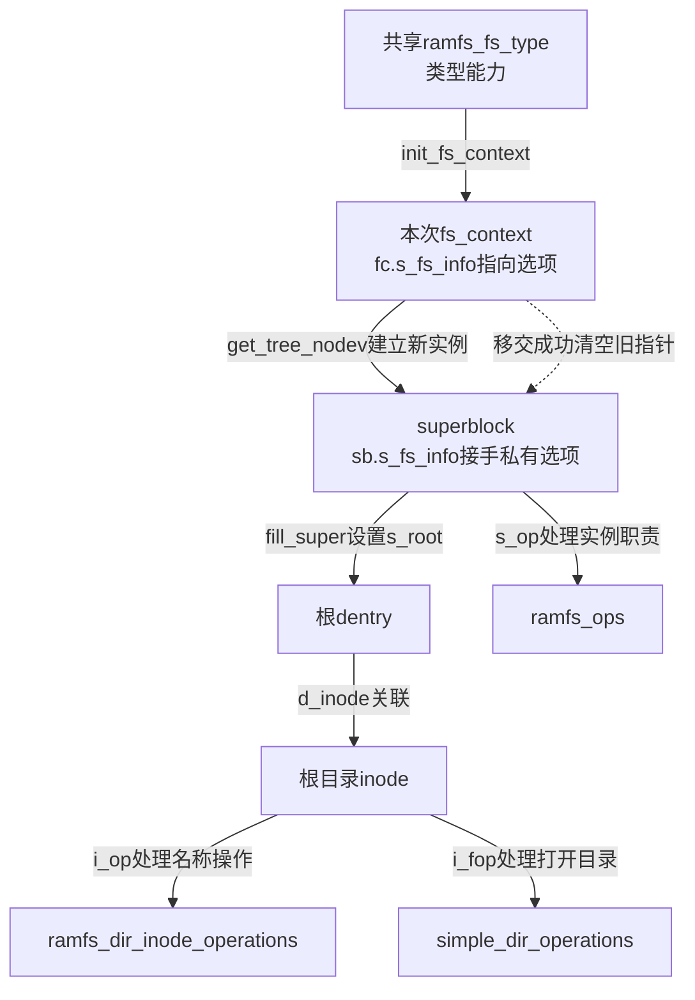
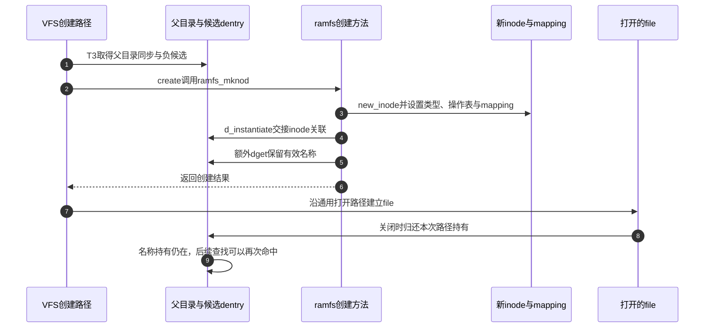

# 第23章\_具体文件系统接入VFS

前面分别建立了挂载、名称查找、文件操作、页缓存和退出协议。现在换到后端作者的位置：如果只想做一个把数据留在内存中的文件系统，需要实现哪些部分，又能复用哪些已有机制？本章选择ramfs，把这些角色放回同一份实际实现。

ramfs的代码少，不是因为文件系统责任凭空消失，而是它直接用VFS中的对象和页缓存作为存储。这个选择省去了磁盘格式和块映射，却带来另一个必须回答的问题：如果没有磁盘目录和数据副本，正常的缓存回收还能随意丢掉这些对象吗？

## 23.1\_先决定文件数据的权威位置

普通磁盘文件系统可以把暂时不用的干净缓存丢掉，以后根据磁盘元数据和数据重新加载。ramfs没有这一份后备存储。名字只存在于内存中的目录关系，文件内容留在mapping的页缓存；把仍有效的名字或数据当作可随意重建的缓存丢掉，就会丢失文件系统内容。

因此它需要两种保留责任：正名称保留dentry及其inode关联，文件数据页不能按普通有后备存储的缓存策略被丢弃。用户关闭最后一个fd，只结束这次打开的使用，不会自动删除仍有名字的文件。unlink、截断和实例退出才分别归还相应内容与关系。

**讲解层次：概念到Linux 6.12.20实现的映射。** 本章的ramfs是一个实际后端，不是“所有文件系统只需填这几张表”的通用模板。磁盘文件系统还要建立存储格式、块分配、持久化和恢复协议；tmpfs则在内存文件这一方向增加容量限制及按配置使用交换等能力。

| 当前对象 | ramfs中的权威内容 | 生命周期责任 |
| --- | --- | --- |
| 正dentry及父子关系 | 有效名称与inode关联 | 创建或链接额外持有，名称撤销时归还 |
| inode | 文件类型、权限、大小、链接数及mapping | 名称和使用关系保持，最后使用按后端策略驱逐 |
| address_space与页缓存 | 文件实际字节 | 没有磁盘回写副本，截断或删除等协议负责撤销 |
| superblock私有状态 | 该实例的挂载选项 | 由配置请求移交给实例，实例关闭时释放 |

ramfs并不提供通常所需的容量上限。这个固定版本识别mode参数，并兼容性地忽略其他未识别选项；给它写上size=64M不会建立64MiB容量限制。后面的实验只写几个字节，目的在于观察对象责任，不做填满内存的测试。

## 23.2\_注册一种能力与创建一个实例分开

ramfs_fs_type是共享的类型描述，说明名字叫ramfs、怎样初始化fs_context、接受哪些参数和怎样关闭实例。注册这张描述只使VFS能够找到这种类型，并没有因此创建某个用户挂载的根目录。

一次挂载请求进入ramfs_init_fs_context时，才分配ramfs_fs_info并设置默认根目录权限0755。配置暂存在fc.s_fs_info；建树成功进入新实例时，通用sget_fc把所有权转给sb.s_fs_info并清空配置侧指针。之后释放fs_context不能再把已经移交的同一块内存释放一次。

ramfs_get_tree选择get_tree_nodev，不需要块设备。新实例由ramfs_fill_super填写操作表、魔数和大小等基础信息，再创建目录inode并用d_make_root形成根dentry。取得根还不等于挂载点已经接入当前namespace，后续接树仍沿前面建立的通用挂载流程。



实线说明构造或能力连接，虚线强调私有状态所有权移交。操作表可由多个对象共享，因为它们主要保存方法；根权限等实例数据不能写回这张全局表。固定源码入口见 [VFS总索引](../../../research/source_reading/vfs/navigation/P01_Linux_6.12_VFS源码阅读索引.md) 和 [ramfs接入导读](../../../research/source_reading/vfs/navigation/P22_ramfs把缓存对象变成文件系统.md#22.1_沿一次实例使用定位状态)，实际构造与失败清理见 [配置和实例生命期](../../../research/source_reading/vfs/source_explanations/P70_ramfs配置根与实例生命期.md#70.1_类型描述只注册能力而不保存实例状态)。

## 23.3\_创建名称时为什么多取一次持有

现在在根目录下创建文件a。VFS先完成路径查找及父目录同步，把一个尚未关联inode的候选dentry交给目录create。ramfs_create转到ramfs_mknod，后者分配inode、初始化类型与操作表，并完成安全初始化；成功后用d_instantiate接上inode，再额外dget这个dentry。

这次额外持有正是ramfs保存名称的责任。普通打开流程以后归还自己临时取得的路径引用，正dentry仍不能因此消失，否则ramfs没有磁盘目录能把a重新查出来。没有找到已有名称时，simple_lookup也不会去磁盘搜索，它只建立一个负结果供当前VFS流程使用。



步骤4没有替代正常名称索引的全部发布协议；本次候选与VFS创建流程共同负责可见性，不能把d_instantiate当成任意裸dentry的通用发布函数。步骤5的额外持有也不是泄漏，它将在unlink等名称撤销路径或实例关闭中归还。

硬链接b增加的不只是i_nlink。simple_link还要为新dentry的inode关联增加inode持有，并为新名字保留dentry持有；这三项分别表达链接数量、关联生命期和名称驻留。simple_unlink减少链接数并归还名称持有，外层VFS再处理名称可见性。改名则还涉及VFS的锁序与dcache移动，不能只看后端simple_rename就推断整个拓扑已经改变。[名称操作与驻留责任](../../../research/source_reading/vfs/source_explanations/P71_ramfs名称操作与驻留责任.md#71.1_创建成功以后把名字留在内存)将这些配对逐项展开。

## 23.4\_操作表怎样把读写引到内存字节

创建普通文件时，ramfs_get_inode把i_fop指向ramfs_file_operations，把i_mapping的a_ops指向ram_aops。当前配置有MMU，实际选中的file-mmu.c提供通用迭代读写及文件映射；不能把另一个无MMU文件中的同名表混进来解释当前路径。

一次缓冲写先进入通用写检查和inode同步，再由generic_perform_write调用ram_aops的write_begin取得页，复制用户数据，最后write_end确认接纳字节、更新大小并标脏。再次读取可以直接从同一个mapping中的有效页取得内容；首次需要读入一个没有后备内容的新页时，simple_read_folio用零填充并标记有效。

| 操作入口 | ramfs选中的方法 | 当前后端的含义 |
| --- | --- | --- |
| 普通文件read_iter / write_iter | generic_file_read_iter / generic_file_write_iter | 复用通用页缓存及迭代器流程 |
| 文件mmap | generic_file_mmap | VMA与同一文件mapping交接，具体缺页见前文 |
| 页准备与接纳 | simple_write_begin / simple_write_end | 准备内存页并确认已复制范围 |
| 新页读入 | simple_read_folio | 没有磁盘内容可取，建立零内容的有效页 |
| 标脏 | noop_dirty_folio | 仍会修改folio脏位，名字中的noop不表示完全无状态变化 |
| fsync | noop_fsync | 返回成功，没有新增磁盘副本 |

这组操作表没有磁盘writeback方法，mapping还被标记为unevictable。这里保留的页就是实际数据，不能因为“通常叫页缓存”就认为总能从后端重建。fsync返回0说明所选后端完成了自己的接口处理，不会让易失内存获得断电保存能力。操作表和每条具体方法见 [页数据与文件操作](../../../research/source_reading/vfs/source_explanations/P72_ramfs页数据与文件操作表.md#72.1_MMU构建选择具体文件操作表)。

## 23.5\_在独立挂载中观察关闭后重新打开

实验先编译一个小程序，再在新的用户与挂载命名空间中挂载ramfs。程序先核对RAMFS_MAGIC，再创建自己的临时子目录，完成写入、硬链接、改名、删除原名和关闭后重开；它只清理自己成功创建的名称。

先预测：关闭所有文件fd以后，c能否重新打开？a删除后i_nlink应是多少？fsync成功是否说明数据离开了内存？这些问题分别检查名称驻留、链接计数和后端同步契约。

```c
#define _GNU_SOURCE
#include <errno.h>
#include <fcntl.h>
#include <inttypes.h>
#include <limits.h>
#include <linux/magic.h>
#include <stdio.h>
#include <stdlib.h>
#include <string.h>
#include <sys/stat.h>
#include <sys/vfs.h>
#include <unistd.h>

int main(int argc, char **argv)
{
    char directory[PATH_MAX];
    const char payload[] = "ramfs";
    char result_data[sizeof(payload)];
    struct statfs filesystem;
    struct stat metadata;
    int base_fd = -1, dir_fd = -1, file_fd = -1;
    int have_directory = 0, have_a = 0, have_b = 0, have_c = 0;
    int result = EXIT_FAILURE;
    size_t done = 0;

    if (argc != 2) { fprintf(stderr, "用法：%s ramfs挂载目录\n", argv[0]); return EXIT_FAILURE; }
    base_fd = open(argv[1], O_RDONLY | O_DIRECTORY | O_CLOEXEC);
    if (base_fd < 0) { perror("open base"); goto cleanup; }
    if (fstatfs(base_fd, &filesystem) < 0) { perror("fstatfs"); goto cleanup; }
    if ((unsigned long)filesystem.f_type != RAMFS_MAGIC) {
        fputs("目标不是ramfs，停止实验\n", stderr); goto cleanup;
    }
    int size = snprintf(directory, sizeof(directory), "%s/demo_XXXXXX", argv[1]);
    if (size < 0 || (size_t)size >= sizeof(directory)) { fputs("路径过长\n", stderr); goto cleanup; }
    if (!mkdtemp(directory)) { perror("mkdtemp"); goto cleanup; }
    have_directory = 1;
    dir_fd = open(directory, O_RDONLY | O_DIRECTORY | O_CLOEXEC);
    if (dir_fd < 0) { perror("open directory"); goto cleanup; }
    file_fd = openat(dir_fd, "a", O_CREAT | O_EXCL | O_RDWR | O_CLOEXEC, 0600);
    if (file_fd < 0) { perror("openat a"); goto cleanup; }
    have_a = 1;
    while (done < sizeof(payload)) {
        ssize_t count = write(file_fd, payload + done, sizeof(payload) - done);
        if (count < 0 && errno == EINTR) continue;
        if (count <= 0) { fputs("写入失败\n", stderr); goto cleanup; }
        done += (size_t)count;
    }
    if (fsync(file_fd) < 0) { perror("fsync"); goto cleanup; }
    puts("fsync返回成功；ramfs没有因此获得磁盘副本");

    /* 两个名称共享inode；改名只改变其中一个名称，随后删除原名。 */
    if (linkat(dir_fd, "a", dir_fd, "b", 0) < 0) { perror("linkat"); goto cleanup; }
    have_b = 1;
    if (renameat(dir_fd, "b", dir_fd, "c") < 0) { perror("renameat"); goto cleanup; }
    have_b = 0; have_c = 1;
    if (unlinkat(dir_fd, "a", 0) < 0) { perror("unlinkat a"); goto cleanup; }
    have_a = 0;
    if (fstat(file_fd, &metadata) < 0) { perror("fstat"); goto cleanup; }
    if (metadata.st_nlink != 1) { fputs("剩余链接数不符\n", stderr); goto cleanup; }
    printf("删除a后仍有c，inode链接数=%ju\n", (uintmax_t)metadata.st_nlink);
    if (close(file_fd) < 0) { file_fd = -1; perror("close a"); goto cleanup; }
    file_fd = -1;

    /* 此时没有打开的文件fd；正名称及数据仍由文件系统的驻留责任保留。 */
    file_fd = openat(dir_fd, "c", O_RDONLY | O_CLOEXEC);
    if (file_fd < 0) { perror("reopen c"); goto cleanup; }
    done = 0;
    while (done < sizeof(payload)) {
        ssize_t count = read(file_fd, result_data + done, sizeof(payload) - done);
        if (count < 0 && errno == EINTR) continue;
        if (count <= 0) { fputs("重新读取失败\n", stderr); goto cleanup; }
        done += (size_t)count;
    }
    if (memcmp(result_data, payload, sizeof(payload))) { fputs("内容不符\n", stderr); goto cleanup; }
    puts("全部文件fd关闭以后，重新打开c仍读到ramfs");
    result = EXIT_SUCCESS;

cleanup:
    if (file_fd >= 0 && close(file_fd) < 0) { perror("close file"); result = EXIT_FAILURE; }
    /* 只清理这个新建私有目录中由本程序成功创建的名称。 */
    if (have_a && unlinkat(dir_fd, "a", 0) < 0) { perror("unlink a"); result = EXIT_FAILURE; }
    if (have_b && unlinkat(dir_fd, "b", 0) < 0) { perror("unlink b"); result = EXIT_FAILURE; }
    if (have_c && unlinkat(dir_fd, "c", 0) < 0) { perror("unlink c"); result = EXIT_FAILURE; }
    if (dir_fd >= 0 && close(dir_fd) < 0) { perror("close directory"); result = EXIT_FAILURE; }
    if (have_directory && rmdir(directory) < 0) { perror("rmdir"); result = EXIT_FAILURE; }
    if (base_fd >= 0 && close(base_fd) < 0) { perror("close base"); result = EXIT_FAILURE; }
    return result;
}
```

在Linux开发环境、仓库根目录编译，材料见 [ramfs_walk_demo.c](../../../labs/kernel/vfs/materials/ramfs_walk_demo.c)：

```bash
cc -std=c11 -Wall -Wextra -Werror labs/kernel/vfs/materials/ramfs_walk_demo.c -o /tmp/ramfs_walk_demo
```

编译之后执行下面一个完整实验单元。unshare需要用户命名空间可用且当前策略允许；若它失败，子命名空间中的命令不会执行，不应把内部mount命令拿出来在未知宿主挂载环境中重试。

```bash
unshare --user --map-root-user --mount --propagation private bash <<'RAMFS_LAB'
set -eu
ramfs_dir=$(mktemp -d /tmp/vfs_ramfs.XXXXXX)
cleanup_ramfs() {
    if mountpoint -q "$ramfs_dir"; then
        umount "$ramfs_dir" || return
    fi
    rmdir "$ramfs_dir"
}
trap cleanup_ramfs EXIT
mount -t ramfs -o mode=0700 ramfs "$ramfs_dir"
stat -f -c '文件系统类型：%T' "$ramfs_dir"
/tmp/ramfs_walk_demo "$ramfs_dir"
RAMFS_LAB
```

新挂载命名空间与private传播限制本次挂载视图；用户命名空间中的root身份也不等于宿主全局root。退出时先卸载，再删除外层临时空目录。程序内部的私有名称由程序自己的cleanup配对处理，不依赖递归删除一个猜测路径。

预期输出类型为ramfs，删除a后链接数为1，全部文件fd关闭以后重新打开c仍读到ramfs；fsync成功行同时提醒其后端没有磁盘副本。这些是待验证预期，当前没有目标Linux编译运行或命名空间挂载结果。它们也不能直接测出内核dentry引用精确值，额外持有的解释仍由源码证明。

## 23.6\_最后释放为什么仍要经过多层责任

ramfs_ops把drop_inode绑定到generic_delete_inode，它总是建议驱逐最后无使用引用的inode。但有名字的对象通常仍被正dentry关联保持，所以“close最后一个fd”不能直接推出inode已经到达这条最后引用分支。这个策略与额外名称持有配合，才既保留有效文件，又在责任归还后及时释放内存。

unlink归还名字责任，已有file或映射仍按前章的协议继续使用；最后引用真正消失以后，通用驱逐清理mapping和inode。实例关闭时，ramfs_kill_sb先释放自己的选项状态，再调用kill_litter_super处理驻留目录树及通用关闭。不能既在fs_context销毁中释放已移交的私有状态，又在这里释放同一地址。

如果要把此实现改成磁盘文件系统，仅补一个写函数不够：名称与inode必须有可重建的后备表示，页回写要知道数据去哪里，fsync和错误恢复还要提供相应持久化保证。反过来，若只需要内存中的小型临时存储，也应先核对容量与回收边界，不能把ramfs未知选项被接受当成容量限制已经生效。

现在已经把类型能力、实例状态、名称驻留和数据页连成一次完整使用过程。下一章比较 [特殊文件与伪文件系统接入](P24_特殊文件与伪文件系统接入.md)：统一的file接口还可以交给设备、管道或其他对象，未必总有本章这样的普通页数据。
