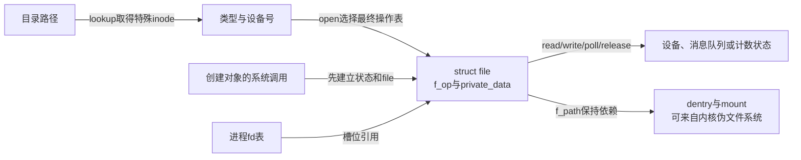
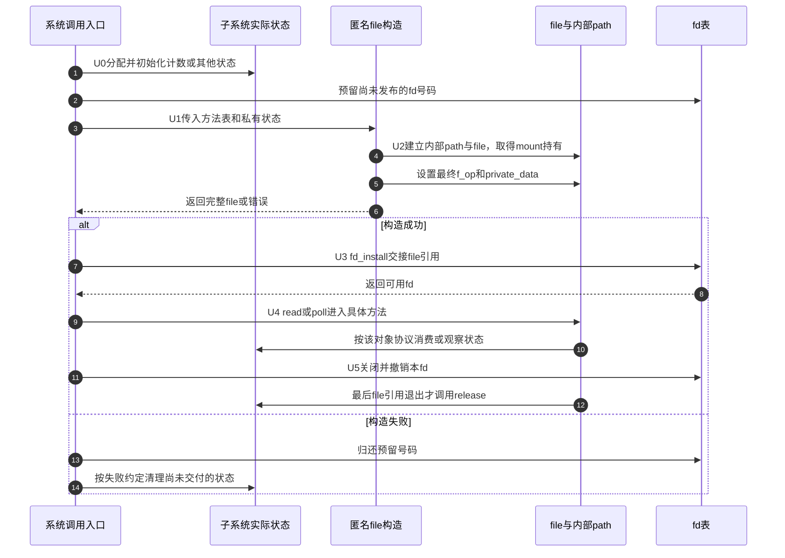

# 第24章\_特殊文件与伪文件系统接入

ramfs已经说明，文件字节可以直接保存在内存中。接着考虑另一种需求：应用想读取传感器结果、消费进程间消息，或者等待一个内核计数器变化。这些对象不一定有“第几个字节存在哪个页”的普通文件模型，却仍需要打开后的引用、访问权限、读写等待和最后关闭。

VFS能够复用这部分交接。要理解它，先把两个问题拆开：**怎样找到对象**，以及 **找到后怎样操作真实状态**。目录名字可以定位一个设备入口；系统调用也可以先创建内核对象，再直接返回fd。两者最终都可以得到file，但状态不必放在普通文件的页缓存。

## 24.1\_把命名方式与数据来源分开

假设设备节点/dev/example已经出现在目录里。查找它仍会经过mount、dentry和inode。这个inode保存的是特殊文件类型和设备号，不能仅凭节点存在就推断设备驱动已经登记，也不能把节点所属文件系统的页缓存当作设备接收队列。

若只是创建一个进程内计数器，先造一个目录名字再open就多了一份命名、权限和删除管理。eventfd这类接口可以直接创建计数状态并返回fd，让已有的read、write、poll和close继续使用。省去的是普通目录名字的查找与维护，内核仍要构造file及其依赖。



图里的两条入口不能合并成“所有fd都是open路径的结果”。反过来，没有普通目录名字也不等于内核file完全没有path；匿名对象可以由内核伪文件系统提供dentry和mount。诊断时显示的名字可能只是类别标签，不能据此推断它可用普通open重新打开。

## 24.2\_特殊inode先选择入口再交给具体后端

一个目录中的特殊文件仍属于承载这个目录的文件系统。它的类型由inode.i_mode说明，字符或块设备号保存在i_rdev；后端创建时的init_special_inode按类型设置初始方法表。**节点的元数据归承载文件系统，读写实际服务由相应子系统负责。**

字符设备先选def_chr_fops，它的open进入chrdev_open。该函数在设备号映射中取得cdev及其方法表，替换当前file.f_op，再调用驱动open。以后read和release就沿最终方法表前进，而不必每次重新走路径查找和号码查询。驱动常用private_data保存所选设备实例或本次打开状态，这个指针的生命期仍须由驱动建立。

| 类型入口 | 初始连接 | 使用时实际消费的状态 |
| --- | --- | --- |
| 字符特殊文件 | i_rdev定位cdev，再替换file操作表 | 驱动定义的设备实例、队列或软件窗口 |
| 块特殊文件 | 块设备打开路径取得块设备对象 | 块层和设备请求；不等同于挂载其上的目录文件系统 |
| 命名FIFO | 目录名字定位FIFO inode，再建立或取得管道状态 | 内存中的管道缓冲及读写端状态 |
| 目录中的socket节点 | 保存供地址查找使用的socket类型节点 | 不能将普通open这个节点等同于socket或connect |

固定版本中，init_special_inode对socket类型保留no_open_fops。这正好提醒我们：“路径中能看到一个socket文件”与“进程拥有一个可收发的socket fd”是两件事。块设备分支还受CONFIG_BLOCK影响；当前配置开启，不能把这一结果推广到关闭配置的构建。

字符设备的登记、硬件访问和安全移除继续由 [字符设备专题](../../driver_model/character_device/大纲.md)解释。本章只负责VFS边界，具体入口见 [特殊inode与打开分派](../../../research/source_reading/vfs/source_explanations/P73_特殊inode的类型选择与打开分派.md#73.1_类型位决定初始入口而非最终服务)。源码阅读先进入 [VFS总索引](../../../research/source_reading/vfs/navigation/P01_Linux_6.12_VFS源码阅读索引.md) 和 [特殊对象导读](../../../research/source_reading/vfs/navigation/P23_特殊文件与匿名对象的VFS交接.md#23.1_沿建立发布使用退出定位状态)。

## 24.3\_没有普通路径的对象也要完整交接

以匿名对象为例，子系统先建立自己的状态，把方法表与状态指针交给anon_inode接口。通用构造为它建立file及内部path，并设置private_data。取得一个未用fd只表示号码已经预留；必须等file及其实际状态初始化完成，才可以fd_install交给描述符表。



图中描述符发布只发生在步骤7，不能把预留号码提前交给其他线程。私有状态怎样释放由子系统回调约定，匿名file构造器不知道任意private_data的类型，无法替调用者自动free。失败尚未发布与成功后的最后release也是两条不同路径。

这个版本的anon_inode_getfile可以让多个独立file共用一个匿名inode，节省不需要独立inode元数据的对象成本。它们仍有各自的file和private_data。需要独立安全上下文或inode属性时，另一组create接口可以分配独立inode；**共用inode不代表共用某个业务计数器**。具体生命期见 [伪路径构造](../../../research/source_reading/vfs/source_explanations/P74_伪路径file的建立与失败归还.md#74.1_内部path仍有真实持有责任) 和 [匿名对象交接](../../../research/source_reading/vfs/source_explanations/P75_匿名inode的共享与私有对象交接.md#75.2_共享inode不共享每次创建的私有状态)。

## 24.4\_同一读写接口可以连接不同状态模型

匿名pipe建立两个file，读端与写端共同引用一份pipe_inode_info；不是让一个普通文件的f_pos在两端来回移动。socket的file则通过private_data连接struct socket，再进入协议操作。它们都复用file生命期，但各自决定数据消费、等待和关闭语义。

procfs与sysfs解决的是另一类问题：把已有内核状态组织成可查找、可访问的文件视图。procfs条目通过proc_ops交给具体提供者；sysfs普通文本属性经kernfs和sysfs_ops进入show/store。这里的读取结果可以当场生成，写入也可能触发一个控制动作，不能默认是在修改一份普通内存文件的字节。

| 当前对象 | 命名与承载 | 真正状态及读写语义 | 不能由file接口直接推出 |
| --- | --- | --- | --- |
| ramfs普通文件 | 用户目录名，inode的mapping | 保存可按偏移读取的内存字节 | fsync成功后有磁盘副本 |
| FIFO与匿名pipe | 前者有目录名字，后者由创建调用返回两端 | 管道缓冲、读写端计数和等待队列 | 有名字就有磁盘数据，或每次read都可重复取得旧字节 |
| socket fd | socket创建或接受路径，内部sockfs对象 | struct socket及协议状态 | 目录socket节点可以直接open成连接 |
| eventfd等匿名对象 | 内部anon_inodefs及类别显示名 | private_data指向本对象计数及等待状态 | 同一inode编号就是同一业务对象 |
| procfs条目 | 可见目录树，具体条目方法 | 提供者状态与生成/控制协议 | 所有条目都是同一种快照或都可写 |
| sysfs属性 | kernfs节点与kobject关系 | 属性show/store或二进制属性回调 | 普通文本属性与二进制属性采用同一数据协议 |

比较时先问状态是不是可重放的字节、读操作会不会消费它、EOF表示什么，以及谁保证后备对象在回调期间仍有效。不要因为它们都能返回一个fd，就给它们套用同一缓存、位置和持久化解释。各入口的固定证据与裁剪边界收在模块导读，不把管道算法、网络协议或设备模型另抄成第二份教程。

## 24.5\_用两个计数对象区分身份与共享

下面创建两个eventfd，初值分别为2和7，再复制第一个描述符。非EFD_SEMAPHORE模式下，一次成功read取走当前计数；非阻塞模式下，计数已空时read返回EAGAIN。先预测：读复制的fd以后，哪一个原fd会变空？显示名称相同，是否足以回答这个问题？

```c
#define _GNU_SOURCE
#include <errno.h>
#include <fcntl.h>
#include <inttypes.h>
#include <stdint.h>
#include <stdio.h>
#include <stdlib.h>
#include <sys/eventfd.h>
#include <sys/stat.h>
#include <unistd.h>

static int show_identity(const char *label, int fd)
{
    char path[64], target[256];
    struct stat metadata;
    int size = snprintf(path, sizeof(path), "/proc/self/fd/%d", fd);
    if (size < 0 || (size_t)size >= sizeof(path)) return -1;
    if (fstat(fd, &metadata) < 0) { perror("fstat"); return -1; }
    ssize_t count = readlink(path, target, sizeof(target) - 1);
    if (count < 0) { perror("readlink"); return -1; }
    target[count] = '\0';
    printf("%s fd=%d inode=%ju 显示名称=%s\n", label, fd,
           (uintmax_t)metadata.st_ino, target);
    return 0;
}

static int read_count(int fd, uint64_t expected)
{
    uint64_t value = 0;
    ssize_t count;
    do { count = read(fd, &value, sizeof(value)); } while (count < 0 && errno == EINTR);
    if (count != (ssize_t)sizeof(value)) { fputs("读取计数失败\n", stderr); return -1; }
    if (value != expected) { fputs("读取计数不符\n", stderr); return -1; }
    printf("本次取走计数=%" PRIu64 "\n", value);
    return 0;
}

int main(void)
{
    int first_fd = -1, second_fd = -1, duplicate_fd = -1;
    int result = EXIT_FAILURE;
    uint64_t value;
    ssize_t count;

    /* 两次创建建立两份计数对象，非阻塞方式使空对象立即报告EAGAIN。 */
    first_fd = eventfd(2, EFD_NONBLOCK | EFD_CLOEXEC);
    if (first_fd < 0) { perror("eventfd first"); goto cleanup; }
    second_fd = eventfd(7, EFD_NONBLOCK | EFD_CLOEXEC);
    if (second_fd < 0) { perror("eventfd second"); goto cleanup; }
    duplicate_fd = fcntl(first_fd, F_DUPFD_CLOEXEC, 0);
    if (duplicate_fd < 0) { perror("duplicate"); goto cleanup; }
    if (show_identity("第一次创建", first_fd) < 0 ||
        show_identity("第二次创建", second_fd) < 0 ||
        show_identity("第一次的复制", duplicate_fd) < 0) goto cleanup;

    /* 复制描述符共享原file和计数，读取复制者会消费第一次创建的对象。 */
    if (read_count(duplicate_fd, 2) < 0) goto cleanup;
    do { count = read(first_fd, &value, sizeof(value)); } while (count < 0 && errno == EINTR);
    if (count != -1 || errno != EAGAIN) {
        fputs("原描述符没有观察到共享对象已空\n", stderr); goto cleanup;
    }
    puts("原描述符返回EAGAIN；第二次创建的对象仍应保有7");
    if (read_count(second_fd, 7) < 0) goto cleanup;
    result = EXIT_SUCCESS;
cleanup:
    if (duplicate_fd >= 0 && close(duplicate_fd) < 0) { perror("close duplicate"); result = EXIT_FAILURE; }
    if (second_fd >= 0 && close(second_fd) < 0) { perror("close second"); result = EXIT_FAILURE; }
    if (first_fd >= 0 && close(first_fd) < 0) { perror("close first"); result = EXIT_FAILURE; }
    return result;
}
```

材料见 [anonymous_file_demo.c](../../../labs/kernel/vfs/materials/anonymous_file_demo.c)。在Linux仓库根目录编译执行；观察显示名称需要挂载procfs：

```bash
cc -std=c11 -Wall -Wextra -Werror labs/kernel/vfs/materials/anonymous_file_demo.c -o /tmp/anonymous_file_demo
/tmp/anonymous_file_demo
```

预期先取走2，再从第一个原fd得到EAGAIN，最后仍能从第二个对象取走7。复制fd增加的是同一file的引用，所以共享同一计数；第二次eventfd创建的是另一份计数。固定源码中的普通匿名构造还使这些对象共用inode，显示名称也相同；程序只打印身份信息，不把某个内核版本的inode号码写成跨版本断言。

这里检查的是对象共享关系，不包含多线程竞争、计数溢出或EFD_SEMAPHORE模式测试。当前环境没有目标Linux编译运行结果，上述数值是根据接口与固定源码推导的待验证预期。

## 24.6\_遇到异常先查最后交接到了谁

如果字符设备节点存在却打不开，先区分路径查找、设备号映射和驱动open失败；如果匿名fd的两个操作互相影响，先确认是否dup/fork共享了file，再查private_data里的对象协议。如果proc或sysfs读到变化的数据，先核对提供者是否承诺快照，不把普通文件的重复读直觉直接搬过来。

现在能够沿“入口—file—实际状态”判断谁负责数据，仍需要把这些关系变成可观察证据。下一章 [VFS调试与源码追踪](P25_VFS调试与源码追踪.md)从失败发生的最早一层出发，组织类型、mount、路径、fd和回调的排查顺序。
