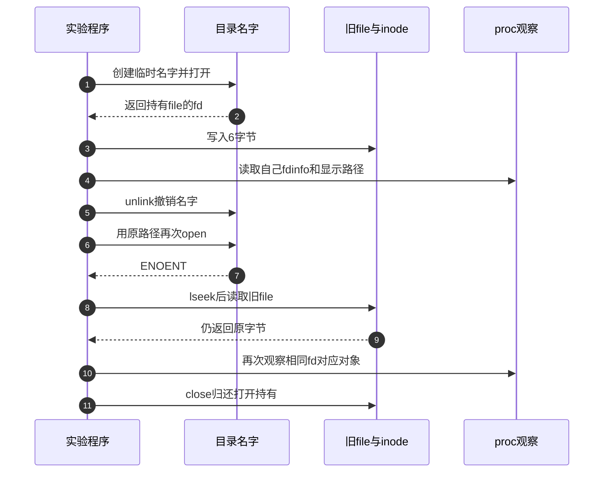

# 第25章\_VFS调试与源码追踪

前一章已经说明，拿到fd之后，实际服务可能是页缓存、设备、管道或匿名计数器。排错因此不能只问“read为什么失败”，还要先确认它操作的是哪个file、由谁提供方法，以及哪一个状态转换尚未完成。

本章以“删除名字以后旧fd仍能读”为可复现案例，将系统调用结果、proc视图和内核跟踪连起来。目标不是一次启用所有探针，而是找到能够区分当前两种解释的最小证据，再沿已经建立的对象关系追踪。

## 25.1\_先找到最早没有成立的条件

假设应用报告打开文件失败。类型已注册不能证明某个mount可见，mount可见不能证明目录分量存在，路径存在也不能证明本次凭据获准打开。若先去观察块设备写回，很可能跳过了根本没有到达的数据路径。


这里从症状选择分支，不要求每次都把所有层重新查一遍。最小问题记录至少包括：目标进程、调用时间、路径或fd、准确返回值与errno、运行内核和文件系统类型，以及是否发生过rename、unlink、dup、fork、mount变化。errno只说明本次接口返回的分类，不唯一指认某个内核函数。

## 25.2\_把进程视图和打开对象对应起来

/proc/self中的self指 **正在访问proc的进程**。在shell里运行cat /proc/self/fdinfo/3，观察的是cat自己的fd 3，未必是shell或你的程序。跨进程观察要使用程序实际PID；下面实验由程序读取自己的proc信息，避免这个歧义。

| 观察入口 | 保存或显示什么 | 可以支持的结论与限制 |
| --- | --- | --- |
| /proc/filesystems | 当前登记的文件系统类型 | 类型可查询，不证明已有可见挂载 |
| /proc/PID/mountinfo | 该进程视图中的mount关系 | 应与同一进程的root及命名空间一起解释 |
| /proc/PID/fd/N | fd所指对象的显示路径或类别名 | 名称可以已删除，也可能只是匿名类别；不证明可重新open |
| /proc/PID/fdinfo/N | 位置、标志、mount ID、inode及可选后端信息 | 当前打开关系的一次观察，不是整个系统的原子快照 |
| fstat或statx | 指定对象的属性 | 对路径查询与对已打开fd查询可能得到不同对象 |
| 系统调用跟踪 | 入口参数、返回值、时序等 | 能定位用户接口结果，不能直接看见全部内核引用与回调 |

fdinfo中的基础字段可在正文直接解读：

| 字段 | 固定实现的来源 | 读数注意点 |
| --- | --- | --- |
| pos | file.f_pos | 是否有普通位置语义取决于后端；匿名流不能照搬磁盘偏移解释 |
| flags | file.f_flags，另合入该fd的O_CLOEXEC | 八进制显示；同一file的两个fd可能有不同CLOEXEC |
| mnt_id | file.f_path.mnt对应的mount ID | 可与同一进程mountinfo关联；内核内部或已脱离视图的mount未必有对应行 |
| ino | file_inode的i_ino | 需要结合实例；匿名对象也可能共用inode，不能唯一识别private_data |
| 后续字段 | file操作表的show_fdinfo回调 | 随对象类型变化，不假设每个fd都有同样字段 |

mountinfo则先读mount ID、父ID、设备号、实例内根和当前挂载点，再找独立的`-`分隔符。分隔符之后依次是文件系统类型、挂载来源和superblock选项。分隔符之前的可选字段数量不固定，不能靠“固定第七列就是类型”解析；路径还可能包含转义。mount ID在卸载后可复用，跨时间比较必须带上观察时点。

这些字段依据固定Linux原件 [proc说明的3.5与3.8](../../../research/source_reading/linux/Documentation/filesystems/proc.rst)、[fdinfo输出](../../../research/source_reading/linux/fs/proc/fd.c) 和 [mount视图输出](../../../research/source_reading/linux/fs/proc_namespace.c)。fdinfo先取得稳定file引用再输出，多个文件的读取仍不是一次全局快照；读不到一行不能立即推断内核对象已经释放。

## 25.3\_用同一程序观察名字消失与旧打开存续

选择普通本地文件系统或tmpfs上的/tmp进行实验。程序建立自己的临时文件，写少量字节，打印对象与fdinfo，然后unlink并分别尝试新open和旧fd读取。它不根据输出中的inode号码写死断言；网络文件系统可能采用不同的删除显示和临时名称策略，不以本例替代其协议。

先作三个预测：新open是否失败？旧fd是否仍能读？显示路径中的删除标记是否证明inode已释放？前两项可以直接用系统调用结果检验，第三项必须结合file持有关系回答。

```c
#define _GNU_SOURCE
#include <errno.h>
#include <fcntl.h>
#include <inttypes.h>
#include <stdio.h>
#include <stdlib.h>
#include <string.h>
#include <sys/stat.h>
#include <unistd.h>

static int show_file(const char *stage, int fd)
{
    struct stat metadata;
    char path[64], target[512], buffer[512];
    ssize_t length;
    FILE *info;
    if (fstat(fd, &metadata) < 0) { perror("fstat"); return -1; }
    int size = snprintf(path, sizeof(path), "/proc/self/fd/%d", fd);
    if (size < 0 || (size_t)size >= sizeof(path)) return -1;
    length = readlink(path, target, sizeof(target) - 1);
    if (length < 0) { perror("readlink"); return -1; }
    target[length] = '\0';
    printf("%s pid=%jd fd=%d dev=%ju inode=%ju links=%ju\n显示路径=%s\n",
           stage, (intmax_t)getpid(), fd, (uintmax_t)metadata.st_dev,
           (uintmax_t)metadata.st_ino, (uintmax_t)metadata.st_nlink, target);
    size = snprintf(path, sizeof(path), "/proc/self/fdinfo/%d", fd);
    if (size < 0 || (size_t)size >= sizeof(path)) return -1;
    info = fopen(path, "r");
    if (!info) { perror("open fdinfo"); return -1; }
    while (fgets(buffer, sizeof(buffer), info)) fputs(buffer, stdout);
    int failed = ferror(info);
    if (fclose(info) != 0) failed = 1;
    if (failed) fputs("读取fdinfo失败\n", stderr);
    return failed ? -1 : 0;
}

int main(void)
{
    char path[] = "/tmp/vfs_probe.XXXXXX";
    const char payload[] = "hello";
    char received[sizeof(payload)];
    int fd = -1, have_name = 0, result = EXIT_FAILURE;
    size_t done = 0;
    fd = mkstemp(path);
    if (fd < 0) { perror("mkstemp"); goto cleanup; }
    have_name = 1;
    if (fcntl(fd, F_SETFD, FD_CLOEXEC) < 0) { perror("fcntl"); goto cleanup; }
    while (done < sizeof(payload)) {
        ssize_t count = write(fd, payload + done, sizeof(payload) - done);
        if (count < 0 && errno == EINTR) continue;
        if (count <= 0) { fputs("写入失败\n", stderr); goto cleanup; }
        done += (size_t)count;
    }
    if (show_file("删除前", fd) < 0) goto cleanup;
    if (unlink(path) < 0) { perror("unlink"); goto cleanup; }
    have_name = 0;
    /* 目录名查找与已有file的使用分开观察。 */
    int fresh_fd = open(path, O_RDONLY | O_CLOEXEC);
    if (fresh_fd >= 0) {
        close(fresh_fd); fputs("名字被重新建立，停止本次观察\n", stderr); goto cleanup;
    }
    if (errno != ENOENT) { perror("再次open的错误不是ENOENT"); goto cleanup; }
    puts("再次open原名字：ENOENT");
    if (lseek(fd, 0, SEEK_SET) < 0) { perror("lseek"); goto cleanup; }
    done = 0;
    while (done < sizeof(received)) {
        ssize_t count = read(fd, received + done, sizeof(received) - done);
        if (count < 0 && errno == EINTR) continue;
        if (count <= 0) { fputs("旧fd读取失败\n", stderr); goto cleanup; }
        done += (size_t)count;
    }
    if (memcmp(received, payload, sizeof(payload))) { fputs("内容不符\n", stderr); goto cleanup; }
    puts("旧fd仍读到hello");
    if (show_file("删除后", fd) < 0) goto cleanup;
    result = EXIT_SUCCESS;
cleanup:
    if (fd >= 0 && close(fd) < 0) { perror("close"); result = EXIT_FAILURE; }
    if (have_name && unlink(path) < 0) { perror("cleanup unlink"); result = EXIT_FAILURE; }
    return result;
}
```

在Linux仓库根目录编译运行，完整材料为 [vfs_probe.c](../../../labs/kernel/vfs/materials/vfs_probe.c)：

```bash
cc -std=c11 -Wall -Wextra -Werror labs/kernel/vfs/materials/vfs_probe.c -o /tmp/vfs_probe
/tmp/vfs_probe
```

通常预期两次fstat指向同一对象，unlink后新open返回ENOENT，旧fd仍读到hello，本地文件的链接数从1变成0。程序实际写入包括字符串终止字节的6字节，lseek回零并读完以后pos为6。显示路径可能带删除标记；它描述名称状态，不证明旧file或inode已回收。



步骤4和10会额外打开proc文件，所以跟踪中出现其他fd是正常的。实验没有其他线程改动原fd，但一般程序可能同时close并复用号码；实际事故分析需要记录时间与对象关系，不能把两个相隔很久的fd N当成同一个file。当前没有目标Linux编译运行结果，以上为待验证预期。

## 25.4\_系统调用记录先回答接口在哪一步失败

若环境已安装strace，可用下列命令观察同一个程序。`%file`选择路径相关调用，`%desc`选择描述符相关调用，避免把某种架构上的具体stat或open系统调用名字误当成所有环境都相同。`-yy`补充fd解码，`-tt`记录时间；日志先写进独立目录。

```bash
trace_output=$(mktemp -d /tmp/vfs_strace.XXXXXX)
strace -tt -yy -e trace=%file,%desc -o "$trace_output/trace.txt" /tmp/vfs_probe
printf '系统调用记录：%s/trace.txt\n' "$trace_output"
```

从记录中只选出这条因果链：创建成功返回哪个fd，unlink何时成功，随后路径打开何时返回ENOENT，旧fd的lseek和read各自返回多少。不要把动态链接器启动时的ENOENT搜索尝试自动当成程序失败，也不要把write返回长度直接升级为介质持久化证据。参数含义可追溯到 [strace官方说明](https://strace.io/) 与 [项目手册](https://github.com/strace/strace/blob/master/doc/strace.1.in)。

strace还会改变被跟踪程序的时序。它可以证明本次用户接口边界，却不能直接证明dentry引用计数、file最终方法地址或某个异步工作队列已经完成；这些问题要继续选择内核侧证据。

## 25.5\_内核跟踪先检查能力再隔离一次观察

当前核对的ARM配置开启TRACING和BPF，但 **未开启FTRACE与BPF_SYSCALL**。因此不能直接宣称下面的tracefs事件实验或用户BPF程序已经可用；配置中的一个基础符号不等于整套入口启用。以下步骤面向另一个已启用所需跟踪能力的Linux环境，先检查事件与权限，不修改目标内核配置。

```bash
trace_root=/sys/kernel/tracing
test -r "$trace_root/available_events" && cat "$trace_root/available_events"
test -r "$trace_root/events/syscalls/sys_enter_openat/format" && cat "$trace_root/events/syscalls/sys_enter_openat/format"
test -r "$trace_root/events/syscalls/sys_exit_openat/format" && cat "$trace_root/events/syscalls/sys_exit_openat/format"
```

事件名字和字段以目标机器为准，不预设有一个覆盖所有VFS动作的通用vfs事件组。syscall事件能显示参数值和返回值；入口中的文件名字段可能是用户地址，不能将它当成已经复制出的路径字符串，也不能在对象或地址失效后随意解引用。下面只记录openat的进入与退出，命中范围由所选事件决定。

具备tracefs实例写权限后，执行 [trace_vfs_probe.sh](../../../labs/kernel/vfs/materials/trace_vfs_probe.sh)。它创建本次独占实例，子shell登记自己的PID后exec被观察程序，保存记录和丢失统计，最后仅清理这个实例。其他跟踪会话的状态不由它重置。

```bash
#!/usr/bin/env bash
set -eu
trace_root=/sys/kernel/tracing
probe_program=/tmp/vfs_probe
if [ ! -x "$probe_program" ]; then
    printf '请先编译 %s\n' "$probe_program" >&2
    exit 1
fi
if [ ! -w "$trace_root/instances" ]; then
    printf '需要可用的tracefs及创建实例的权限\n' >&2
    exit 1
fi
for event_name in sys_enter_openat sys_exit_openat; do
    if [ ! -r "$trace_root/events/syscalls/$event_name/format" ]; then
        printf '当前内核没有可用事件：%s\n' "$event_name" >&2
        exit 1
    fi
done
trace_instance="$trace_root/instances/vfs_probe_$$"
# mkdir失败就停止，不接管同名既有实例。
mkdir -- "$trace_instance"
cleanup_trace() {
    printf '0\n' > "$trace_instance/tracing_on"
    rmdir -- "$trace_instance"
}
trap cleanup_trace EXIT
printf '0\n' > "$trace_instance/tracing_on"
trace_output=$(mktemp -d /tmp/vfs_trace.XXXXXX)
printf '本次记录目录：%s\n' "$trace_output"
for event_name in sys_enter_openat sys_exit_openat; do
    printf '1\n' > "$trace_instance/events/syscalls/$event_name/enable"
done
command_status=0
# 子shell先登记自己的PID，再开始记录；exec保留该PID执行被观察程序。
bash -c '
    set -eu
    printf "%s\n" "$$" > "$1/set_event_pid"
    printf "1\n" > "$1/tracing_on"
    exec "$2"
' _ "$trace_instance" "$probe_program" || command_status=$?
printf '0\n' > "$trace_instance/tracing_on"
cat "$trace_instance/trace" > "$trace_output/trace.txt"
for stats_file in "$trace_instance"/per_cpu/cpu*/stats; do
    [ -r "$stats_file" ] || continue
    printf '\n%s\n' "$stats_file"
    cat "$stats_file"
done > "$trace_output/stats.txt"
printf '记录：%s/trace.txt\n丢失统计：%s/stats.txt\n' "$trace_output" "$trace_output"
exit "$command_status"
```

```bash
bash labs/kernel/vfs/materials/trace_vfs_probe.sh
```

若事件不存在，脚本会停止；即使存在，也要看目标libc是否实际用了openat，以及记录中是否包含预期PID和入口/退出配对。`stats.txt`中的overrun、dropped events等计数用于发现记录丢失。空记录可能是事件未执行、过滤不匹配、能力缺失或采集时机不对，不能作为“VFS没有执行”的充分证据。

function graph需要目标函数可跟踪且相应tracer可用，异步工作还可能换任务执行；只按提交者PID过滤会漏掉后端工作线程。动态调试只能看到实际编入且启用的日志点。BPF还要核对系统调用入口、程序类型、探针许可及对象读取有效性，不能把CONFIG_BPF=y当成这些条件全部满足。本章不提供未经目标验证的函数名或探针字段脚本。版本依据为 [ftrace说明](../../../research/source_reading/linux/Documentation/trace/ftrace.rst) 与 [事件跟踪说明](../../../research/source_reading/linux/Documentation/trace/events.rst)，亦可对照 [Linux 6.12官方跟踪文档](https://docs.kernel.org/6.12/trace/ftrace.html)。

## 25.6\_让每条证据只回答它能证明的问题

| 现象 | 优先核对 | 继续阅读的实现入口 |
| --- | --- | --- |
| 类型未知或挂载失败 | 类型是否登记、参数是否接受、建树与接树哪一步失败 | [类型导读](../../../research/source_reading/vfs/navigation/P01_Linux_6.12_VFS源码阅读索引.md)，按索引进入对应模块 |
| ENOENT、ELOOP或EXDEV | 调用者起点、符号链接、mount边界与具体操作限制 | [路径查找](P09_路径查找状态机.md) 与 [名称修改](P11_创建删除链接与重命名.md) |
| open成功但读写异常 | 最终f_op、私有状态、位置与短进度 | [I/O分派](P14_VFS_read_write分派.md) 与 [特殊对象](P24_特殊文件与伪文件系统接入.md) |
| fsync返回错误或成功含义不明 | 数据回写、元数据协议、每file错误观察与后端保证 | [写回与错误传播](P16_writeback_fsync与错误传播.md) |
| close后仍可访问或卸载busy | dup/fork、映射、路径、子mount及内核持有 | [回收责任](P21_file_dentry_inode与superblock回收.md) 与 [退出边界](P22_freeze_unmount与故障退出.md) |

本章用到的固定源码从 [VFS总阅读索引](../../../research/source_reading/vfs/navigation/P01_Linux_6.12_VFS源码阅读索引.md)进入。fd复用、最后file清理和内部path分别已有唯一实现，本章不另复制它们的函数体。一次调试记录应明确写出“观察到了什么、排除了哪种解释、还有哪项条件未核对”，而不是只写“未发现异常”。

练习：两个fdinfo的ino相同但eventfd计数不同，是否矛盾？不矛盾，匿名框架可共用inode而private_data独立。mountinfo里找不到旧fd的mnt_id，是否证明fd已悬空？不能，挂载可能已脱离可见树而仍由file持有，内部伪挂载也未必出现在用户视图。跟踪未出现某函数，是否证明它从未执行？还需核对构建、可跟踪性、过滤范围、异步任务、采集区间和记录丢失。

至此，可以把一个文件操作从用户结果追到对象、状态和完成责任，并说明每条证据的限度。继续研究具体文件系统、块层或设备驱动时，保留这条追踪方法；不要把统一fd接口误当成统一后端模型。

版本原件、配置与本轮验证范围见 [调试证据记录](../../../research/source_reading/linux/SOURCE_BASELINE.md#1.304_VFS调试的对象观察与跟踪边界)。
