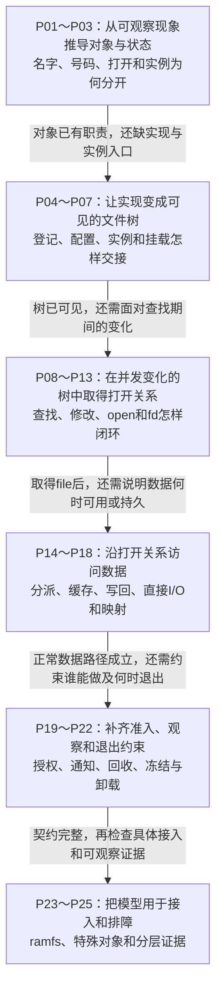

# 第1章\_VFS\_子系统大纲

## 1.1\_专题定位

VFS 是 Linux 对文件系统、路径、打开文件和 I/O 操作的统一内核抽象。它不是字符设备的辅助层，也不等于一组 `file_operations`：本专题要独立解释文件系统怎样注册和挂载、路径怎样解析、对象怎样缓存和共享、文件怎样打开、I/O 怎样分派，以及对象怎样在并发卸载下安全释放。

读者可以先运行第一章的小程序，带着“名字删除以后，为什么旧fd还能读取”这个问题进入。默认路线先建立对象与持有的必要性，再建立实现接入和路径查找，随后追踪数据与退出。各阶段不是互不相干的API分类：后一阶段继续解释前一阶段尚不能回答的现象。

阅读地图中的P编号是本专题的章节号。每章里的S、T、C等阶段编号只属于该章的一个操作周期，不能把不同章节的同名编号当成同一状态机。字段与函数的固定版本证据另由源码索引组织，不要求首次读正文就逐行阅读全部实现。

## 1.2\_完整阅读路线

按下面顺序阅读时，每一阶段都以前一阶段已经成立的对象和操作为前提。已经熟悉某一部分的读者可以直接跳转，但应先核对该阶段入口所列的依赖；章末问题指出下一步需要补齐的解释。

### 1.2.1\_阶段一\_问题\_抽象与全局状态

这一阶段只要求已有基本C与文件操作经验。先观察名称、复制fd和独立打开的不同结果，再尝试设计能解释结果的状态；第三章才把这些职责放回Linux字段。

1. [为什么需要 VFS](P01_为什么需要_VFS.md)：先解释公共接口的价值，再通过完整C程序观察两个名字、dup与独立open，以及unlink后旧打开继续读取。 这些现象会成为下一章设计状态的输入。
2. [VFS 抽象机制推演](P02_VFS抽象机制推演.md)：沿前章现象从最小函数表逐步推导实例、名称、文件本体、打开对象和挂载视图，最后对应Linux名称。 角色成立以后，下一章追踪它们在Linux中的状态位置。
3. [VFS 状态与对象拓扑](P03_VFS_状态与对象拓扑.md)：沿S0～S6把实验落到真实字段，区分名称、表项、打开引用与实例存续，检查失败、数字复用和并发变化。 对象关系已经清楚，接下来仍需找到能够创建实例的实现。

> **读完这一阶段**，应能解释为什么 VFS 不能只有一张操作表，以及名称、文件本体、打开实例和挂载视图为什么必须分开。

### 1.2.2\_阶段二\_从文件系统实现到可见挂载树

现在已知道实例与挂载视图必须区分，但还没有说明它们怎样产生。第四章先找到实现，随后把一次配置请求与长期实例分开，最后把实例接入调用者看到的树。

4. [文件系统类型注册](P04_文件系统类型注册.md)：沿T0～T5解释登记可见性与代码持有，比较类型查询和挂载视图，追踪自动装入及失败归还。 取得实现不等于已经挂载，下一章建立一次配置事务。
5. [fs_context 挂载事务](P05_fs_context挂载事务.md)：沿C0～C5区分参数接收、建树、分离挂载和目标连接，用完整C程序观察配置fd与挂载fd的独立持有。 配置得到根以后，还需解释实例复用、构造完成与退出。
6. [superblock 实例状态与生命周期](P06_superblock实例状态与生命周期.md)：沿B0～B5解释身份匹配、未就绪公开、等待交接及两种引用，区分实例关闭与最终内存释放。 实例有效还不等于调用者能从路径到达它，下一章接上挂载视图。
7. [mount 与 mount namespace](P07_mount与mount_namespace.md)：沿M0～M5解释独立视图与共享后端、传播连接和mountinfo，用完整C程序区分拓扑分离与旧fd存续。 视图可见以后，下一阶段检查名称读取期间的并发变化。

> **读完这一阶段**，应能从 `file_system_type` 追踪到 `fs_context`、superblock、mount 和调用者可见的命名空间入口。

### 1.2.3\_阶段三\_名称读取\_并发修改与打开

树已经建立，新的问题是另一个任务可以在查找期间删除、重命名或卸载。先建立名称缓存的几个独立状态，再推进查找和保护模式；掌握变化的边界后，才能解释open为何不是一次简单的指针读取。

8. [dcache 与名称状态](P08_dcache与名称状态.md)：沿D0～D5解释正负结果、哈希可达性、候选进度和引用保留，区分用户态现象与缓存追踪证据。 名称候选的状态明确后，下一章把多个分量连成一次查找。
9. [路径查找状态机](P09_路径查找状态机.md)：沿L0～L5解释起点、前导与末项、挂载及链接转向和结果交付，用完整C程序反证字符串化简。 查找步骤成立后，下一章解释怎样减少引用写入而保留验证。
10. [RCU-walk 与 ref-walk](P10_RCU-walk与ref-walk.md)：从共享引用写入推导快速观察，解释保护内持有交接、有限回退和同名慢查询的登记等待。 保护协议明确后，下一章检查真正改变名称关系的操作。
11. [创建、删除、链接与重命名](P11_创建删除链接与重命名.md)：用同一名称替换案例区分对象与打开关系，沿W0～W5解释目录保护、链接增减、重命名锁序和通知边界。 读写名称的约束齐备后，下一章组合末项创建与打开。
12. [open 状态机](P12_open状态机.md)：沿O0～O6解释打开意图、末项创建、具体打开、后置检查与描述符发布，用完整实验区分排他创建、路径句柄和截断。 file构造完成后，下一章跟踪发布槽位、共享与关闭。
13. [fd table 与 file 生命周期](P13_fd_table与file生命周期.md)：沿F0～F5区分共享表、复制槽位、稳定引用、号码复用与最终清理，核对位置和两层标志的可见关系。 稳定取得file以后，下一章才能沿它分派数据操作。

> **读完这一阶段**，应能沿一个 pathname 经过 dcache、RCU-walk 和最后分量建立完整 file，并说明 fd 发布与 close 的并发边界。

### 1.2.4\_阶段四\_文件数据\_缓存与持久化

前一阶段已经交付file，但成功取得对象不等于数据已读完或写入介质。先跟踪一次读写的分派与返回，再沿数据所处位置解释缓存和写回，最后用不同访问需求引出直接I/O与地址映射。

14. [VFS read/write 分派](P14_VFS_read_write分派.md)：沿I0～I5区分共享位置、显式位置与缓冲描述，解释标量和向量的方法选择、短进度及同步完成责任。 返回进度已能解释，下一章追问数据实际存放在哪里。
15. [address_space、folio 与页缓存](P15_address_space_folio与页缓存.md)：从重复读取与共享修改推导缓存，沿C0～C5解释竞争发布、有效范围、填充等待和写入接纳。 数据已被缓存接纳，下一章追踪它离开内存的责任。
16. [writeback、fsync 与错误传播](P16_writeback_fsync与错误传播.md)：沿B0～B5追踪修改责任、写回完成、同步分派与延后错误，区分文件和目录同步。 普通缓存同步的边界明确后，下一章讨论应用自管缓存的路径。
17. [Direct I/O 与异步完成](P17_Direct_IO与异步完成.md)：从应用自管缓存的需求推导直接路径，沿D0～D5追踪缓存交接、子请求引用、同步等待与异步通知。 直接路径的完成责任明确后，下一章比较通过虚拟地址访问文件的另一种入口。
18. [文件 mmap 与 page fault](P18_文件mmap与page_fault.md)：从索引文件的地址访问需求推导映射，沿M0～M6连接VMA、文件页、PTE、两类写入与截断。 映射与截断已接入对象模型，下一阶段补足授权、通知与退出约束。

> **读完这一阶段**，应能区分系统调用完成、数据进入页缓存、写回提交和介质持久化，并能说明 Direct I/O 与 mmap 怎样和页缓存协调。

### 1.2.5\_阶段五\_策略\_通知和退出闭环

数据路径成立后，还要补足操作许可、外部观察者与退出者的约束。这一阶段沿同一批对象分别追踪权限判断、事件记录、持有归还和修改准入，避免把这些独立状态混成一个“文件是否可用”标志。

19. [权限、凭据与安全钩子](P19_权限凭据与安全钩子.md)：从主体、对象和动作建立授权模型，区分打开与使用、ACL与能力范围，并观察chmod后的旧fd与新open。 许可决定操作能否进入，下一章说明其他观察者怎样得知发生过什么。
20. [fsnotify、inotify 与 fanotify](P20_fsnotify_inotify与fanotify.md)：从增量观察推导登记、分派与队列，区分历史提示和许可裁决，并用C程序观察删除后仍可读的事件。 收到事件不等于对象已经释放，下一章追踪实际持有与回收。
21. [file、dentry、inode 与 superblock 回收](P21_file_dentry_inode与superblock回收.md)：沿unlink、dup、close与munmap归还持有，区分缓存保留、驱逐和最终内存释放，并接入实例退出条件。 单个对象的归还明确后，下一章处理整个实例停止接纳修改与退出。
22. [freeze、unmount 与故障退出](P22_freeze_unmount与故障退出.md)：从稳定修改区间推导分级准入，区分解冻持有、挂载脱离与故障拒绝服务，并用C模型观察收口和回退。 正常、冻结和故障边界齐备后，下一阶段用真实实现检验接入契约。

> **读完这一阶段**，应能说明谁保存权限与事件状态，以及 unlink、close、freeze 和 unmount 为什么拥有不同终点。

### 1.2.6\_阶段六\_实现接入与验证

前面已经建立接口与退出契约，现在用具体实现检验它们。先用ramfs串联普通名称和数据，再检查没有普通磁盘内容的对象如何接入，最后把模型变成排障时可取得的证据。

23. [具体文件系统接入 VFS](P23_具体文件系统接入VFS.md)：从没有后备存储推导名称和数据驻留，串起类型、实例、操作表与退出，用C实验观察关闭重开。 普通内存文件已串起来，下一章检查设备和匿名对象为何不能照搬其数据模型。
24. [特殊文件与伪文件系统接入](P24_特殊文件与伪文件系统接入.md)：区分命名入口与真实状态，解释特殊inode分派、内部path及匿名对象共享，用两个eventfd和复制fd观察身份边界。 各种接入的身份边界清楚后，最后一章用观察和跟踪定位实际故障。
25. [VFS 调试与源码追踪](P25_VFS调试与源码追踪.md)：以删除后旧fd存续建立可复现实验，解释proc字段、系统调用记录、能力检查与跟踪丢失的证明边界。 从这里可按故障所属阶段回到前文，并沿源码索引核对对应实现。

> **完成整条路线**，读者应能从任意文件系统调用同时追踪调用链、状态地址、通知方向和对象释放条件，而不是只记住一组 VFS API。

## 1.3\_与相邻专题的边界

- 字符设备专题负责设备号、cdev注册与驱动打开的使用模型，入口见 [字符设备专题](../../driver_model/character_device/大纲.md)；本专题第二十四章解释特殊inode怎样进入该分派。固定版本chrdev_open函数体只在 [字符打开实现](../../../research/source_reading/vfs/source_explanations/P73_特殊inode的类型选择与打开分派.md) 展开，其他入口链接该处。
- 页缓存的内存管理基础归内存管理专题；VFS 仍需解释 address_space、文件 I/O 和回写的子系统契约。
- 块层负责 bio、request 和块设备调度；VFS 解释文件 I/O 在何处交给文件系统和块层。
- 权限、安全模块和 fsnotify 分别有自身机制；VFS 解释它们插入路径和文件操作的边界。

整体职责与交叉规则见 [Linux I/O 与驱动子系统建设路线](../../../atlas/roadmaps/linux_io_driver_subsystems.md)。

固定NXP Linux 6.12.20证据从 [VFS源码阅读索引](../../../research/source_reading/vfs/navigation/P01_Linux_6.12_VFS源码阅读索引.md#1.1_先固定源码身份与运行证据) 进入。索引按状态问题定位原件，正文先建立因果模型；源码分支存在与目标构建启用、目标程序运行是三种不同证据。

## 1.4\_完成标准

完整专题最终必须让读者能够追踪：

1. 一个文件系统类型怎样产生一次挂载和 `super_block`；
2. 路径怎样跨 dentry、mount 和符号链接找到 inode；
3. inode、dentry 和 file 为什么不是同一个对象，各自怎样缓存和释放；
4. fd 怎样指向 file，`dup/fork/close` 共享什么；
5. `read/write/mmap/fsync` 怎样进入文件系统、页缓存和块层；
6. 并发重命名、删除、卸载时哪些引用、锁和序列状态保证对象有效；
7. 字符设备、管道、socket 和 procfs 等非普通磁盘文件怎样接入统一接口。
