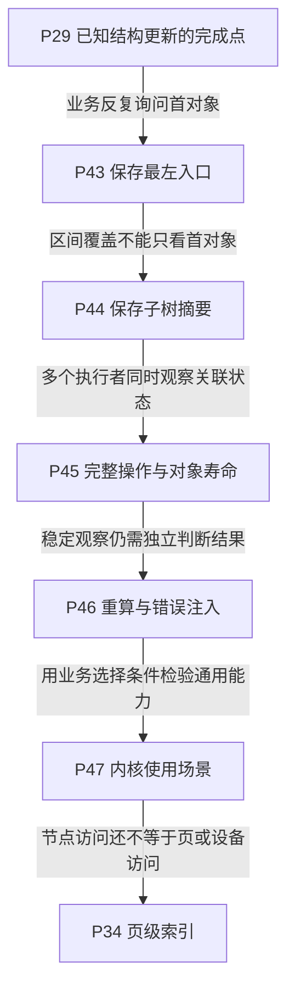

# 第12章\_Linux\_rbtree\_工程扩展的阅读路线

## 12.1\_从结构操作进入工程约束

[P37 调用者框架](P37_构建rbtree调用者接口.md#37.16_运行完整的私有调用者框架)已把对象、计数和失败清理接成程序，后续查询、插入、删除、遍历和同键替换又逐项建立了底层契约。现在回到一组按到期时间排序的任务：若业务反复问“下一件事是什么”，每次都从根重新向左查找是否值得？

### 12.1.1\_本章在\_Linux\_rbtree\_学习路线中的位置

默认路线 P08/P09/P37 → P10/P26 → P11/P27/P28 → P29 已建立类型、业务持有权、更新与返回边界。P28 留下额外缓存与摘要的维护责任；[P29 完成边界](P29_普通旋转与Linux修复的完成边界.md#29.5_回顾与练习)说明回调中间态不等于整轮完成。本章为后续五个单元组织路线，主要追踪三类不同问题：保存一个可直接取得的首节点入口、随子树变化维护摘要，以及在真实读写协议下验证结果。它们不互相替代。

沿下面的阅读地图先解释缓存根的正常与故障过程，再进入子树摘要、并发、调用者回访与独立验证。取首常量时间不等于删除或整个调度操作常量时间；增加一个指针也不表示它自动具有新的并发保证。

### 12.1.2\_本章参照的源码文件

固定版本从[NXP Linux 6.12.20 源码总索引](../../../../research/source_reading/rbtree/navigation/P01_Linux_6.12_rbtree源码阅读索引.md#1.1_固定提交与阅读边界)进入。正文解释为何需要这些状态；实现语句按上游位置在源码层单独展开：

| 上游位置 | 本章的阅读任务 |
| --- | --- |
| include/linux/rbtree_types.h | rb_root_cached 的普通根和最左入口 |
| include/linux/rbtree.h | 缓存取首、插入、删除、替换包装与比较辅助 |
| include/linux/rbtree_augmented.h | 增强回调、旋转时摘要与删除传播 |
| lib/rbtree.c | 通用修复、遍历、替换及无锁下行的说明边界 |

完成正文对应单元后，可以沿[缓存模块导读](../../../../research/source_reading/rbtree/navigation/P08_最左缓存与结构更新导读.md#8.2_沿接入与摘除跟踪C0到C6)观察状态地址，再按需要进入具体实现；不能把当前本地配置或实验分支头当作固定发布证据。

### 12.1.3\_沿新增约束进入五个工程单元

每个单元只增加一种主要观察需求；完整程序、失败反例与解释保留在该单元正文。先读本章定位，再按箭头继续，不需要来回翻找长章中的实验。

| 正文入口 | 已有结论与本单元新增的问题 | 完成后留下的问题 |
| --- | --- | --- |
| [P43 反复取首与最左缓存](P43_反复取首与最左缓存.md) | 普通查找有效，但反复取首重走路径 | 保存一个入口能否帮助区间查询 |
| [P44 区间查询与子树摘要](P44_区间查询与子树摘要.md) | 已有首地址，但缺少整棵子树的范围证据 | 多字段被并发观察时如何保持契约 |
| [P45 完整操作与返回对象的并发保护](P45_完整操作与返回对象的并发保护.md) | 已会维护字段，但一次操作与对象寿命需要保护 | 受保护结果是否真的满足所有不变量 |
| [P46 独立验证树形与派生状态](P46_独立验证树形与派生状态.md) | 已有稳定观察，需独立重算与故障拒绝 | 这些机制各自适用于什么内核负载 |
| [P47 从内核使用场景选择索引](P47_从内核使用场景选择索引.md) | 已建立通用能力，需区分树键与业务选择 | 高度相同是否意味着访问成本相同 |

## 12.2\_本章小结

这条路线将从“第一个对象在哪”走到“某棵子树有没有候选”，再走到“谁能在什么时候读取这些状态”。缓存增加一个首地址，增强树增加每节点摘要；两者都把一部分查询工作移到更新阶段，因此同时增加维护责任。操作返回后排序与颜色正确，还不够证明缓存和摘要正确。

并发把一次更新拆给多个观察者之后，还要分别说明事务范围、比较稳定性、结果寿命与严格缺失的含义。有限向下路径、RCU 发布和父链遍历有不同边界，不能因某个名称带 safe 或 RCU 就合并成一个承诺。完整示例保留在 P37/P27，缓存、增强、双线程复制与有界检查器则各自给出一个可运行的增量。

最后的真实场景说明树只是业务结构的一部分：到期时间、虚拟截止时间、逻辑扇区和 file/fd 复合键分别服务不同问题；资格、期限、就绪与范围属性又为候选附加约束。选型时先写清查询和更新需要什么关系，再比较结构、同步、寿命与测试成本。

这些单元的教材与有限模型并不意味着所有目标模块或子系统已经实测。先进入 P43，依次读完五个单元，再从[P34 页级索引与访问成本](P34_从多路节点到页级索引.md#34.1_高度相同不等于访问成本相同)区分页请求、缓存和存储定位，再沿 P13 进入多路页布局与范围查询；不要把某一层减少的访问次数直接当成端到端性能结论。
