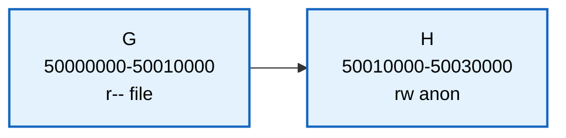
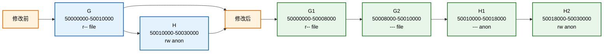
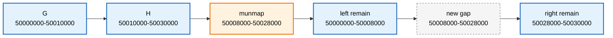

# 第14章\_从地址查询到VMA范围修改

## 14.1\_一个地址为什么需要三种查询

前面已经看到，多路节点可以把更多边界放在一次索引访问附近。但如果查找的不是整数 30，而是进程访问的地址 `0x50012000`，怎样判断它属于哪段映射？如果地址正好落在空洞，应该返回空，还是返回后面最近的一段？准备映射一块新区域时，我们甚至要查找“尚未存对象”的地方。

这些问题属于 **虚拟地址范围管理**。本章以两个相邻区域 G、H 为主线：先区别精确命中、向后查找与范围相交，再观察跨边界改权限和取消映射怎样改变区间。随后在 P48～P50 保持同一组操作，继续比较索引状态、返回保护与选择边界。

阅读依赖是前面的有序树和 [P34 页级索引的成本模型](P34_从多路节点到页级索引.md#34.1_高度相同不等于访问成本相同)。本章用 C++ 顺序容器执行区间语义，不重新实现 Maple Tree；读完应能画出 G/H 修改后的片段、预测边界查询，并通过模型中的地址失效引出下一阶段的对象保护问题。

## 14.2\_先把地址空间和调度任务分开

VMA 是 **Virtual Memory Area，虚拟内存区域**，描述一个进程地址空间中具有一组共同属性的连续虚拟地址。`mm_struct` 是内核保存这个地址空间管理状态的对象；同一进程的多个线程通常共享它。Maple Tree 是范围索引实现的名称，用于把地址范围关联到 VMA。

一次内存访问可能需要查询 VMA；决定当前哪个可运行任务获得 CPU 则属于调度。P50 保留 EEVDF 调度算法的对照，用来划清职责，此时不需要先学完调度器。Maple Tree 也不承担页表翻译、物理页分配或数据预取。

先记住本章只讨论的映射：`虚拟地址范围 → VMA 元数据对象`。VMA 本身与它描述的用户数据页不是同一块内存。

## 14.3\_VMA\_管理的对象是什么

VMA 是 Virtual Memory Area，即虚拟内存区域。

一个 VMA 的 vm_start 字段保存包含式起点，vm_end 字段保存排除式终点，描述进程虚拟地址空间中的一段连续区域：

```text
[vm_start, vm_end)
```

例如：

```text
代码段 VMA；
堆 VMA；
栈 VMA；
mmap 文件映射 VMA；
匿名映射 VMA；
共享库映射 VMA。
```

一个 VMA 本身不是物理页。

它是虚拟地址空间里的元数据对象。

它通常描述：

```text
这段虚拟地址范围从哪里开始，到哪里结束；
这段范围允许读、写、执行哪些权限；
这段范围是匿名映射还是文件映射；
这段范围发生 page fault（缺页或访问保护异常）时应该怎么处理；
这段范围是否能和相邻 VMA 合并。
```

所以 VMA 层主要回答的是：

```text
某个虚拟地址属于哪个 VMA？
某次访问是否符合 VMA 权限？
某段地址范围是否和现有 VMA 重叠？
某段范围能否拆分、合并、扩展或删除？
```

它不是直接回答：

```text
这个虚拟地址最终映射到哪个物理页？
这个物理页是否在内存中？
这个页表项怎么填写？
```

那些问题属于页表、缺页处理和物理内存管理路径。VMA 可关联文件对象及映射操作表 vm_ops，后者给出这类映射需要的处理回调；NUMA（Non-Uniform Memory Access，非一致内存访问）策略涉及在多内存节点机器上如何选分配位置。这些属性帮助处理路径作决定，不表示 VMA 内已经放着全部物理页号。

Maple Tree 优化的是 VMA 范围索引元数据，不是用户数据页本体。

## 14.4\_VMA\_管理为什么适合\_Maple\_Tree

VMA 的核心语义是范围，而不是单点 key。

内核常见 VMA 操作包括：

```text
find_vma(addr)：
	找到包含 addr 或位于 addr 之后的 VMA。

vma_lookup(addr)：
	查找包含 addr 的 VMA。

vma_find(vmi, end)：
	从调用方的迭代器当前位置向后找，end 是排除式上界。

find_vma_intersection(mm, start, end)：
	查找和某个范围相交的 VMA。

mmap：
	选择或使用指定地址建立映射，更新已有范围集合。

munmap：
	删除或拆分一段 VMA 范围。

mprotect：
	修改权限，可能导致 VMA split / merge。

mremap：
	移动、扩展或收缩映射范围。

page fault：
	根据 fault address 快速定位 VMA 并检查权限。
```

这些操作有三个共同点。

第一，它们经常以地址范围为单位。

不是简单地查：

```c
key == x
```

而是查：

```text
addr 是否落在某个 [start, end) 中；
range 是否和已有范围重叠；
从某个地址开始下一个 VMA 是谁；
某段地址区间里有哪些 VMA。
```

第二，VMA 之间天然不重叠。

同一个 `mm_struct` 的 VMA 集合表示一个进程地址空间的各段映射。

这些映射区间不能随意重叠。

第三，VMA 操作经常需要 previous / next 和 range iteration。

比如：

```text
合并时要看前一个和后一个 VMA；
拆分后要调整相邻范围；
查找 unmapped area 时要找空洞；
遍历某段虚拟地址范围时要连续访问多个 VMA。
```

因此，Maple Tree 将这些范围操作放入同一套容器契约。红黑树也能表达这些语义；真正的取舍是哪些信息由调用方维护、哪些由容器维护，以及查询与修改的实际成本。

## 14.5\_贯穿本章的复杂\_VMA\_示例

为了避免后面只停留在概念上，本章先固定一个稍微复杂一点的进程地址空间。

下面固定一张教学地址图。所有范围右端不包含，地址按 4 KiB 对齐；这不是某个真实进程的装载记录，也不假定每种体系结构都使用这套用户地址上限。r/w/x 表示读/写/执行，p 表示私有映射，anon 表示匿名映射；代码段、数据段和库的名字用来说明属性来源。

```text
低地址

0x00400000 ─ 0x00452000  text        r-xp  /bin/app
0x00651000 ─ 0x00657000  data        rw-p  /bin/app
0x01000000 ─ 0x01280000  heap        rw-p  anonymous

0x40000000 ─ 0x40021000  libA text   r-xp  /lib/libA.so
0x40021000 ─ 0x40024000  libA rodata r--p  /lib/libA.so
0x40024000 ─ 0x40028000  libA data   rw-p  /lib/libA.so

0x50000000 ─ 0x50010000  mmap file   r--p  /tmp/data.bin
0x50010000 ─ 0x50030000  mmap anon   rw-p  anonymous

0x7ffde000 ─ 0x80000000  stack       rw-p  grow-down

高地址
```

为了让图更适合后续推演，把这些 VMA 简写为：

```text
A：text
B：data
C：heap
D：libA text
E：libA rodata
F：libA data
G：mmap file
H：mmap anon
I：stack
```

地址空间可以画成：


这个例子里可以推演多种操作。PROT_NONE 是撤去读写执行访问权限的参数；它不会取消映射本身，所以与 munmap 形成空洞不同：

```text
page fault addr = 0x01012000：
	应该命中 heap VMA C。

page fault addr = 0x00460000：
	落在 A 和 B 之间的 gap，不应该命中 VMA。

mprotect 0x50008000-0x50018000，设为 PROT_NONE：
	撤去该段访问权限，跨越 G 后半段和 H 前半段，形成四个属性片段。

munmap 0x50008000-0x50028000：
	可能把 G/H 切掉中间一段，并留下前后残片。

mmap 新区域 size = 0x20000：
	需要查找一个足够大的 unmapped gap。

stack grow：
	需要判断 I 前面的 gap 是否允许栈向低地址扩展。
```

如果使用普通红黑树管理 VMA，树的排序 key 通常是 `vm_start`。

但是上面这些问题真正关心的是：

```text
addr 是否落在 [vm_start, vm_end)；
range 是否和已有 VMA 相交；
range 两侧的 previous / next VMA 是谁；
哪里存在足够大的 gap；
修改一个 range 后会产生几个 VMA 片段。
```

这就是 Maple Tree 更贴合 VMA 的原因。

它不是因为红黑树“不能查”，而是因为 VMA 管理的主要语义不是单点 key，而是非重叠范围集合。

## 14.6\_复杂操作一\_mprotect\_跨两个\_VMA\_时旧模型要维护什么

继续看示例中的两个相邻 VMA：

```text
G：0x50000000-0x50010000  r-- file
H：0x50010000-0x50030000  rw- anon
```

假设执行：

```text
mprotect(0x50008000, 0x10000, PROT_NONE)
```

也就是修改：

```text
0x50008000-0x50018000
```

这个范围跨越了：

```text
G 的后半段；
H 的前半段。
```

修改前：



修改范围：

```text
50008000-50018000
```

假定调用成功、不计后续其他请求，撤去访问权限后的逻辑片段为：

```text
G1：50000000-50008000  r-- file
G2：50008000-50010000  --- file  修改范围内
H1：50010000-50018000  --- anon  修改范围内
H2：50018000-50030000  rw- anon
```

这里 G 原本只读，若仍改为 PROT_READ（允许读），就不能用“G 一定拆分”作推导；改用 PROT_NONE 才同时改变 G 与 H 的属性。G2 与 H1 虽同为无权限，但一个文件映射、一个匿名映射，不因此合并。其他相邻片段能否合并还要看：

```text
权限；
文件映射对象；
偏移；
flags；
anon_vma；
其他 VMA 属性。
```

教学化拆分图：



## 14.7\_复杂操作二\_munmap\_造成前后残片和中间空洞

再看：

```text
G：50000000-50010000
H：50010000-50030000
```

执行：

```text
munmap(0x50008000, 0x20000)
```

也就是删除：

```text
50008000-50028000
```

删除前：

```text
G + H 覆盖 50000000-50030000
```

删除后：

```text
50000000-50008000  保留，G 前半段
50008000-50028000  空洞
50028000-50030000  保留，H 后半段
```

图示：



这个例子里，VMA 管理真正关心的是：

```text
删除范围与哪些 VMA 相交；
每个相交 VMA 是被完整删除、切掉前半段、切掉后半段，还是被一分为二；
删除后形成的新 gap 能否被后续 mmap 使用；
前后相邻 VMA 是否可以合并。
```

Maple Tree 可维护取消映射后的空区间，但拆分 VMA、处理页表和回收映射资源仍由 mm 路径完成。索引容器不能独自执行整个 munmap。

## 14.8\_运行G与H的区间模型

现在先预测三个结果：查询共同边界属于谁；在 G 前面一个地址调用精确查询和向后查询会不会相同；取消中间 `0x20000` 字节后，留下哪两段。

下面是完整 C++17 程序，材料为 [vma_range_model.cpp](../../../../labs/kernel/tree_basics/materials/vma_range_model.cpp)。它用有序 vector 保存半开区间，以顺序扫描刻意隔离“查询契约”与“树的实现”。权限值 1 表示读、2 表示写、3 表示读写、0 表示无访问权限；owner 只区分 G/H 来源，不是完整文件偏移或匿名映射状态。

程序的查询返回 vector 内对象地址，仅在容器未修改时可用。protect 与 unmap 构造新的片段后替换容器，旧地址随之失效；这与真实内核 VMA 的分配方式不同，但可以直接提醒我们：查到指针和取得长期使用权是两件事。protect 的“范围必须全覆盖，否则一点不改”是本模型的契约，不宣称 Linux mprotect 对所有失败都提供相同回滚保证。

```cpp
#include <algorithm>
#include <cassert>
#include <cstdint>
#include <iomanip>
#include <iostream>
#include <optional>
#include <utility>
#include <vector>

using address = std::uint64_t;

struct region {
    address start;
    address end;
    unsigned permissions;
    char owner;
};

class range_map {
public:
    std::vector<region> regions;

    // 输入是有效、递增且不重叠的半开区间；空洞没有对象。
    explicit range_map(std::vector<region> input) : regions(std::move(input)) {
        for (std::size_t i = 0; i < regions.size(); ++i) {
            assert(regions[i].start < regions[i].end);
            assert(i == 0 || regions[i - 1].end <= regions[i].start);
        }
    }

    const region* lookup(address index) const {
        for (const auto& item : regions)
            if (item.start <= index && index < item.end)
                return &item;
        return nullptr;
    }

    const region* find(address index) const {
        for (const auto& item : regions)
            if (index < item.end)
                return &item;
        return nullptr;
    }

    const region* intersection(address start, address end) const {
        if (start >= end)
            return nullptr;
        const auto* item = find(start);
        return item && item->start < end ? item : nullptr;
    }

    // 仅寻找给定窗口内最低的连续空洞，不模拟对齐和栈保护间隔。
    std::optional<address> gap(address low, address high, address length) const {
        if (low >= high || length == 0 || length > high - low)
            return std::nullopt;
        address cursor = low;
        for (const auto& item : regions) {
            if (item.end <= cursor)
                continue;
            if (item.start >= high)
                break;
            if (item.start > cursor && length <= item.start - cursor)
                return cursor;
            cursor = std::max(cursor, item.end);
            if (cursor >= high)
                return std::nullopt;
        }
        return length <= high - cursor ? std::optional<address>(cursor)
                                       : std::nullopt;
    }

    // 修改已有映射；要求全部覆盖才修改，这是教学模型自己的失败契约。
    bool protect(address start, address end, unsigned permissions) {
        if (start >= end)
            return false;
        address cursor = start;
        for (const auto& item : regions) {
            if (item.end <= cursor)
                continue;
            if (item.start > cursor)
                return false;
            cursor = std::min(end, item.end);
            if (cursor == end)
                break;
        }
        if (cursor != end)
            return false;
        rewrite(start, end, permissions, false);
        return true;
    }

    void unmap(address start, address end) {
        if (start < end)
            rewrite(start, end, 0, true);
    }

private:
    void rewrite(address start, address end, unsigned permissions, bool erase) {
        std::vector<region> next;
        for (const auto& item : regions) {
            if (end <= item.start || item.end <= start) {
                next.push_back(item);
                continue;
            }
            if (item.start < start)
                next.push_back({item.start, start, item.permissions, item.owner});
            if (!erase)
                next.push_back({std::max(start, item.start), std::min(end, item.end),
                                permissions, item.owner});
            if (end < item.end)
                next.push_back({end, item.end, item.permissions, item.owner});
        }
        // 为了直接观察切分保留相邻片段，不模拟 Linux 的合并条件。
        regions.swap(next);
    }
};

static void show(const range_map& map) {
    for (const auto& item : map.regions)
        std::cout << item.owner << " [" << std::hex << item.start << ','
                  << item.end << ") permissions=" << item.permissions << '\n';
}

int main() {
    const std::vector<region> original{
        {0x50000000, 0x50010000, 1, 'G'},
        {0x50010000, 0x50030000, 3, 'H'}
    };
    range_map map(original);
    assert(map.lookup(0x50010000)->owner == 'H');
    assert(map.lookup(0x4fffffff) == nullptr);
    assert(map.find(0x4fffffff)->owner == 'G');
    assert(map.intersection(0x4fff0000, 0x50000000) == nullptr);
    assert(map.intersection(0x4fff0000, 0x50000001)->owner == 'G');
    const bool protected_all = map.protect(0x50008000, 0x50018000, 0);
    assert(protected_all);
    std::cout << "protect:\n";
    show(map);
    map = range_map(original);
    map.unmap(0x50008000, 0x50028000);
    std::cout << "unmap:\n";
    show(map);
    const auto vacant = map.gap(0x50000000, 0x50030000, 0x20000);
    assert(vacant && *vacant == 0x50008000);
    std::cout << "gap=" << std::hex << *vacant << '\n';
    return 0;
}
```

在材料目录编译运行；命令中的 g++ 指 C++ 编译器，不需要 Python：

```bash
g++ -std=c++17 -Wall -Wextra -Werror -pedantic vma_range_model.cpp -o vma_range_model
./vma_range_model
```

预期输出：

```text
protect:
G [50000000,50008000) permissions=1
G [50008000,50010000) permissions=0
H [50010000,50018000) permissions=0
H [50018000,50030000) permissions=3
unmap:
G [50000000,50008000) permissions=1
H [50028000,50030000) permissions=3
gap=50008000
```

第一次操作保留四片；重置到原 G/H 后再取消中段，剩两片。区间切分沿着原对象逐个求交：左残片继承原属性，中段改变权限或删除，右残片继续继承；未相交的对象原样保留。这也解释了为何只调用一次容器“写入范围”不能包办 Linux 的 VMA 分裂、文件偏移、页表和对象回收。

空洞查找先排除长度为零或超出窗口的请求，用 `length <= high-cursor` 判断容纳关系，避免先做 `cursor+length` 溢出。程序不模拟对齐、栈保护间隔、随机化、节点分裂、空洞汇总或并发，它的线性时间不能拿来测量 Maple Tree 性能。

动手改三处，再解释结果：

1. 把取消映射上界设为 `0x50010000`：H 应完整留下，边界查询仍命中 H。
2. 在 G 与 H 之间制造空洞，再让 protect 横跨它：本模型应返回 false 且保持原片段；Linux 系统调用的错误/回滚行为需另做目标验证。
3. 把 gap 请求长度增加 1：现有中间空洞不够，窗口内应找不到结果。若增大 high，尾部空洞可能再次成为候选，不是“树查询失败后永远没有空间”。

---

下一单元：[P48 从VMA辅助索引到Maple范围节点](P48_从VMA辅助索引到Maple范围节点.md)。
