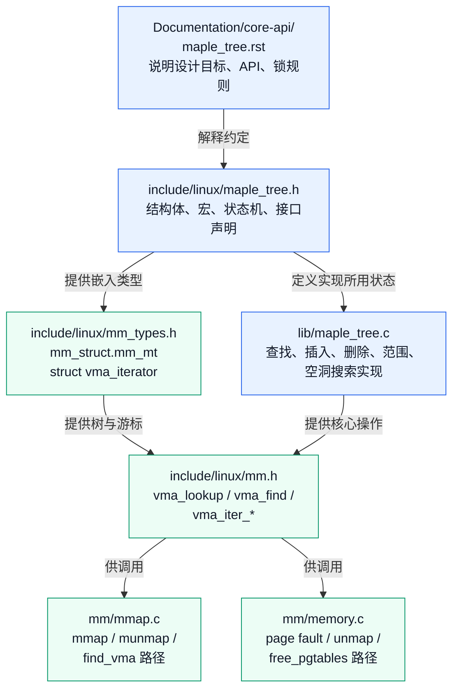
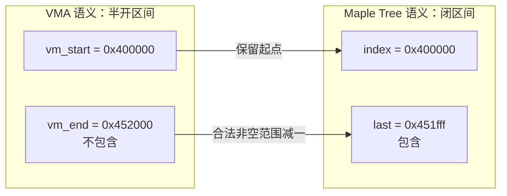
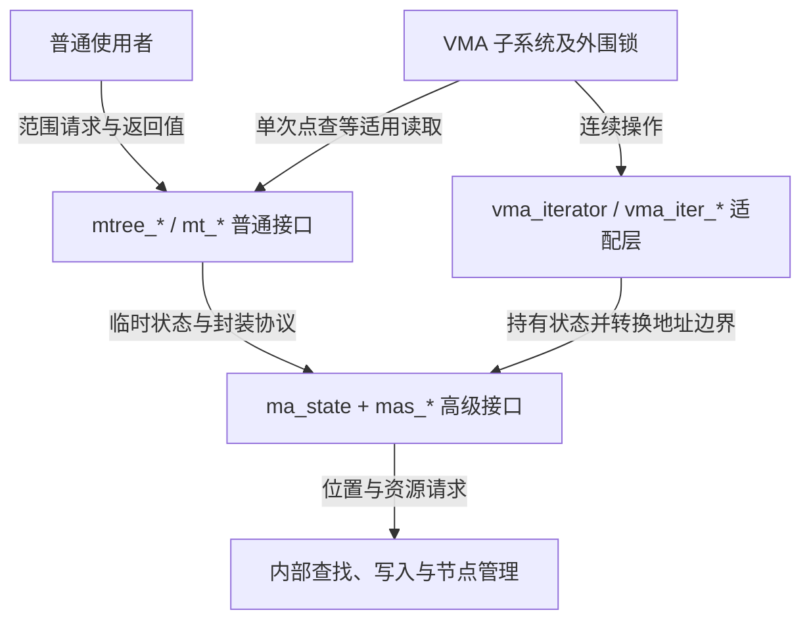
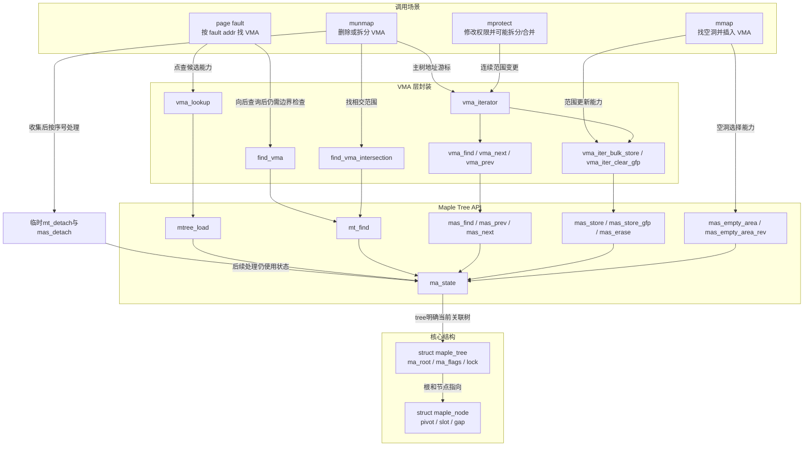

# 第15章\_Maple固定实现的阅读路线

P14 用 G、H 两段 VMA 说明：地址命中、向后找对象和查找相交范围是不同的问题。P13 又说明多路节点只是承载方式，不能由树名推断对象位置和并发保证。现在进入固定版本，追问这些范围在哪里保存、调用者维护什么状态、返回对象能用多久。

本章有三层参与者：地址空间拥有共享 mm_mt，Maple 管理内部节点，调用方用 ma_state 或 vma_iterator 保存一次操作的游标。VMA 是被索引的独立对象。先区分这些所有者，再阅读普通接口、高级接口和 VMA 封装，才能判断某个字段属于树、当前操作，还是业务对象。

证据统一进入[Maple 源码阅读索引](../../../../research/source_reading/maple_tree/navigation/P01_Linux_6.12_Maple范围源码阅读索引.md#1.2_按读者问题进入证据)：NXP 官方 linux-imx，Linux 6.12.20，标签 lf-6.12.20-2.0.0，固定提交 dfaf2136deb2af2e60b994421281ba42f1c087e0。本文不以本地实验提交解释内核行为。正文建立职责和因果关系，具体宏、字段与函数体沿上游路径进入唯一实现标题；仓库补充的中文说明与上游原文分别标识。

## 15.1\_本章涉及的源码文件

面对“查一个地址”的任务，先不从几千行算法开头顺读。由调用者一路向内追踪：VMA 封装选择查询契约，普通或高级 API 进入共享树，节点编码与游标决定如何下行。遇到初始化或释放问题时，再回到树建立与退出的调用环境。

| 上游位置 | 带着什么问题阅读 |
| --- | --- |
| [Documentation/core-api/maple_tree.rst](../../../../research/source_reading/linux/Documentation/core-api/maple_tree.rst) | 存储的范围、空洞模式、普通/高级 API 和调用者锁责任是什么 |
| [include/linux/maple_tree.h](../../../../research/source_reading/linux/include/linux/maple_tree.h) | 共享根、节点类型、操作状态和模式位保存在哪里 |
| [lib/maple_tree.c](../../../../research/source_reading/linux/lib/maple_tree.c) | 怎样读取、写入、查空洞，以及管理节点资源 |
| [include/linux/mm_types.h](../../../../research/source_reading/linux/include/linux/mm_types.h) | mm_mt 属于哪个 mm，vma_iterator 封装什么 |
| [include/linux/mm.h](../../../../research/source_reading/linux/include/linux/mm.h) | VMA 封装怎样选择查询语义、翻译半开端点 |
| [mm/mmap.c](../../../../research/source_reading/linux/mm/mmap.c) | 查找、映射和退出过程怎样组织范围容器与锁 |
| [mm/memory.c](../../../../research/source_reading/linux/mm/memory.c) | 缺页、解除映射和页表释放为什么需要定位 VMA |
| kernel/fork.c | mm_init 怎样初始化 mm_mt 并登记外部 mmap_lock；固定 blob 见源码基线 |



这张文件图中的连线表示阅读和使用关系，不代表这些文件中的所有函数都在一次查找中执行。算法路线先读官方契约，再读头文件状态与核心算法；VMA 路线先看 mm 的所有权和封装，再追具体调用点。两条路线在 Maple API 汇合，而不是彼此独立的两套范围树。

本章组织根、节点、编码、游标、接口与 VMA 调用的阅读问题。共享树根的对应实现入口是[树模式与初始化导读](../../../../research/source_reading/maple_tree/navigation/P03_树对象与模式选择.md#3.2_从未发布到受保护使用)，先把外层的读写责任建立起来。


### 15.1.1\_沿共享状态与调用责任前进

先按下表的依赖顺序读正文，再由每个单元的源码入口核对具体宏和函数；返回本路线可以查看接口和场景总图。

| 阅读单元 | 承接的问题与新增结论 | 后续问题 |
| --- | --- | --- |
| [P51 共享树根](P51_共享树根怎样确定表示与保护模式.md) | 同一地址空间共享根，根表示与模式决定外层责任 | 一个节点怎样划分范围 |
| [P38 节点与空洞](P38_Maple节点中的范围与空洞.md) | NULL 分区、pivot/slot 与 gap 汇总 | 存在字段里的值怎样解码 |
| [P52 字段编码](P52_按字段区分Maple编码与错误状态.md) | 节点类型、父槽、根父关系、载荷和错误各有格式 | 一次操作怎样保留位置 |
| [P39 操作游标](P39_Maple操作游标的暂停与继续.md) | 状态、暂停与继续的完整周期 | 普通封装替调用者做了什么 |
| [P40 普通接口](P40_Maple普通接口中的范围与查询.md) | 范围覆盖、条件插入与返回边界 | 写入资源怎样预先准备 |
| [P41 写入准备](P41_Maple写入准备与锁边界.md) | 位置、资源、重试与清理分开 | VMA 调用者怎样传请求 |
| [P53 VMA 适配](P53_VMA游标怎样翻译范围请求.md) | 共享 mm、局部游标与半开边界转换 | 同一地址怎样得到不同查询结果 |
| [P54 四种查询](P54_同一地址的四种VMA查询结果.md) | 点查、向后、相交与前驱各自的输出 | 得到对象后怎样组织撤销 |
| [P42 两棵树](P42_撤销映射中的两棵Maple树.md) | 地址主树与序号临时树分工 | 完整动态算法及目标运行仍需独立研究 |

## 15.2\_从官方文档先抓住\_Maple\_Tree\_的语义

Maple Tree 为非重叠范围提供索引。这里的“非重叠”约束的是同一位置最终对应的映射，**不表示所有重叠写入都会失败**。普通 store 可以覆盖已有映射；要求目标全为空再接入时，应选择 insert 类接口并处理其失败。具体更新分支稍后再读，本节先限定数据模型。

红黑树通常由调用方比较业务键，从一条键找到一个对象；Maple 则把索引范围直接纳入接口，可以用 `[start,last] → entry` 表示。一个 entry 可以是 VMA 指针，也可以是其他允许的值，Maple 不是只为 VMA 定义的结构。查询得到 VMA 仍不等于已经找到物理页，也不等于已获准访问相应内存。

VMA 使用半开范围 `[vm_start,vm_end)`；<span style="color:red;">Maple Tree 内部使用的是闭区间</span>。对于已确认非空且端点合法的 VMA，写入范围是 `[vm_start,vm_end-1]`。例如 `[0x400000,0x452000)` 对应 `[0x400000,0x451fff]`：0x451fff 属于这段，0x452000 不属于。



减一的前提必须放在动作之前。空半开范围没有最后一个元素，end 为 0 时无符号减一会回绕；反过来，Maple 允许的闭上界 ULONG_MAX 也不能无条件加一转换。VMA 封装依赖调用方提供合法边界，不能把接口中的 end−1 当成输入合法性检查。

| 层次 | 典型入口 | 谁负责什么 |
| --- | --- | --- |
| 普通接口 | mtree_load、mtree_store_range、mtree_erase、mt_find | 封装常见查询和修改，按约定管理内部操作状态及相应同步；返回对象的后续保护仍属调用者 |
| 高级接口 | MA_STATE、mas_walk、mas_store、mas_find、mas_empty_area、mas_pause | 调用者持有 ma_state、选择有效锁或 RCU 读侧条件、处理状态和资源边界 |
| VMA 接入 | vma_lookup、vma_find、vma_next、vma_iter_* | 选择地址空间的树，把 VMA 问题和半开范围翻译为 Maple 操作 |

高级接口需要承担更多责任，不是默认“越高级越应该用”。一次简单点查可以使用普通接口；要在同一保护范围内连续走多个对象、预分配节点，或在批量修改之间保留游标时，显式状态才有价值。普通与高级操作可以组合，但锁契约必须相容，不能把普通修改函数再套进同一把不可重入内部锁而不查它是否自行加锁。

P14 的 mmap 空洞、mprotect 切分、munmap 删除以及缺页定位，使 VMA 接入需要这些不同能力。RCU 模式允许树在特定条件下支持读写并发，写者仍须串行化；游标、内部节点寿命和 VMA 属性保护各自有责任。普通查询内部的一段 RCU 读侧不会给返回对象自动增加长期引用，相关说明见[返回指针期限](../../../../research/source_reading/maple_tree/navigation/P02_范围契约与查询入口.md#2.4_返回指针的使用期限)。

可以回到[P14 完整 C++ 区间程序](P14_从地址查询到VMA范围修改.md#14.8_运行G与H的区间模型)，先预测查询 G 的末地址、排除终点和 G 前空洞各自得到什么，再运行对照。该程序验证范围契约，不运行 Maple API，也不测试 RCU；下一步要把已经明确的契约落到树对象，而不是用宿主容器替换源码证据。

## 15.3\_struct\_maple\_node\_真正装\_pivot\_和\_slot\_的节点

共享根建立后，下一步是解释一个节点怎样划分地址、空洞在哪里、类型和构建条件怎样限制容量。这个问题已经拆为完整的[P38 节点与空洞](P38_Maple节点中的范围与空洞.md#38.1_从一个共享根继续向下)，保留原七个 VMA 的全部边界和间隔，并用 C++ 分区程序观察包含式 pivot。

阅读顺序是：先补齐 VMA 之间的 NULL 槽，再区分叶 entry 与非叶孩子入口；由找洞请求推导 gap 摘要的收益与维护责任，最后核对 32/64 位构建条件、union 和元数据的实际存储。具体定义只在[固定节点布局](../../../../research/source_reading/maple_tree/source_explanations/include/linux/maple_tree.h.md#1.6_构建条件决定数组容量)展开，原图中遗漏空洞的关系已在新单元修正。

完成 P38 后进入 [P52 字段编码](P52_按字段区分Maple编码与错误状态.md)，继续判断一个编码地址到底包含哪种信息。不要由 _64 名字推断 unsigned long 的宽度，也不要把数组容量当作每个节点的有效孩子数。

## 15.4\_struct\_ma\_state\_Maple\_Tree\_高级\_API\_的状态机

字段编码分清以后，还需要把一次操作串起来：谁拥有 index/last，暂停前后哪些字段保留，下一次调用从哪里继续？完整单元进入[P39 暂停与继续](P39_Maple操作游标的暂停与继续.md#39.1_从查一个对象走到继续遍历)，保留原结构、初始化和状态名称的教学责任，并用 S0～S6 与私有模块观察差别。

ma_state 是多组正交状态，不能由一个 status 名称推断所有字段；pause 与 reset 不等价，NULL 返回也不唯一对应 overflow。原状态图已经按固定入口修正到 P39，具体字段、宏与函数只在[游标源码模块](../../../../research/source_reading/maple_tree/navigation/P06_操作游标与暂停继续.md#6.2_沿一次遍历追踪状态)关联的实现标题展开。

读完 P39 后继续 P40 的普通接口，再在 P53/P54 用边界和八段地址图核对 VMA 查询；不要把高级游标的完整字段契约外推给普通查询的内部临时状态。

## 15.5\_普通\_API\_mtree\_*()\_和\_mt\_*()

普通接口在内部建立临时 ma_state，让调用者主要面对范围、返回值与业务对象所有权。完整单元进入[P40 范围与查询](P40_Maple普通接口中的范围与查询.md#40.1_从保存一个范围到选择操作契约)，以同一棵私有树观察覆盖、条件插入、清除和终止游标。

### 15.5.1\_mtree\_load()\_精确点查找

点查只返回覆盖当前索引的普通可见 entry，不跳到后面的对象。内部 RCU 读侧在返回前结束，业务对象的使用期需要外围协议。见[P40 点查](P40_Maple普通接口中的范围与查询.md#40.3.1_点查只回答当前索引)；vma_lookup 的固定函数体统一见[mm.h 实现](../../../../research/source_reading/maple_tree/source_explanations/include/linux/mm.h.md#1.2_vma_lookup只查询当前地址)。

### 15.5.2\_mtree\_store\_range()\_范围写入

范围 store 允许覆盖，insert 要求整段没有已有值；普通写封装直接使用 ma_lock，不能自动代替外部锁模式的协议。具体示例见[P40 覆盖政策](P40_Maple普通接口中的范围与查询.md#40.2_同一棵树中的覆盖与拒绝覆盖)，固定封装见[写入与擦除](../../../../research/source_reading/maple_tree/source_explanations/lib/maple_tree.c.md#1.11_普通写入与整段擦除)。rbtree 由业务自己比较并定位，Maple 则提供闭区间更新契约，这项职责差别仍然成立。

### 15.5.3\_mt\_find()\_从某点向后找第一个\_entry

向后查询可以跳过空洞，成功把游标推进到命中范围 last+1；max 不裁剪对象范围，ULONG_MAX 后的回绕由后续 mt_find_after 检查。原 [100,199] 命中后游标变为 200 的例子是这个规则的普通情形；见[P40 查询表和边界](P40_Maple普通接口中的范围与查询.md#40.3.2_向后查会跳过空洞)。

## 15.6\_高级\_API\_mas\_*()\_是真正的状态机接口

[P40](P40_Maple普通接口中的范围与查询.md#40.5_内部封装在哪里结束)已经区分普通封装与调用者责任。高级接口把 ma_state 保留在调用者手中，用于连续查询，也允许将可失败的资源准备与真正写入分开；它不自动建立外围同步。先进入[P41 写入准备与锁边界](P41_Maple写入准备与锁边界.md#41.1_为什么一次写入还需要准备阶段)，沿 S0～S5 和完整外部锁模块观察准备、取消、兑现与清理。

以下保留常用入口声明，作为已理解职责后的查询表；声明来自固定[maple_tree.h](../../../../research/source_reading/linux/include/linux/maple_tree.h)，不把函数名目录当作学习起点。

```c
void *mas_walk(struct ma_state *mas);
void *mas_store(struct ma_state *mas, void *entry);
void *mas_erase(struct ma_state *mas);
int mas_store_gfp(struct ma_state *mas, void *entry, gfp_t gfp);
void *mas_find(struct ma_state *mas, unsigned long max);
void *mas_find_range(struct ma_state *mas, unsigned long max);
void *mas_find_rev(struct ma_state *mas, unsigned long min);
void *mas_next(struct ma_state *mas, unsigned long max);
void *mas_prev(struct ma_state *mas, unsigned long min);
int mas_empty_area(struct ma_state *mas, unsigned long min,
		   unsigned long max, unsigned long size);
int mas_empty_area_rev(struct ma_state *mas, unsigned long min,
		       unsigned long max, unsigned long size);
```

| 任务 | 接口 | 选择前应明确的问题 |
| --- | --- | --- |
| 当前定位 | mas_walk | 由输入 index 定位，返回时范围字段按命中结果改变；见 P39 |
| 向后找值或走范围 | mas_find、mas_find_range | 第一次是否包含当前位置；range 变体后续可访问空范围，不能把任意 NULL 当遍历结束 |
| 反向遍历 | mas_find_rev、mas_prev | 包含当前项还是前一个，以及下界；后续源码单元分别处理 |
| 写入 | mas_store、mas_store_gfp、mas_store_prealloc | 返回旧 entry、整数结果还是依赖预先准备；详见 P41 |
| 擦除 | mas_erase | 删除的是命中整段，业务对象寿命另行负责 |
| 空洞搜索 | mas_empty_area、mas_empty_area_rev | allocation tree 中按哪个方向、窗口和 size 找空洞 |
| 资源准备 | mas_preallocate、mas_expected_entries | 单次写入准备与有序批量填充是不同任务 |
| 状态与资源 | mas_pause、mas_reset、mas_destroy | 暂停、重新定位与资源清理不可互换；分别见 P39/P41 |



保留这张分层图是为了区分谁构造状态、谁持有锁、谁转换地址语义；不能把 VMA 到普通接口的箭头理解为任意普通写入都适用于外部锁树。vma_find 复用 vmi->mas 调用 mas_find，并转换半开上界，固定函数只在[mm.h 唯一标题](../../../../research/source_reading/maple_tree/source_explanations/include/linux/mm.h.md#1.4_VMA查找复用高级游标)展开。读完 P41 后进入 [P53 VMA 适配](P53_VMA游标怎样翻译范围请求.md)，再到 [P54 查询对照](P54_同一地址的四种VMA查询结果.md)，将请求、状态和锁放回真实 mm/VMA 调用者。

## 15.7\_page\_fault\_unmap\_free\_pgtables\_为什么也会碰\_Maple\_Tree

查到对象只是工作的入口。缺页、权限变更、撤销映射和页表清理分别需要哪些 VMA 信息，仍按下表区分；这些是场景职责，不表示所有路径都直接调用同一个短包装。

| 路径 | 为什么需要 VMA |
| --- | --- |
| page fault | fault 地址是否合法？权限是否允许？是匿名页、文件映射、栈增长还是特殊映射？ |
| `munmap()` | 删除范围内有哪些 VMA？是否要拆分边界 VMA？ |
| `mprotect()` | 修改权限的范围覆盖哪些 VMA？是否需要拆分、合并？ |
| `free_pgtables()` | 释放页表时需要按 VMA 边界遍历 |
| `unmap_vmas()` | 解除映射时要逐段处理 VMA |

完整 E/F/G 部分撤销场景已进入[P42 两棵树](P42_撤销映射中的两棵Maple树.md#42.2_保留原来的E与F与G场景)，原全部地址边界和保留结果不丢失。关键增量是：主树 mm_mt 按地址索引，临时 mt_detach 按处理序号保存待撤销对象，清主树后还要完成页表、对象与临时索引的退出。

free_pgtables 与 unmap_vmas 的完整固定签名和函数分别见[页表释放](../../../../research/source_reading/maple_tree/source_explanations/mm/memory.c.md#1.3_释放页表与上界哨兵)及[映射清除](../../../../research/source_reading/maple_tree/source_explanations/mm/memory.c.md#1.2_解除映射与继续遍历)，通过[撤销模块](../../../../research/source_reading/maple_tree/navigation/P10_撤销范围与临时索引.md#10.2_两棵树沿S0到S5分工)关联调用方。ma_state 的 tree、索引单位、首项参数与搜索上界必须一起看；exit_mmap 与对齐 munmap 传入的树并不相同。

P42 的 S0～S5 还解释失败恢复为何不承诺逆转所有拆分、页表 ceiling=0 为什么有该接口明确允许的哨兵含义，以及普通半开请求不能照搬该约定。读完后回到下一节，把局部协议放进职责总图。

## 15.8\_ma\_state\_和\_VMA\_iterator\_的一张总图

把前面的内容合并，可以得到下面的职责地图。场景到接口的箭头表示需要哪类能力，不声明每条边都是当前版本的一次直接 C 调用；真实调用点和条件分支以关联模块为准。



这张图里最重要的关系是：

```text
VMA 不是绕过 Maple Tree API 直接操作节点。
VMA 主要通过 vma_iterator / vma_iter_* 把 VMA 半开区间翻译成 Maple Tree 闭区间，
然后交给 ma_state / mas_* 状态机。
```

## 15.9\_这一章没有展开的内容

现在已经有真实存在的节点布局、字段编码、游标、普通接口、写入资源和撤销场景单元。完整内部算法仍有边界，不能因为所有接口都能定位，就宣称动态实现已讲完。

| 继续研究的问题 | 本轮已有基础 | 仍未由本章证明的部分 |
| --- | --- | --- |
| 节点搜索 | [P38 pivot 与范围](P38_Maple节点中的范围与空洞.md)、[P39 游标](P39_Maple操作游标的暂停与继续.md) | 内层搜索完整分支与失效节点重试证明 |
| 写入与删除 | [P40 契约](P40_Maple普通接口中的范围与查询.md)、[P41 资源](P41_Maple写入准备与锁边界.md) | store_type 分类、split、合并/再平衡与跨节点覆盖 |
| 空洞选择 | P38 的 gap 分区与窗口模型 | gap[] 动态更新、mmap 的 bottom-up/top-down 选择及对齐规则 |
| 资源与并发 | P41 的准备/重试/清理与已核对 RCU 模式 | maple_alloc 完整资源链及 RCU 删除节点的全部延迟释放过程 |
| MM 完整修改 | [P42 两棵树](P42_撤销映射中的两棵Maple树.md) | mmap/munmap/mprotect 的全部拆分、合并、通知和页表底层 |

旧文为这些未落地主题预留的“第16～19章”与本专题现有章节冲突，现以问题边界和真实链接表达，不再把未来设想伪装成可读章节。继续阅读从[源码总索引](../../../../research/source_reading/maple_tree/navigation/P01_Linux_6.12_Maple范围源码阅读索引.md#1.2_按读者问题进入证据)选择已经落地的模块；未展开内容保留为研究任务，不用不存在的链接填空。

## 15.10\_本章小结

本章沿树根、节点、编码、操作状态、接口与 VMA 建立了源码位置感，完整单元分别在 P38～P42 与 P51～P54 中兑现。共享 maple_tree 保存根与模式；节点用 pivot/slot 表达包含式范围，容量依类型和构建条件；ma_state 由范围、位置、状态和资源等正交信息组成，不能看一个枚举就猜完所有结果。

普通接口常创建临时状态，高级接口把连续位置和更多协议交给调用者。VMA 适配层把半开边界转成闭区间，但不代替有效输入、外围锁和对象寿命。点查、向后查、相交和前驱分别回答不同问题；进入撤销场景后，还必须区分地址主树与序号临时树。

回顾时先尝试解释这些变化：

1. 为什么节点数组里必须表示空洞，pivot 不能被当成普通 B-Tree 的唯一记录键？
2. 一个指针的低位属于节点编码、父关系还是业务 entry，应该先看哪个字段？
3. pause 与 reset 都可能清 node，为什么下一次 find 仍可能得到不同结果？
4. 预分配成功、补分配要求重试、范围已经发布，分别属于哪个阶段？
5. 主树清除后还要处理哪棵树？这时 index=1 是地址还是序号？

核对方向分别是 P38 的范围分区、P52 的字段归属、P39 的继续规则、P41 的资源阶段和 P42 的待处理集合。能够沿这些状态解释行为，才比记住函数名多走了一步；本章的源码地图也不等于已经运行目标内核中的全部并发、分裂和回收路径。
