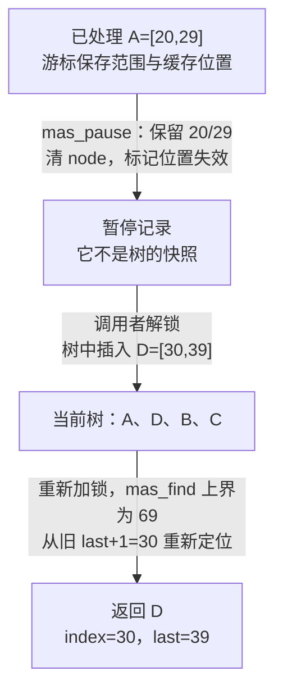
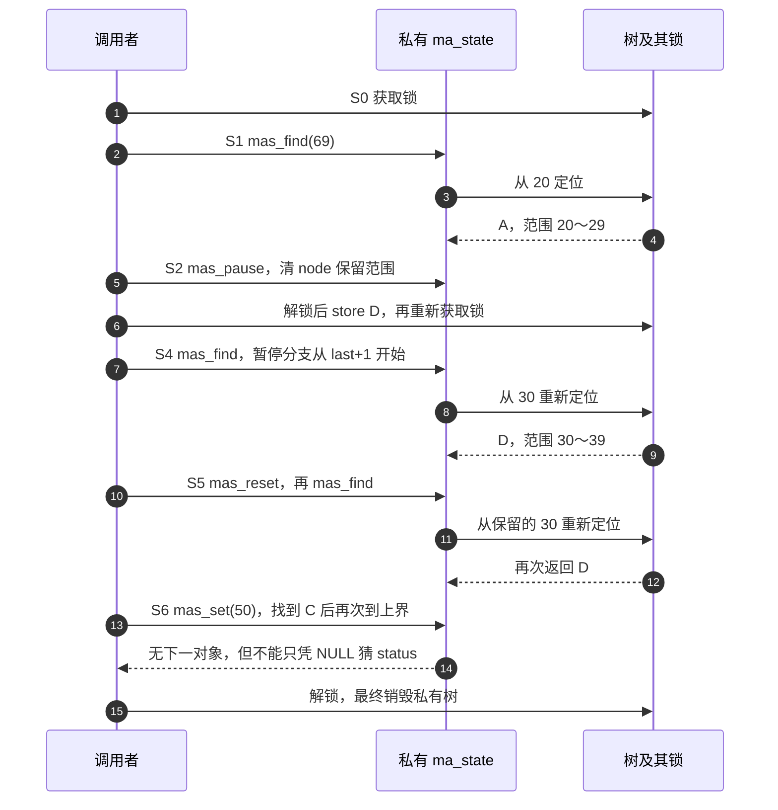
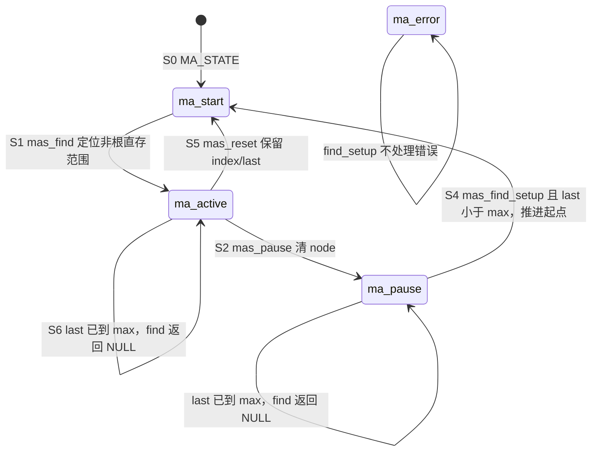

# 第39章\_Maple操作游标的暂停与继续

## 39.1\_从查一个对象走到继续遍历

[上一单元的范围分区](P38_Maple节点中的范围与空洞.md#38.2_先把空洞也放进范围分区)已经说明：一个 entry 可以覆盖多个索引，空洞也属于分区；P15 编码单元又区分了节点地址与操作状态。现在把问题从“索引 20 对应谁”改成“从 20 到 69，依次处理每个非空范围”。一次点查的答案已经不够，因为调用者还要知道下一轮从哪里接着走。

用一组小整数固定现场：A 覆盖闭区间 [20,29]，B 覆盖 [40,49]，C 覆盖 [60,69]。先查到 A 以后，如果仍从 20 做点查，会再次得到 A；若只把查询索引加一变成 21，也仍在 A 的范围内。我们要记住的是 **刚处理范围的末端 29**，这样才知道下一次应越过整个 A，而不是只越过它的第一个索引。

还可以记住当前所在的树节点与槽位，让连续操作从已知位置继续，而不总是重新从根寻找。但这引出本章的第二个问题：如果为了处理结果暂时解锁，期间树变了，原节点和槽位还能用吗？“继续遍历”既需要记住逻辑进度，又要知道缓存位置是否仍可信。

Maple 的 `ma_state` 结构体承担这份调用者操作记录，本章称它为游标。树入口保存在 mm_mt 等 `maple_tree` 对象中，节点和 entry 由各自协议管理；游标不复制整棵树，也不是树自己的全局进度。两位调用者可以关联同一棵树、分别扫描不同位置，但不能未经同步共用同一个可变游标。

下面先从上述两个问题推出应保存什么，再比较暂停与重置，最后用同一组范围运行完整私有模块。源码版本沿[Maple 总索引](../../../../research/source_reading/maple_tree/navigation/P01_Linux_6.12_Maple范围源码阅读索引.md#1.2_按读者问题进入证据)进入，[游标模块](../../../../research/source_reading/maple_tree/navigation/P06_操作游标与暂停继续.md#6.2_沿一次遍历追踪状态)定位具体实现。

## 39.2\_为什么保留范围却要放弃节点位置

先在有效保护下找到 A。游标的 `index/last` 记录本次结果的闭范围 20/29，`node` 与槽位记录算法当前的位置。二者回答不同问题：范围告诉调用者“处理到了哪里”，位置帮助下一次算法“从树的哪里继续”。只记指针会丢失业务进度，只记索引则无法表达缓存路径是否可继续使用。

如果遍历始终处于适当保护内，后续操作可以依据有效位置前进。本章使用树锁，让修改与高级遍历按同一保护协议串行。若调用者需要让出锁，修改路径就可能插入范围、移动槽位、替换甚至退休旧节点。重新拿锁只能保护 **当前的树**，不能让游标里以前缓存的节点位置自动重新有效；锁本身也不会改写调用者栈上的 ma_state。

因此必须在交出保护之前标明“下次不要沿用这个节点位置”，同时保留已经完成的范围。`mas_pause` 做的正是这件事：清空 node，把 status 改为 `ma_pause`，保留 index/last。它没有执行解锁；调用者随后自己解锁，继续之前自己重新建立保护。

恢复后要做什么，取决于接下来的操作。本章使用的 `mas_find` 是有上界的向后非空查询：遇到 pause 时，先判断原 last 是否已到上界；尚未到达才从 last+1 重新定位。因此，原来处理完 A 后暂停，恢复时从 30 开始。在这期间若插入 D=[30,39]，应该看到新 D，而不是机械跳到暂停前已知的 B。



这里的代价是放弃缓存位置并重新定位，换取在保护间断后按已处理边界继续的明确语义。它没有保存变化前的对象列表；若新范围跨过旧末端，返回对象甚至可能同时覆盖已经经过的索引。需要固定快照、每个对象恰好处理一次或解锁后仍持有结果对象时，必须另有快照、身份记录或对象持有协议，pause 不提供这些保证。

那 `mas_reset` 为什么不是 pause 的另一种拼法？它同样清 node，却把 status 设为 `ma_start`。随后 mas_find 从保留下来的 index 重新查询，而不是先越过 last。处理 D 后 reset 会从 30 再得到 D；pause 后继续则打算越过 39。两个接口都丢弃缓存位置，**区别在于下一次请求是“重新查这里”还是“从刚处理范围之后继续”**。

这些区别建立以后，再看固定[ma_state 与初始化](../../../../research/source_reading/maple_tree/source_explanations/include/linux/maple_tree.h.md#1.10_操作状态与初始化)中的字段分组，就能把每组放回对应任务。它们是几组同时存在、不能互相替代的信息：

| 状态组 | 具体存储 | 为什么需要 |
| --- | --- | --- |
| 关联与请求/结果范围 | tree、index、last | 选择共享树；调用前提出索引或范围，返回时某些 API 将其改为对象的完整闭范围 |
| 位置与继承范围 | node、min、max、offset、end、depth | 记录当前位置和父层传来的边界；哪些字段有意义取决于状态和调用路径 |
| 操作控制 | status、mas_flags、store_type | 决定下一步重新定位、继续或处理错误，区分操作选项和写入类型 |
| 节点资源 | alloc | 记录本次操作的分配请求或预分配资源，不是 status 的另一个枚举值 |

MA_STATE 为一个新变量指定 tree、输入 index/last、ma_start 和空 node 等初值；未显式指定的聚合成员按 C 初始化规则归零。mas_init 对已有存储先清零再设置初值，因此不能拿它“重启”仍拥有未处理分配资源的操作，假装清零等于资源释放。mas_reset 更小：只设置 ma_start 和 NULL node，保留 index/last 及其他字段，下一条操作按状态决定哪些旧字段应重新建立。

本章的正常过程主要经历 `ma_start`、`ma_active` 与 `ma_pause`：先建立位置，使用有效位置，再主动放弃位置准备继续。它们是 status 枚举值，不是锁状态；active 不代表已经替调用者加锁，也不保证该槽非空。固定头还需要表达根直接保存 entry、未取得节点位置、遇到边界和错误等情况，下面在 39.4 节结合返回值解释。

## 39.3\_沿S0到S6比较暂停与重置

继续使用 A=[20,29]、B=[40,49]、C=[60,69]。为了把控制流与真正的多线程交错分开，下面的私有树只由同一个调用者操作：遍历到 A，暂停并释放锁，自己在空洞存入 D=[30,39]，再重新持锁查询。这能观察“树改变后游标怎样继续”，没有模拟真实并发读写，也不证明所有节点重平衡情况。

| 阶段 | 触发与写入者 | 状态地址与变化 | 下一步怎样使用 |
| --- | --- | --- | --- |
| S0 初始化 | 调用者建立 ma_state | index=last=20，status=ma_start，node=NULL，tree 关联共享树 | 在适当保护下第一次 mas_find |
| S1 定位 A | 查询路径写操作状态 | 返回 A，index=20、last=29、status=ma_active | 上层消费结果，决定继续或暂停 |
| S2 暂停后解锁 | 调用者先 mas_pause 再解锁 | status=ma_pause、node=NULL；index/last 仍为 20/29 | 旧节点位置失效，范围边界仍用于继续 |
| S3 改变树 | 普通 store 接口在自身锁约定内写树 | 新增 D；原游标没有自动变为一个有效节点位置 | 调用者重新持锁后才能继续 |
| S4 继续 | mas_find_setup 解释 ma_pause | 确认 last 小于上界后将 index 与 last 推到 30，状态转 ma_start，再定位 D | 返回 D 的完整范围 30～39 |
| S5 重置后再查 | 调用者 mas_reset，随后 mas_find | reset 保留 30/39；重新从当前 index 找，仍返回 D | 与 pause 的“从末端之后继续”不同 |
| S6 改起点与到达边界 | mas_set(50)，再 mas_find 到 69 | 返回 C 的 60～69；再次以 69 为上界返回 NULL，仍可保持 ma_active | 返回值和状态要结合具体路径解释 |




暂停函数本身没有释放锁，也没有等待其他线程；它把下一轮需要的控制状态写好，由调用者安排释放与重新建立保护。VMA 的 vma_iter_invalidate 包装同一暂停动作，所以“失效后从根重新定位”只说了一半：若后续是 mas_find 的暂停继续路径，还会先推进到原 last 之后。相关固定语句见[暂停与继续](../../../../research/source_reading/maple_tree/source_explanations/lib/maple_tree.c.md#1.9_暂停继续与有界find)和[VMA 失效封装](../../../../research/source_reading/maple_tree/source_explanations/include/linux/mm.h.md#1.3_VMA游标失效调用暂停)。

## 39.4\_返回NULL为什么不等于游标越界

S6 已经找到 C=[60,69]，再次以 69 为上界查询，当前范围末端已经到达上界，不存在允许继续的索引。mas_find 可以直接返回 NULL，而不用把有效位置改成错误或越界状态。返回值回答“这次有没有对象”，status 决定“下一步按什么操作条件解释游标”，这两个问题不能合并。

下图只画本章已经核对的入口，S 编号与上一节一致。特别观察 active 和 pause 的上界早退：返回空并不一定发生状态切换。



其余状态用于正常三步之外的情况。`ma_root` 表示根直接保存 entry 的分支；这个特殊表示对应索引 0，查询不覆盖它时仍可能返回 NULL。`ma_none` 表示当前查找没有可用节点位置，并不是所有 NULL 返回的共同名字。`ma_underflow/ma_overflow` 记录具体路径遇到的边界，`ma_error` 要按错误协议处理，find_setup 不替调用者恢复错误。

这些状态的入口条件见[定位与重走实现](../../../../research/source_reading/maple_tree/source_explanations/lib/maple_tree.c.md#1.8_从根定位与walk重走)。例如固定 mas_find 在进入 mas_next_slot 后会将 status 设回 ma_active，这与“所有越界都停在 ma_overflow”的记忆法不一致。mas_walk 的固定条件用 `!active || !start`，一个 status 不能同时属于两者，因此进入时会设为 ma_start；不能只照注释推测它必然复用旧路径。本文说明当前执行语句，不修改外部内核树。

如果只是读取当前位置的一项，普通 mtree_load 使用的快速查找并不保证维护完整游标字段。高级游标契约、普通查询的临时状态以及结果对象期限必须分开，不能观察到一个函数用了 MA_STATE 就承诺所有字段都有相同意义。

## 39.5\_运行完整私有模块

下面使用真实 Maple API 组织 S0～S6，静态载荷在实验期间始终存活，不注册设备或后台工作。普通修改自行管理内部锁，高级查找在调用者持锁期间运行；本例没有设置 RCU 模式，也没有外部读者。

`items` 是本例的四个静态载荷，编号 1～4 对应 A～D。`expect_state` 是自定义检查函数，把返回对象编号、结果范围和 status 一起比较；不匹配时返回 `-EINVAL`，即本实验检查未满足预期。普通存入使用允许睡眠分配的 `GFP_KERNEL` 标志，因此安排在初始化的可睡眠上下文，且没有在外层已经持有树锁时再调用这些自行加锁的普通接口。任何失败都沿 unlock/destroy 清理，完整保留正在持锁与未持锁的不同出口。

```c
// SPDX-License-Identifier: GPL-2.0
#include <linux/init.h>
#include <linux/module.h>
#include <linux/maple_tree.h>
#include <linux/errno.h>

/* 载荷在模块寿命内保持存活；实验不注册任何外部访问入口。 */
struct demo_item { int id; };
static struct demo_item items[] = {{1}, {2}, {3}, {4}};

static int expect_state(struct ma_state *mas, void *entry, int id,
                        unsigned long first, unsigned long last,
                        enum maple_status status, const char *stage)
{
    struct demo_item *item = entry;
    int actual = item ? item->id : 0;

    pr_info("maple_state %s: id=%d index=%lu last=%lu status=%u\n",
            stage, actual, mas->index, mas->last, mas->status);
    if (actual != id || mas->index != first || mas->last != last ||
        mas->status != status)
        return -EINVAL;
    return 0;
}

static int __init note_maple_state_init(void)
{
    struct maple_tree tree;
    MA_STATE(mas, &tree, 20, 20);
    void *entry;
    int ret;

    mt_init(&tree);
    ret = mtree_store_range(&tree, 20, 29, &items[0], GFP_KERNEL);
    if (ret)
        goto destroy;
    ret = mtree_store_range(&tree, 40, 49, &items[1], GFP_KERNEL);
    if (ret)
        goto destroy;
    ret = mtree_store_range(&tree, 60, 69, &items[2], GFP_KERNEL);
    if (ret)
        goto destroy;

    /* 高级遍历在锁内运行；暂停不执行解锁，仍由调用者安排。 */
    mtree_lock(&tree);
    entry = mas_find(&mas, 69);
    ret = expect_state(&mas, entry, 1, 20, 29, ma_active, "first");
    if (ret)
        goto unlock;
    mas_pause(&mas);
    ret = expect_state(&mas, NULL, 0, 20, 29, ma_pause, "pause");
    if (ret || mas.node) {
        ret = -EINVAL;
        goto unlock;
    }
    mtree_unlock(&tree);

    /* 普通写接口自行管理内部锁；不要在同一内部锁中再次调用。 */
    ret = mtree_store_range(&tree, 30, 39, &items[3], GFP_KERNEL);
    if (ret)
        goto destroy;
    mtree_lock(&tree);
    entry = mas_find(&mas, 69);
    ret = expect_state(&mas, entry, 4, 30, 39, ma_active, "resume");
    if (ret)
        goto unlock;

    /* reset 保留索引，不按 pause 的规则跳过刚才的范围。 */
    mas_reset(&mas);
    ret = expect_state(&mas, NULL, 0, 30, 39, ma_start, "reset");
    if (ret)
        goto unlock;
    entry = mas_find(&mas, 69);
    ret = expect_state(&mas, entry, 4, 30, 39, ma_active, "repeat");
    if (ret)
        goto unlock;

    mas_set(&mas, 50);
    entry = mas_find(&mas, 69);
    ret = expect_state(&mas, entry, 3, 60, 69, ma_active, "after_hole");
    if (ret)
        goto unlock;
    entry = mas_find(&mas, 69);
    ret = expect_state(&mas, entry, 0, 60, 69, ma_active, "bounded_end");
unlock:
    mtree_unlock(&tree);
destroy:
    /* 销毁的是内部节点，静态载荷不由 Maple 释放。 */
    mtree_destroy(&tree);
    if (!ret)
        pr_info("maple_state private sequence checked\n");
    return ret;
}

static void __exit note_maple_state_exit(void)
{
    /* 初始化实验结束前已清理私有树，无后台状态。 */
}

module_init(note_maple_state_init);
module_exit(note_maple_state_exit);
MODULE_LICENSE("GPL");
MODULE_DESCRIPTION("Private Maple iterator state observation");
```

材料为[note_maple_state.c](../../../../labs/kernel/tree_basics/materials/note_maple_state.c)，同目录 [Makefile](../../../../labs/kernel/tree_basics/materials/Makefile)登记模块。静态载荷始终存活，树的销毁不释放这些载荷；这一点不能因为退出路径调用了 destroy 就省略。

在与目标内核匹配的构建环境中，从仓库根目录编译：

```bash
# Linux 构建环境的仓库根目录；KDIR 为已配置并生成头文件的目标内核构建树。
make -C "$KDIR" M="$PWD/labs/kernel/tree_basics/materials" modules
```

`M` 选择外部模块目录，make 可能同时构建该目录已登记的其他材料。交叉构建需按目标设置 ARCH 和工具链，并把产物传到目标；编译成功不代表可以在构建主机加载。以下命令在匹配的目标 Linux 执行，示例假设产物仍位于同样的仓库相对路径：

```bash
# 目标 Linux 的仓库根目录；使用刚才针对该内核构建的模块。
sudo insmod labs/kernel/tree_basics/materials/note_maple_state.ko
```

初始化会完成整段私有实验，并在返回前销毁树。某个检查失败会导致模块加载失败，但仍执行清理；不要把 insmod 的终端错误当成完整诊断，继续查该次内核日志：

```bash
# 目标 Linux；查看本次实验附近的日志，注意与之前运行的记录区分。
sudo dmesg | tail -n 24
```

成功时应出现七个阶段，最后输出 `maple_state private sequence checked`。如果系统日志较密，应扩大观察范围或使用目标已有的日志工具定位本次记录；tail 的行数不是“没出现就没执行”的证明。本章没有在当前目标执行装卸，以下为固定源码推导的预期检查点。程序打印的是枚举的数值，所以表中同时给出本版本名称和数值：

| 输出阶段 | id | index/last | status 名称与输出数值 |
| --- | --- | --- | --- |
| first | 1 | 20/29 | ma_active，0 |
| pause | 0，暂停步骤无返回对象 | 20/29 | ma_pause，4 |
| resume | 4 | 30/39 | ma_active，0 |
| reset | 0，重置步骤无返回对象 | 30/39 | ma_start，1 |
| repeat | 4 | 30/39 | ma_active，0 |
| after_hole | 3 | 60/69 | ma_active，0 |
| bounded_end | 0，无下一对象 | 60/69 | ma_active，0 |

暂停与重置两行的 id=0，是调用检查函数时主动传入 NULL，表示该步只检查游标而没有查询对象；最后一行的 0 才来自 mas_find 确实没有返回下一项。不能把三行里的零解释成同一种查找失败。

```bash
# 目标 Linux；仅在 insmod 成功、观察结束后正常卸载本例。
sudo rmmod note_maple_state
```

退出函数没有再次销毁树，因为初始化返回前已经清理。若加载已失败，模块并未留在系统中，也就没有待卸载的本例实例。

既有[游标实验验证记录](../../../../governance/migration/repository_textbook_refactor.md#1.4.59_B03aw游标暂停与查询状态)包含 ARM 前端语法检查，消费的 348 份头文件中非生成部分与固定提交无差量。历史宿主检查使用固定的暂停、重置、set 和 find/setup 函数，但用显式的范围行走替身代替 Maple 核心，并注入四个 store 失败位置核对退出清理；这不是模块真实装卸记录。完整 Kbuild、MODPOST、目标日志、RCU 和并发验证均未执行。

## 39.6\_用反例检查自己是否理解继续位置

1. 在第一次返回 A 后使用 reset 而非 pause，下次会不会看到新 D？重置保留 index=20，先再次命中 A；这不同于保留“下一项”的位置。
2. 暂停后把 max 设为上次的 last。find_setup 为什么不执行 last+1？先检查边界可避免越过允许范围，极值时也避免回绕。
3. 若解锁期间有人把一个 entry 扩展为覆盖旧 last+1 的更大范围，继续遍历能否被理解为固定快照？不能；暂停只重建位置条件，不承诺跨修改的快照或固定对象恰好访问一次。
4. reset 清了 node，是否同时释放 alloc？没有。重新初始化状态、放弃预分配资源和销毁共享树是不同动作；本例只有查找状态，不留下预分配资源。

本章已经能按字段重建一次暂停与继续，而不是背状态名字。接下来把这个认识放回进程地址空间，区分普通点查与向后查询实际维护了哪些结果。

上一篇：[P15 的字段编码](P15_Linux_6.12_Maple_Tree_源码结构与_API_分层.md#15.5_指针低位编码_Maple_Tree_的_隐形字段)。

下一篇：[P15 的地址场景](P15_Linux_6.12_Maple_Tree_源码结构与_API_分层.md#15.7_用一个复杂_VMA_场景理解_ma_state)。返回[依赖阅读路线](大纲.md#1.1_沿问题进入现有章节)。
