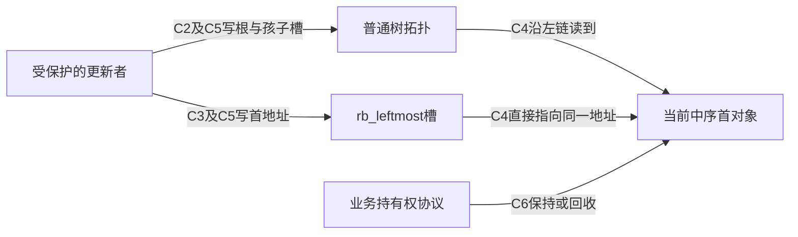
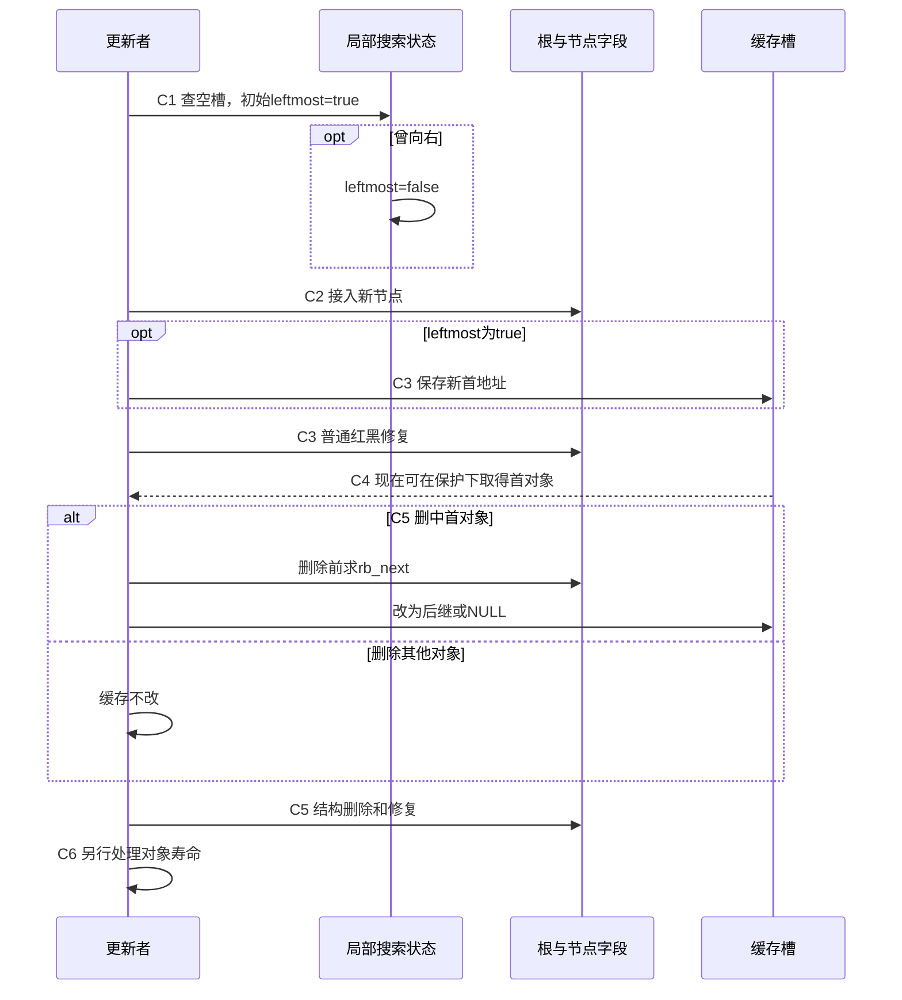

# 第43章\_反复取首与最左缓存

前面的普通查询已经能沿左链取得首节点。现在沿一组按到期时间排序的任务，比较反复走同一段路径与保存首地址的代价，并追踪这个新入口由谁维护。

## 43.1\_cached\_rbtree\_struct\_rb\_root\_cached

cached rbtree 是在普通树之外维护一个中序首地址的包装。没有改变红黑修复算法，而是增加了一项必须与树结构共同维护的不变量：稳定观察时，缓存地址应与沿左链找到的首节点 **完全相同**。有等价键时，“也是一个最小键”还不足以证明对象身份正确。

## 43.2\_为什么要缓存最左节点

普通根只保存拓扑根地址。`rb_first(root)` 从根逐次读取左孩子，直到没有更左的节点；实际读取几层取决于当前形状，红黑高度给出对数上界，空树则直接返回空。一次查询已经很便宜，但频繁重复会访问同一段路径。

设某个稳定树形取得首节点需要读 L 个节点，业务在下一次更新前询问一千次。普通方式仍做一千次左链查找；若在更新时保存首地址，一千次询问就各读一次缓存槽。这是操作数量的推导，不是缓存未命中或时间的实测，也没有假定每次左链都落到主存。

`struct rb_root_cached` 包含普通 `rb_root` 与 `rb_leftmost` 两个入口，完整类型见[缓存根实现](../../../../research/source_reading/rbtree/source_explanations/include/linux/rbtree_types.h.md#1.3_rb_root_cached增加一个最左入口)。`rb_first_cached()` 只读取后者，因此取得地址是 O(1)，但它不查树、不加锁、不取得引用，更不保证返回对象仍活着。宏体见[直接取首](../../../../research/source_reading/rbtree/source_explanations/include/linux/rbtree.h.md#1.12_缓存取首只读取入口)。

最早到期任务或下一个时间线事件是自然场景；若业务还需按位置、资格等额外条件挑选，最左节点未必就是最终候选。例如不能仅凭“调度器有虚拟运行时间”就推导所有版本的下一任务只读最左缓存，具体场景在本章后面分别核对。

## 43.3\_为什么只缓存最左节点\_不缓存最右节点

缓存不只占一枚指针，还在插入、删除和替换时增加判断与写入。两端都缓存，则每个采用该结构的根都需额外存储，并让两端的更新协议保持一致。固定头文件选择只提供最左入口；这是这份接口的工程取舍，不是最右端点在算法上难以缓存。

只有偶尔取最小、树很小或主要按任意键查询时，继续用普通根可以省掉额外不变量。反复取首且更新路径可统一维护缓存时，cached 根才更有吸引力。若需要频繁取最大或两端，业务可以另行设计对应入口，但要明确所有修改如何维护它们；不能只给结构体增加一个字段。

已有缓存根不因“也需要最大值”就一定不适用：仍可沿右链偶尔查询最大值，或在确有收益时增加另一端缓存。选择依据是观察与更新负载、字段成本和维护复杂度，最终性能需要同一场景测量。

## 43.4\_rb\_insert\_color\_cached()\_的使用方式

沿用普通插入的空槽搜索。新增局部布尔量 leftmost，初始 true：若一路向左，新节点将排在所有现存节点之前；只要有一次向右，就已有一个节点位于它之前，此后再向左也无法抹掉那个祖先。因此第一次向右时置 false，之后不恢复。

这里跟踪的是 **实际插入路径**。若等价键按“不小于则向右”处理，新对象并不是已有等价组中的首对象；不能只判断新键是否等于当前最小键就传 true。`rb_add_cached()` 已把搜索、标志计算、挂接和 cached 修复组合起来，它不做唯一键拒绝；需要拒绝重复的业务仍须使用相应搜索契约。

手写路径先 rb_link_node 接入空槽，再传入正确 leftmost 给 rb_insert_color_cached。包装先按标志写缓存，再调用普通修复。此时不是两份独立可随意观察的结构：C2 挂接后缓存可能仍旧，C3 写缓存后红黑修复可能尚未完成，调用者必须保护整个操作。

| 阶段 | 状态实际在哪里，谁修改 | 稳定性与后续动作 |
| --- | --- | --- |
| C0 初始化 | 调用者写普通根与 rb_leftmost 为 NULL | 空树与空缓存同时成立 |
| C1 搜索 | 更新者的局部 parent、link、leftmost | 遇右置 false，直到得到空槽 |
| C2 挂接 | rb_link_node 写节点字段和根/孩子槽 | 尚未完成缓存及红黑修复 |
| C3 缓存与修复 | cached 包装按标志写 rb_leftmost，再调用普通插入修复 | 返回后才向受保护观察者承诺一致 |
| C4 取首 | 读者按协议读 rb_leftmost | 只省查找路径，不替代对象寿命保护 |
| C5 摘除 | 更新者必要时先用旧拓扑求后继并改缓存，再结构删除 | 返回时重新满足缓存等于当前中序首 |
| C6 退出 | 调用者处理其他入口和持有权 | 与树中是否还保存旧地址是不同问题 |





源码对应[搜索产生标志](../../../../research/source_reading/rbtree/source_explanations/include/linux/rbtree.h.md#1.15_辅助插入如何产生最左标志)与[缓存先写、修复随后](../../../../research/source_reading/rbtree/source_explanations/include/linux/rbtree.h.md#1.13_缓存写入先于插入修复)。rb_add_cached 返回新节点仅表示它新成首节点；返回 NULL 时节点也已经插入，不能按“失败”释放它。

## 43.5\_rb\_erase\_cached()\_如何更新最左缓存

若删除对象不是当前 rb_leftmost，首对象不变；若是，新的首对象是它的中序后继。必须在旧对象仍处于原拓扑时计算 rb_next，再修改缓存并调用 rb_erase。删除后旧节点不再是有效遍历起点，即使它的字段没有被清零；旋转和回接也可能改变其他节点的链接。

最后一个对象没有后继，缓存变为 NULL，结构删除后普通根也为空。返回值却要更仔细地读：固定 rb_erase_cached 的局部返回值初始 NULL，仅在删中缓存时赋为后继。因此下面两种删除都返回 NULL：删除非首对象而缓存未变；删除最后对象而后继为空。不能由这个返回值直接判断当前树是否有首节点。完整函数见[缓存删除](../../../../research/source_reading/rbtree/source_explanations/include/linux/rbtree.h.md#1.14_缓存删除先取后继)。

同键替换也属于维护入口的操作：若旧对象正是缓存对象，即使键值不变，也必须改成新对象地址。[P28 缓存替换](P28_Linux同键替换与旧对象退出.md)及[唯一包装实现](../../../../research/source_reading/rbtree/source_explanations/include/linux/rbtree.h.md#1.10_替换时的最左缓存入口)已区分这个地址身份变化。更新缓存没有撤销已有读者保存的旧地址，C6 仍须按持有权协议完成。

## 43.6\_cached\_rbtree\_的使用边界

使用 cached 根时，插入、删除、替换都要维持额外入口。只调用普通 rb_erase 可能留下“所有红黑性质都对，首指针却错”的状态。若旧对象被释放，继续相信缓存就会使用失效地址；若它尚存活，错误也不能因为暂时不崩溃而被忽略。

普通根和缓存不是一次原子写入，更没有因宏只读一个指针就自动支持无锁读者。当前标准包装需调用者完整保护更新；若需要另一种读写协议，应单独证明缓存发布、节点拓扑和回收条件，而不是把普通替换换成带 RCU 后缀的函数后就宣布完成。

### 43.6.1\_运行缓存一致性实验

下面用五个私有任务观察两种返回值与一次故障。按 `(deadline, id)` 排序，这组数据没有重复完整键；数组中的 active 是实验核对台账，不是 Linux 自动维护字段。它让我们独立扫描仍在树中的对象预测最小地址，再与普通左链和缓存比较。完整材料为 [note_rbtree_cached.c](../../../../labs/kernel/tree_basics/materials/note_rbtree_cached.c)：

```c
// SPDX-License-Identifier: GPL-2.0
/* 私有自动对象：缓存故障演示不会释放对象，也不发布并发入口。 */
#include <linux/init.h>
#include <linux/module.h>
#include <linux/rbtree.h>
#include <linux/errno.h>

struct cached_job {
    int deadline;
    unsigned int id;
    bool active;
    struct rb_node rb;
};

static bool job_less(struct rb_node *a, const struct rb_node *b)
{
    struct cached_job *first = rb_entry(a, struct cached_job, rb);
    const struct cached_job *second = rb_entry(b, struct cached_job, rb);
    if (first->deadline != second->deadline)
        return first->deadline < second->deadline;
    return first->id < second->id;
}

/* 数组扫描独立预测最小对象，不从缓存或树的左链生成预期值。 */
static bool cache_matches(struct rb_root_cached *root, struct cached_job *jobs,
                          unsigned int count)
{
    struct cached_job *expected = NULL;
    unsigned int i;
    for (i = 0; i < count; ++i) {
        if (jobs[i].active && (!expected || job_less(&jobs[i].rb, &expected->rb)))
            expected = &jobs[i];
    }
    return rb_first_cached(root) == (expected ? &expected->rb : NULL) &&
           rb_first(&root->rb_root) == (expected ? &expected->rb : NULL);
}

static int __init note_cached_init(void)
{
    struct cached_job jobs[] = {
        {.deadline = 40, .id = 0}, {.deadline = 10, .id = 1},
        {.deadline = 40, .id = 2}, {.deadline = 25, .id = 3},
        {.deadline = 70, .id = 4}
    };
    struct rb_root_cached root = RB_ROOT_CACHED;
    struct rb_node *result;
    unsigned int i;

    if (!cache_matches(&root, jobs, ARRAY_SIZE(jobs)))
        return -EINVAL;
    for (i = 0; i < ARRAY_SIZE(jobs); ++i) {
        result = rb_add_cached(&jobs[i].rb, &root, job_less);
        jobs[i].active = true;
        if (result != (i < 2 ? &jobs[i].rb : NULL) ||
            !cache_matches(&root, jobs, ARRAY_SIZE(jobs)))
            return -EINVAL;
    }
    pr_info("note_cached: five inserts, first=10:1\n");

    result = rb_erase_cached(&jobs[4].rb, &root); /* 删除非最小的 70。 */
    jobs[4].active = false;
    if (result || !cache_matches(&root, jobs, ARRAY_SIZE(jobs)))
        return -EINVAL;
    pr_info("note_cached: erase non-first returns NULL, first still exists\n");

    result = rb_erase_cached(&jobs[1].rb, &root); /* 最小从 10 变为 25。 */
    jobs[1].active = false;
    if (result != &jobs[3].rb || !cache_matches(&root, jobs, ARRAY_SIZE(jobs)))
        return -EINVAL;
    pr_info("note_cached: erase first returns 25:3\n");

    /* 故意混用普通删除：树结构更新，但额外入口仍指向已摘除的25。 */
    rb_erase(&jobs[3].rb, &root.rb_root);
    jobs[3].active = false;
    if (cache_matches(&root, jobs, ARRAY_SIZE(jobs)))
        return -EINVAL;
    pr_info("note_cached: ordinary erase leaves a stale cache\n");
    /* 故障演示中对象仍活着且完全独占，重建缓存后继续观察。 */
    root.rb_leftmost = rb_first(&root.rb_root);
    if (!cache_matches(&root, jobs, ARRAY_SIZE(jobs)))
        return -EINVAL;

    while ((result = rb_first_cached(&root)) != NULL) {
        struct cached_job *item = rb_entry(result, struct cached_job, rb);
        rb_erase_cached(result, &root);
        item->active = false;
        if (!cache_matches(&root, jobs, ARRAY_SIZE(jobs)))
            return -EINVAL;
    }
    pr_info("note_cached: empty tree and empty cache agree\n");
    return 0;
}

static void __exit note_cached_exit(void)
{
    /* 根与节点均为初始化期间私有自动对象，没有外部保存其地址。 */
}
module_init(note_cached_init);
module_exit(note_cached_exit);
MODULE_LICENSE("GPL");
MODULE_DESCRIPTION("Private cached rbtree invariant exercise");
```

先预测：插入 40:0 时它是首对象；插入 10:1 后首对象改变；后面三次返回 NULL，但都已插入。删除 70:4 返回 NULL 且树不空；删除 10:1 返回后继 25:3。故意用普通删除摘掉 25:3 时，树会修复，缓存仍保存那个旧成员地址，数组核对就会发现不一致。

故障对象是仍然存活的局部数组元素，程序不会释放它，也没有并发入口。因此这里能安全比较地址并在独占条件下重新计算缓存，以便继续后面的观察；这不是建议生产代码对任意悬空缓存进行解引用后再修补。真正的修正是让所有合法修改路径维持不变量。

所有对象与根都仅在初始化函数里存活，既无动态申请也无外部发布，任何检查失败返回都没有堆对象或共享入口需要回收。成功路径逐个 cached 摘除到空。程序没有用 RB_EMPTY_NODE 作为台账，因此不要求额外清游离标记；若业务采用该协议，应按自己的安全时机维护。

已有 [Makefile](../../../../labs/kernel/tree_basics/materials/Makefile) 登记该模块。Linux 构建环境先设置匹配目标内核的 KDIR，并按工具链设置 ARCH/CROSS_COMPILE；在仓库根目录构建：

```bash
: "${KDIR:?先设置匹配目标内核的构建目录}"
make -C "$KDIR" M="$PWD/labs/kernel/tree_basics/materials" modules
```

把 note_rbtree_cached.ko 放到匹配目标系统后，从它所在目录执行：

```bash
sudo insmod ./note_rbtree_cached.ko
sudo dmesg | tail -n 30
sudo rmmod note_rbtree_cached
```

成功时预期五条核心消息如下；初始化失败时先检查 insmod 错误和日志，不假定模块已经加载：

```text
note_cached: five inserts, first=10:1
note_cached: erase non-first returns NULL, first still exists
note_cached: erase first returns 25:3
note_cached: ordinary erase leaves a stale cache
note_cached: empty tree and empty cache agree
```

本轮 ARMv7 前端与宿主显式适配检查已执行，目标 Kbuild、MODPOST、装卸及这组目标日志未执行。宿主父色位宽和访问宏有适配，只检查串行算法与接口返回，不证明内核 ABI、并发可见性或实际缓存性能。

## 43.7\_本节小结

缓存把反复查找首节点的工作移到更新者维护的额外入口，但不改变树操作和寿命契约。按 C0～C6 核对的是两个槽、树结构与对象持有三组不同状态；稳定时首地址一致，中间态需被保护。三个练习检查这个认识：

1. 将 25 的输入改为 5，哪次插入会新成首节点？它会排在 10 之前，rb_add_cached 那次返回该节点；测试预期也须随输入契约改变，不能继续硬编码“只有前两次返回节点”。
2. 删除非首对象时返回 NULL，能据此清空 root.rb_leftmost 吗？不能，NULL 在这个分支只是没有新的首地址要报告，原缓存仍正确。
3. 只比较缓存键值与最小键值，能发现所有错误吗？不能，两个等价键对象地址不同；还需核对当前中序首对象身份以及它是否仍为有效成员。

下一节不再缓存一个端点，而是给每个子树增加摘要。旋转仍保持中序关系，却会改变哪些节点属于某个子树，因此仅保存最左地址的办法不能直接维护区间最大值等增强信息。

[下一单元：区间查询与子树摘要](P44_区间查询与子树摘要.md)。
